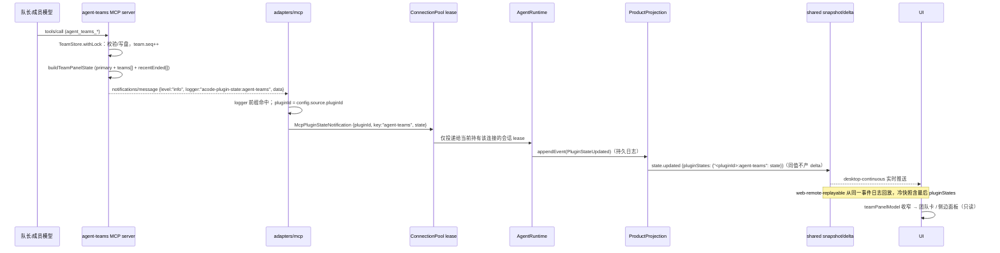

# AgentTeams 0.4.0 移植规格（ACode）

> 状态：定稿待实施（2026-10-20）
> 源参考（只读）：`D:\Leo1\project\demo\anker-code`，`master` @ `2bf8d04d`；插件版本 0.4.0
> 目标仓库：`D:\AnkerCodes\QYDemo\ACode1`，`dev/1.0.1` @ `38b93920`
> 范围：把源仓库 AgentTeams 插件 0.1.0→0.4.0 的全部能力、pluginStates 宿主通道与桌面 UI 移植到目标仓库；
> 本文只定义产品规则、边界、状态所有者、接口、事件时序与验收，**不修改任何代码**。

---

## 0. 结论速览

| 需求 | 本 spec 的落点 | 章节 |
| --- | --- | --- |
| R1 命名映射 | 源仓库的 ZCode 命名整体映射为 ACode 命名；列出包名、环境变量、request-context、logger、worktree 路径与分支前缀 | §2 |
| R2 插件 0.4.0 | 17 个工具、多团队、成员工作树、成员常驻等活、tasks-captain/progress 拆分、panel-state 扩展；保留目标独有 `trust-wrapper.ts`；满足 400 行 ratchet | §3 |
| R3 宿主链路 | MCP 通知 → adapter → 会话事件 → v4 投影 → `pluginStates` → UI；唯一所有者与完整时序；基线无该链路，写作时工作树已有未提交实现 | §4 |
| R4 UI 落点 | 会话尾部团队卡、状态面板团队分区、侧边「团队」面板、审批动作、i18n；数据只来自 `pluginStates` | §5 |
| R5 发布登记 | 四处版本一致 = 0.4.0；parity 单测机械钉住 | §6 |
| R6 验收与测试 | 可执行命令与 12 个验收场景；区分实测与未验证 | §7 |

**基线核实结论（HEAD `38b93920`）**

- 目标插件是 0.1.0、14 个工具、单团队平铺状态、无 worktree、无 `agent_teams_wait_for_work`/`adopt_team`/`merge_member_worktree`。
- 目标插件独有 `src/trust-wrapper.ts` + `tests/trust-wrapper.test.ts`（源 0.4.0 没有），本移植必须保留。
- 目标仓库的派生配置链已实现（`subagent-live-state.ts`、`subagent-plugin-overrides.ts`、core 消费点），见 `apps/acode-cli/specs/agent-teams-derived-config.md`；本移植不得回退该链。
- HEAD 没有 pluginStates 宿主通道：`SessionEventType` 无 `PluginStateUpdated`、`conversationSnapshot`/`statePatch` 无 `pluginStates`、adapter 无 logging notification 捕获、pool 无订阅面、UI 无任何团队卡/团队面板。
- **写作时目标工作树已有未提交的在途实现**：R3 宿主通道（14 个修改文件 + 3 个未跟踪测试，约 +213 行）与部分 R4 UI（`teamPanelModel.ts`、`teamWorkflowPresentation.ts`、`TeamSidePane*.tsx`、`teamPaneParts.tsx`、`TeamWorkflowPhaseList.tsx`、`TeamTaskGraph.tsx`、`useTeamPanelOpener.ts` 及 side pane 类型/渲染接线，约 +100 行修改 + 10 个未跟踪文件）。这些是并行成员的在途成果，不是本文产生的改动；实现者应在该成果上收口而不是重写（§4.1、§5.2）。本文的「基线」指 HEAD `38b93920`，「在途」指写作时工作树。
- 目标插件目录不在 `.architecture-baseline.json` 中，所有插件源码文件（非测试）必须 ≤400 物理行；`packages/ui/src/v4/conversationStatusPanelModel.ts` 当前 385 行且未登记基线，新增团队模型必须抽到兄弟文件（§5.2）。

---

## 1. 术语与基线

| 术语 | 含义 |
| --- | --- |
| 插件 server | `plugin:agent-teams:team` stdio MCP 进程（`dist/mcp/server.js`） |
| 团队状态 | 插件磁盘状态根 `<workspace>/.agent-teams/`，唯一可写所有者为 `TeamStore` |
| pluginStates | 宿主 v4 会话快照中的通用插件状态键；键 = `${pluginId}:${key}` |
| 团队快照 | 插件 `TeamPanelState`（v1 形状，additive 扩展不抬版本） |
| 成员常驻 | 成员交付后阻塞在 `agent_teams_wait_for_work`，由队长结束其后台 Agent |

**基线行号约定**：`文件:行` 均按 2026-10-20 核对时的内容标注。R3 的宿主文件同时存在 HEAD 基线与工作树在途两套行号，文中明确区分；实施前按当前文件复核一次。

---

## 2. R1 命名映射

源仓库代码中所有 ZCode 命名必须在目标仓库映射为 ACode 命名。映射不是全局字符串替换：注释、文档、测试断言、错误消息中的品牌词也要一致；但**协议字段、状态根 `AGENT_TEAMS_*` 环境变量、`sess_subagent_<agentId>` 会话 id 规则保持不变**。

| 类别 | 源（ZCode） | 目标（ACode） | 目标落点/证据 |
| --- | --- | --- | --- |
| 包名 | `@zcode/agent-teams-plugin` | `@acode/agent-teams-plugin` | `package.json:3`（已正确） |
| MCP server 名 | `zcode-agent-teams` | `acode-agent-teams` | `src/server.ts:51`（现为 0.1.0，需同步 0.4.0） |
| 插件根模板 | `${ZCODE_PLUGIN_ROOT}` | `${ACODE_PLUGIN_ROOT}` | `.mcp.json:7`（已正确） |
| 工作区环境变量 | `ZCODE_PROJECT_DIR` | `ACODE_PROJECT_DIR` | `src/server.ts:36`（已正确）；插件 MCP resolver 在 `apps/acode-cli/packages/adapters/src/plugins/mcp.ts` 注入 |
| 插件身份 env | `ZCODE_PLUGIN_ID` | `ACODE_PLUGIN_ID` | `packages/shared/src/mcp.ts:16`（`ACODE_PLUGIN_ID_ENV_KEY`） |
| MCP 请求上下文 | `com.zcode/request-context` | `com.acode/request-context` | `src/identity.ts:52`（已正确） |
| 状态通知 logger 前缀 | `zcode-plugin-state:` | `acode-plugin-state:` | `src/server.ts:200`、`src/panel-state.ts:7`（已正确） |
| manifest 目录 | `.zcode-plugin/plugin.json` | `.acode-plugin/plugin.json` | 目标已存在 |
| 工作树目录 | `<repoRoot>/.zcode/worktrees/` | `<repoRoot>/.acode/worktrees/` | 本移植新增，源自 `src/worktree/naming.ts:8` |
| 工作树 exclude 行 | `/.zcode/worktrees/` | `/.acode/worktrees/` | 源自 `naming.ts:9`；同时识别 `.acode/worktrees/` |
| 工作树分支前缀 | `zcode/wt/` | `acode/wt/` | 源自 `naming.ts:10` |
| 官方 marketplace id | `zcode-plugins-official` | `acode-plugins-official` | `apps/acode-cli/packages/contracts/src/plugins/index.ts:7` |
| 插件身份 pluginId | `agent-teams@zcode-plugins-official` | `agent-teams@acode-plugins-official` | 插件 loader 的 `loaded.id` |
| 团队状态根 | `<workspace>/.agent-teams/` | 不变 | `src/server.ts:36-41` |
| 工具/环境配置前缀 | `AGENT_TEAMS_*` / `agent_teams_*` | 不变 | `.mcp.json`、工具注册表 |
| 成员子会话 id | `sess_subagent_<agentId>` | 不变 | `src/identity.ts:90-96`；宿主 core runner 规则 |

**规则**

1. 插件源码、README、`docs/*.md`、skill/command/agent 提示词、测试中不得残留 `ZCODE_`/`zcode-plugin-state`/`zcode/wt/`/`.zcode/worktrees`/`@zcode/`/`ZCode` 品牌词（源文件里的历史注释也一并改写）。
2. 允许保留 `CLAUDE_PROJECT_DIR`/`CLAUDE_PLUGIN_ROOT` 等兼容回退（目标现有代码已如此），但权威路径是 `ACODE_*`。
3. worktree 归属判据必须与目标仓既有命名空间一致：只认 `acode/wt/` 分支与 `.acode/worktrees/` 下的路径；不得沿用源的 `zcode/` 前缀。
4. 目标插件已有 `ACODE_PROJECT_DIR`/`com.acode/request-context`/`acode-plugin-state`，移植新文件时保持这些值，不得从源逐字复制回 ZCode 值。

---

## 3. R2 插件 0.4.0 功能清单与文件布局

### 3.1 工具清单（14 → 17）

源注册表 `src/tools/*.ts` 的工具名与权限（`memberAllowed`）：

| # | 工具 | 归属文件（源 0.4.0） | 成员可调用 | 目标 0.1.0 现状 |
| --- | --- | --- | --- | --- |
| 1 | `agent_teams_create` | `team.ts:64` | 否 | 有 |
| 2 | `agent_teams_approve_plan` | `team.ts:141` | 否 | 有 |
| 3 | `agent_teams_status` | `team-status.ts:18` | 是 | 有（内联在 `team.ts`） |
| 4 | `agent_teams_resume` | `team.ts:180` | 否 | 有 |
| 5 | `agent_teams_delete` | `team.ts:211` | 否 | 有 |
| 6 | `agent_teams_adopt_team` | `team-adopt.ts:22` | 否 | **新增** |
| 7 | `agent_teams_add_member` | `members.ts:38` | 否 | 有 |
| 8 | `agent_teams_bind_member` | `members.ts:108` | 否 | 有 |
| 9 | `agent_teams_remove_member` | `members.ts:159` | 否 | 有 |
| 10 | `agent_teams_send_message` | `messages.ts:16` | 是 | 有 |
| 11 | `agent_teams_create_task` | `tasks-captain.ts:51` | 否 | 有 |
| 12 | `agent_teams_amend_task` | `tasks-captain.ts:122` | 否 | 有 |
| 13 | `agent_teams_reassign_task` | `tasks-captain.ts:176` | 否 | 有（独立 `task-reassign.ts`） |
| 14 | `agent_teams_claim_task` | `tasks-progress.ts:39` | 是 | 有 |
| 15 | `agent_teams_update_task` | `tasks-progress.ts:125` | 是 | 有 |
| 16 | `agent_teams_wait_for_work` | `member-wait.ts:74` | 是（仅成员） | **新增** |
| 17 | `agent_teams_merge_member_worktree` | `worktree.ts:23` | 否 | **新增** |

`tools/list` 对宿主返回全量 17 个工具；权限仍在每次 `tools/call` 时校验（`memberAllowed=false` 的成员调用返回 `forbidden_for_caller`）。目标 `src/server.ts:24` 的 `ALL_TOOLS` 必须扩为：

```ts
[...teamTools, ...memberTools, ...taskTools, ...messageTools, ...worktreeTools, waitForWorkTool]
```

`src/tools/registry.ts` 需要新增 `workingDirectory`、`maxActiveTeams` 两个 `ToolContext` 字段，以及 `workingDirectory` 用于 worktree 仓库解析起点（源 `registry.ts:38-49`、`:96-117`）。

### 3.2 目标文件布局

| 路径（目标） | 动作 | 说明 |
| --- | --- | --- |
| `src/state/types.ts` | 扩展 | 新增 `TeamWorktreeIsolation`、`MemberWorktree`、`TeamState.lastCaptainSeenAt/captainHistory`、`TeamMember.waitingUntil/worktree`、`TEAM_ID_PATTERN`、`team_archived/team_not_found/team_ambiguous/team_limit_exceeded/team_not_active/adoption_conflict` 及 `worktree_*` 错误码、`DEFAULT_MAX_ACTIVE_TEAMS`/`normalizeMaxActiveTeams`/`ADOPTION_COOLDOWN_MS`/`STALE_TEAM_AFTER_MS`（源 `types.ts:151-250`） |
| `src/state/store.ts` | 扩展 + 拆分 | 多团队布局 `teams/<teamId>/{team.json,tasks/,mailbox/}`、根级 `lock`/`panel.json`/`archives/`、`migrateFlatLayoutIfNeeded`、归档读取（§3.5 ratchet） |
| `src/state/fs-helpers.ts` | 保留 | 目标独有拆分产物（锁文件、目录计数、目录名清洗）；新 store 继续复用 |
| `src/state/dag.ts` | 不变 | 依赖/就绪/关键路径纯函数 |
| `src/state/machine.ts` | 不变 | 任务状态机 |
| `src/state/helpers.ts` | 扩展 | 追加 `TEAM_ID_PATTERN`、`normalizeMaxActiveTeams` 等 re-export |
| `src/identity.ts` | 扩展 | 新增 `teamsCallerParticipatesIn`（源 `identity.ts:118-146`） |
| `src/panel-state.ts` | 扩展 | `captainSessionId`、`members[].childSessionId`、`updatedAt/stale`、`teams[]`、`recentEnded[]`（源 `panel-state.ts:40-106`） |
| `src/panel.ts` | 扩展 | `/team/<teamId>/api/state|events`、`/api/teams`、多团队首页、归档 `/history/<teamId>`（源 `panel.ts:9-190`） |
| `src/scheduler.ts` | 扩展 | `waitingUntil` 未过期的成员不出 wake；wake 消息带 `teamId`；`assignee: "captain"` 不派发（源 `scheduler.ts:55-60,90-145`） |
| `src/server.ts` | 扩展 | 17 工具、`AGENT_TEAMS_MAX_ACTIVE_TEAMS`、启动迁移、每团队 seq 游标、`teams[]`/`recentEnded[]` 通知、`manageOwnLock` 分支（源 `server.ts:26-60,113-160,212-290`） |
| `src/tools/team.ts` | 扩展 | `worktreeIsolation` 建队、`maxActiveTeams` 上限、delete 返回 `disband[]`、归档前清理工作树 |
| `src/tools/team-status.ts` | 新增 | 单团队全量 + 多团队总览（源 234 行） |
| `src/tools/team-adopt.ts` | 新增 | 孤儿团队接管、10 分钟冷静期（源 83 行） |
| `src/tools/members.ts` | 扩展 | `waitingUntil` 清理、worktree 创建、`remove_member` 返回 `disband[]` |
| `src/tools/tasks-captain.ts` | 新增 | create/amend/reassign（源 273 行） |
| `src/tools/tasks-progress.ts` | 新增 | claim/update（源 217 行） |
| `src/tools/tasks.ts` | 改为 barrel | 组合导出 `captainTaskTools + memberTaskTools`（源 10 行） |
| `src/tools/task-reassign.ts` | 删除 | 内容并入 `tasks-captain.ts`，避免两处注册 |
| `src/tools/member-wait.ts` | 新增 | 8 分钟等活、2 秒轮询、`manageOwnLock`（源 146 行） |
| `src/tools/worktree.ts` | 新增 | 队长合并入口（源 99 行） |
| `src/worktree/git.ts` | 新增 | `execFile` git 执行面、超时、冲突解析（源 151 行） |
| `src/worktree/naming.ts` | 新增 | `.acode/worktrees`、`acode/wt/`、路径/分支归属判据（源 60 行，按 R1 改值） |
| `src/worktree/manager.ts` | 新增 | `inspectRepo`、创建、合并、清理（源 410 行，需拆分，§3.5） |
| `src/worktree/lifecycle.ts` | 新增 | 团队/成员维度的保守清理编排（源 110 行） |
| `src/trust-wrapper.ts` | **保留** | 目标独有读边界包装；不得被源文件覆盖 |
| `tests/trust-wrapper.test.ts` | **保留** | 目标独有验收；继续钉住包装不变量 |
| `tests/multi-team.test.ts` | 新增 | 从源移植，按 ACode 命名调整 |
| `tests/worktree.test.ts` | 新增 | 从源移植，断言 `.acode/worktrees` 与 `acode/wt/` |
| `agents/member.md` | 改写 | `maxTurns: 200`、`agent_teams_wait_for_work` 工作循环、`team_archived` 硬停、队长结束成员 |
| `commands/team.md`、`skills/agent-teams/SKILL.md` | 改写 | 多团队寻址、adopt、worktree、`disband[]`→`TaskStop` 收尾 |
| `docs/protocol.md`、`docs/usage.md`、`README.md` | 改写 | 17 工具、多团队布局、worktree、成员常驻；命名按 R1 |
| `.acode-plugin/plugin.json` | 扩展 | 版本 0.4.0、`maxActiveTeams` userConfig、描述更新 |
| `.mcp.json` | 扩展 | 增加 `AGENT_TEAMS_MAX_ACTIVE_TEAMS`；其余不变 |
| `package.json` | 版本/描述 | 0.4.0、17 工具；license 保持目标 MIT，不改为源 Apache-2.0 |

### 3.3 多团队语义

- 状态布局：`<root>/teams/<teamId>/{team.json,tasks/,mailbox/}`；`lock`、`panel.json`、`archives/` 仍在根。锁保持全根一把（源 `store.ts:17-22`）。
- 旧平铺布局（根直接放 `team.json/tasks/mailbox`）在 server 启动时于 `store.withLock` 内一次性迁入 `teams/<原 teamId>/`；迁移失败即启动失败，不做半迁移（源 `store.ts:118-139`、`server.ts:63-68`）。
- 所有团队级工具新增可选 `teamId`（`TEAM_ID_PATTERN = /^team-[a-z0-9-]+$/u`）。解析顺序（源 `registry.ts:6-13,96-150`）：
  1. 显式 `teamId` → 必须是活跃团队；已归档报 `team_archived`，不存在报 `team_not_found`。
  2. 未传：调用方参与的活跃团队恰 1 个 → 隐式选中；0 个 → `no_active_team`（subagent 未绑定报 `caller_not_member`）；≥2 个 → `team_ambiguous`，`data.candidates` 列出团队。
  3. `agent_teams_status` 在 ≥2 团队时例外：返回多团队总览，不报歧义。
- 活跃团队上限 `maxActiveTeams`（userConfig，默认 4，夹取 1..8）；达上限 `agent_teams_create` 返回 `team_limit_exceeded`。设 1 复刻旧单团队行为。
- `agent_teams_adopt_team`：main scope 把 draft/active/paused 团队的 `captainSessionId` 改为调用会话，追加 `captainHistory`；原队长 10 分钟内活跃（`lastCaptainSeenAt`）且未带 `force` 返回 `adoption_conflict`。
- `agent_teams_delete`/`remove_member` 返回 `disband: Array<{name, agentId}>`；`delete` 归档前按保守判据清理成员工作树，结果随 `worktrees` 返回。
- 成员调用任何团队工具时，若其绑定的团队已归档，统一报 `team_archived`（不得再混用 `no_active_team`），成员据此立即收工。

### 3.4 成员常驻与工作树

**成员常驻（`agent_teams_wait_for_work`）**

- 仅成员可用；`manageOwnLock: true`，不占 server 互斥锁（源 `member-wait.ts:12-17,74-146`）。
- 锁内探测当前任务/可认领任务/未读邮件；有则立即 `ready:true`，无则记 `waitingUntil = deadline` 并锁外每 2 秒重探；约 8 分钟（`WAIT_MAX_MS`）返回 `ready:false`，成员再调继续等。等待上限必须小于 `.mcp.json` 的 `timeoutMs: 600000`。
- 团队归档 → `team_archived`；被移出名册 → `caller_not_member`。这两种错误就是「队长结束了你」的信号。
- 调度器对 `waitingUntil` 未过期的成员不出 wake（notes 说明会自动取活）；过期才回到 SendMessage 唤醒。
- `agents/member.md` 的 `maxTurns` 由 40 改为 200；工作循环改为「交付 → 回报 → `wait_for_work`」，删除「直接结束本轮」的旧规则。

**工作树隔离（默认关闭）**

- `agent_teams_create({worktreeIsolation:true})` 才开启；建队时 `inspectRepo` 解析 `repoRoot`/`baseBranch`/`baseCommit`。非 git、无提交、detached HEAD 返回 `worktree_unavailable`，不建团队、不回落共享工作区。
- 开启后 `add_member` 为每个成员创建 `<repoRoot>/.acode/worktrees/<teamId>-<member>-<8hex>`，分支 `acode/wt/<teamId>-<member>-<8hex>`；建树失败不登记成员。成员名与 id 清洗规则沿用源 `naming.ts:13-28`。
- 幂等把 `.acode/worktrees/` 写入共享 `.git/info/exclude`（同时识别已存在的 `.acode/worktrees/` 行）。
- 派工消息与成员 `status` 的 `worktree` 字段带路径/分支/基线。插件不能设置子代理 cwd，成员须按提示使用工作树绝对路径；这是已知限制，不得在宿主侧伪造隔离。
- `agent_teams_merge_member_worktree(member, method, cleanup?)`：先快照成员树未提交改动到成员分支；主工作区脏/不在基线分支/冲突 → 结构化错误且不改主工作区；`merge`（`--no-ff`）或 `squash`；无独有提交返回 `already_merged` 幂等；`cleanup:true` 只删「干净且已合并」的树与分支（`branch -d`，绝不用 `-D`）。
- 团队结束/成员移除时自动尝试清理；未合并提交、未提交改动、非 `acode/wt/` 归属、成员仍有进行中任务的一律保留并在 `keptReason` 说明。

### 3.5 400 行 ratchet 与拆分要求

目标 `.architecture-policy.yaml:304`：`maxFileLines: 400`，对未纳管模块（`acode-cli`、`ui` 均为 `managed:false`）是「只减不增」ratchet；测试文件不参与。目标插件目录没有任何 baseline 条目，因此**任何新的 >400 行插件源码文件都是硬失败**。源 0.4.0 有三个超限/贴线文件，不能逐字复制：

1. `src/state/store.ts`：目标现 378 行，源 0.4.0 501 行。移植时拆为：
   - `state/store.ts`：锁、原子 JSON、team/task/mailbox 基础读写（≤400）。
   - `state/store-teams.ts`（新）：`teamsDir/teamDir`、`migrateFlatLayoutIfNeeded`、`listTeams/findTeam/findSoleActiveTeam`。
   - `state/store-archives.ts`（新）：`listArchivedTeams/listRecentArchivedTeams/listArchivedTeamStates/readArchivedTeam/archiveTeam`。
   - `state/fs-helpers.ts` 保留；禁止把行数压回 `store.ts` 或新增 baseline/ignore。
2. `src/worktree/manager.ts`：源 410 行。拆为 `manager.ts`（`inspectRepo`、`createMemberWorktree`、exclude 写入）与 `merge.ts`（`mergeMemberWorktree`、`cleanupMemberWorktree`）；`git.ts`/`naming.ts`/`lifecycle.ts` 不变。
3. `src/server.ts`：源 387 行，目标现 265 行。移植后若逼近/超过 400，把 `recentEnded` 缓存与快照组装抽到 `src/panel-snapshot.ts`（新增），不要压缩注释或关闭 lint。
4. `src/tools/tasks.ts`（目标现 339 行）+ `task-reassign.ts` 必须按源拆成 `tasks.ts`(barrel)/`tasks-captain.ts`/`tasks-progress.ts`；`team.ts` 的 status 抽到 `team-status.ts`、adopt 抽到 `team-adopt.ts`。
5. `packages/ui/src/v4/conversationStatusPanelModel.ts` 现 385 行且未登记基线；团队模型必须放 `teamPanelModel.ts`，该文件只增加极小的类型/调用面并保持 ≤400。若仍超限，抽离一个既有内聚段（如 running workflow 行的构建）到兄弟文件；不得更新 baseline、不得加 `max-lines` 豁免。

### 3.6 必须保留的目标独有 trust-wrapper

源 0.4.0 重写了 `members.ts`、`tasks-captain.ts`、`tasks-progress.ts`、`team-status.ts`，这些文件正是 mailbox 正文的读边界。移植时必须把目标 `src/trust-wrapper.ts` 的包装重新接到所有新读边界上，不能因为文件来自源而丢失：

- 成员 `agent_teams_status` 返回的 `unread_messages[].message` 用 `wrapTeamMessageBodies` 包装；队长 `status` 返回的成员未读样本同样包装；`claim_task` 返回的未读/消息字段按源 0.1.0 既有接线逐处复核。
- 返回对象带 `trust_note: TEAM_TRUST_NOTE`；框架行在列 0，正文整体缩进 4 空格；内容里伪造的框架行被缩进中和。
- **磁盘 mailbox 与 panel 投影存原文**；包装只发生在进入模型上下文的读边界。
- 保留 `tests/trust-wrapper.test.ts`，并把它加入新任务文件的导入清单（当前测试从 `tools/tasks.ts` 导入 `taskTools`，拆分后 barrel 仍应导出同名集合）。
- 源 0.4.0 的 `team-status.ts` 是新增文件，必须从目标 0.1.0 的 `team.ts` status 分支迁移包装逻辑，而不是重新实现一套。

### 3.7 panel-state 扩展

目标 `src/panel-state.ts` 现 165 行，需增加到源 0.4.0 的 199 行形状（v 仍为 1，全部 additive）：

- `captainSessionId?`：宿主据此只在队长会话显示团队卡；缺席（旧插件）不过滤。
- `members[].childSessionId?`：由 `subagentSessionIdForAgent(agentId)` 派生，UI 据此打开成员会话。
- `updatedAt?`、`stale?`：`updatedAt` 取 `team.updatedAt`；`stale` 为 `Date.now() - updatedAt > STALE_TEAM_AFTER_MS`（48h），只标注不自动归档。
- `teams?: TeamPanelState[]`：所有活跃团队快照；primary 为最近更新的活跃团队（归档保留时取归档终态）。
- `recentEnded?: Array<TeamPanelState & { endedAt: string }>`：最多 `MAX_RECENT_ENDED_TEAMS = 5`，按结束时间倒序，不带 mailboxes/unreadMessages。
- 归档那一帧必须同时携带 `teams: activeTeams` 与 `recentEnded`，不能因为 primary 是归档队就省略 `teams[]`（否则其它活跃团队会闪没）。
- `src/server.ts` 的通知去重游标从单团队 `seq/teamId` 改为每团队 seq 映射；`manageOwnLock` 工具返回后在锁内补发一次通知；通知失败保留旧游标，下次成功调用重试。

---

## 4. R3 宿主链路：pluginStates

### 4.1 基线与在途成果

**HEAD `38b93920` 的事实（已核实）**

- `apps/acode-cli/packages/contracts/src/events/session.events.ts`：`SessionEventType` 无 `PluginStateUpdated`；payload 联合无对应条目。
- `apps/acode-cli/packages/contracts/src/interfaces/mcp-config.port.ts:9-11`：`McpServerRuntimeSource` 只有 `kind`，无 `pluginId`。
- `apps/acode-cli/packages/contracts/src/interfaces/mcp.port.ts`：`McpPort` 只有 `onToolsChanged`（:68），无 `subscribePluginStateNotifications`。
- `apps/acode-cli/packages/adapters/src/mcp/index.ts`：未注册 `notifications/message` handler，无 `onPluginStateNotification`。
- `apps/acode-cli/packages/adapters/src/mcp/pool.ts`：无插件状态订阅表。
- `apps/acode-cli/packages/bootstrap/src/app/create-app.ts`：无 `onPluginStateNotification` 选项/桥接；`types.ts` 同。
- `apps/acode-cli/packages/bootstrap/src/acode-protocol-v4/projection-state.ts`：初始快照无 `pluginStates`；`product-projection.ts` 无 reduce case/归约函数。
- `packages/shared/src/acode-protocol-v4/snapshot.ts:513-515`（`workflowRuns` 处）与 `delta.ts:55` 无 `pluginStates`。
- `apps/acode-cli/packages/bootstrap/src/acode-protocol/session-mapper.ts:368-380` 只剥离 `DynamicWorkflowRunProgress`/`SwarmPlanProgress`，不含插件状态。
- `packages/ui` 无任何 `pluginStates` 消费。

**写作时工作树在途（未提交，核对于 2026-10-20）**

| 文件 | 在途内容 | 当前行 |
| --- | --- | --- |
| `contracts/src/events/session.events.ts` | `PluginStateUpdated` 枚举、`PluginStateUpdatedPayload`、payload 联合 | 161 / 1029 / 1359 |
| `contracts/src/interfaces/mcp-config.port.ts` | `source.pluginId?: string` | 9-12 |
| `contracts/src/interfaces/mcp.port.ts` | `McpPluginStateNotification`、`subscribePluginStateNotifications?` | 30-39 / 81-85 |
| `adapters/src/plugins/mcp.ts` | `source.pluginId = context.loaded.id` | 187-191 |
| `adapters/src/mcp/index.ts` | logger 前缀、`onPluginStateNotification`、`setNotificationHandler("notifications/message")` | 141 / 221 / 1718-1744 |
| `adapters/src/mcp/pool.ts` | `pluginStateSubscribers`、按 lease 路由、关闭清理 | 59-88 / 270-273 / 375-391 / 461 |
| `bootstrap/src/app/create-app.ts` | adapter 回调 → `runtime.appendEvent`；lease 订阅 + unsubscribe | 696-745 / 1299 |
| `bootstrap/src/app/session-facade.ts` | close 时 `unsubscribePluginState()` | 117-120 / 285-287 |
| `bootstrap/src/app/types.ts` | `onPluginStateNotification?` | 184-191 |
| `bootstrap/.../product-projection.ts` | reduce case + 键级整体替换 + deep-equal 幂等 | 1482 / 4562-4575 |
| `bootstrap/.../projection-state.ts` | 初始 `pluginStates: null` | 89-90 |
| `bootstrap/src/acode-protocol/session-mapper.ts` | v3 剥离 | 384-389 |
| `packages/shared/.../snapshot.ts` | `pluginStates` default(null) | 520-523 |
| `packages/shared/.../delta.ts` | `pluginStates` nullable optional | 59-61 |
| `apps/acode-cli/tests/plugin-state-bridge.test.mjs` | 新增 | 未跟踪 |
| `apps/acode-cli/tests/plugin-state-pool.test.mjs` | 新增 | 未跟踪 |
| `packages/shared/test/plugin-states.test.ts` | 新增 | 未跟踪 |

**本 spec 的裁决**：在途实现与源 0.4.0 同构且命名已按 ACode 映射，作为 R3 的候选实现保留；实施者先跑 §7 的 R3 测试与门禁，通过则收口，不重写。本文以下条款是**最终验收口径**，不区分作者。

### 4.2 状态唯一所有者

| 事实 | 唯一所有者 | 落点 |
| --- | --- | --- |
| 团队/任务/成员/邮箱/归档 | 插件 `TeamStore`（磁盘真相） | `<workspace>/.agent-teams/` |
| 团队快照形状与派生字段 | 插件 `panel-state.ts` | `buildTeamPanelState` |
| 通知是否发送/何时发送 | 插件 `server.ts`（写盘后、解锁前） | `emitPanelStateNotification` |
| 通知的插件身份 | 宿主插件 loader（`loaded.id`） | `adapters/src/plugins/mcp.ts` 写入 `config.source.pluginId` |
| 通知的会话归属 | MCP 连接池 lease（session isolation） | `adapters/src/mcp/pool.ts` |
| 会话事件持久化 | `AgentRuntime.appendEvent` | `bootstrap/src/app/create-app.ts` |
| v4 投影与幂等 | `ProductProjection.onPluginStateUpdated` | `bootstrap/.../product-projection.ts` |
| wire 形状 | `@acode/shared` 的 snapshot/delta schema | `packages/shared/src/acode-protocol-v4/` |
| 快照解释/收窄 | UI `teamPanelModel.ts` | `packages/ui/src/v4/teamPanelModel.ts` |
| 冷恢复/回放 | 同一会话事件日志 + 同一投影 | `replay.ts` / `cold-session-resume.ts` |

**硬边界**

- 宿主与 UI 都**不写**团队状态；UI 不调用插件工具。
- `pluginId` 只能来自 loader；不能用 server 名推断、不能采信 server 自报的 logger 身份、不能从快照内容读取身份。
- 非插件 MCP 连接（`config.source?.pluginId` 缺席）永不接收插件状态。
- 设置页 lease（无 `sessionId`）不订阅；关闭的 lease 立刻取消订阅。

### 4.3 事件时序



**文字版顺序（验收按此检查）**

1. 插件工具调用进入 `TeamStore.withLock`；所有读写与快照构造在同一互斥段完成。
2. 写盘推进 `team.seq`；`emitPanelStateNotification` 读全量并构造快照。通知在写盘后、解锁前发出（`manageOwnLock` 工具在返回后补发）。
3. adapter 的 logging handler 只认 `acode-plugin-state:` 前缀；主题是前缀后的剩余部分。
4. pool 只向持有该连接的 lease 投递；session isolation 下每个会话一个连接，workspace isolation 下向该 entry 的所有持有 lease 投递。
5. `create-app` 把通知落成 `PluginStateUpdated` 会话事件；宿主可用 `onPluginStateNotification` 接管（测试/协议宿主演进路径）。
6. `ProductProjection` 按键 `${pluginId}:${key}` 整体替换 `pluginStates`；同键同值（deep-equal）不产 delta、不抬 revision。
7. `pluginStates` **不进入** `REVISION_BEARING_PATCH_KEYS`（`projection-state.ts:196-207`）：它是非命令展示状态，不参与用户命令 CAS。
8. UI 只读 `snapshot.pluginStates`，按 `teamPanelModel` 收窄；归档后插件停发通知，UI 定格终态。

### 4.4 待改文件清单（最终状态）

| 层 | 文件 | 改动 |
| --- | --- | --- |
| contracts | `apps/acode-cli/packages/contracts/src/events/session.events.ts` | 枚举 + payload + 联合 |
| contracts | `apps/acode-cli/packages/contracts/src/interfaces/mcp-config.port.ts` | `McpServerRuntimeSource.pluginId?` |
| contracts | `apps/acode-cli/packages/contracts/src/interfaces/mcp.port.ts` | `McpPluginStateNotification` + `subscribePluginStateNotifications?` |
| adapters | `apps/acode-cli/packages/adapters/src/plugins/mcp.ts` | loader 身份写入 `source.pluginId` |
| adapters | `apps/acode-cli/packages/adapters/src/mcp/index.ts` | notification handler + sink |
| adapters | `apps/acode-cli/packages/adapters/src/mcp/pool.ts` | lease 订阅/路由/清理 |
| bootstrap | `apps/acode-cli/packages/bootstrap/src/app/create-app.ts` | adapter/lease 两条桥接 + appendEvent |
| bootstrap | `apps/acode-cli/packages/bootstrap/src/app/types.ts` | `onPluginStateNotification?` |
| bootstrap | `apps/acode-cli/packages/bootstrap/src/app/session-facade.ts` | close 时退订 |
| bootstrap | `.../acode-protocol-v4/projection-state.ts` | 初始 `pluginStates: null` |
| bootstrap | `.../acode-protocol-v4/product-projection.ts` | reduce case + 归约 |
| bootstrap | `.../acode-protocol/session-mapper.ts` | v3 剥离 |
| shared | `packages/shared/src/acode-protocol-v4/snapshot.ts` | `pluginStates` default(null) |
| shared | `packages/shared/src/acode-protocol-v4/delta.ts` | `pluginStates` nullable optional |
| 插件 | `src/panel-state.ts`、`src/server.ts` | 多团队快照与通知 |
| UI | §5 文件 | 消费 `pluginStates` |

### 4.5 失败与边界语义

- 通知发送失败**不回滚**已提交磁盘状态；保留旧 seq 游标，下一次成功工具调用必须重试当前快照。只读且无变化的调用不产生虚假通知。
- 归档：`delete(archive:true)` 先把终态写盘并推进 seq，再搬入 `archives/`；通知读归档记录而不是已不存在的根目录 `team.json`。`archive:false` 发 `null` 清卡。
- 多团队：游标是每团队 seq 的映射；任一团队 seq 变化或活跃团队集合变化都触发通知。归档帧必须携带 `teams[]` 与 `recentEnded[]`。
- 冷恢复：`bootstrap/src/acode-protocol-v4/cold-session-resume.ts` 与 `replay.ts` 通过同一 `ProductProjection` 归约；`pluginStates` 随快照持久化，不另建第二存储。
- 双链路：`desktop-continuous` 收到 `state.updated` 实时增量；`web-remote-replayable` 从事件日志/冷快照恢复同一结果。禁止在任一链路上另存团队历史。
- 旧客户端：`statePatchSchema` 容器非 strict，旧客户端剥离 `pluginStates` 键但不影响其余 patch；旧快照缺字段按 `null` 解析。

---

## 5. R4 UI 落点与数据流

### 5.1 界面构成

| 界面 | 位置 | 内容 |
| --- | --- | --- |
| 会话尾部团队卡 | `ConversationTimeline` 尾部 `tailSlot` | 每团队一张卡：目标、状态、阶段成员、当前任务、内联任务清单、打开面板/成员会话 |
| 状态面板团队分区 | `ConversationStatusPanel` 的 `TeamStatusSection`（Subagent 分区上方） | 主区只放在跑/待审批团队；`TeamEndedSection` 单独放已结束桶 |
| 侧边「团队」面板 | Side Pane `team` tab | 概览 / 任务板 / 成员 / 邮箱四页签；多团队切换；已结束团队只读 |
| 审批动作 | draft 团队卡操作行 | 填入批准语、复制批准语、查看计划；不提供面板内批准 |
| 成员会话 | 药丸/成员行 | 用插件 `childSessionId` 打开既有子会话 tab |

### 5.2 新增 UI 文件（从源移植，按目标命名调整）

**在途状态（写作时）**：`teamPanelModel.ts`、`teamWorkflowPresentation.ts`、`TeamSidePane.tsx`、`TeamSidePaneView.tsx`、`TeamSidePaneTasks.tsx`、`TeamSidePanePeople.tsx`、`teamPaneParts.tsx`、`TeamWorkflowPhaseList.tsx`、`TeamTaskGraph.tsx`、`useTeamPanelOpener.ts` 已作为未跟踪文件出现在工作树；`workspaceSidePane.ts` 与 `AnimatedSidePanePanel.tsx` 已有修改。实施前先按当前盘面核对：已存在且形状正确的直接复用并补齐缺口，不要重写或覆盖。

| 文件 | 源行数 | 说明 |
| --- | --- | --- |
| `packages/ui/src/v4/teamPanelModel.ts` | 338 | 唯一收窄函数：`buildConversationStatusPanelTeam/Teams/EndedTeams`、`isTeamEnded`；按 `agent-teams@...:agent-teams` 键取状态；形状不符整卡丢弃 |
| `packages/ui/src/v4/teamWorkflowPresentation.ts` | 257 | 展示模型、任务分组、药丸两行、计划摘要、批准语模板、`isTeamEnded` 复用 |
| `packages/ui/src/v4/ConversationTeamCards.tsx` | 77 | 会话尾部卡片槽；身份由 `SessionPane` 补齐 |
| `packages/ui/src/v4/TeamEndedSection.tsx` | 171 | 「已结束的团队 N」就地展开、只读、残留成员「全部停止」 |
| `packages/ui/src/components/TeamWorkflowCard.tsx` | 279 | 运行卡/阶段线/折叠/任务清单/打开入口 |
| `packages/ui/src/components/TeamApprovalActions.tsx` | 72 | 填入/复制批准语、查看计划 |
| `packages/ui/src/components/TeamInlineTaskList.tsx` | 144 | 内联任务分组 |
| `packages/ui/src/components/TeamLingeringMembers.tsx` | 59 | 残留成员提示与停止 |
| `packages/ui/src/components/TeamStatusSummary.tsx` | 70 | 状态面板摘要 |
| `packages/ui/src/components/TeamTaskGraph.tsx` | 225 | 分层布局依赖图（纯 SVG，无图库；非力导向） |
| `packages/ui/src/app-shell/TeamSidePane.tsx` | 78 | 面板外壳 |
| `packages/ui/src/app-shell/TeamSidePaneView.tsx` | 246 | 概览/页签/多团队切换/三态 |
| `packages/ui/src/app-shell/TeamSidePaneTasks.tsx` | 136 | 任务板图/列表切换 |
| `packages/ui/src/app-shell/TeamSidePanePeople.tsx` | 204 | 成员页签 + 邮箱页签 |
| `packages/ui/src/app-shell/teamPaneParts.tsx` | 249 | 状态色、身份色、任务分组/行/阻断卡 |
| `packages/ui/src/app-shell/TeamWorkflowPhaseList.tsx` | 224 | 阶段线 |
| `packages/ui/src/hooks/useTeamPanelOpener.ts` | 32 | 补齐 workspace/session 身份后调用宿主 opener |
| `packages/ui/src/hooks/useTeamApprovalDraft.ts` | 45 | 批准语写入 composer 的唯一通道 |

### 5.3 目标现有文件的集成点

| 文件（目标） | 现状 | 改动 |
| --- | --- | --- |
| `packages/ui/src/v4/conversationStatusPanelModel.ts` | 385 行；无 team/pluginStates | 增加 `pluginStates?`、`sessionId?`、`team/teams/endedTeams`；团队逻辑委托 `teamPanelModel`；**保持 ≤400** |
| `packages/ui/src/v4/ConversationStatusPanel.tsx` | 2099 行；props 在 107-157 | 增加 `pluginStates`、`sessionId`、`onOpenTeamPanel`；插入 `TeamStatusSection`（Subagent 之前，约 2050）与 `TeamEndedSection`；>4 团队折叠 |
| `packages/ui/src/v4/SessionPane.tsx` | 3719 行；builder 在 3141，panel 在 3567 | builder 传 `pluginStates/sessionId`；panel 传 `pluginStates/onOpenTeamPanel`；尾部 `tailSlot` |
| `packages/ui/src/v4/ConversationTimeline.tsx` | 1903 行；只有 `bottomDock`（305/1846/1885） | 新增 `tailSlot?: ReactNode`（源 292/377/1788/1905）；与 bottomDock 同视口渲染 |
| `packages/ui/src/lib/workspaceSidePane.ts` | 2304 行 | 新增 `TeamPanelLanding`、`OpenTeamSideTabRequest`、`OpenScopedTeamSideTabRequest`、`TeamSidePaneTab`、`createTeamSidePaneTab`、`openTeamSidePane`；纳入可见性/关闭其他/关闭全部/去重 |
| `packages/ui/src/hooks/useAppPanels.ts` | 1630 行 | `handleOpenTeamPanel`：解析 workspaceKey/rootSessionId，reveal + commit；导出回调 |
| `packages/ui/src/app-shell/types.ts` | — | 增加 `handleOpenTeamPanel` 类型 |
| `packages/ui/src/App.tsx` | — | 解构并下传 |
| `packages/ui/src/app-shell/WorkspaceShellLayout.tsx` | — | 下传到 `AnimatedSidePanePanel`/聊天区 |
| `packages/ui/src/v4/V4WorkspaceChatArea.tsx`、`V4ChatPane.tsx` | — | 透传 `onOpenTeamPanel` |
| `packages/ui/src/app-shell/AnimatedSidePanePanel.tsx` | 1401 行；render 分支 1111-1260 | 增加 `tab.type === "team"` 分支与 labels `teamTitle` |
| `packages/ui/src/app-shell/SidePaneTabTrigger.tsx` | 562 行 | 标题 case `team` → `sidePane.team`；`UsersIcon` |
| `packages/ui/src/app-shell/sidePaneTabPresentation.ts` | 128 行 | labels 增加 `teamTitle`；标题映射、类型标签、搜索提示 |
| `packages/ui/src/i18n/locales/zh-CN.ts` / `en-US.ts` | 6441 / 6721 行 | 新增 `chat.statusPanel.agentTeams.*`、`teamPanel.*`、`teamCard.*`、`sidePane.team` |

### 5.4 数据流与只读边界

```text
pluginStates
  └─ buildConversationStatusPanelTeams(pluginStates, sessionId)
       ├─ 按 captainSessionId 过滤（缺席 = 不过滤，兼容旧插件）
       ├─ isTeamEnded 分桶：活跃/在跑 → teams；归档或全 done/cancelled → endedTeams
       ├─ 状态面板 TeamStatusSection（主区）
       ├─ 会话尾部 ConversationTeamCards（tailSlot）
       └─ Side Pane TeamSidePaneView（同一收窄结果，禁止各算一遍）

写入方向：UI → 宿主 opener（只开 tab） / composer 插入（只写草稿）
          UI -×-> 插件工具（禁止）
          UI -×-> 团队磁盘状态（禁止）
```

- 团队卡与团队面板**必须共用** `buildConversationStatusPanelTeam`（源 `teamPanelModel.ts:109`）；两边结论不一致即验收失败。
- 依赖图用分层布局（列 = 到根的最长路径），同一快照重复渲染节点位置不变；禁止力导向。
- 任务板分组依据插件下发的 `readyTaskIds` 与 `blockedByFailedQuality`，不从 `status` 猜测就绪；`cancelled` 归入失败/阻断/取消。
- 已结束团队只读；邮箱页签隐藏（快照不带 mailboxes）；归档后不额外冻结。
- 残留成员「全部停止」复用既有 `handleCancelBackgroundWork`（源 `SessionPane.tsx:5021-5031`），不新增停止通道。
- 团队 tab 身份按 `parentSessionId` + workspace identity/rootSessionId 收窄；重复点击激活同一 tab；关闭其他/全部不得影响其它会话。

### 5.5 审批动作与 composer `append`

目标 `requestComposerTextInsert` 当前只支持 `"replace" | "prepend-if-missing"`（`packages/ui/src/store/acodeSessionStoreTypes.ts:141,240`、`acodeSessionStoreWorkspaceSlice.ts:436`、`ConversationComposer.tsx:195`），源 0.4.0 的「填入批准语」使用 `"append"`。移植必须补齐这一模式：

1. `store/acodeSessionStoreTypes.ts`：联合类型加 `"append"`。
2. `store/acodeSessionStoreWorkspaceSlice.ts`：签名加 `"append"`，只透传请求，不改变单一写入路径。
3. `v4/ConversationComposer.tsx`：`ExternalTextInsertRequest.mode` 加 `"append"`；在 `prepend-if-missing` 分支之后增加源同款逻辑（读取 `inputApi.getMarkdown()` 的 canonical 文本，`trimEnd()` 后与批准语以单个空格拼接；含 `](plugin://` 时走 `setTextWithPluginMentions`，否则 `setText`；随后 `updateText`、持久化草稿、聚焦，**不发送**）。

审批动作规则：

- 「填入批准语」经 `useTeamApprovalDraft` → `useACodeSessionStore.getState().requestComposerTextInsert(path, text, identity, undefined, "append")`；身份必须一起传（workspaceIdentity 优先）。
- 「复制批准语」用 `navigator.clipboard.writeText`（目标既有用法），失败 `toast` 反馈，不改变团队状态。
- 「查看计划」打开团队侧栏。
- 批准本身仍由用户在对话里发出、队长调 `agent_teams_approve_plan`；UI 不直接调用插件工具。

### 5.6 i18n

目标 locale 是 `Record<string, string>`（`packages/ui/src/i18n/locales/zh-CN.ts:2`），新增键必须在 zh-CN 与 en-US 同步：

| 命名空间 | 代表键 |
| --- | --- |
| `chat.statusPanel.agentTeams.*` | `statusDraft/statusActive/statusPaused/statusArchived`、`tasksLabel`、`inProgressCount`、`readyCount`、`criticalPath`、`memberCountOfMax`、`openPanel`、`planSummary`、`fillApproval`、`copyApproval`、`viewPlan`、`approvalText`、`endedTeams`、`endedAgo`、`failedCount`、`lingeringMembers`、`stopAll`、`showAll`、`showLess`、`stale/staleHint` |
| `teamPanel.*` | `timeline.*`（card/phase/summary/paneSummary/group*/tasksTitle/moreTasks/fillApproval/copyApproval/copied/viewPlan/...）、`tab.*`、`empty/loading/targetEnded/archivedHint/endedReadonly`、`metric.*`、`view.*`、`topology.*`、`teamSwitcher` |
| `teamCard.*` | `openPanel/collapse/expand/tasksTitle/group.*/moreTasks/doneCount/openMemberSession` |
| `sidePane.team` | 「团队」/「Team」 |

实际 key 前缀以目标 locale 现有命名空间为准；不得另起与源不同的第二套命名。源键表见 `packages/ui/src/i18n/locales/zh-CN.ts:5522-5567,5910-5981`。

---

## 6. R5 发布登记：四处版本一致 = 0.4.0

| # | 文件 | 当前值（基线） | 目标值 | 备注 |
| --- | --- | --- | --- | --- |
| 1 | `apps/acode-cli/packages/agent-teams-plugin/package.json:4` | `0.1.0` | `0.4.0` | 描述改为 17 工具；license 保持 MIT |
| 2 | `apps/acode-cli/packages/agent-teams-plugin/.acode-plugin/plugin.json:3` | `0.1.0` | `0.4.0` | 增加 `maxActiveTeams` userConfig；描述改多团队/adopt |
| 3 | `apps/acode-cli/packages/bootstrap/src/app/official-plugin-definitions.ts:329` | `0.1.0` | `0.4.0` | `defaultEnabled: true` 与 `requiredSeedPaths` 保持不变；注释 14→17 |
| 4 | `apps/acode-cli/packages/cli/scripts/sea-official-plugin-assets.mjs:65` | `0.1.0` | `0.4.0` | `requiresRuntime: true`、`requiredRuntimePaths: ["dist/mcp/server.js"]`、`requiredSeedPaths` 镜像 definition |

补充要求：

- `src/server.ts:51` 的 MCP server 版本也改为 `0.4.0`（不属于四处登记，但必须一致）。
- `apps/acode-cli/tests/agent-teams-registration-parity.test.mjs:57-70` 机械断言四处版本一致、包名、SEA runtime 校验与 requiredSeedPaths 镜像；任何一处漏改该测试即红。
- 桌面生产/dev/预构建三份暂存清单已经在目标存在：`packages/desktop/scripts/prepare-agent-node-bundle.mjs:124`、`scripts/build-desktop-agent-cli.mjs:73`、`scripts/prepare-prebuilds.mjs:123`；本次不新增文件路径，但要确认它们仍 stage 新 dist。
- 远端合同 `packages/server/src/remote/acodeAgentOfficialPluginAssets.ts:5-64` 继续包含 `agent-teams-plugin` 与五个必需资产；若新增 requiredSeedPath 才需要同步，本移植不新增。
- 源仓库 `official-plugin-definitions.ts:349` 当前写 `version: "0.2.0"`，与源插件 0.4.0 不一致；**不得**照抄该值。目标四处必须是 0.4.0。

---

## 7. R6 验收场景与测试计划

### 7.1 可执行命令（目标仓库根目录）

```bash
node scripts/check-workspace-freshness.mjs

# 插件包
pnpm --filter @acode/agent-teams-plugin typecheck
pnpm --filter @acode/agent-teams-plugin lint
pnpm --filter @acode/agent-teams-plugin test
pnpm --filter @acode/agent-teams-plugin build
pnpm --filter @acode/agent-teams-plugin smoke

# 宿主通道与共享协议
pnpm --dir apps/acode-cli test          # 含 plugin-state-bridge/pool/registration-parity
pnpm --filter @acode/shared test        # 含 plugin-states.test.ts
pnpm --filter @acode/ui test            # 纯模型测试

# 总门禁
pnpm typecheck
pnpm lint
pnpm fmt:check
pnpm architecture:check --changed
pnpm verify:pre-push
```

**门禁注意**

- 根 `pnpm lint` 的 `ignorePatterns` 含 `apps/acode-cli`（`.oxlintrc.json:80`），插件 Lint 必须用包级命令；报告退出码时不得用 `pnpm lint | tail` 之类的管道（退出码会取自 `tail`）。
- `pnpm architecture:check --changed` 对插件与 UI 都按 400 行 ratchet 判定；不得更新 `.architecture-baseline.json`、不得加 `max-lines` 豁免。
- 插件测试/冒烟需要先 `build`（`dist/mcp/server.js` 是 gitignore 产物，不构建则 bridge/pool/smoke 全失败）。
- `pnpm typecheck` 在根不覆盖 `apps/zcode-cli` 的旧问题不存在于本仓；但为稳妥仍逐包跑插件 `typecheck`。

### 7.2 验收场景

| # | 场景 | 期望 | 测试落点 |
| --- | --- | --- | --- |
| S1 | `tools/list` 返回 17 个工具，名称与权限矩阵正确；未知工具返回错误 | 17 个；成员调用队长工具 `forbidden_for_caller` | `tests/tools.test.ts`（移植/扩展） |
| S2 | 双团队隔离：名册/DAG/邮箱/attempt 互不串；不带 `teamId` 报 `team_ambiguous`；`status` 返回总览；单团队旧流程无 `teamId` 仍可用 | 源 `multi-team.test.ts:84-205` | `tests/multi-team.test.ts` |
| S3 | `maxActiveTeams=1` 拒绝第二个团队；越界配置夹到 1..8 | `team_limit_exceeded` | `multi-team.test.ts:354-392` |
| S4 | 旧平铺布局启动迁移到 `teams/<id>/`；旧 history URL 仍可读 | 数据不丢、地址可用 | `multi-team.test.ts:394-440`、`store.test.ts:190` |
| S5 | worktree：非 git/无提交/detached 拒绝；创建 `.acode/worktrees/...` 与 `acode/wt/...`；exclude 幂等；脏主工作区/错分支/冲突拒绝；merge/squash/already_merged；cleanup 保守 | 源 `worktree.test.ts`，断言改 ACode 前缀 | `tests/worktree.test.ts` |
| S6 | `wait_for_work`：有活 `ready:true`（current/claimable/unread 理由）；8 分钟无活 `ready:false`；归档 `team_archived`；移出 `caller_not_member`；等待期 `waitingUntil` 不出 wake；不占互斥锁 | 源 `member-wait.ts` 行为 | `tests/tools.test.ts` 或新增 wait 测试 |
| S7 | trust-wrapper：框架行列 0、内容缩进、伪造框架行中和、空文本不包装；成员/队长 status 与 claim 的邮箱正文被包装；磁盘 mailbox 仍旧原文；`trust_note` 在场 | 目标 `tests/trust-wrapper.test.ts` 全绿 | 保留并扩展导入 |
| S8 | 通知桥：真实 `dist/mcp/server.js` → adapter 捕获 `{pluginId,key,state}`；非插件连接/无 pluginId 不投递；pluginId 不可由 server 自报 | 目标 `apps/acode-cli/tests/plugin-state-bridge.test.mjs` | 在途文件 |
| S9 | 池路由：workspace isolation 下通知只到持有 lease；设置页无 session lease 不订阅；关闭 lease 后不再投递 | 目标 `apps/acode-cli/tests/plugin-state-pool.test.mjs` | 在途文件 |
| S10 | wire 兼容：snapshot 缺字段→null，任意插件 JSON 原样通过；delta 可 null 清除、可缺席；旧客户端键剥离 | 目标 `packages/shared/test/plugin-states.test.ts` | 在途文件 |
| S11 | 投影幂等：同键同值不产 delta、不抬 revision；值变化产生 `state.updated`；归档 null 清卡；冷恢复后 `pluginStates` 仍在 | `ProductProjection` 单测（新增到 CLI tests 或现有投影测试） | 新增 |
| S12 | UI 模型：多卡、`captainSessionId` 过滤、active/ended 分桶、DAG 分层坐标稳定、任务分组依据 `readyTaskIds`、审批语模板 | 纯模型测试（无 DOM） | `packages/ui/test/teamPanelModel.test.ts`、`teamWorkflowPresentation.test.ts` |
| S13 | 版本/发布：四处 0.4.0、requiredSeedPaths 镜像、桌面/预构建/SEA 入口在场、knip 入口在场 | `agent-teams-registration-parity.test.mjs` 全绿 | 现有测试 |
| S14 | 双链路手测：desktop-continuous 实时卡片更新；web-remote-replayable 重连/冷恢复后卡片与终态一致；归档后卡片定格 | 人工冒烟（无 E2E 环境时如实标注未验证） | §7.4 |

### 7.3 测试文件映射（源 → 目标）

| 源 | 目标 | 处理 |
| --- | --- | --- |
| `apps/zcode-cli/packages/agent-teams-plugin/tests/{dag,machine,scheduler,store,tools,prompt-contract}.test.ts` | 同名目标路径 | 移植并更新 17 工具/多团队断言 |
| `tests/multi-team.test.ts` | `apps/acode-cli/packages/agent-teams-plugin/tests/multi-team.test.ts` | 移植 |
| `tests/worktree.test.ts` | 同名 | 移植，断言 `.acode/worktrees`/`acode/wt/` |
| `tests/trust-wrapper.test.ts` | 目标已有 | 保留，更新任务工具导入后仍全绿 |
| `apps/zcode-cli/packages/bootstrap/src/app/plugin-state-bridge.test.ts` | `apps/acode-cli/tests/plugin-state-bridge.test.mjs` | 在途；按目标 test 脚本 `.mjs` 形式 |
| `apps/zcode-cli/packages/bootstrap/src/app/plugin-state-pool.test.ts` | `apps/acode-cli/tests/plugin-state-pool.test.mjs` | 在途 |
| `packages/shared/src/zcode-protocol-v4/plugin-states.test.ts` | `packages/shared/test/plugin-states.test.ts` | 在途 |
| `packages/ui/src/v4/conversationStatusPanelModel.team.test.ts` | `packages/ui/test/teamPanelModel.test.ts` | 改为纯模型测试（目标无 DOM 测试装置） |
| `packages/ui/src/v4/teamWorkflowPresentation.test.ts` | `packages/ui/test/teamWorkflowPresentation.test.ts` | 移植 |
| `packages/ui/src/lib/workspaceSidePane.team.test.ts` | `packages/ui/test/workspaceSidePane.team.test.ts` | 移植 |
| `packages/ui/src/hooks/useTeamPanelOpener.test.tsx` 及 `*.test.tsx` DOM 测试 | 不直接移植 | 目标 `packages/ui` 只有 `test/**/*.test.ts` 且无 `@testing-library/react`；用模型测试 + 源码守卫 + 手测覆盖，不能伪称已跑 DOM |

### 7.4 手工验收（必须如实标注）

- `pnpm dev:desktop`：建团队 → 审批 → 成员派工 → 任务变更 → 尾卡/状态面板/侧栏同步；归档后终态与「已结束」桶；「填入批准语」不自动发送；「打开成员会话」进入既有子会话 tab。
- 手机/Web 远控（`web-remote-replayable`）：重连/冷恢复后团队卡仍在，最后快照一致；不出现第二套团队状态。
- 亮色、Zai Dark、Ember 主题下依赖图节点/边/文字可辨；窄侧栏可水平查看完整 DAG。
- 未执行或环境受限时，必须在交付说明中写「未验证」，不得把推断写成实测。

---

## 8. 状态所有者汇总

| 事实 | 所有者 | 不变量 |
| --- | --- | --- |
| 团队/任务/成员/邮箱/归档 | 插件 `TeamStore` | 磁盘唯一真相；所有写入在 `withLock` 内 |
| 面板快照 `TeamPanelState` | 插件 `panel-state.ts` | v1 形状；派生字段由插件计算 |
| 通知发送 | 插件 `server.ts` | 写盘后、解锁前；失败不回滚、可重试 |
| 插件身份 `pluginId` | 宿主插件 loader | 不可由 server/配置伪造 |
| 会话事件 | `AgentRuntime.appendEvent` | 一条通知一条 `PluginStateUpdated` |
| `pluginStates` 投影 | `ProductProjection` | 键级整体替换；deep-equal 幂等；非命令 revision |
| wire 形状 | `@acode/shared` | additive、非 strict、旧端可剥离 |
| UI 收窄 | `teamPanelModel.ts` | 团队卡与侧栏共用；不渲染半张卡 |
| 已结束桶 | 插件 `recentEnded[]` | 宿主不另存历史 |
| 成员子会话 id | 插件 `identity.ts` | UI 不手写 `sess_subagent_` |
| 成员停止 | 队长/宿主后台任务注册表 | 插件只给 `disband[]`；UI 复用手动停止回调 |
| 面板折叠/页签 | 组件局部状态 | 不进全局 store、不广播 |

---

## 9. 改动清单（按批次）

**批次 A：插件 0.4.0（R1/R2/R5）**

1. 命名映射与版本文档（R1）。
2. `state/types.ts`、`store` 拆分、`identity`、`panel-state`、`panel`、`scheduler`、`server`。
3. 工具拆分/新增（`team-status`、`team-adopt`、`tasks-captain`、`tasks-progress`、`member-wait`、`worktree`、`tasks` barrel）。
4. `worktree/*` 与 `.acode` 命名。
5. trust-wrapper 接线保留。
6. `agents/member.md`、`commands/team.md`、`skills/agent-teams/SKILL.md`、`docs/*`、`README`。
7. `.acode-plugin/plugin.json`、`.mcp.json`、`package.json`。
8. 测试：multi-team、worktree、tools、store、prompt-contract、trust-wrapper；smoke 17 工具。

**批次 B：宿主通道（R3）**

1. 保留/收口在途实现（§4.1）。
2. 补投影幂等/冷恢复测试。
3. 跑 §7.1 的 CLI/shared 测试与门禁。

**批次 C：UI（R4）**

1. 新增模型/组件/侧栏文件。
2. 集成 `ConversationTimeline`、`ConversationStatusPanel`、`SessionPane`、side pane 链路。
3. composer `append` 模式。
4. i18n 双语。
5. 纯模型测试。

**批次 D：发布登记与总验收（R5/R6）**

1. 四处版本 0.4.0 + parity 测试。
2. build/smoke/全量门禁。
3. 手工双链路验收与未验证项登记。

---

## 10. 不在本项范围

- 不修改源仓库 `D:\Leo1\project\demo\anker-code`（只读参考）。
- 不新增 AgentTeams 之外的插件通道；`pluginStates` 是通用通道，但不要求其它插件接入。
- 不实现 UI 内直接批准/调度（只读边界）；不新增停止成员的 IPC/通道。
- 不改变目标派生配置链（`agent-teams-derived-config.md`）的既有行为；不回退默认启用。
- 不升级依赖、不做无关重构、不改源仓库 `license` 差异（目标保持 MIT）。
- 不实现宿主侧强制成员 cwd 隔离（插件无法设置子代理 cwd，沿用源 spec 的已知限制）。
- 不移植源仓库的 DOM 测试（目标无测试装置）；用模型测试 + 手测替代并如实标注。

---

## 11. 风险与未决

1. **并行实现在途**：R3 与部分 R4 工作树已有未提交改动与未跟踪文件；实施前先 `git status` 确认是否继续在同一工作树收口，避免重复实现或覆盖他人修改。本文不声称这些改动已通过门禁。
2. **ratchet 压力**：`state/store.ts`、`worktree/manager.ts`、`server.ts`、`conversationStatusPanelModel.ts` 都在 400 行边界附近；拆分方案见 §3.5。禁止用 baseline/ignore/lint 豁免绕过。
3. **源版本不一致**：源 `official-plugin-definitions.ts` 仍写 0.2.0；目标必须四处 0.4.0，并以 parity 测试为准。
4. **目标无 DOM 测试装置**：源 `.test.tsx` 不能直接跑；目标 `packages/ui/package.json:18` 的 test glob 只匹配 `test/**/*.test.ts` 与 `tests/**/*.test.mjs`，放在 `src/**/*.test.tsx` 的测试（含在途的 `packages/ui/src/hooks/useTeamPanelOpener.test.tsx`）不会被 CI 执行。UI 交互（折叠、审批按钮、页签）只能用纯模型测试 + 源码守卫 + 手测覆盖，交付说明必须标注未验证部分。
5. **通知与归档竞态**：归档帧必须读归档目录并携带 `teams[]`/`recentEnded[]`；否则旧宿主会闪没其它活跃团队（源 SPEC-012 §1.3 的已知 bug）。
6. **工作树 git 操作**：`git worktree add` 对 `.git/worktrees` 有并发锁；创建必须串行（源 `git.ts:serializeWorktreeCreation`），失败要结构化报告，不能静默回退共享工作区。
7. **长任务与轮次**：成员 `maxTurns` 200 会放大 token 消耗；`wait_for_work` 必须在 8 分钟内返回，且小于 `.mcp.json` 600s 超时。
8. **未验证声明**：本文只做源码/文件核实，未运行任何目标测试或构建；在途 R3 改动与本文所有行为均待实施批次验证。

---

## 12. 验收对照

- [ ] R1 映射表逐项落地；`grep` 无残留 ZCode 品牌词（协议兼容词除外）。
- [ ] R2 17 工具、多团队、worktree、member-wait、panel-state、tasks 拆分完成；`trust-wrapper.ts` 保留并接线；所有插件源码 ≤400 行。
- [ ] R3 通知→adapter→事件→投影→pluginStates→UI 链路完整；状态所有者与失败语义符合 §4；在途实现通过测试与门禁。
- [ ] R4 团队卡/状态面板/侧栏/审批/i18n 完成；团队卡与侧栏共用同一收窄函数；`append` 模式只有一条 composer 写入路径。
- [ ] R5 四处版本 = 0.4.0；parity 测试绿。
- [ ] R6 命令真实执行并记录退出码；未执行项明确写「未验证」。

---

## 13. 修订记录

| 日期 | 变更 |
| --- | --- |
| 2026-10-20 | 初稿：基于目标 HEAD `38b93920` 与源 `master@2bf8d04d` 核实；记录 R3 工作树在途实现 |
