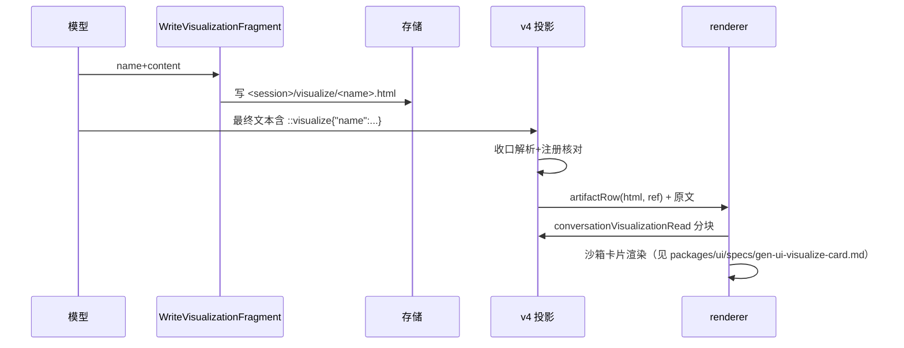

# ACode：对话内可视化（gen-ui / visualize）——CLI 侧契约

## 背景与目标

模型在会话里产出**交互式 HTML 片段**（图表/模拟器/ mockup），最终响应携带行内引用，
宿主把片段渲染成对话内沙箱卡片。参考上游 zcode 3.15.1 的 plugin-sandbox/gen-ui 机制，
按 ACode 协议纪律重新设计：**不新增 row 类型、不新增持久 part、不用绝对路径**。

三段式契约：
1. **写入**：专用工具 `WriteVisualizationFragment` 把片段写进会话产物存储；
2. **引用**：最终文本携带 `::visualize{"name":"<文件名>","mode":"wide"?}`；
3. **读取**：v4 查询 `conversationVisualizationRead` 分块读字节（授权按会话+注册名，
   renderer 传的任何字符串不直接成为路径）。

## 产品规则

- 片段是 HTML fragment（无 doctype/html/head/body），≤ 1 MiB，UTF-8；
- 同名再写 = 更新（新版本，旧引用继续读新内容——与上游"文件是可编辑源"一致）；
- 引用未注册名 / JSON 非法 → 投影层**不**产 artifactRow，指令按纯文本留在正文
  （降级可见，模型与用户都能看到自己写了什么）；
- 每轮最终响应至多解析 8 条引用；`mode` 只接受 `"wide"`，其他值忽略。
- 工具仅在会话加载过 `visualize` 技能后可用（技能门，同
  `requireDynamicWorkflowSkill` 先例；错误码沿用 428 族语义）。

## 写入：`WriteVisualizationFragment`

- 落点：`<storageRoot>/cli/artifacts/<sessionId>/visualize/<清洗后 name>`（复用
  NodeToolArtifactStore 的目录族与文件名消毒；name 限定 `^[a-z0-9-]+(\.[a-z0-9-]+)?$`、
  ≤ 80 字符，强制 `.html` 后缀）。
- 输入：`{ name, content, title? }`；输出 `{ name, bytes }`。
- 拒绝（422 语义）：含 `<!doctype`/`<html` 开头 → 提示只写 fragment；>1 MiB；
  name 非法。**不做** HTML 语法深度校验（渲染端沙箱兜底）。
- 不进 Write 工具权限链（不写工作区）；也不落 `acode-artifact://` 的 tool-result
  retention——可视化目录独立于 toolCall 生命周期，随 session 清理策略走。

## 引用解析（CLI v4 投影层）

位置：`bootstrap/src/acode-protocol-v4/product-projection.ts` 的 assistantText **全部收口点**
（2026-10-11 实机修订：最初只挂 `text_end`，但最终回复正文在多数 runtime 下由 turn 终态
`closeStreamingRows` 收口——指令按技能契约恰在最终回复里，只挂 text_end 会漏掉整条主路径、
卡片永不渲染；现 `text_end`、`openTextRow` 的旧行收口、`closeStreamingRows(state=complete)`
三处共用 `visualizationArtifactRows`；entityId 经 rowId→entityId 映射取得，segment fact 可选）。
live 与冷恢复（transcript-hydration 合成的同族事件）共用该投影，天然满足 replayable
收口不变量与 "reduce(transcript) ≡ reduce(events)"；同一 text row 只被收口一次，扫描不重复产 row。

- 正则解析正文中的 `::visualize{...}`（容错：单/三冒号、智能引号——复用
  renderer `assistantDirectiveParser` 的词法约定，CLI 侧实现一份严格版）；
- 命中且 name 已注册（该 session 写入过）→ upsert 一条 **既有 `artifactRow`**：
  `{ kind:"artifact", artifactType:"html", ref:"acode-visualization://<sessionId>/<name>", title?, meta:{ visualization:{ mode? } } }`，插在该 assistantText row 之后
  （行序 = 引用在正文中的出现序）；正文文本**原样保留**（含指令文本）；
- 未命中/未注册 → 不产 row。

新增 v4 查询（transport.ts 方法表 + capabilities）：

```ts
conversationVisualizationRead
  { sessionId, name, offset, limit ≤ PROTOCOL_V4_LIMITS.attachmentChunkMaxBytes }
  → { dataBase64, totalBytes ≤ 1 MiB, nextOffset: number | null }
```

授权：sessionId 必须是发起方会话；name 必须在该会话 visualize 目录存在
（经注册表/journal 记录核对，不信任 renderer 传参拼路径）；逐字照
`workflowRunArtifactRead` 的分块纪律（含 base64 superRefine）。分享投影**不**包含
visualization artifactRow 的 ref（沿用 rows.ts:221 的本地引用裁剪规则）。

### 注册表绑定（2026-10-12 实机修复：多 app 进程）

投影的 name 核对走 visualization-registry.ts 的模块级绑定（ProductProjection 构造链
太深，store 不逐层穿签名）。初版是**单一 activeStore 单例**，前提「一个进程同一时刻
只有一个 active app」——桌面 app-server 不成立：每 workspace 一个 agent 进程、每会话
一个 create-app，多 app 并存。实机后果（2026-10-12 E 卡片复现，Bug 6）：

- last-writer-wins：后建 app 覆盖先建 app 的 store 绑定；
- dispose 无条件置 null：任一 app 关闭（UI 切走任务即触发）把**其他在世 app** 的
  绑定一并清掉。该轮 `WriteVisualizationFragment` 正常落盘（工具走 app 本地 tool
  context，不经单例）、`::visualize` 指令逐字发出、renderer 剥离正常，但投影
  lookup miss → 按「未命中不产 row」静默降级 → 卡片永不出现。

修复：注册表按 **sessionId 键控**（Map）：

- `registerVisualizationFragmentStore(sessionId, store)`——create-app 装配时；
- `unregisterVisualizationFragmentStore(sessionId, store)`——dispose 与启动失败路径，
  **实例身份校验**：同会话旧 app 的迟到 dispose 不得误删新 app 的绑定；
- `lookupVisualizationFragment(sessionId, name)` 按 sessionId 取 store 再查其索引。

单例 setter（setActiveVisualizationFragmentStore）删除，不留兼容面——调用点仅
create-app 三处与测试，全部改造。

### live 发射缺口（2026-10-12 实机修复：clone 清单漏 sessionId，Bug 7）

注册表键控修复后 live 轮仍不产 row，%TEMP% 诊断日志判决：live 投影实例
`this.sessionId === undefined`，hydrate 实例正常。根因在
`ProductProjection.cloneProjection()`：live 发布链逐事件走
`applyEventAtomically`（clone → reduce → adopt），clone 用 `Object.create` +
**手工字段清单**复制约三十个 side-map/标量，唯独漏了构造期身份字段 `sessionId`
（文件内注释本就警告「遗漏该侧表会让…丢失」这类清单漂移）。于是 live 收口处
`visualizationArtifactRows` 的注册表核对以 undefined 为键必 MISS；hydrate 走真实例
不受影响——这正是「冷恢复有卡、live 无卡」的不对称。

修复：clone 清单补 `clone.sessionId = this.sessionId`；`sessionId` 字段去掉
`readonly`（clone 清单的写入需求；「构造后不变」改由约定保证，除 clone 外无人写）。
回归测试：`applyEventAtomically` 路径（text_end 收口）必须产出 artifactRow——
把 clone 清单钉进测试，防同类漂移。

### live 验收（2026-10-12，双修复后）

干净 live 轮（新任务、不杀进程）：模型加载 visualize 技能 →
WriteVisualizationFragment 落盘 → 最终回复两行（描述 + 逐字指令）→ **卡片在 live
轮内渲染**：`data-v4-visualization-card` 在场、iframe `sandbox="allow-scripts"`、
815×196 可视、指令行被剥离不泄漏；诊断日志确认 atomic 路径 sessionId 正确、
注册表 hit。此前各轮（E2/e3/e5/e6）的失败分别由 Bug 6（注册表单例）与 Bug 7
（clone 清单）解释，均已闭环。

## 技能：`bundled-skills/skills/visualize/`

- `SKILL.md`（frontmatter：name `visualize` + description/when_to_use）：教模型
  「什么时候值得做对话内可视化、fragment 契约（fragment-only、字面量标记、根元素
  唯一 id、无 fetch/XHR/WebSocket、渲染库本地优先、静态资源回退只从 CSP 白名单
  CDN、≤1MB 降采样、主题用 CSS 变量）、`WriteVisualizationFragment` +
  `::visualize` 引用只在最终响应发、导览模式 wide 的使用边界」。文案自研，不复刻
  上游文本。
- 渲染库取用（2026-10-15 起，**本地优先、CDN 回退**；渲染端机制与安全论证见
  `packages/ui/specs/gen-ui-visualize-card.md`「vendored 钉版渲染库与 CSP 本地源」）：
  - mermaid 与 chart.js 已钉版随包分发（mermaid@11.17.2 / chart.js@4.5.0），技能教
    片段用规范相对路径引用：`visualization-vendor/npm_mermaid@11.17.2_mermaid.min.js`、
    `visualization-vendor/npm_chart.js@4.5.0_chart.umd.min.js`（全局 `window.mermaid` /
    `window.Chart`）——离线可渲染，宿主负责 Web/桌面两态解析（http(s) 源直载；桌面
    生产 file: 页面重写为 `acode-viz-vendor:` 本地协议）；
  - CSP 白名单 CDN 保留为其余静态资源的回退面（渲染端执行，技能里教同一张表）：
    `cdnjs.cloudflare.com esm.sh cdn.jsdelivr.net unpkg.com fonts.googleapis.com fonts.gstatic.com fonts.bunny.net`；
  - 本地源只进 `script-src`；`connect-src 'none'`（无 fetch/XHR/WebSocket）红线不变。
- 登记进 bundled-skills 完整性清单；`visualize` 工具门常量放 contracts（照
  `DYNAMIC_WORKFLOW_SKILL_NAME` 先例）。

## 事件顺序



## 验收场景

1. 写片段→最终文本引用→renderer 收到 artifactRow；冷恢复重放后 row 仍在
   （hydration 黄金测试扩展）。
2. 引用未注册名→无 row、正文保留指令文本；`{"name":123}` 非法→同上。
3. 超 1 MiB 写入被拒；`<!doctype` 开头被拒并提示。
4. `conversationVisualizationRead`：越界 offset 拒绝；跨会话 name 拒绝；分块拼接
   逐字节等于写入内容。
5. replayable profile 终态与 continuous 逐字节一致（两 profile 黄金测试）。
6. 技能未加载时工具报 428 族错误；加载后可用。
7. 测试：`apps/acode-cli/tests/gen-ui-visualize.test.mjs`（投影解析、注册核对、
   读写往返、技能门）。

## 验证基建立项（2026-10-11）

实机 E2E 的卡片实渲染被**测试模型合规性**卡住（qwen3.8-max 六轮仅一轮原样输出
`::visualize` 引用行；指令被吞则无 row、无卡——产品行为正确但验收不可复现）。
立项把验收从「模型心情」移到确定性层：

1. **投影收口确定性测试**（CLI 单测层）：合成 SessionEvent 序列（text_delta 带指令 +
   三种收口路径：text_end / 新 text 段顶替 / turn 终态 closeStreamingRows），配临时
   fragment store 注册同名片段，断言三条路径都产出 artifactRow（ref/artifactVersionId/
   meta.mode 逐字段），且未注册名不产 row。钉住 2026-10-11 收口点修复的回归。
2. **renderer 组件测试**（ui 单测层）：`VisualizationArtifactRow` 以 mock
   readVisualization 分块喂入，断言 iframe `sandbox="allow-scripts"` 唯一（无
   allow-same-origin）、meta CSP 注入、ResizeObserver 高度回传父校验；正文剥离的
   唯一面是 `lib/assistantVisualizeReference.ts` 的 `projectAssistantVisualizeReferences`
   （语法级无条件剥离、等长空白保 citation 偏移；miss 的降级可见性在 journal/投影层
   成立——row 缺席——渲染层不承诺 miss 可见，2026-10-11 立项 E 排查时曾误加组件级
   条件剥离 helper，已回退归一）。既有 `packages/ui/test/genUiVisualizeCard.test.ts`
   守护 CSP 串/sandbox 面/剥离/分块纪律，补强项进该文件。
3. **CSP 实机探针脚本化**：iframe target 连入后跑 fetch 探针（expect BLOCKED）与
   `window.acodeViz` shim 存在性断言，进 z-work 实机套件（供有合规模型或手工回合
   后的半自动验收），不作为 CI 门禁。
4. _live E2E 保留_：换合规性更好的模型或手工回合触发引用行后跑全链（卡片渲染 +
   CSP + 高度自适应），环境受限结论如实标注不进门禁。

## 创作指导增补包（2026-10-15，第二轮价值提取 T1-p2）

`SKILL.md` 从单文件演进为「入口 + 按需 references」两级——对应提取条目①「模块分级
装载」。ACode 没有厂商的 `read_me(modules=[...])` 工具；等价机制是技能文件由模型
按需 `Read`（`dynamic-workflows` 的 patterns.md/examples.md 与 `research-report` 的
method.md 同款惯例），装载不向用户叙述。全部指导文本**自撰**（机制调查源：需求
条目 T1-p2 与还原工程 BLOCK 72/165/196/202/228/255 等证据行），厂商文案一字不抄；
技能正文沿用既有惯例全英文（bundled-research-review-skills.test.mjs 的无 CJK 纪律
同款，本批 references 一并用例覆盖）。

结构与内容面：

- `SKILL.md`（增补，不重写）：新增「Guidance modules」索引节（按产物类型路由到
  references/，静默装载）与「Every-visual non-negotiables」节——复杂度预算硬限
  （副标题 ≤5 词 / 每图 ≤2 色 ramp / 横向 tier ≤4 box，超限三出路：缩、折行、
  拆图）、自我拆穿条款（正文承诺「点开看更多」则顶层视图必须真稀疏）、交付诚实
  （正文承诺 N 张图 = N 次 `WriteVisualizationFragment` 调用；相邻两图之间必须有
  承接正文）、a11y 底线（HTML 开头 sr-only 一句摘要；SVG `role="img"` +
  `<title>`/`<desc>`；canvas `role="img"` + `aria-label` + 标签间 fallback 文本；
  绝不仅靠颜色区分系列——每色系配第二视觉通道）。
- `references/diagram.md`：手排 SVG 失败模式量化规则（画线前对全部已放 box 求交、
  box 宽度 = max(标题字符×8, 副标题字符×7)+24、CJK/特殊字形宽度校准、viewBox
  高 = max_y+边距「不许猜」、WRONG/RIGHT 数值反例对、dominant-baseline 居中公式、
  间距常数）+ 意图路由表（按动词不按名词路由；文档型/直觉型二分；ERD 强制
  Mermaid——手排 SVG 每次败在实体框尺寸与边交叉同处；环状流程禁 ring 改 HTML
  stepper——本参考全部间距公式是笛卡尔布局的，环形排布无一条适用）。
- `references/chart.md`：色彩语义学（颜色最后定——六步程序；form 选择表带「不要
  用」列：单值→stat tile 非单柱柱状图、>7 类→表格非更多颜色；sequential 是安全
  默认；单 y 轴；色随实体不随排名；蓝/绿/琥珀/红在 ACode 表面保留 UI 语义
  info/success/warning/error，不当普通系列色；色底文字取同 ramp 深档非纯黑灰）+
  主题变量消费 + canvas a11y + 每系列第二视觉通道（虚线/点形/纹理）进图例。
- `references/mockup.md`：ACode 设计语言还原（引 design-tokens.md）、faux-viewport
  规则（卡片高度 = 内容流高度 → `position:fixed`/`100vh` 不贡献布局高度，遮罩类
  mockup 用普通流包裹层）、无 fullscreen 表面披露（扩展布局用同帧 class 翻转，
  不重建控件 DOM）、输入校验义务（无效输入就地报错并阻断推进）。
- `references/interactive.md`：`window.acodeViz` 状态 shim（内存态、卡生命周期）、
  控件预算（每个控件当帧可见地改变图形）、脚本装载顺序（库 src 先于消费方）、
  高度上报器不对抗（无嵌套滚动、内容自适应）、片段内 reduced-motion 用片段自身
  `@media`（宿主根属性不穿透 sandbox iframe——如实披露边界）。
- `references/design-tokens.md`：**@generated 生成物**（见下节），不手改。

### 流式感知规则不移植（理由记录）

厂商指导含一组针对 token 级流式渲染的写作规则（style 前/script 后、gradient/
shadow/blur 流式闪烁禁令、禁注释、禁 `display:none` 分段等，提取条目⑥）。ACode
**不移植**：片段经 `WriteVisualizationFragment` 一次性整体写入，renderer 在写入
完成后才分块读取并整卡渲染——不存在流式 DOM diff 中间态，「闪烁」「隐藏内容不可见
地流出」等规则没有消费面。库 `<script src>` 先于消费其全局的 inline script 属普通
脚本装载顺序纪律（与流式无关），保留在 interactive.md。

### DESIGN.md → design-tokens 生成管线（@generated 头纪律小立项）

对应提取条目⑩「设计 token 技能由文档生成」：设计系统文档是单一来源，模型消费的
技能参考是编译产物，两处不手抄（厂商证据：`@generated by …gen-cds-skill.mjs …
Do not edit by hand — edit the source docs and re-run`，BLOCK 72@11205）。

- 脚本：`apps/acode-cli/scripts/generate-visualize-design-tokens.mjs`（纯 node
  ESM、零新增依赖，与兄弟 generate-*.mjs 同惯例）。从 `DESIGN.md` 提取 UI 字号
  token 表、Spacing 节奏、Radius 阶梯（容器层级+基本控件表）、Sizing 基线与
  `--color-*` 语义角色分组，生成 `bundled-skills/skills/visualize/references/design-tokens.md`；
- 生成物首行 @generated 头注释：指回脚本与 DESIGN.md，声明「勿手改，改源后重跑」；
- **手动运行**（`node scripts/generate-visualize-design-tokens.mjs`），不接
  build/tsup/vite——不碰构建配置面；
- 一致性校验：`apps/acode-cli/tests/generate-visualize-design-tokens.test.mjs`
  以 `--check` 模式对真实 DESIGN.md 重生成并逐字节比对已提交产物，漂移即非零退出
  （根 `pnpm test` 串行全包时天然进门禁）；
- 消费边界：片段 sandbox 内**没有** app 层 token（--color-*/text-ui-* 变量不进
  iframe）；生成物价值是设计语言教材（比例、节奏、阶梯数值），mockup 据此还原
  ACode 观感，片段实际着色仍走 SKILL.md 契约节注入的主题变量。

### 增补包验收场景

8. references 四文件 + design-tokens.md 存在于技能目录；SKILL.md 索引节逐一指到。
9. SKILL.md 与全部 references 正文无 CJK（并入 bundled 技能无 CJK 用例族）。
10. 生成管线：`--check` 对当前 DESIGN.md 通过；改动 DESIGN.md token 节后 `--check`
    失败（测试内以变异输入断言）。
11. 测试落点：`apps/acode-cli/tests/bundled-visualize-skill-guidance.test.mjs`
    （结构/索引/无 CJK/预算与诚实条款关键句在场）+
    `apps/acode-cli/tests/generate-visualize-design-tokens.test.mjs`（生成一致性）。
