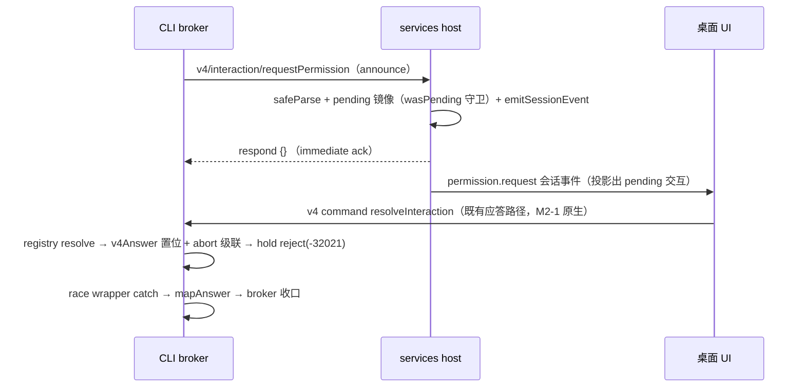

# M2-4 inbound 交互面七方法迁 v4（permission / userInput / providerRuntimeHeaders / officialMcp / browser ×2 / CUA event）

> 状态：**已实施**（2026-10-28）。
> 实施记录（验收节逐项证据）：
> A. `acodeProtocolMethods.` 七法在 packages/services/src 实测归零（20 → 13，−7；tokenized
>    grep 自证）；全仓残留消费 5 种/6 点——sessionSend×2 / sessionSubagents /
>    pluginsCancelOperation（M4 残留）+ pluginsReferenceCatalog 对（M2-5 −32601 回落链），
>    均与本批无关。
> B. shared protocol-boundary.test.mjs 46/46 绿，其中本批 M2-4 块 10 条（1448 行起）：
>    transport 六请求方法 + 两通知登记、announce+ack 空 strict、permission / userInput /
>    providerRuntimeHeaders / officialMcp / browser params/response 与 legacy 逐字一致、
>    CUA operation event 点等价（fail-closed）、叶无反向 import。
> C. CLI tests/m2-4-inbound-interaction.test.mjs 20/20 绿（4 race + 5 broker + 3 server +
>    2 CUA + 6 headers）；established-flag 用真实 server 实测（officialMcpAuthRequestContext
>    返回完整运行时上下文，含 hostV4InboundEstablished / requestClient / v4Interactions）。
> D. 套件：shared 478/478；services 578 pass/0 fail（7 skip 基线）；ui 1125/1125；
>    CLI 3205 pass/0 fail（38 skip 基线）；typecheck 32/32。
> E. lint 163w/0e（基线 164，−1）；architecture:check --changed new 0/regrown 0
>    （violations 303 = 基线，legacy 棘轮 413）。
> 冒烟：§5.1 headless 矩阵已执行（CLI 套件 + services 双 clientMode + server loopback WS
>    双端升级 + ui/shared 包套件）；Electron main 端到端弹窗回路与 relay attachment 回路
>    登记为发布期门禁。
> 关联：docs/reviews/2026-10-28/m2-scoping.md M2-4 条目；M2-1 迁移样板；M2-5 §4 skew 教义。

## 1. 范围与判据

迁移 **agent/CLI → host 方向**（反向请求 + 通知）七个交互面方法；M2-0 判据：`acodeProtocolMethods.` 对本七法的消费在 services 侧归零（实测基线：实施时刻 20 → **13**，−7；本批实施前兄弟批次已把基线从 72 降至 20）。
载体 = `packages/shared/src/acode-protocol-v4/inbound-interaction.ts`（新建叶）+ transport.ts 登记。

| legacy 方法（agent→host） | CLI 发送点（迁移前） | services 消费点 | v4 归宿 |
|---|---|---|---|
| `interaction/requestPermission` | interaction-broker.ts `requestPermission` | acodeAgentService.ts:2207 | 新 v4 方法 `v4/interaction/requestPermission`（announce+ack） |
| `interaction/requestUserInput` | interaction-broker.ts `requestUserInput` / `requestExitPlanModeApproval` | :2236 | 新 v4 方法 `v4/interaction/requestUserInput`（announce+ack） |
| `interaction/requestProviderRuntimeHeaders` | provider-runtime-headers.ts | :2265 | 新 v4 方法 `v4/interaction/requestProviderRuntimeHeaders`（真 RPC） |
| `interaction/requestOfficialMcpAuthHeaders` | official-mcp-auth-port.ts | :2316 | 新 v4 方法 `v4/interaction/requestOfficialMcpAuthHeaders`（真 RPC） |
| `interaction/browserList` | browser-control-broker.ts | :2422 | 新 v4 方法 `v4/interaction/browserList`（真 RPC） |
| `interaction/browserExecute` | browser-control-broker.ts | :2452 | 新 v4 方法 `v4/interaction/browserExecute`（真 RPC） |
| `computer-use/operation-event`（通知） | server-operations.ts `onSessionEvent` | :2016（host 侧消费） | 新 v4 通知 `v4/cua/operationEvent`（fail-closed 等价迁移） |

**第 8 点（伴随）**：`interaction/providerRuntimeHeadersCancelled`（CLI→host 通知，:1941）不是 `acodeProtocolMethods.` 计数面（属 `acodeProtocolNotifications.`），但与 providerRuntimeHeaders 请求**成对**：取消通知的形态必须与其触发的请求形态一致（见 §2.3），故同批迁移为 `v4/interaction/providerRuntimeHeadersCancelled`，host 侧保留字面量 legacy 分支。

**纪律**：
- legacy 只删不增；双向协议变更按「CLI 双形态共存 → host 切换 → legacy 删除留 M3/M4」。本分支内完成双形态共存 + host 切换；legacy wire 入口保留并标注（skew 方向写明），实质删除归 M3。
- `computerUseOperationEvent` 整面属 `packages/acode-cua` fail-closed 面——**迁不删**：以 fail-closed v4 形态保持行为逐点等价（保守默认，零功能变化）。host 侧对未知通知**静默丢弃**（onNotification 无 else 分支，已实测），因此旧 host 上 CUA 事件必须继续走 legacy 形态——这是 established-flag 门控（§2.4）存在的直接原因。
- 不新增任何协议词汇：所有 wire 形态 = legacy schema 逐字重声明（v4 叶）或中立叶/幸存白名单导入。
- 应答路径**不动**：权限/用户输入的最终应答早已走 v4 `resolveInteraction` command → CLI `v4Interactions` registry（interaction-registry.ts，M2-1 已原生）。本批只迁「请求投放」半边。
- host 侧 `pendingPermissions`/`pendingUserInputs` 是**死存储**（登记后从无 respond 路径；应答只经 v4 resolveInteraction——services `acodeTaskServiceAdapter.ts:2303/:2331` 实测）。v4 分支登记为纯镜像 + `emitSessionEvent`；`pendingProviderRuntimeHeaders` 有真实 respond 路径（`respondAccountRequestAuthWithoutInteraction` :1240-1280），v4 分支复用同一核心。

## 2. 行为规格

### 2.1 六请求：v4 先行，-32601 回落（skew 探测机制）

**裁决（保守默认，仓内先例）**：请求面不引入新协商机制，沿用仓内已有 `-32601` 回落先例：
- 先例一：`apps/acode-cli/packages/bootstrap/src/acode-protocol/automation-port.ts:55-90`——`catch (error) { if (!(error instanceof ProtocolRequestError && error.code === -32601)) throw error; /* 只有"方法不存在"能证明是能力差异 */ …legacy 回落 }`。
- 先例二：M2-5 spec §4（specs/m2-5-plugins.md:56-63）：pluginReferenceCatalogRequest.ts 两级 `-32601` 回落链；「其余 16 方法无 skew fallback：host 与 CLI 同版本发布，v4 方法名即版本边界」。
- 本批六法属「两侧版本可偏斜」面（桌面宿主可旧于 CLI），故采先例一的回落：v4 请求先行；仅当 `ProtocolRequestError.code === -32601`（host onRequest 尾分支实测：`Unsupported ACode Protocol request: ${method}`，acodeAgentService.ts:2841）时回落 legacy 形态；其它错误照旧上抛。
- 否决备选（记录）：hello/helloAck 门控（validation.ts:110-123 无能力字段，CLI 侧 helloAck 仅传输层消费）；capabilitiesQuery 探测（host→CLI 单向，V4_CAPABILITY_KEYS = {independentPlanState} 闭枚举）；subscribe 参数注入（方向反）；环境变量门控；通知双发（`cuaOperationTurnTracker?.accept` 双火风险）。

**CLI 侧双形态发送器结构**（六法统一）：

```
try {
  result = await requestClient(V4_METHODS.v4Interaction…, params, resultSchema, options)
  markHostV4InboundEstablished()        // 见 §2.4 通知门控
  return result
} catch (error) {
  if (!(error instanceof ProtocolRequestError && error.code === -32601)) throw error
  // skew 回落：旧 host 无 v4 方法（-32601）。legacy 分支保留至 M3（skew 方向：新 CLI + 旧 host）。
  return await requestClient(acodeProtocolMethods.…, legacyParams, resultSchema, legacyOptions)
}
```

v4 与 legacy 的 **params 逐字同形**（§2.6 表），故回落不换载荷。

### 2.2 permission / userInput：announce + immediate ack（v4 语义）

classic 反向 RPC 的问题：v4 客户端不产生 RPC response（应答走 `resolveInteraction` command）。若 v4 announce 悬空等待 response，host 重启/断连时该 pending 会阻塞（且 server.ts:323 shutdown 守卫计 `pendingClientRequests.size > 0`）。故：

**v4 语义 = announce + immediate ack**：
1. CLI 发 `v4/interaction/requestPermission`（params = §2.6 同形载荷）。
2. host 分支：safeParse（失败 → -32602）→ 登记**镜像**（`wasPending` 幂等守卫照旧）→ `emitSessionEvent(workspace, sessionId, { type: "permission.request" | "userInput.requested", request })` → **立即 respond `{}`**（ack）。
3. CLI startRequest 收到 ack 后返回一个**hold promise**：仅当级联 signal abort 时以 `ProtocolRequestError(-32021)` reject——与 legacy 反向 RPC 被 abort 时的终态一致。hold promise 只存在于 startRequest 闭包内，**不注册** `pendingClientRequests` 假条目（不碰 shutdown 守卫；server.ts:323-325 注释明示）。ack 对应的真 pending 条目在 respond 时已按既有 `resolveClientRequest` 路径清除。
4. 用户应答经 v4 `resolveInteraction` → interaction-registry `resolve(answer)` → race wrapper 的 `v4Answer` 置位 + `controller.abort()`（interaction-response-race.ts:50-54 实测）→ hold promise reject(-32021) → wrapper catch 分支检测 `v4Answer` → `mapAnswer`（:90-94 实测）。wrapper 代码零改动。
5. **v4 路径不带 reannounce**。legacy reannounce（`withInteractionRequestRecovery`，1s 指数退避，interaction-broker.ts:341-356）的存在理由注释自述：「桌面/恢复链路里 UI 可能只从 snapshot 恢复出 pending 交互，但 host 里原 protocol id 对应的内存登记已丢失」——刷新的是**死掉的 legacy respond 路径**的 protocolRequestId。v4 应答不经 protocolRequestId（经业务 requestId → registry），host 重启恢复由 v4 conversation snapshot 的 PendingInteraction 行承载。legacy 回落路径保留 `withInteractionRequestRecovery` 原样。
6. fullAccess 注册分支（claimResponse/commitPermissionFullAccess/waitForPermissionGrantCommit，interaction-broker.ts:96-116）不动：它在 race wrapper 的 registrationOptions 面，与请求形态无关。



**幂等与过期**：业务 `requestId` ≡ interactionId（registry 键）。重投放（同 requestId）host 侧经 `wasPending` 守卫去重（既有语义，两分支共用提取的核心助手）。registry 侧先到先得、晚到 noop（interaction-registry.ts:6 注释「先到先得，晚到 noop」）。stale 应答（会话已关）由既有 registry/record 生命周期收口，本批不改。

### 2.3 providerRuntimeHeaders / officialMcpAuthHeaders / browserList / browserExecute：真 RPC 换名

四法的 v4 形态 = 同 params、同 result、方法名加 `v4/interaction/` 前缀；-32601 回落同 §2.1。host 侧把既有分支体提取为**核心助手**（纯函数/闭包注入），v4 与 legacy 分支共用——语义逐点不变：
- providerRuntimeHeaders：登记 pending `{client, protocolRequestId, request}` → `accountRequestAuthService && accountAccess` 时 `respondAccountRequestAuthWithoutInteraction({key, pending})`；否则 delete + fast-fail respond `{headersApplied:false, errorMessage:"Provider request auth is unavailable"}`。v4 形态下 protocolRequestId 仍是本次连接的 server-N id（respond 机制不变）。
- officialMcp：**安全顺序不变**——trust 校验（`isTrusted({mcpKey, origin: targetOrigin, pluginId})`，validator_error/validator_missing fail-closed）先于任何凭据读取；不信任 → respond `{ok:false, reason:"official_mcp_origin_untrusted"}` + warn（不读凭据）；无 resolver → `{ok:false, reason:"official_auth_unavailable"}`；resolve 失败 catch → 同 reason；**永不 respondError、永不匿名**。成功路径 `markFirst` + `summarizeOfficialMcpIdentityHeaders` 审计/日志分支不动（凭据永不进日志）。
- browserList：无 executor → `{browsers:[]}`；`executor.list(parsed.data)` → `{browsers}`；catch → -32603 respondError。
- browserExecute：无 executor → respond `{ok:false, error:{code:"backend_unavailable",…}, elapsedMs:0}`；执行带既有 spread 缺省（连接 workspace 回退、clientMode ?? "desktop-continuous"、sessionContext ?? "live"）；catch → `{ok:false, error:{code:"execution_error",…}, elapsedMs:0}`。

**第 8 点取消通知形态**：provider-runtime-headers.ts 在请求闭包内记录本次请求实际使用的形态（v4 / legacy）；超时或外层 abort 触发的 `providerRuntimeHeadersCancelled` 通知**用同一形态**发出（取消的形态 = 其触发请求的形态——比连接级 flag 精确：同连接上 v4 回落瞬间的在途请求仍发 legacy 取消）。host 侧两分支共用取消核心（`cancelProviderRuntimeHeaders(key, pending)`，带 `pending?.client === client` lease 校验 + workspaceKey 匹配守卫，:1941-1953 既有体提取）。

### 2.4 两通知：established-flag 门控（skew 探测机制）

通知无法探测（host 对未知通知静默丢弃，无错误回路）。裁决（保守默认）：**连接级 `hostV4InboundEstablished` flag**：
- 六请求方法中任一者首次收到 v4 成功响应（含 ack）时置 `true`——证明当前连接对端是新 host（已注册 v4 分支）。
- flag `false` → 通知发 legacy 形态。最坏情形（新 host 连接后、任何交互发生前就来的早期 CUA 事件）= 走 legacy 形态——旧分支保留正是为此，零丢失。
- **无双发**：一个事件只发一种形态。
- **复位**：`setNotificationSink()`（server.ts:389-392，新连接附着点，同时重置 `clientDisconnectError`）复位为 `false`——新附着 = 可能换了 host 版本。`disconnectClient` 不必复位（不发通知；下次附着必经 setNotificationSink）。
- CUA 通知（`onSessionEvent`，server-operations.ts:2606-2635）：flag true → `v4/cua/operationEvent`（params 逐字同 `mapComputerUseOperationEvent` 产物）；否则 → `acodeProtocolMethods.computerUseOperationEvent`。debug/warn 日志两形态共用。
- 取消通知不走本 flag（走 §2.3 的请求形态绑定，更精确）。
- **host 侧 v4 通知分支**（acodeAgentService.ts onNotification）：`v4/cua/operationEvent` → safeParse → `cuaOperationTurnTracker?.accept(workspace, parsed.data)`（parse 失败 → warn + issues + workspaceKey，丢弃——与既有 legacy 分支逐点同）；`v4/interaction/providerRuntimeHeadersCancelled` → 与 legacy 分支同一提取核心（含 lease 校验）。
- **旧 host 行为等价证明**：旧 host 收不到 v4 通知（CLI 不发，flag 未置）；收得到 legacy 通知（分支保留）——逐点不变。新 host 收到两形态中恰好一种（flag 或请求形态绑定决定）——无重复消费（`cuaOperationTurnTracker?.accept` 幂等由 sequenceNumber 面既有保证，不在本批范围）。
- v4 叶命名对齐既有纪律（transport.ts V4_NOTIFICATIONS 注释）：CUA 事件是「仅当前进程 live 产生；历史与 replayable 链路不得补造」——与 `cuaPermissionObservation` 同族；注释照写。
- v4-bridge 既有四通知（frame/telemetryFact/cuaPermissionObservation/networkCaptureRecords）**无条件**发送（:1444-1462 实测），证明 `context.notify` 的 method 类型已容纳 V4_NOTIFICATIONS 字面量——本批两个新通知无需放宽类型；但 `requestClient` 的 method 参数类型（server-types.ts `ACodeProtocolMethod` / server.ts:925 私有签名）需放宽以容纳 `V4Method`（联合 `ACodeProtocolMethod | V4Method`，只放宽不改行为）。

### 2.5 skew 矩阵（版本偏斜裁决表）

| 场景 | 六请求 | 两通知 | 结果 |
|---|---|---|---|
| 新 CLI + 新 host | v4 命中，无回落 | flag 置位后走 v4；置位前瞬时走 legacy（host 双分支兼容） | 全 v4 |
| 新 CLI + 旧 host | v4 → -32601 → legacy 回落 | flag 永假 → 全 legacy | 逐点等价（本分支保活面） |
| 旧 CLI + 新 host | 旧 CLI 只发 legacy → host 字面量分支服务 | 旧 CLI 只发 legacy 通知 → host 字面量分支服务 | 逐点等价 |
| 连接中途换 host（detach/attach） | 在途请求按发起形态收口或断连错误 | setNotificationSink 复位 flag → 重新探测 | 保守正确 |
| providerRuntimeHeaders 请求中换形态 | 取消通知形态 = 请求形态（§2.3） | — | 成对一致 |
| 早期 CUA（新 host，无交互前） | — | flag 未置 → legacy | 零丢失（最坏情形已覆盖） |
| host 重启 + CLI 在途（permission） | v4：snapshot PendingInteraction 行承载恢复；无 reannounce 需要 | — | §2.2 裁决 5 |

### 2.6 wire 形态表（逐字重声明 / 导入来源）

新叶 `packages/shared/src/acode-protocol-v4/inbound-interaction.ts`。**零新词汇**：

| schema | 来源裁决 |
|---|---|
| 权限请求 params / `permissionOption`（optionId/kind/name/description/response） | legacy index.ts:2204 / :622 **逐字重声明**；其组件 `acodePermissionResponseSchema` 从 `acode-protocol-legacy-types.js` 导入（白名单幸存符号，已实测 :80） |
| `acodeInteractionRequestOriginSchema`（origin 字段） | 同上，白名单幸存（:206） |
| `acodeWorkspaceRefSchema`（providerRuntimeHeaders/officialMcp/cancelled 的 workspace） | 同上，白名单幸存（:43） |
| userInput 请求 params（questions/`acodeUserInputQuestionSchema`/`acodeUserInputOptionSchema`）与响应（action/content/reason） | 逐字重声明（:2263-2306） |
| providerRuntimeHeaders params / cancelled / 响应（discriminatedUnion headersApplied） | 逐字重声明（:2307-2358）；`modelSelectionSchema`、`acodeProviderAccountAccessSchema` 从**中立叶**导入（model-selection.ts:4 / account-access-types.ts:46，已实测） |
| officialMcp params / 响应（discriminatedUnion ok）/ 失败原因枚举 | 逐字重声明（:2364-2402）；`OFFICIAL_MCP_AUTH_PORT_FAILURE_REASONS` 从中立叶官方-mcp-auth.ts:88 导入 |
| browserList/browserExecute params | 逐字重声明（:2221-2258）；其组件 `browserClientModeSchema`/`browserSessionContextKindSchema`/`browserCommandSchema` 从中立叶导入（command-metadata.ts:126 / browser-use/backend.ts:46 / commands.ts:307） |
| browserList/browserExecute result | **直接导入**中立叶：`acodeBrowserListResultSchema = browserBackendListResultSchema`（backend.ts:77）、`acodeBrowserExecuteResultSchema = browserCommandResultSchema`（result.ts:95）——result 面本就中立，重导出即可 |
| CUA 事件（base + 6 variant discriminatedUnion "kind"） | 逐字重声明（:983-1034）；`timestampMsSchema` 是 legacy 私有 → 在本叶重声明同一 `z.number().int().nonnegative()` |

transport.ts 登记（带批次节注释，照 M2-5/M2-6 格式）：
- `V4_METHODS`: `interactionRequestPermission: "v4/interaction/requestPermission"` 等六条（键名对齐 legacy `acodeProtocolMethods` 同名，对象命名空间隔离；方向注释：agent→host 反向）。
- `V4_NOTIFICATIONS`: `cuaOperationEvent: "v4/cua/operationEvent"`、`interactionProviderRuntimeHeadersCancelled: "v4/interaction/providerRuntimeHeadersCancelled"`（方向注释：CLI→host）。

`packages/shared/src/acode-protocol-v4/index.ts` 增 `export * from "./inbound-interaction.js"`（照 :33/:40 既有格式）。protocol-boundary.mjs **无需新增**白名单（三个幸存符号已在集内，已实测）；新叶对 legacy-types 的导入受既有谓词守护。

## 3. 所有权与不变量

- **应答所有权**：CLI `v4Interactions` registry 是 deferred 应答的唯一权威；host `pendingPermissions`/`pendingUserInputs` 是镜像（死存储事实不变），`pendingProviderRuntimeHeaders` 是唯一有 respond 路径的 pending 面。镜像/登记由 `invalidateWorkspaceClient`（:1169）的 lease（`pending.client === client`）在连接失效时清理——v4 分支登记进同一结构、同一清理路径。
- **形态绑定不变量**：取消通知形态 ≡ 触发请求形态；CUA 通知形态由发送瞬间的 flag 决定；一个事件恰好一种形态。
- **安全不变量**（逐点继承，不放宽）：officialMcp trust 先于凭据读取；失败原因可枚举；凭据不入日志；CUA strict parse 失败丢弃 + warn。
- **shutdown 不变量**：hold promise 不进 `pendingClientRequests`；v4 announce 的真 pending 条目由 ack 清除（不新增长挂条目）。
- **skew 方向标注不变量**：所有保留的 legacy 发送点/分支必须注释写明服务的偏斜方向（新 CLI+旧 host / 旧 CLI+新 host）与删除归属（M3）。

## 4. 失败语义表

| 失败 | v4 路径 | legacy 回落路径 | 终态 |
|---|---|---|---|
| host 无 v4 方法（旧 host） | -32601 | 回落，逐点等价 | 正常 |
| params 解析失败 | host -32602 respondError | 同（既有） | broker 抛错 |
| 连接断开（在途） | `clientDisconnectError` / pending reject | 同（既有） | 既有终态 |
| signal abort（用户/超时级联） | hold reject -32021 → wrapper：有 v4Answer 则 mapAnswer，否则上抛 | 既有 -32021 | 既有终态 |
| v4Answer 与 response 竞速 | wrapper 先到先得（既有） | — | 既有终态 |
| CUA 事件映射失败 | 不发（既有：map 返回空） | 同 | 静默，与今日一致 |
| 取消通知发往已断连接 | catch 吞（既有 `.catch(() => {})` 模式） | 同 | 无副作用 |
| officialMcp 校验/解析异常 | respond `{ok:false, reason}` 枚举 | 同（核心共用） | 永不 respondError |
| browserExecute 无 executor | respond backend_unavailable | 同（核心共用） | 既有终态 |
| 未知 v4 通知（旧 host 收到） | — | — | 旧 host 收不到（flag 门控）；理论收到 = 静默丢弃（无 else 分支） |

## 5. 验收

- **A**：`acodeProtocolMethods.` 七法在 packages/services/src 实测归零（20 → 13，−7；tokenized grep 自证，排除测试文件）。
- **B**：shared 协议单测 protocol-boundary.test.mjs 全绿（含本批新增：七法 wire 形态 strict/值域钉住 + 叶无反向 import legacy barrel 断言）。
- **C**：CLI 侧 broker 单测：双形态发送（v4 命中 / -32601 回落两方向）、announce+ack hold 生命周期（ack 后挂起、abort 收口、不阻塞 shutdown 计数）、established-flag 置位/复位/门控、取消通知形态绑定。
- **D**：套件：shared / services（双 clientMode 边界 + broker 相关）/ CLI 受影响套件全绿。
- **E**：typecheck（shared/services/bootstrap）exit 0；oxlint 本批新文件 0w/0e；architecture:check --changed new 0 / regrown 0。

### 5.1 冒烟边界（如实登记）

结构性不可 headless 跑（登记为**发布期门禁**，照 m2-2 §5.1 措辞）：
- Electron main 持续通道的端到端反向交互（真实宿主进程内 permission/userInput 弹窗回路）；
- 外部 relay → 桌面 attachment 的真实回路（browserExecute 跨进程真实执行）。

headless 可跑矩阵（本批执行）：CLI `delivery-profile-contrast` / `snapshot-gap-repair` / `v4-deferred-live-session-repro` / `command-inbox` 套件 + services（双 clientMode 边界 + broker 单测）+ server（loopback WS 双端升级）+ web/desktop/ui/shared 包套件。

裁决依据（scout 调查已采信）：inbound broker 不属 13 高危会话面（stream/snapshot/queue），属交互面；但权限弹窗/AskUserQuestion 跨进程语义重，验收至少覆盖双 clientMode 边界 + broker 单测（本批 C 节）。
