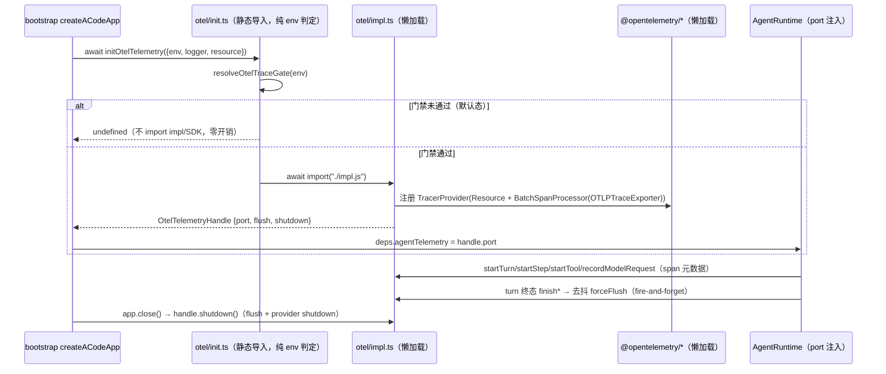

# 懒加载 OTel 遥测（无端点零开销零上报）

波 2 · WI-14。机制参照 oh-my-pi（MIT，`packages/coding-agent/src/telemetry-export.ts` 与
`telemetry-export-otlp.ts`）：无 OTLP 端点即完全 no-op（SDK 模块图不加载）、
`OTEL_SDK_DISABLED` kill-switch、仅支持 `http/protobuf`（`grpc`/`http/json` 显式拒绝防误路由）、
turn 边界主动 flush。本 spec 只覆盖 **traces**；metrics/logs 与本地用量仪表盘（omp-stats
对应物）登记不做。

## 与 no-telemetry.md 的关系

`specs/no-telemetry.md`（审计版）删除了常开 exporter 与身份注入。本 spec 在保留其隐私删除面的
前提下，把 tracing 边界改为 **env 门禁 opt-in、默认 no-op**：

- 保留：`packages/shared/src/runtimeEnv.ts` 对工具/Bash/MCP 子进程的 `OTEL_*`、
  `ACODE_TELEMETRY_*` 剔除（OTLP headers 携带 ingest 凭据，不得泄漏给不可信子进程）。
- 保留：`packages/desktop/src/main/desktopTelemetryPolicy.ts` 对 Host 进程 env 的遥测剔除
  ——桌面下被托管 Agent 的 trace 透传不在本波（见「已知限制」）。
- 恢复：CLI 独立进程（terminal 直跑）在用户显式配置 `OTEL_EXPORTER_OTLP_*` 端点后导出
  GenAI 语义约定 traces；desktop main 进程仅初始化进程级 Resource 身份。
- 不恢复：OAuth 身份读取、遥测身份注入（`userSubjectId` 等 PII 不进 span，见隐私节）。

## 开关矩阵（traces 信号）

判定顺序自上而下，命中即停；除「启用」行外全部为完全 no-op——**impl 模块不被 import，
OTel SDK 模块图不加载，默认启动路径零开销**：

| # | 条件 | 结果 |
|---|------|------|
| 1 | `ACODE_TELEMETRY` ∈ {`0`,`false`,`off`}（大小写不敏感，trim） | 强制 no-op（用户 opt-out 总开关） |
| 2 | `OTEL_SDK_DISABLED` = `true`（大小写不敏感） | no-op（OTel 标准 kill-switch） |
| 3 | `OTEL_TRACES_EXPORTER` 列表含 `none` | no-op |
| 4 | `OTEL_TRACES_EXPORTER` 有非空选择且不含 `otlp` | no-op |
| 5 | 无 `OTEL_EXPORTER_OTLP_TRACES_ENDPOINT` 且无 `OTEL_EXPORTER_OTLP_ENDPOINT` | no-op（**默认态**） |
| 6 | `OTEL_EXPORTER_OTLP_TRACES_PROTOCOL ?? OTEL_EXPORTER_OTLP_PROTOCOL` 显式设置且 ≠ `http/protobuf` | **拒绝**：no-op + `warn` 日志给出明确错误（`OTEL trace export disabled: protocol <p> is unsupported; only http/protobuf is supported`），防止把 protobuf 载荷误路由到 grpc/json 端点 |
| 7 | 其余（有端点） | 启用 traces 导出 |

`ACODE_TELEMETRY=1` 不构成强制启用：端点存在与否仍是唯一启用条件（第 5 行），总开关只有
「关」的语义，避免误开上报。端点、headers、压缩等连接参数由 OTLP exporter 自行读取标准
`OTEL_EXPORTER_OTLP_*` env（SDK 内建行为），本模块不重复解析、不落日志（headers 含凭据）。

## 懒加载时序



幂等：进程内 `initOtelTelemetry` 只装配一次（单 initPromise）；重复调用返回同一 handle。
失败 containment：装配或导出异常一律降级为 no-op + `warn` 日志，绝不阻断 app 启动或 turn。

## Span 层级与命名

复用既有 `AgentExecutionTelemetryPort` 面（contracts/telemetry，runtime 已全量插桩，
默认 NOOP）；本波只提供 OTel 实现，不为遥测改业务插点。唯一新增插点：模型请求事实
（见下）。

```text
invoke_agent            turn（startTurn；causation=child 时挂远端父，linked_root 时根 span+Link）
└─ agent_step           step（startStep，模型步）
   ├─ chat {model}      模型请求（recordModelRequest 事实回填，显式 startTime/endTime）
   └─ execute_tool {n}  工具调用（startTool；n=registeredToolName）
      └─ command {safeName}  Bash 命令子 span（startCommand）
context_compaction      compaction（startCompaction，独立 span，处于 turn scope 内）
{operation}             detached 操作（startDetachedOperation：标题生成/记忆抽取等）
```

嵌套父子关系由 `AsyncLocalStorageContextManager` + 各 writer 的 `run()` 作用域自动建立；
runtime 既有 `scope.run()` 包裹点（turn/step/tool/compaction/detached）即 OTel context 边界。
模型请求 span 在 `recordModelUsageFact`（runtime/methods/usage-observability.ts，所有模型
用量事实的单一 producer）收口处以显式 `startTime=startedAt`、`endTime=completedAt` 回填，
因此天然落在当时活跃的 step/turn scope 下，覆盖 main turn、compact、sidecar 全部来源
（`querySource` 区分）。

## 属性白名单（隐私红线）

**span 属性绝不携带提示词正文、模型输出、工具参数、文件内容、命令全文、凭据。** 只允许
名称、时长、token 数、状态/错误码级别的元数据。实现侧用封闭白名单构造属性（非白名单键
在构造层直接丢弃），并由单测断言。

Resource（进程级）：`service.name`（`acode-cli` / `acode-desktop`）、`service.version`
（app 版本）、`service.instance.id`（CLI=app sessionId；desktop=进程启动 UUID）、
`os.type`（平台）、`OTEL_SERVICE_NAME`/`OTEL_RESOURCE_ATTRIBUTES`（env detector，用户自配，
后者优先级最高，同 omp）。

| Span | 允许属性 |
|------|----------|
| invoke_agent (turn) | `gen_ai.operation.name`=invoke_agent、`gen_ai.agent.name`、`gen_ai.conversation.id`（=会话 id）、`acode.session.id`、`acode.turn.id`、`acode.turn.number`、`acode.query.id`、`acode.actor.kind`、`acode.launch.surface`、`acode.input.source`、`acode.parent.session.id`、`acode.parent.turn.id`、终态：`acode.turn.result` / `acode.failure.stage` / `acode.error.category` / `acode.cancellation.reason` / `acode.abandon.reason` / `error.type`（Error.name 或分类枚举，不含 message） |
| agent_step | `acode.step.id`、`acode.step.index`、终态：`acode.step.result` / `acode.failure.stage` / `acode.error.category` / `acode.cancellation.reason` / `error.type` |
| chat {model} | `gen_ai.operation.name`=chat、`gen_ai.provider.name`（providerId）、`gen_ai.request.model`、`gen_ai.usage.input_tokens`、`gen_ai.usage.output_tokens`、`gen_ai.usage.reasoning_tokens`*、`gen_ai.usage.cache_read_tokens`*、`gen_ai.usage.cache_write_tokens`*、`gen_ai.response.finish_reasons`（数组）、`gen_ai.response.model`*、`acode.query.source`、`acode.request.status`、`acode.request.duration_ms`、`acode.request.ttft_ms`*、`acode.request.retry_count`、`acode.request.context_exceeded`、`acode.error.type` / `acode.error.code`（枚举/代码，**不含 errorMessage**）、`acode.reasoning.level`（* 号=有值才写）。成本：现有 usage 面无成本数据（`ModelUsage` 不含 cost），本波不写成本属性，登记为限制 |
| execute_tool {n} | `gen_ai.operation.name`=execute_tool、`gen_ai.tool.name`（注册名）、`gen_ai.tool.call.id`、`acode.permission.decision`、`acode.permission.requested`、`acode.output.bytes`、`acode.output.truncated`、终态：`acode.tool.result` / `acode.failure.stage` / `acode.error.category` / `acode.cancellation.reason` / `error.type` |
| command {safeName} | `acode.command.safe_name`（既有消毒名，非命令全文）、`acode.command.category`、`acode.command.count`、`acode.command.shell_kind`、`acode.command.sandboxed`、`acode.command.exit_code`、`acode.command.signal`、`acode.command.timed_out`、`acode.command.output_bytes`、`acode.command.backgrounded`、终态字段同上 |
| context_compaction | `gen_ai.operation.name`=context_compaction*、`acode.compaction.phase`、`acode.compaction.trigger`、`acode.compaction.model_mode`、`acode.compaction.threshold_tokens`、`acode.compaction.policy_context_window_tokens`、`acode.compaction.token_source`、`acode.usage.input_tokens`、`acode.usage.output_tokens`、`acode.compaction.fallback_reason`、终态字段同上 |
| detached {operation} | `gen_ai.operation.name`={operation}、`acode.operation.execution_kind`、`acode.operation.trigger`、`acode.operation.target_kind`、`acode.operation.chunk_index`、`acode.operation.chunk_count`、`acode.operation.goal_iteration`、`acode.result.type`、终态字段同上 |

跨进程因果（`AgentTelemetryCausation`）只透传 trace/span id 与 traceFlags——已是既有契约，
不新增身份字段。span 事件（exception）只记 `error.type` 级别信息，不记 stack/message 正文
（stack 可能内嵌提示词片段与路径）。

## 落点与分层

- **CLI**：`apps/acode-cli/packages/core/src/telemetry/otel/`（新模块，acode-cli 为非纳管
  模块，无 layer 约束；与既有 `telemetry/runtime-telemetry.ts` facade 同域）。
  - `env-gate.ts`：纯 env 判定（无 OTel import，可单测）。
  - `init.ts`：门禁 + `await import("./impl.js")` + 幂等 + 装载探针（诊断/单测用）。
  - `impl.ts` / `spans.ts`：SDK 注册与 `AgentExecutionTelemetryPort` 实现（仅懒加载图内）。
  - `attributes.ts`：白名单属性构造。**所有 `@opentelemetry/*` import 只出现在
    impl/spans/attributes（懒加载图），init/gate 静态图零 OTel 依赖。**
- **装配**：bootstrap `app/create-app.ts` 最小插点——init handle、`AgentRuntime` deps 注入
  `agentTelemetry`、`close()` 中 shutdown。
- **模型请求插点**：`runtime/methods/usage-observability.ts` 的 `recordModelUsageFact` 头部
  一处调用（先于 usageStore 早退，遥测不依赖 SQLite 观测面存在）；facade
  （`telemetry/runtime-telemetry.ts`）新增 `recordModelRequest(fact)` 以结构化能力探测转发，
  NOOP port 无此方法即静默——contracts 不改。
- **desktop main**：`packages/desktop/src/main/desktopTelemetry.ts`（门禁语义与 CLI 同款，
  独立小实现，desktop 不依赖 CLI core 包）；`app.whenReady` 内一行 fire-and-forget 初始化，
  仅注册进程级 Resource（app 版本/平台/进程会话 UUID），**不产 desktop 业务 span**；
  `will-quit` 时 shutdown。tsup main 产物中 `@opentelemetry/*` 为 package.json dependencies
  → 默认 external，动态 import 不被内联，禁用态零加载。审计守卫测试
  `packages/desktop/tests/no-telemetry.test.mjs` 同步修订（WI-14 边界）：`@opentelemetry/`
  只允许出现在 desktopTelemetry.ts 且必须是函数内动态 import（静态 import 即守卫失败），
  该文件必须保留端点门禁/opt-out/kill-switch 字样；package.json 的 @opentelemetry 依赖
  钉死为最小四件套；@arms、常开 exporter、IPC 遥测桥的禁止面原样保留。

实现注记（OTel JS 2.x API 面，与 omp 所用 1.x 习惯不同处）：`TracerProvider` 不再有
`register()`——全局注册走 `context.setGlobalContextManager(new AsyncLocalStorageContextManager().enable())`
+ `trace.setGlobalTracerProvider(provider)`；`ReadableSpan` 用 `parentSpanContext`（无
`parentSpanId`）；`InMemorySpanExporter` 经 `@opentelemetry/sdk-trace-base` 再导出。

## Flush 时序

1. **turn 边界主动 flush**（omp 同款语义）：turn span 任一终态（completed/failed/cancelled）
   触发去抖 `forceFlush()`（fire-and-forget，自带 catch，不阻断 turn）。
2. 周期 flush：30s `setInterval(...).unref()`，长驻进程（ACP/协议入口）不等批窗口。
3. `app.close()` / desktop `will-quit`：`shutdown()`（flush + provider shutdown，超时上限
   5s）。崩溃退出丢批内 span 是 BatchSpanProcessor 固有语义，接受（同 omp）。
4. 导出失败只 `debug`/`warn` 日志（OTel diag 走 logger 分级），永不抛出到业务路径。

## 验证场景

- 门禁矩阵单测：上表 7 行逐行断言（env-gate 纯函数）。
- no-op 装载探针单测：无端点 env 调 `initOtelTelemetry` → 返回 undefined 且 impl 模块
  未被加载（探针标志断言）。
- grpc/http-json 拒绝单测：显式协议 → 禁用 + warn 文案含 `unsupported`。
- 属性白名单单测：InMemorySpanExporter 收 span，构造 turn/step/tool/model-request 全链路
  （入参故意携带「内容形态」字符串），断言导出属性键 ⊆ 白名单且无值等于内容样本。
- flush 时序单测：turn 终态后批内 span 已到达 exporter（无需手动 flush）。
- stub OTLP server 验证：本机 HTTP stub 收 `/v1/traces` POST——真实 OTLPTraceExporter
  （http/protobuf）导出成功、turn 去抖 flush 到达、懒加载探针只在启用态翻转
  （手工执行，非 CI 门禁；真实 OTLP collector/Jaeger 验证不在本波）。

## 移植来源与署名

机制参照 oh-my-pi（MIT License）：
- 懒加载 + 端点门禁 + kill-switch：`telemetry-export.ts`（`initTelemetryExport`/
  `signalEnabled`，:79-156）。
- 仅 http/protobuf、grpc/json 显式拒绝：`telemetry-export.ts`:148-154。
- Resource env detector 合并顺序、BatchSpanProcessor、30s unref 周期 flush、turn 边界
  flush：`telemetry-export-otlp.ts`:150-206、:443-449。
本实现为 TypeScript 重写（非逐行拷贝），GenAI 属性对齐 OpenTelemetry GenAI 语义约定。

## 已知限制（登记不做）

- metrics/logs 信号、`OTEL_LOG_LEVEL` 日志桥：登记不做（波外）。
- omp-stats 对应物（本地 SQLite 用量仪表盘）：登记不做——ACode 已有 usageStore 观测面。
- 成本属性：现有 usage 面无成本数据，不写。
- 桌面下被托管 Agent（Host 进程）的 trace：`desktopTelemetryPolicy` 仍剔除 Host env 的
  `OTEL_*`（审计版策略，未在本波翻转），desktop 下仅 main 进程 Resource 身份生效。
- workflow-facade / script-workflow 子 runtime 的 port 透传未新增（subagent 路径已有透传）。
- `third-party/inventory.json` 发布台账（U13 inputs-only 门禁）记录 package.json/lockfile
  哈希：本波依赖变更后台账过期属预期，须由编排器在波收口后按 CI Linux 规范统一重生成
  （该文件为共享桶，本 WI 不改；台账另有波前已提交的漂移项，非本波引入）。
- 无真实 OTLP collector（Jaeger/ARMS）的端到端验证；stub server 已验证 exporter 线路。
