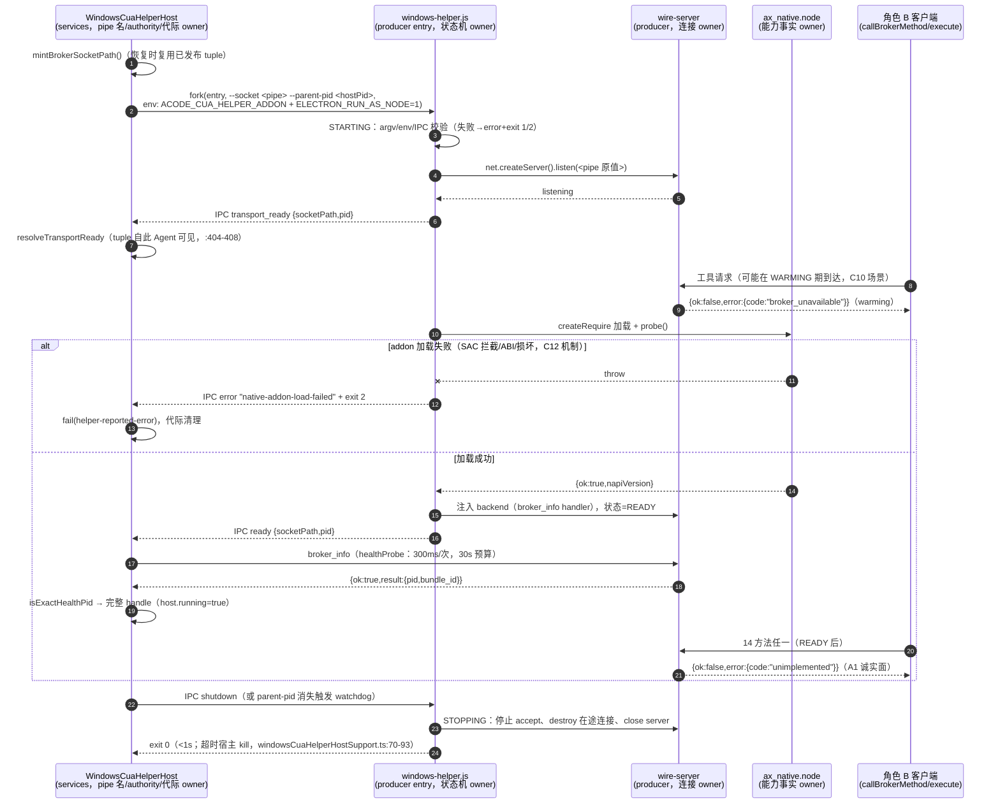

# Spec: Windows CUA 原生 producer（角色 A）——全实现面契约（A1/A2 已落地 + A3/阶段 4）

> 状态：角色 A 全实现面契约。§1–§7 = A1（阶段 2 角色 A 切片 1，**已落地**，提交 `1ef8108`）；
> §10 = A2（指针/键盘/剪贴板 + WGC 截图 + delivery-state 派发契约，**已落地**——2026-10-14
> A2 实现批次，实现期实证回写见 §18，债务项 §17.2/§17.3 同批修复）；§11 = A3（UIA 六工具）；
> §12 = 阶段 4（平台判定收口）；§13 = 14 工具全映射表；§14 = C08 可执行交付物；
> §15 = 真机烟测契约（`scripts/smoke-real.mjs`）；§16 = 各阶段 AC 验收清单；
> §17 = A1 评审债务回写（含全文行号修正对照）；§18 = A2 实现批次实证回写。
> §4.2/§4.3 原「A2 spec / 阶段 3 spec 钉死」的预留项**已由 §10/§11 钉死**（本文即 A2/A3 spec；
> 原节保留为预留历史与机制索引，冲突时以 §10/§11 为准）。§8/§9 维持原编号不重排——外部文档
> （handoff、wire spec、module-boundary）按「§1.2/§4.6/§8 oQ#n」引用本文，重排会悬空这些引用；
> 新章节一律追加为 §10+。
> 本文是 ACode 原创规范：上游材料只作机制参照并逐条注明出处，不复制上游表达（复制表达会触发
> `third-party/` 台账登记义务，而台账重生成只能在 CI-Linux 落绿，见 `z-work/u14-handoff.md` §4）。

## 0. 本文地位、权威层级与出处约定

`cua-producer/` 是 U14 阶段 2 **角色 A**（Helper 侧原生 producer）的落点（决策二，
`docs/upgrades/product-and-support-2026-10.md` §7.8，已裁决不重开）。本文钉死角色 A 全部交付面
（A1 已落地 + A2/A3/阶段 4 契约）的产品规则、状态所有者、接口与验收场景；实现前不得偏离，
偏离须先改本文。阶段 4 的判定面改动虽落在宿主文件（`packages/shared`、`packages/desktop`、
`apps/acode-cli/packages/contracts`），其**设计契约**收口在本文 §12（范围 = 计划书 §7.5 阶段 4
列举的判定面收口 + 本批次源码核查增补的第四处同型字面量）；宿主文件的实际修改由阶段 4
实现批次按 §12 执行。

权威层级（冲突时上位优先）：

1. **已裁决事项**（不重开）：三项架构决策 + 角色范围洞三分裁决（计划文档 §7.8）；
   工具链裁决 node-gyp 13 / producer 自带 devDependency / 禁根 pnpm override
   （2026-10-14，`z-work/u14-handoff.md` §8）；warming-up 翻译方案 (b)（wire spec §5.4）。
2. **链路乙 wire 契约**：`packages/acode-cua/specs/broker-wire-protocol.md`（下称 wire spec）——
   Helper 服务端行为的单一事实源。本文只钉 producer 侧实现细节，不复述、不修改 wire 契约。
3. **宿主既成事实**（源码即契约，本文只登记不改动）：
   `packages/services/src/cua-permission-broker/` 的解析/生命周期/ready 消息校验。
4. **本文**：producer 模块边界、进程时序、addon 接口面、构建契约、A1 测试与验收；
   A2/A3 切片契约（§10/§11）、阶段 4 判定面设计契约（§12）、14 工具映射（§13）、
   C08 交付物（§14）、真机烟测（§15）与各阶段验收（§16）。

出处标注三类（沿用 wire spec §0 约定）：`本仓 <路径>:<行号>`（均已 Read 核实）；
`上游 <相对路径>:<行号>`（staging `C:/Users/ZhuanZ/AppData/Local/Temp/claude/cua-upstream-ref/`
下 `clone-attempt/ZCode/`，PROVENANCE：zai-org/ZCode v3.15.1，Apache-2.0，Copyright 2026
Z.AI Co., Ltd——只参照机制，不复制表达）；`【ACode 自定】`（权威材料未钉死、本文裁决并给论证）。
**上游 SDK 客户端引用约定（§10/§11 沿用 wire spec 同型简写）**：`computer-use-client.mjs:<行号>`
指 staging `upstream/apps/zcode-cli/packages/zcode-cua-plugin/scripts/computer-use-client.mjs`
（Apache-2.0 同 provenance；本批全部行号经该文件 grep/sed 核实）；其余上游引用默认
`clone-attempt/ZCode/docs/` 下的设计文档。

## 1. 模块边界与状态所有者

### 1.1 同名双包：host 面 vs Helper 面

仓内存在两个 `name: "@acode/acode-cua"` 的包，是两个角色、两条加载路径（骨架 README 已登记，
`cua-producer/README.md`「为什么这里有个和 packages/acode-cua 同名的包」节）：

|        | 角色 B（`packages/acode-cua`）              | 角色 A（本目录 `cua-producer/`）                                                        |
| ------ | ------------------------------------------- | --------------------------------------------------------------------------------------- |
| 内容   | host 侧 broker RPC 客户端 + 编排，纯 JS     | Helper 进程：`dist/windows-helper.js` + `build/Release/ax_native.node` + wire 服务端      |
| 加载   | 按名 import（`workspace:*`，pnpm 解析）     | 按路径 fork（dev `ACODE_CUA_DEV_ROOT` / 产品 `resources/tools/cua-helper`）               |
| 进程   | host / agent / node-repl-host 内            | 独立 Helper 子进程（`ELECTRON_RUN_AS_NODE=1`，本仓 windowsCuaDevRuntime.ts:149）          |
| 治理   | workspace 模块（架构检查、knip、不变量 1-4） | `SKIP_DIRECTORIES` 排除（本仓 scripts/architecture/discovery.mjs:7，实测含 `cua-producer`） |

**解析隔离（硬规则）**：Helper 运行时进程的模块解析只允许三个来源——
① `node:` 内建；② `cua-producer/dist/` 内部相对导入；③ 经 `createRequire` 以**绝对路径**加载
`ax_native.node`（路径来自 env，见 §2.1）。**禁止任何裸包名 import**。论证（两条独立充分）：

- **产品模式自足**：staged 产品根（`resources/tools/cua-helper`）由阶段 5 的 staging 脚本产出，
  宿主解析只校验 entry/addon 两个 artifact（本仓 windowsCuaDevRuntime.ts:197-224），不携带任何
  `node_modules/@acode/*`；裸 import 在产品模式必断。
- **dev 模式同样解析不到**：仓根 `node_modules/` 不存在 `@acode` scope（本机实测 grep 零命中——
  pnpm 只把 workspace 包链进各依赖方的 `node_modules`，`cua-producer` 在 glob 外不在任何
  依赖图里）。即「Helper 按名 import 占位包」在两种模式下都不存在可行的解析路径。

### 1.2 裁决：wire 服务端由 producer 自建，不回填占位包

计划文档 §7.5 阶段 2 角色 A 一句「消费 `broker.js` 的 Helper 服务端三件套
（`dispatchRequest`/`handleRequestLine`/`parseRequestLine`）与 `broker-server.js` 的原生 seam」
存在两种读法：(a) producer 运行时 import 占位包里的占位函数并等其回填；(b) producer 按 wire spec
在自有树内实现同语义原语。**本文裁决为 (b)——自建，占位包三件套与原生 seam 永不回填**，理由：

1. **物理不可行**：§1.1 已证两种加载模式下 Helper 都解析不到 `@acode/acode-cua`；读法 (a) 无实现路径。
2. **治理死局**：`packages/acode-cua/broker.js` 全文逐字派生自上游 Apache-2.0（wire spec §8.5
   已 diff 核实且**尚未登记台账**）。回填 = 修改 copied 文件 = 须同批加 `"Modified by ACode:"`
   注释 + `copied-components.json` 登记 + CI-Linux 重生成 `inventory.json`/`THIRD-PARTY-NOTICES.md`
   （`z-work/u14-handoff.md` §4 硬边界：该原子单元无法在 Windows 落绿）。producer 自建 = ACode
   原创表达，机制参照 wire spec（其本身是 ACode 自著的契约驱动文档），零台账义务。
3. **占位包治理约束**：不变量 3/4（module-boundary.md「不变量 3」「不变量 4」）禁止改 `.d.ts`、
   新增导出、引入构建步骤；三件套当前占位（本仓 broker.js:283-285/306-312，恒 undefined/throw）
   且**全仓 0 host 消费者**（wire spec §9），回填无收益只有风险。
4. **wire spec 本就如此设计**：其 §0 自述为「契约驱动自写」的单一事实源，两端各自实现——角色 B
   客户端已按它落地（本仓 broker.js:91-262），角色 A 服务端按它自建是对称的既定路径。§9 的
   「三者在物理上位于 broker.js」是对占位所在地的描述，不是实现地点指令。

**推论**：`broker-server.js` 的原生 seam（`loadRealNativeAddon`/`resolvePackagedNativeAddonPath`/
`resolveInTreeAddonPath`/`createAxReadOnlyMethods`/`ROLE_TO_KIND`/`roleToKind`，本仓
broker-server.js:45-65）同理不回填——producer 自带 native 加载器（§2.1），seam 占位保持
fail-closed。module-boundary.md 不变量 1 栏②「Helper 服务端（随角色 A 的 windows-helper.js）」
的措辞需随之校准为「角色 A 已在 producer 树内自建实现；broker.js/broker-server.js 占位保留
API 兼容、不再回填」——该文件不在本文改动范围，登记为 openQuestion #1。

### 1.3 状态所有权（唯一所有者原则）

| 状态                       | 唯一所有者                     | 说明                                                                                                     |
| -------------------------- | ------------------------------ | ---------------------------------------------------------------------------------------------------------- |
| pipe 名（socketPath）      | host（`WindowsCuaHelperHost`） | host 铸（`defaultSocketPathFactory = mintBrokerSocketPath`，本仓 windowsCuaHelperHostSupport.ts:63）；恢复时复用已发布 tuple（windowsCuaDevHelperHost.ts:63/137/308）。Helper 只 bind，**绝不自铸、绝不改名** |
| `pluginAuthority`          | host（内存态）                 | 每 host 实例铸一次（windowsCuaDevHelperHost.ts:34/88）；只经 env 交 agent（node.ts:1172-1227）；**Helper 全程不接触**（§3.1）        |
| 代际/生命周期线性化        | host                           | lifecycleTail 串行（windowsCuaDevHelperHost.ts:47-49/233-243）；Helper 无跨代记忆                              |
| ready/warming 状态机       | Helper 进程内                  | 单进程内存态，不落盘、不跨进程共享（§2.4）                                                                    |
| backend（方法→handler 注册表） | Helper 进程内               | wire spec §9.3 的注入 seam；A1 只注册 `broker_info`（§2.5）                                                    |
| 每条 wire 连接             | Helper 的连接处理器            | 单连接单请求（wire spec §1.2）；响应后 server 侧 `end()`；客户端（角色 B）负责 destroy                        |
| 原生能力事实               | addon                          | 能力只经导出面诚实暴露（§4.6）；JS 层不猜测、不缓存能力声明                                                    |
| 输入 admission 队列（A2+） | Helper 进程内会话层（`input-session`） | 变更/观察类 native 派发全局串行（并发=1）、队列有界；`stop_computer_control` 与 `broker_info`/`request_access` 旁路（§10.5） |
| held-input 注册表（A2+）   | addon native 层                | 被按下的鼠标键/按住键的唯一事实源；一切退出路径先幂等释放再 exit（§10.4/§10.8）                                |
| frame 注册表（A2+）        | Helper 进程内会话层            | `frame_id` → 栅格几何/bounds/owner/显示拓扑世代；坐标投影与 stale 判定的事实源（§10.7）                        |
| 元素/窗口注册表（A3）      | native（COM 引用）+ 会话层（元数据） | `state_id`→冻结 UIA 元素引用（COM 引用绝不出 MTA worker）；`window_id`→HWND+身份快照（§11.5）             |

Helper **无持久状态、无磁盘写入**——该不变量在 A2/A3 钉死后**仍然成立**：截图走内联 base64，
`image_ref` 落盘 artifact **不启用**（宿主 frame-contract 面当前全部 fail-closed 占位——本仓
frame-contract.js:7-37 恒 false/undefined/passthrough，本批核实；启用 image_ref 须宿主实现先落地，
见 §10.7 与 §8 oQ9）。A2/A3 引入的进程内可变状态 = 上表四个注册表/队列，全部是单进程内存态、
随进程消亡；仍无跨代记忆、无磁盘写入、无 stdout 输出（§2.7 纪律不变）。

## 2. 进程模型与就绪时序

### 2.1 fork 面（宿主既成事实，Helper 必须适配）

宿主 fork（本仓 windowsCuaDevHelperHost.ts:309-326）：

- **argv**（entry 之后的 args）：`["--socket", <pipe 名>, "--parent-pid", <host pid 十进制串>]`。
- **env**：`{ ...process.env, ELECTRON_RUN_AS_NODE: "1", ACODE_CUA_HELPER_ADDON: <addon 绝对路径> }`
  （`ADDON_ENV` = `HELPER_ADDON_ENV` = `"ACODE_CUA_HELPER_ADDON"`，本仓 broker-server.js:3、
  windowsCuaHelperHostSupport.ts:16；addon 路径由宿主解析并保证是 dev root 内的非链接普通文件，
  windowsCuaDevRuntime.ts:134-142）。
- **cwd**：producer root（`runtime.root`，windowsCuaDevHelperHost.ts:319）。Helper 自我定位一律用
  `import.meta.url`，不依赖 cwd（cwd 是宿主实现细节，非契约）。
- **IPC**：`nodeFork` 默认带 IPC 通道（windowsCuaHelperHostSupport.ts:55-61）；控制消息只走 IPC。

Helper 侧 argv/env 契约【ACode 自定，实现须遵守】：

- argv 解析用**严格白名单**：只接受 `--socket <非空串，win32 上必须以 `\\.\pipe\` 前缀开头>` 与
  `--parent-pid <正整数>`，两者必现且各一次；出现未知 flag、缺失、重复、前缀不符 → 启动失败
  （§2.7 错误面 `invalid-helper-arguments`，exit 1）。前缀校验防止把任意文件系统路径交给
  `net.listen`（fail-closed 方向）。
- addon 路径**只**取自 `ACODE_CUA_HELPER_ADDON`（唯一来源；缺失 → `native-addon-env-missing`，
  exit 2）。不回退契约相对路径 `build/Release/ax_native.node`——宿主两种模式（dev/产品）都已注入
  该 env，回退会让「宿主接线错误」被静默掩盖，违反 fail-closed。
- `process.send` 不可用（非 fork 启动）→ 无法向宿主报告任何事，stderr 写稳定字面量后 exit 1
  （`missing-ipc-channel`）。
- `process.platform !== "win32"` → IPC error `unsupported-platform` + exit 1（宿主解析层已挡
  non-win32，windowsCuaDevRuntime.ts:82-87，此处是双保险）。

### 2.2 控制消息（IPC）精确形态

控制协议常量 `WINDOWS_DEV_CONTROL_PROTOCOL = "acode-cua-windows-dev/v1"`（本仓 broker-server.js:4，
经 windowsCuaHelperHostSupport.ts:10/15 别名 `CONTROL_PROTOCOL`）。宿主校验函数
`parseReadyMessage`（本仓 windowsCuaHelperHostSupport.ts:205-231，行号已按当前检出修正，§17.1）
是消息形态的**裁决者**，Helper 发送面必须逐字段满足：

- **transport_ready**（named pipe 已 bind，功能层未就绪）：
  ```json
  { "protocol": "acode-cua-windows-dev/v1", "type": "transport_ready",
    "socketPath": "\\\\.\\pipe\\acode-cua-broker-<uuid>", "pid": <Helper 自身 process.pid> }
  ```
  （JSON 转义示意；进程内对象即 `{protocol, type, socketPath, pid}` 经 `process.send` 发送，
  不手工序列化。`socketPath` 必须是 argv `--socket` 原值回显，`pid` 必须是正整数
  `process.pid`——宿主 :218-224 校验非空串 + 正整数，:401 校验与本代 mint 值全等（不等则**静默
  忽略**该消息），:402-403 校验与 fork 出的 child.pid 全等（不等则 fail `ready-pid-mismatch`）。）
- **ready**（功能层就绪，可受理 health 探测）：同形态，`type: "ready"`。宿主收到后发起
  `healthProbe`（windowsCuaDevHelperHost.ts:408-441，300ms/次、30s 预算，wire spec §6.3）。
- **error**（Helper 自报启动失败）：`{ protocol, type: "error", message: <非空稳定字面量> }`
  （parseReadyMessage :211-216 要求 message 为非空字符串，否则整条被判 malformed）。宿主转
  `fail(new Error(message), "helper-reported-error")`（windowsCuaDevHelperHost.ts:396-399），该
  message 会进宿主日志（node.ts:1237 通路）——**只允许 §2.7 枚举的稳定失败类别字面量，禁止
  插值任何动态内容**（wire spec §9.2 第 5 条隐私硬约束：不得含窗口标题/元素名/文本内容；本文
  收紧为完全无插值）。
- **入站 shutdown**：宿主经 IPC 发 `{ protocol, type: "shutdown" }`（windowsCuaHelperHostSupport.ts:95-101）。
  Helper 收到即进 STOPPING（§2.4）。其它入站消息（协议不符或未知 type）一律忽略——与宿主
  parseReadyMessage 对未知 type 返回 `"ignore"` 的前向兼容语义对称（:202-203/217）。

顺序契约：**transport_ready 必须先于 ready**，且各恰好发送一次（宿主对同一代重复 ready 无完整
幂等保护——每条匹配消息都会重入 resolveTransport 并再次发起 healthProbe，:404-409——Helper
不得依赖宿主容错）。

### 2.3 named pipe 路径来源（裁决：host 传入，Helper 不自铸）

pipe 名由 host 唯一铸造并经 argv 传入；Helper 逐字 bind、逐字回显。依据：wire spec §1.1
（「名由 Host 铸造…`mintBrokerSocketPath` 只负责产出格式；铸一次并复用的稳定性是调用方
`WindowsCuaHelperHost` 的职责」）；宿主现状 windowsCuaDevHelperHost.ts:308
（`preservedTransport?.socketPath ?? this.mintSocketPath()`）与 :401（回显不符即忽略）。
Helper 自铸会导致宿主永远等不到匹配消息（30s startup-timeout），属结构性故障，无任何回退价值。

bind 失败（名字被占/权限拒绝等）→ IPC error `transport-bind-failed` + exit 1，**不回退到其它
名字**。宿主 lifecycle tail 保证上一代 exact child 退出后才 fresh fork（windowsCuaDevHelperHost.ts:47-49），
正常不撞名；撞名即环境异常，诚实失败。

### 2.4 状态机与事件顺序（含所有者）



状态定义【ACode 自定，与上游两阶段机制对齐（上游 windows-transport-ready.md:9-26：bind→
transport_ready→load native + build backend→ready）】：

- **STARTING**：进程起、listen 前。无 wire 面。任何校验失败 → FAILED。
- **WARMING**：pipe 已 bind、transport_ready 已发、功能层（addon 加载 + backend 构建）未完成。
  所有 wire 请求（**含 `broker_info`**）→ `broker_unavailable`（§2.5）。
- **READY**：ready 已发。`broker_info` 诚实应答；A1 的 14 方法一律 `unimplemented`（§4.6）。
- **STOPPING**：shutdown 消息或 watchdog 触发；只拆连接不再应答；出口 exit 0。
- **FAILED**：发 error 消息（若有 IPC）后按 §2.7 退出码退出。状态只前进不回退，READY 后不得
  回到 WARMING（能力退化属 A2+ 的 per-capability 状态设计，A1 不引入）。

### 2.5 warming-up 语义（C10 机制面）

- READY 之前到达的**任何** wire 请求（14 方法 + `broker_info` + 未知方法）统一应答
  `{ok:false, error:{message:"Computer Use Helper is starting up.", code:"broker_unavailable"}}`。
  【ACode 自定】把 `broker_info` 也纳入 warming 门是比 wire spec §6 更严的选择，论证：
  「ready 代表完整 health probe 成功」（上游 windows-transport-ready.md:26）——若 warming 期就
  应答 broker_info，设置页 300ms ping（wire spec §6.3）会在功能层未就绪时把 Helper 报成健康，
  与两阶段就绪的语义相反；宿主自己的 healthProbe 只在收到 ready 后才发起
  （windowsCuaDevHelperHost.ts:408-409），门掉 broker_info 对启动链路零影响。
- 下游语义由角色 B 既有实现承接（本文不改）：`broker_unavailable` → `execute` 翻译成
  `CUA_NOT_READY` 非-error 信封（retryable=true）→ SDK 退避重试 ≤6 次（wire spec §5.4 方案 (b)
  已裁决并落地，本仓 index.js:14/112-119）。`broker_unavailable` 只用于「请求未进 native」的
  warm-up 重试；A1 结构上保证这一点——WARMING 期请求根本不触达 backend/native。
- A1 的 WARMING 窗口 ≈ addon 加载耗时（数十 ms）；真实计时行为（C10 全量）属 A2（native 初始化
  变重后）。A1 以 wire-server 单元测试确定性覆盖状态机分支（§6.3），不靠集成测试抢时序。

### 2.6 连接处理与限额（服务端侧）

单连接单请求（wire spec §1.2 的服务端对偶）【ACode 自定，服务端硬化】：

- 每连接行缓冲上限 **1 MiB**（与客户端请求上限对称，wire spec §7.1）；超限 → 直接 `destroy()`
  不应答（客户端按「完整响应行到达前关闭」得 `broker_unavailable` + possiblySent=true，本仓
  broker.js:159-162——超大请求是客户端自身违约，该语义可接受）。
- 应答一行（`JSON.stringify(response)+"\n"`，wire spec §1.3/§3.1 同构、producer 内原创实现）后
  server 侧 `socket.end()`；同连接再收到请求行 → `destroy()`（协议违约不应答）。
- 连接空闲 30s → `destroy()`（对齐 wire spec §7.2 客户端缺省超时，防句柄泄漏）。
- server 不并发限流（每连接独立处理）；A1 无共享可变 native 状态，A2 引入输入序列化时须重审
  （变更类动作的 admission 串行属 A2 spec——**A2 已重审并钉死：所有派发 native 的操作经单一
  admission 队列串行、限流发生在 admission 而非连接层，见 §10.5**）。

### 2.7 失败面与退出码（封闭枚举）

IPC error 消息 / 退出码是**封闭表**，实现不得新增（新增须先改本文）；全部为稳定字面量、零插值：

| 场景                                             | IPC error message 字面量     | exit code | 依据                                                              |
| ------------------------------------------------ | ---------------------------- | --------- | -------------------------------------------------------------------- |
| argv/env 校验失败、平台不符、bind 失败、内部异常 | `invalid-helper-arguments` / `unsupported-platform` / `transport-bind-failed` / `internal-helper-failure` | 1         | 配置/环境类失败对齐上游「exit 1/2」约定（本仓 windowsCuaHelperHostSupport.ts:199-200 注释，行号按当前检出修正，§17.1） |
| `ACODE_CUA_HELPER_ADDON` 缺失                    | `native-addon-env-missing`   | 2         | C12「native addon blocked/unavailable 以退出码 2 报告」（计划文档 §7.6 C12；上游 windows-source-development.md:27-31 机制） |
| addon 加载失败（SAC 拦截、ABI 不符、文件损坏、路径不存在） | `native-addon-load-failed` | 2 | 同上；**绝不降级为「无 addon 模式」继续跑**（能力真实性，§4.6） |
| 无 IPC 通道（非 fork 启动）                      | （无法发 IPC；stderr 同名字面量） | 1    | 【ACode 自定】                                                        |
| 正常关闭（shutdown / parent 消失）               | —                            | 0         | 宿主终止链 1s 内须完成（windowsCuaHelperHostSupport.ts:70-93：sendShutdown→等→kill→等→blocker） |

未捕获异常/未处理 rejection：`process.on("uncaughtException"/"unhandledRejection")` → 尽力发
`internal-helper-failure` + exit 1。**stderr 纪律**：stderr 仅本地诊断（继承到宿主控制台，
windowsCuaDevHelperHost fork 未设 silent），可含错误 name/类别与栈，**不得含 socketPath、任何
凭据值、屏幕内容**（上游同纪律：日志复制前须删除 pipe 路径与凭据，上游
windows-source-development.md:264-266；本文将其机器化为「根本不打印」）。**stdout 纪律**：
Helper 永不写 stdout（控制面只有 IPC；stdout 继承到宿主控制台，写入即污染）。

### 2.8 parent-pid watchdog

【ACode 自定（上游材料只钉了「父进程消失后不遗留被按下的键」——那是 A2 输入纪律，计划文档
§7.5 阶段 2；进程级 orphan 防护无成文上游规范）】：每 2000ms `process.kill(parentPid, 0)` 探活；
`ESRCH` → 父进程消失 → 走 STOPPING 同路径清理并 exit 0（stderr 字面量 `parent-process-gone`）；
`EPERM` 及其它错误 → 视为存活（保守方向：宁可不退，不可误退）。定时器 `unref()`。A1 无输入
能力，orphan Helper 无副作用面；watchdog 防的是进程与 pipe 实例泄漏。A2 落地输入后，本 watchdog
是「父进程消失不遗留按住键」纪律（计划文档 §7.5 阶段 2）的触发器之一，届时 STOPPING 路径必须
先经 native 释放所有 held input 再退出（**A2 已钉死该义务与自适应轮询间隔：held 非空时收紧至
250ms，见 §10.4/§10.8——oQ6 随之闭合**）。

## 3. 安全

### 3.1 pluginAuthority 传递面（全链路，Helper 零接触）

`pluginAuthority` 是当前唯一敏感凭据（计划文档 §7.7 安全门槛）。**已核实的完整传递链**：

```
host 内存铸造（windowsCuaDevHelperHost.ts:34/88，randomBytes(16).hex）
  └→ 只随 CuaHelperHandle/tuple 存在于 host 内存（:97-99/404-407/422-431）
  └→ agent spawn env：{ACODE_CUA_PERMISSION_BROKER_SOCKET, ACODE_CUA_PLUGIN_AUTHORITY}
     （node.ts:1172-1173/1185-1186/1205-1206/1226-1227 —— env 传递，非 argv）
       └→ agent bootstrap 在 sanitize 前捕获进进程私有存储（shared/src/runtimeEnv.ts:139-176，
          socket+authority 必须成对，半组 fail-closed 清空）
       └→ 定向注入官方 plugin MCP 子进程 env（bootstrap/src/mcp-config.ts:150-166）
       └→ core 校验：只有 plugin id + authority 双匹配的 server 获得 CUA 项目授权共享
          （core/src/runtime/methods/mcp.ts:17-38——authority 是「配置出自可信 host 注入」的
          provenance 证明，防第三方仿造 computer-use server）
```

**Helper 进程不在链上**：宿主 fork env 只有 `ACODE_CUA_HELPER_ADDON` + `ELECTRON_RUN_AS_NODE`
（windowsCuaDevHelperHost.ts:320-325），无 authority；链路乙 wire 无 token（wire spec §2.3，
已裁决——「角色 B/A 不得因为『没有 token』而在 wire 上自造 token 字段」）。因此：

- Helper **不接收、不校验、不转发**任何 token；A1 不实现任何 wire 层鉴权（该已接受风险的登记与
  重评条件见 wire spec §2.3/openQuestion #5，本文不重开）。
- 防御纵深【ACode 自定】：即便未来某宿主版本把 authority 泄进继承 env（`...process.env`），
  Helper 也绝不读取 `ACODE_CUA_PLUGIN_AUTHORITY`、绝不把任何 env 值回显到 IPC/stdout/stderr/
  wire 响应。A1 测试以 canary 值断言该性质（§6.2 步骤 7）。

### 3.2 argv / 日志 / 错误文本红线

- child argv 白名单恒等于 `[entry, "--socket", <pipe>, "--parent-pid", <pid>]`（宿主侧既成事实；
  Helper 侧测试断言无多余项，§6.2 步骤 3）。凭据永不进 argv（计划文档 §7.7）。
- IPC error message 只用 §2.7 封闭字面量；wire error message 只用 §4.6 封闭字面量表；两者零插值
  → 结构上排除「窗口标题/元素名/文本内容/路径/凭据」进入宿主日志（wire spec §9.2 第 5 条 +
  计划文档 §7.7 隐私门槛的 producer 侧落实）。
- 上游同型验收（「token 未出现在 argv 或捕获日志」，上游 windows-product-runtime.md:238，
  行号按 staging 文件复核修正，§17.1）在 ACode 语境下对象是 pluginAuthority canary 与 pipe 路径
  （pipe 名即链路乙的全部访问控制，wire spec §2.3，故按凭据同级对待）。

### 3.3 pipe 访问控制现状（如实登记，不粉饰）

- A1 使用 Node `net.createServer().listen(<pipe 名>)`，**不附加显式 DACL/SecurityAttributes**，
  即沿用 Node/libuv 在 Windows 上的默认 named-pipe 安全属性。默认属性的精确 DACL 内容**本仓未
  实测**，如实登记为未验证项；可确认的边界是：链路乙无 token、无 peer 门（wire spec §2.3），
  实际访问控制 = pipe 名 128-bit 随机段不可枚举 + host 铸造 + 同 UID argv 可读（已接受风险，
  与「上游 Windows peer-identity gate 临时放开」同现状——上游
  windows-source-development.md:93-101：Windows 上任何本机进程都能连这条 pipe，peer 原语落地后
  门重新闭合）。
- **不得为验收自动关闭系统安全策略**；收紧措施（显式 DACL 限同 UID、native peer 原语）绑定
  wire spec openQuestion #5 的未来裁决，A1 不自造。

### 3.4 Smart App Control / 签名（C12 语义）

未经 Trusted Root Program CA 签名的 `ax_native.node` 在 SAC 强制模式下会被 Code Integrity 拒绝
加载——「成功编译不等于当前机器可执行」（计划文档 §7.8 决策一附注；上游
windows-source-development.md:27-31 机制）。A1 落实：加载失败一律走 §2.7 `native-addon-load-failed`
+ exit 2（诚实报告 blocked/unavailable），宿主经 helper-reported-error 失败该代——不静默降级、
不重试绕过、不提示用户关安全策略。产品签名闭环属阶段 5，不在 A1。

## 4. addon 接口面（ax_native.node）

### 4.1 A1 导出（诚实 probe/version 面，精确签名）

```ts
// build/Release/ax_native.node（CommonJS .node，经 createRequire 加载）
export const addonVersion: string;   // producer native 版本常量（A1 取 package.json version "0.0.0" 的编译期嵌入）
export function probe(): { ok: true; napiVersion: number };
// probe 为同步纯函数：无 I/O、无副作用，证明「已加载且可调用」；
// napiVersion = 编译期 NAPI_VERSION 宏值（运行时防漂移断言的锚，§4.4）。
```

【ACode 自定】A1 只导出这两项：addon 的存在意义是「可构建、可加载、可调用、诚实」，任何超出
probe/version 的导出在 A1 都没有真实能力支撑，导出了就得按 §4.6 报 unavailable，不如不导出
（能力真实性优先于覆盖面，计划文档 §7.7 回退条款）。`probe` 同步是刻意例外（§4.2 全异步）：
它在加载校验路径上被调用一次，无并发/阻塞面。

### 4.2 A2 预留（指针/键盘 + WGC 截图）——签名与形态，**已由 §10 钉死**

> **状态更新（本批次）**：本节保留为预留历史与决策一引文索引。A2 的导出名、参数形态、
> 语义与纪律以 **§10** 为准（§10.1 在本节提案基础上细化：指针五导出名保持不变，
> `captureDisplay`/`captureWindow` 命名确认，oQ3 闭合；新增键盘/剪贴板/预检/held 释放面）。

决策一已锁定的机制（计划文档 §7.8 决策一，引上游 wgc/pointer 设计）：C++/WinRT + D3D11 + WIC，
经 **N-API 异步 Promise** 暴露；PNG 编码在后台 worker 执行不阻塞 N-API/V8 主线程；addon 导出
`moveTo`/`scrollAt`/`drag`/`mouseDown`/`mouseUp`。据此预留（导出名为 ACode 沿承决策一引文的
五个指针名；参数形态是【ACode 自定】提案，A2 spec 可细化、不得破坏 A1 已发布面）：

```ts
// 指针（A2）：全部返回 Promise（Napi::AsyncWorker / ThreadSafeFunction 完成端 resolve）
moveTo(x: number, y: number): Promise<void>;                       // virtual-desktop 绝对坐标
scrollAt(x: number, y: number, deltaX: number, deltaY: number): Promise<void>;
drag(fromX: number, fromY: number, toX: number, toY: number): Promise<void>;
mouseDown(button?: "left" | "right" | "middle"): Promise<void>;    // 缺省 left
mouseUp(button?: "left" | "right" | "middle"): Promise<void>;      // 兼作 held-key 清理原语
// 键盘（A2）：原语面（holdKey/sendKeys 族）名称与签名由 A2 spec 钉——决策一引文只锁指针五导出；
// 上游存在 hold_key 概念（上游 windows-source-development.md:183-185 机制）。

// 截图（A2，WGC + D3D11 + WIC；导出名【ACode 自定】提案——上游 wgc-visual-capture 设计 spec
// 不在本次 staging 材料内（本机 find 零命中），最终命名以 A2 spec 为准）：
captureDisplay(displayRef, bounds?): Promise<{ png: Uint8Array; bounds: {x;y;width;height} }>;
captureWindow(windowTarget): Promise<{ png: Uint8Array; bounds: {x;y;width;height} }>;
// PNG 为 8-bit BGRA SDR 语义（上游 windows-source-development.md:268 机制记载），编码在 worker 线程。
```

A2 必须一并承接的不变量（本文预登记，A2 spec 展开）：

1. **指针纪律**：全局 `SendInput` 前验证目标应用仍是唯一前台应用，无法证明时 fail-closed；任何
   部分失败/Helper 停止/父进程消失后不遗留被按下的鼠标键（计划文档 §7.5 阶段 2 + §7.8 决策一；
   上游 windows-source-development.md:268/355-359 机制：键盘只在证明 `app_ref.pid` 唯一前台后才
   转全局 SendInput；`left_mouse_up` 仅作已按下键的清理）。前台证明原语（Win32 foreground 查询
   或 UIA 等价物）的选型在 A2 spec 钉。
2. **delivery-state / action_receipt**：变更类 handler 的成功结果必须是显式收据（wire spec §3.3
   禁止空成功），`dispatch_status ∈ {not_sent, accepted, possibly_sent}` / `action_sent` 由
   producer 自报，客户端不得凭传输状态伪造（wire spec §5.4）；「native 错误永不触发重放」
   （上游 2026-08-18-ax-action-state-consistency.md:14-38 机制：consumer 只消费 producer 的
   action_receipt）。
3. **截图诚实**：锁屏/Session 0/非交互桌面/目标变化/更高完整性级别一律固定失败关闭；不得用
   空白像素或其他 fallback 冒充成功（上游 windows-source-development.md:268 机制记载；像素归属
   教训参照上游 2026-08-18-frame-pixel-zoom-regression.md——macOS WindowServer 机制不直接迁移，
   但「坐标命中判定必须基于真实归属证据」的纪律适用于 WGC/遮挡场景）。

### 4.3 阶段 3 预留（UIA 树）——**已由 §11 钉死**

> **状态更新（本批次）**：A3（UIA 六工具）的导出面、worker 模型、预算与树文本契约以
> **§11** 为准；本节保留为机制约束索引（下列三条约束全部被 §11 承接并细化）。

`list_apps`/`list_windows`/`get_app_state`/`set_value`/`select_text`/`perform_action` 依赖 UIA
（计划文档 §7.5 阶段 3）。预留原语面（名称由阶段 3 spec 钉，本文只锁机制约束）：

- 应用/窗口枚举、元素树 snapshot、元素 action/focus、进程 canonical executable path 查询
  （机制参照：上游 windows-source-development.md:270-287——launcher/GUI child rebind 的
  「启动前 snapshot + 完整 executable path + live 再验证 + 唯一候选」纪律；packaged app 以
  AUMID 经 `PKEY_AppUserModel_ID` 解析唯一 PID，0 或多候选 fail-closed）。
- **UIA 调用须在专属 MTA worker 线程**，带取消与卡死隔离（计划文档 §7.5 阶段 3 点名的已知
  难点）；JS 主线程只经 Promise/TSFN 收结果。
- UIA 树内容 = 不可信输入（web-content-untrusted-discipline 同级，`z-work/u14-handoff.md` §10），
  不得当指令执行、不得整树进日志。

### 4.4 NAPI_VERSION 裁决：pin 9，构建脚本显式注入，probe 回读断言

**地板事实（本次全部实测/查证）**：

| 装载 runtime                                | Node        | `process.versions.napi` | 来源                                                     |
| ------------------------------------------- | ----------- | ----------------------- | ------------------------------------------------------------ |
| Electron 41.10.7（desktop pin，产品 Helper 宿主） | 24.18.0 | **10**                  | 本机实测：`ELECTRON_RUN_AS_NODE=1 electron.exe -p process.versions`（packages/desktop devDep electron=41.10.7） |
| Electron 41.0.3（上游产品验收用）           | 24.14.0     | **10**                  | 上游 windows-product-runtime.md:234-235 记载（行号按 staging 复核修正，§17.1）                   |
| 仓 pin Node（mise.toml `node = "24.14.0"`） | 24.14.0     | 10（据上行同版本文档记载；本机未直测 24.14.0） | mise.toml:2 + 上游同文 |

生产路径 Helper 经 `ELECTRON_RUN_AS_NODE=1` fork（本仓 windowsCuaDevRuntime.ts:149），dev 路径
`command = process.execPath`（:148）——即 addon 的装载者恒为「Electron 41 node 模式或 Node 24」，
N-API 稳定 ABI 正是跨 Node/Electron 免重编译的关键（决策一：N-API addon）。

**裁决**：`NAPI_VERSION = 9`。论证：(1) 全部已知装载者 napi=10，pin 9 严格低于地板、留一档
余量（若未来出现 Node 22 系装载者——napi 9——addon 仍可载；pin 10 则碎）；(2) A1–阶段 3 所需
N-API 特性（Promise/AsyncWorker/TSFN ≤ N-API 4，Buffer/TypedArray ≤ N-API 1）全部 ≤ 9，pin 10
无任何特性收益；(3) node-addon-api 的 gyp 缺省把 NAPI_VERSION 取**构建机** Node 的 napi
（本机 node-addon-api@7.1.1 common.gypi:3 实测：`process.env.NAPI_VERSION || process.versions.napi`），
不显式钉则构建机漂移即 ABI 漂移——故由 `scripts/build-native.mjs` 在 spawn node-gyp 前设
`env.NAPI_VERSION = "9"`（单一来源），`src/native/addon.cc` 以 `#ifndef NAPI_VERSION #error`
编译期兜底，`probe().napiVersion` 运行期回读供测试断言 `=== 9`（§6.2 步骤 6）。若未来特性需要
≥10，必须重新对照本表地板裁决后改本文。

### 4.5 node-addon-api / 编译器形态裁决

- **node-addon-api `^8.9.2`**（npm latest，本次实测 `npm view node-addon-api version` = 8.9.2；
  engines `node ^18||^20||>=21` 满足构建机）。作 producer 自有 devDependency（header-only，构建期
  include，无运行时 JS 依赖，不破坏 §1.1 解析隔离）。不用仓根 node_modules 里传递存在的 7.1.1——
  producer 在 pnpm workspace 外，自有 npm 安装树，版本与 pnpm 树零耦合。8.x 系的最低 NAPI_VERSION
  要求（发布说明称 ≥6）**本机未复核**，如实登记；pin 9 高于该值，若实现期发现不符则以升 NAPI_VERSION
  或降 node-addon-api 大版本解决，两者都须回写本文。（**实现期已复核闭合，2026-10-14 A1 批次**：
  8.9.2 + pin 9 本机端到端构建绿、`probe()` 回读 9；8.x 的 gyp 接线机制与 §4.4 所记 7.1.1 事实
  不同，修正方式见 §5.2「实现期实证回写」。）
- **C++ 异常开启**：define `NAPI_CPP_EXCEPTIONS` + MSVC `/EHsc`（ExceptionHandling:1）。理由：
  A2/A3 的 C++/WinRT 以 `hresult_error` 异常为主要错误通道（决策一锁定 C++/WinRT），异常模式下
  node-addon-api 在边界自动转 JS 异常；关闭异常的手工 `.Return()` 检查在 WinRT 代码里易漏。
- **C++ 标准 `/std:c++17`**（C++/WinRT 最低要求；MSVC 缺省标准低于此，必须显式）。
- **工具集不 pin**：node-gyp 13 的 find-visualstudio 自动解析（本机 VS Community 2026 18.4 →
  v145 工具集已实测 configure+build 通过；未来 windows release runner 的 VS2022 同版本 node-gyp
  可解析——`z-work/u14-handoff.md` §8 裁决实证）。binding.gyp 不写死 `msvs_version`/toolset，
  避免把开发机事实固化成发布链约束。

### 4.6 能力真实性纪律（A1 的 wire 行为面）

**封闭的 wire error 字面量表**（A1 全集，零插值；码取自 wire spec §4.1 的 17 码词汇表）：

| 场景                                   | 响应                                                                |
| -------------------------------------- | ------------------------------------------------------------------- |
| WARMING 期任何请求                     | `{ok:false, error:{message:"Computer Use Helper is starting up.", code:"broker_unavailable"}}` |
| READY 期，method ∈ 14 方法表           | `{ok:false, error:{message:"Computer Use method is not implemented by this producer.", code:"unimplemented"}}` |
| READY 期，method ∉ 14 表且 ≠ broker_info | `{ok:false, error:{message:"Unknown Computer Use broker method.", code:"method_not_found"}}` |
| 请求行解析失败（非法 JSON/非对象/method 非字符串） | `{ok:false, error:{message:"Invalid Computer Use broker request line.", code:"invalid_request"}}`（wire spec §9.1：解析失败仍欠一行响应，不得静默关连接） |
| READY 期 `broker_info`                 | `{ok:true, result:{pid:<process.pid>, bundle_id:<process.execPath>}}` |

- **A1 的 backend 对 14 方法一个 handler 都不注册**，`unimplemented` 由 dispatch 层统一产出
  （wire spec §9.2 第 2 步裁决：「在表内但未注册 → `unimplemented`（→`ACTION_UNAVAILABLE`→
  retry never），比 method_not_found 更诚实」）。**绝不**返回空树/空结果冒充成功（C09 红线；
  计划文档 §7.7 回退条款）。
- `parseRequestLine` 判据与 wire spec §9.1 一致：对象（非数组非 null）且 `typeof method === "string"`；
  `id`（若有）须 `string|null`；`params` 不校验（校验属 handler，A1 无 handler）。
- **`broker_info` 最小诚实面 = `{pid, bundle_id}`**：pid 是 health 门的 load-bearing 字段
  （`isExactHealthPid` 只校 pid，本仓 windowsCuaHelperHostSupport.ts:233-238；
  `probeHelperHealth` 只投影 bundle_id/pid，本仓 broker.js:234-243）。bundle_id 按 wire spec §6.2
  Windows 优先级取规则 2 = canonical exe 绝对路径（`process.execPath`）——规则 1（AUMID）对
  fork 出的 node-mode 进程不适用（无 AUMID 注册）；`bundleId` 在 Windows 非 load-bearing，
  不得因它判 health 失败（wire spec §6.2）。 richer 字段（`version`/`kind`/`display_name`/
  `capabilities`，wire spec §6.1「可以携带」）延后：`version` 的运行期来源依赖阶段 5 staging
  布局（staged 根是否含 package.json 未裁决，产品模式的版本事实在 runtime-manifest.json，
  本仓 windowsCuaDevRuntime.ts:153-166），A1 不猜测、不读可能不存在的文件（openQuestion #4）。
- 14 方法表以 wire spec §8.1 为单一事实源。producer 在自有树内持有该名单（14 个方法名字符串是
  wire 契约词汇/接口事实，非表达；名单的**实现代码**为 ACode 原创，不从 broker.js 复制表达——
  §1.2 理由 2 的台账纪律同样适用于常量字面量的成段拷贝）。

#### 4.6.1 封闭表扩充（A2/A3 生效行 + dispatch 防御分支；§17.5 债务回写）

A1 表（上）在 A2/A3 注册真实 handler 后**不再是全集**。扩充如下——纪律不变：全部为稳定
字面量、**零插值**（§3.2 红线），码全部取自 wire spec §4.1 的 17 码词汇表（**零新码**），
实现不得新增行（新增须先改本文）。`wire-server.ts` 的 `WIRE_ERROR_MESSAGES.internal`
（"Computer Use broker failed to handle the request."，wire-server.ts:53）是 dispatch 防御
分支字面量（handler 抛非类型化异常 / 空成功违约），A1 结构上不可达、**A2 起可达**，正式
入表：

| 场景（生效切片）                                   | message 字面量                                                                              | code                 |
| -------------------------------------------------- | ------------------------------------------------------------------------------------------- | -------------------- |
| handler 抛非类型化异常 / 空成功违约（防御分支，A2+ 可达） | `Computer Use broker failed to handle the request.`                                     | `internal`           |
| 参数校验失败：类型不符/未知键/缺必填/超限（A2）    | `Invalid Computer Use method parameters.`                                                     | `invalid_request`    |
| app_ref 解析失败：pid 死亡/不可读（A2）、0 候选（A3）——**须含 SDK isAppNotFound 兼容子串**（§10.9/§11.3） | `Computer Use target app is not running.`                              | `invalid_request`    |
| app_ref 解析歧义：≥2 候选（A3，绝不猜 active/第一个） | `Computer Use app_ref resolved to multiple running applications; pass a pid.`                | `invalid_request`    |
| A2 切片 app_ref 非 pid 形态（§10.9 能力诚实）      | `Computer Use app_ref requires a pid in this producer slice.`                                 | `invalid_request`    |
| 前台校验失败：目标应用非唯一前台（A2，指针纪律 §10.4） | `Computer Use input requires the target application to be the only foreground application.` | `foreground_required` |
| 非交互桌面：锁屏/Session 0/非默认输入桌面/DPI 上下文失败（A2，§10.9） | `Computer Use is not available on a locked or non-interactive desktop.`   | `permission_denied`  |
| 元素/frame/window 引用 stale 或未知、frame owner 不符、显示拓扑换代（A2/A3） | `Computer Use observation state is stale; observe the application again.` | `element_unavailable` |
| 目标应用进程存活但无可观察窗口（A3，get_app_state 窗口选择） | `Computer Use target app has no observable window.`                        | `element_unavailable` |
| A2 切片 element target（UIA 面未实现，C09 同律诚实拒绝，§10.9） | `Computer Use element targets require the UIA observation surface.`            | `element_unavailable` |
| 截图目标失败：最小化/目标变化/WGC 拒绝/预算穷尽（A2，§10.7） | `Computer Use capture target changed or is not capturable.`                              | `element_unavailable` |
| native 操作超时（只读类 / 派发前，A2/A3）          | `Computer Use operation timed out.`                                                           | `timeout`            |
| 元素不接受赋值（A3，ValuePattern 缺失）            | `Computer Use element does not accept a value.`                                               | `not_settable`       |
| 元素不支持文本选择（A3，TextPattern 缺失）         | `Computer Use element does not support text selection.`                                       | `not_selectable`     |
| 动作未被元素广告（A3，pattern 缺失/未知 action）   | `Computer Use element does not advertise this action.`                                        | `action_unavailable` |
| admission 忙：队列满 / 排队超时 / 被 stop 清空（A2，§10.5/§10.6） | `Computer Use controller is busy; retry after the current action completes.`  | `controller_busy`    |
| 剪贴板打开失败：互斥预算耗尽（A2，§10.9 paste）    | `Computer Use clipboard is busy.`                                                             | `controller_busy`    |
| 剪贴板打开被拒（A2，交互桌面异常）                 | `Computer Use clipboard access was denied.`                                                   | `permission_denied`  |

**铁律（§10.12 摘要）**：变更类方法一旦 native 派发已启动，**禁止**以 `ok:false` 应答
（应用层 `ok:false` 不携带 delivery-state、角色 B 不置 possiblySent——wire spec §5.4；
`ok:false timeout` 会被 SDK 归为可重试 → 重放风险）。派发后失败一律走 `ok:true` +
`isError:true` 收据（possibly_sent / accepted+interrupted，字面量见 §10.12 表）。
`broker_unavailable` 仍**仅限 WARMING**（READY 后任何 handler 不得产出——wire spec §5.3）。
上表 `ok:false` 各行均只用于「确定未派发」的失败。

## 5. 构建契约

### 5.1 package.json（契约块冻结，其余按 A1 增补）

**冻结区（不得改动）**——`requireExpectedPackage` 硬约束（本仓 windowsCuaDevRuntime.ts:544-556：
`acodeCuaRuntime` 键恰好 `["schema","windows"]`、`windows` 恰好 `["entry","nativeAddon"]`、两者为
规范 `/` 相对路径且互不相等；`name` == `@acode/acode-cua`、`version` 非空 trim 串；违反即
`invalid-package` 汇聚码）：

```json
{
  "name": "@acode/acode-cua",
  "version": "0.0.0",
  "acodeCuaRuntime": {
    "schema": 1,
    "windows": { "entry": "dist/windows-helper.js", "nativeAddon": "build/Release/ax_native.node" }
  }
}
```

（`"type": "module"` 宿主不校验但必须保留：entry 是 ESM，缺失则通过全部解析校验后在 fork 阶段
崩且不在 12 类稳定错误码内——骨架 README「运行时契约」节已登记该自证约束。）

**A1 增补区**（顶层键可自由增补，`requireExpectedPackage` 只检 name/version/acodeCuaRuntime）：

```json
{
  "private": true,
  "engines": { "node": ">=24" },
  "scripts": {
    "build": "npm run build:js && npm run build:native",
    "build:js": "tsc -p tsconfig.json",
    "build:native": "node scripts/build-native.mjs",
    "clean": "node scripts/clean.mjs"
  },
  "devDependencies": {
    "@types/node": "^24.19.2",
    "node-addon-api": "^8.9.2",
    "node-gyp": "^13.1.0",
    "typescript": "^6.0.2"
  }
}
```

版本依据：node-gyp `^13.1.0` = 工具链裁决（handoff §8，npm latest 实测 13.1.0）；
typescript `^6.0.2` 对齐仓内已装 6.0.2（实测；**不追** npm latest 7.0.2——与仓工具链一致性优先）；
@types/node `^24` 对齐运行时地板（npm 实测 24.19.2 存在）；node-addon-api 见 §4.5。
全部为 devDependencies：运行时零裸 import（§1.1），安装树只服务构建。

### 5.2 binding.gyp 要点

```python
{
  "targets": [{
    "target_name": "ax_native",                       # → build/Release/ax_native.node（契约路径）
    "sources": ["src/native/addon.cc"],               # A2/A3 追加 .cc/.cpp 于此
    "include_dirs": ["<!@(node -p \"require('node-addon-api').include\")"],
    "dependencies": ["<!(node -p \"require('node-addon-api').gyp\")"],
    "defines": ["NAPI_CPP_EXCEPTIONS"],               # NAPI_VERSION 不进 defines：由 env 注入（§4.4），
                                                       # 避免与 common.gypi 的 NAPI_VERSION% 缺省双写冲突
    "cflags_cc": ["-fexceptions"],
    "conditions": [["OS=='win'", {
      "msvs_settings": { "VCCLCompilerTool": {
        "ExceptionHandling": 1,                        # /EHsc，配合 NAPI_CPP_EXCEPTIONS
        "AdditionalOptions": ["/std:c++17"]            # C++/WinRT 地板（§4.5）
      }}
      # A2/A3 增量已钉死（本批次）：libraries/defines/sources 清单见 §10.10（A2）与 §11.7（A3），
      # 随对应切片落地并由契约测试锁定（§16 A2-AC-1）。
    }]]
  }]
}
```

`scripts/build-native.mjs`：设 `env.NAPI_VERSION="9"` 后 spawn 本地 `node_modules/.bin/node-gyp`
`rebuild`（跨平台 env 注入不引第三方包；node-gyp 用 producer 自有安装，不触根 pnpm——工具链
裁决：禁根 override）。非 win32 构建直接失败退出（本 addon 仅 Windows 目标；CI ubuntu 不构建
producer，见 §6.1）。`scripts/clean.mjs`：`fs.rm` 移除 `dist/`、`build/`（纯 node 内建）。

#### 5.2.1 实现期实证回写（2026-10-14，A1 实现批次；node-addon-api 8.9.2 + node-gyp 13.1.0 + VS2026 v145 + Node 25.8.2 本机端到端构建绿）

以下五项是实现批次以真实构建实证后按 §4.5「回写本文」纪律登记的机制修正/增补；
§4.4 的 pin 9 裁决值、env 单一来源、probe 运行时回读锚**均不变**：

1. **node-addon-api 8.x 的 gyp 接线机制与 §4.4 所记 7.1.1 事实不同**：8.9.2 的
   `require('node-addon-api').gyp` = `node_api.gyp:nothing`（空 static_library），**不再**自动
   携带 common.gypi 的 `NAPI_VERSION%` env 翻译逻辑。修正：binding.gyp 在 **target 内**显式
   `"includes": ["node_modules/node-addon-api/common.gypi"]`（实测：顶层 includes 的
   defines/conditions **不传播**进 target——接线在顶层时 vcxproj 零 NAPI_VERSION 定义）。
   接线后实测 vcxproj 含 `NAPI_VERSION=9`、`probe()` 返回 `{ok:true, napiVersion:9}`。
2. **`package.json` 顶层增补 `"gypfile": false`**（§5.1「顶层键可自由增补」范围内）：包根存在
   binding.gyp 时 `npm install` 会隐式执行**裸** `node-gyp rebuild`（本机实证复现）——绕过
   build-native.mjs 的 env 注入、按构建机缺省产出 ABI 漂移的 addon。置 false 后
   `build:native` 是唯一 native 构建入口（与 §4.4 单一来源裁决一致）；AC-1 的
   `npm install && npm run build` 语义不变。
3. **Node 25 头文件自带基线缺省，`#ifndef` 编译期兜底失效**：`js_native_api_types.h:6-16` 在
   消费者未定义时 `#define NAPI_VERSION 8`（基线）。即 addon.cc 的 `#ifndef NAPI_VERSION #error`
   在新头文件下**不可触发**；「未显式钉则漂移」的漂移值是头文件基线 8（非 §4.4 表的
   `process.versions.napi`）。防漂移的 load-bearing 锚因此是 **probe().napiVersion 运行时回读
   + 测试断言 ===9**（§4.4/§6.2 步骤 6）——本批次已实证该锚有效：includes 未接线时构建产物
   probe=8，正是被该断言面抓住。`#ifndef #error` 保留（对无基线缺省的旧头文件仍有效，零成本）。
4. **MSVC 配套增补**（§5.2 要点 sketch 之外、实现期实测必要）：① `_HAS_EXCEPTIONS=1` define
   ——node-gyp 缺省注入 `_HAS_EXCEPTIONS=0`，会关掉 MSVC STL 异常机构、与 NAPI_CPP_EXCEPTIONS
   矛盾（node-addon-api except.gypi 同型配方）；② `/utf-8`——源含中文注释，MSVC 缺省按系统
   代码页（936）解析报 C4819 且实测**吞行破坏预处理**（本批次真实踩中：注释字节与换行被按
   GBK 配对吞并，`#include` 失效引发假性 `#error`）；③ node-gyp 13 MSVC 缺省已带 `/std:c++20`，
   spec pin 的 `/std:c++17` 以后出现者生效并报良性 D9025 覆盖警告（§4.5 的 pin 保持）。
5. **addonVersion 编译期嵌入的落地形态**：binding.gyp `variables` 从 package.json 读 version，
   `ADDON_VERSION=\"<(addon_version)\"` 注入 defines（实测 vcxproj `ADDON_VERSION="0.0.0"`；
   addon.addonVersion 与 package.json version 全等由测试锚定，§6.2 步骤 6）。

### 5.3 源布局与 dist 生成

**裁决：TypeScript 源 → tsc 编译 → dist（ESM）**。源在 `src/`，`npm run build:js`
（`tsc -p tsconfig.json`）产出 `dist/`；entry 契约路径 `dist/windows-helper.js` 由
`src/windows-helper.ts` 编译而来。理由：wire 协议/状态机/argv 解析全是契约密集面，TS 类型是
最便宜的防漂移；仓文化为 TS-first；tsc 是纯 JS devDep，无额外工具链。备选（手写 JS 直拷 dist）
被否：省一个 devDep 换来契约面无类型，不值。

tsconfig 钉死项：`module/moduleResolution: nodenext`、`target: es2023`（Node 24 地板）、
`rootDir: src`、`outDir: dist`、`strict: true`、`sourceMap: true`、`declaration: false`
（dist 消费者是 fork 运行时与测试，无 .d.ts 需求）、`types: ["node"]`。相对导入一律带 `.js`
后缀（nodenext ESM 规则）。

A1 源布局（模块划分是契约——§6.3 的单元测试依赖 wire-server 可独立导入；文件内组织是实现细节）。
**A2/A3 增补（本批次登记，`.npmrc` 与 `scripts/smoke-real.mjs` 为已存在/已钉死项）**：

```
cua-producer/
  .gitignore               # 规则 build/（§5.4 裁决，与工具链接线同一提交）
  .npmrc                   # producer 自有安装树的 registry 钉定（官方源；§5.4/§17.4——已入库，
                           #   防漂移 = 契约测试的 resolved-host 断言，cua-producer-contract.test.mjs）
  binding.gyp  tsconfig.json  package.json  package-lock.json  README.md
  specs/windows-helper-producer.md        # 本文
  scripts/build-native.mjs  scripts/clean.mjs
  scripts/smoke-real.mjs   # 真机烟测（§15 契约；仓库侧 dev 工具，非 Helper 运行时面）
  src/windows-helper.ts    # entry：argv/env/IPC/状态机接线/watchdog（薄层）
  src/wire-server.ts       # parse/serialize/dispatch + 状态门（可独立单测，无进程耦合）
  src/backend-a1.ts        # READY 期 backend：仅 broker_info handler
  src/native-loader.ts     # env 路径 + createRequire 加载 + fail-closed（§2.7 exit 2 面）
  src/control-protocol.ts  # 协议常量与消息构造（ACode 原创实现，不从占位包复制表达）
  src/native/addon.cc      # NAPI 入口：addonVersion + probe（§4.1）
  # ── A2 增补（§10）──────────────────────────────────────────────
  src/backend-a2.ts        # A2 wire handlers（7 变更类 + request_access）；纯逻辑 + 注入 driver
  src/param-validation.ts  # A2 参数校验（§10.2/§13 封闭 schema 手写验证器；A2 实现批次自
                           #   backend-a2 拆出——oxlint max-lines 400 硬约束 + 校验面独立单测）
  src/receipts.ts          # 三态收据构造 + RECEIPT_MESSAGES 字面量表 + native→wire 映射
                           #   （§10.12/§10.12.1；同批拆出，契约测试逐字面量锁定）
  src/mutating-dispatch.ts # 变更类派发编排（admission 包装/二分收口/cleanup 释放/修饰键
                           #   包裹——§10.4 规则 4/5 + §10.5 + §10.12 铁律 1；同批拆出）
  src/input-session.ts     # admission 队列 + held 镜像 + stop/cancel 编排 + 退出收口原语（§10.5/§10.6/§10.4 规则 3）
  src/frame-registry.ts    # frame_id → 栅格几何/bounds/owner/拓扑世代（§10.7）
  src/driver-contract.ts   # driver 接口 + NativeRejected/NativeAmbiguous 错误类型（§10.3 二分契约；
                           #   A2 实现批次增补文件：纯逻辑模块与 native-driver 的共享契约面——
                           #   规则① 禁 import native-driver，故接口/错误类型独立成文件，fake/real 同接口）
  src/native-driver.ts     # 真 driver（包 addon 导出 + native 错误二分归类）；**只允许 entry 组装路径 import**（§10.11 模块规则）
  src/keymap.ts            # chord/键名 → VK 封闭映射表（§10.9）
  src/native/ax_internal.h # native 共享设施（取消旗/held 注册表/类型化错误 worker 基类；A2 实现批次增补，
                           #   头文件不进 binding.gyp sources 清单）
  src/native/pointer.cc  keyboard.cc  clipboard.cc  capture.cc  foreground.cc  environment.cc
  # ── A3 增补（§11）──────────────────────────────────────────────
  src/backend-a3.ts        # UIA 六工具 handlers；纯逻辑 + 注入 uia driver
  src/uia-driver.ts        # 真 UIA driver（包 addon UIA 导出）；同 native-driver 隔离规则
  src/tree-text.ts         # 树文本渲染 + 预算/截断（§11.4，CI 可单测）
  src/state-registry.ts    # state_id/window_id 会话层元数据（§11.5）
  src/native/uia_worker.cc  uia_tree.cc  uia_patterns.cc  window_registry.cc
  dist/  build/  node_modules/            # 全部构建产物/安装树，不入库（§5.4）
```

（A2/A3 的文件划分随实现批次可微调，但**三条模块规则是契约**：① backend/input-session/
registry/tree-text/keymap 一律纯 TS + 注入 driver，不得 import native-driver/uia-driver
（CI 常驻单测的前提，§14；防漂移 = 契约测试静态断言 import 面）；② native-driver/uia-driver
只被 windows-helper.ts 组装路径 import；③ driver 接口 = §10.3 的类型化错误二分契约。）

### 5.4 工件与 gitignore 边界

**事实纠正（2026-10-14 评审后本机 `git check-ignore -v` 实测，取代初稿「根 .gitignore 已全局
覆盖、无需新增 ignore 行」的错误断言）**：仓根 `.gitignore` 对 node-gyp 构建树的覆盖只有
**macOS/Make 形态**（`*.o` :40、`.deps/` :41、`obj.target/` :42、`config.gypi` :43、
`gyp-mac-tool` :44、`*.target.mk` :45、`binding.Makefile` :46、`**/build/Makefile` :52、
`**/build/Release/*.node` :53）加全局 `node_modules/` :1、`dist/` :2。Windows MSVC 构建必产出
`build/binding.sln`、`build/ax_native.vcxproj`、`build/ax_native.vcxproj.filters`、
`build/Release/ax_native.lib`、`build/Release/ax_native.exp`——实测这些路径**零规则命中**
（同批实测仅 config.gypi、Release/*.node、dist/、node_modules/ 四类命中；
package-lock.json 不命中 = 应入库，符合预期）。且根 `.gitignore:37-38` 注释所指 CI 卫生门禁
`scripts/ci/ci-repo-hygiene.mjs` **不存在**（实测 find scripts/、仓根 3 层与 grep
.github/workflows/*.yml 均零命中，悬空引用）——工件若被 `git add -A` 扫进索引，当前无 CI 兜底。

**裁决：新增 producer 本地 `cua-producer/.gitignore`，规则 `build/`（附注释记录上述实测依据），
与工具链接线同一提交落地**。整棵 node-gyp 构建树全量忽略（MSVC/Make/未来工具集演进的中间形态
天然覆盖）。不选「根 .gitignore 加 `cua-producer/build/`」的理由：① producer 是 workspace 外
自足包（自有 npm lockfile，§5.1），构建树知识随包内聚；② 根 .gitignore :47-51 记载过
「忽略范围与门禁范围对齐」的历史教训，动根文件有跨模块回归面；③ 本地规则相对 cua-producer/
生效，无跨层级匹配 subtlety，目录迁移时规则随迁。`dist/`、`node_modules/` 维持由根 :2/:1
覆盖（实测命中），本地不重复设规则。

**原子性（硬要求）**：`cua-producer/.gitignore` 必须与 binding.gyp + `scripts/build-native.mjs`
（工具链接线）**同一提交**——接线落地的瞬间 `npm run build:native` 即产出未被忽略的 MSVC 工件；
与「建 cua-producer 目录 + 改 SKIP_DIRECTORIES 同批提交」是同一纪律（cua-producer/README.md
「为什么 cua-producer 必须在 SKIP_DIRECTORIES 里」节）。

- **不入库**：`dist/`、`build/`、`node_modules/`（均为构建产物/安装树；规则来源见上）。
- **入库**：`package-lock.json`（不被任何 ignore 规则命中，实测；handoff §8 裁决「应随构建
  接线一并提交（复现性）」）、`cua-producer/.gitignore` 自身、**`.npmrc`（§17.4 债务回写：
  2026-10-14 评审修复产物，钉定官方 registry、防个人 `~/.npmrc` 镜像偏好固化进 lockfile
  resolved；只含公开 registry URL、绝无凭据——防漂移由契约测试的 resolved-host 与
  「无凭据赋值形态」两条断言把守，本批核实已落地）**、binding.gyp、tsconfig.json、
  scripts/（含 §15 的 smoke-real.mjs）、src/、specs/。
- **台账边界**：`cua-producer/package.json` 不在 licenses 台账 inputs（handoff §8 实测
  `grep cua-producer third-party/inventory.json` = 0 命中），producer 加 devDeps 不触发 L01；
  producer 内全部文件为 ACode 原创（机制参照不复制表达），不产生 copied-components 登记义务。

### 5.5 dev root 准入的 A1 后果（C02/C03 对齐）

- A1 构建齐套（dist + addon 都在）后，`ACODE_CUA_DEV_ROOT=<repo>/cua-producer` 的 dev 解析
  **成功**（entry/addon 均为 root 内非链接普通文件，满足 windowsCuaDevRuntime.ts:124-142）。
- C02（`missing-native-addon`）自此可真机命中：只跑 `build:js` 不跑 `build:native` → entry 在、
  addon 缺 → 解析顺序先 entry（:124）后 addon（:134）报 `missing-native-addon`（骨架 README
  C02 备注登记的「裸骨架只报 missing-helper-entry」缺口由 A1 关闭）。
- dev root 严格前置不变（计划文档 §7.8 决策二 + 上游 windows-source-development.md:47-49 机制）：
  root 不得是 symlink/junction，契约文件必须是 realpath 位于 root 内的非链接普通文件——宿主已实现
  （windowsCuaDevRuntime.ts:333-354/414-443），producer 侧无需动作、也不得用链接「修复」布局问题。

## 6. A1 测试策略

### 6.1 落点与守卫（ubuntu CI 安全）

测试**不落 `cua-producer/`**（无 CI 入口；根 `pnpm test` 不含它），落 `apps/acode-cli/tests/`
（角色 B 全部 CUA 测试的既有落点与深相对导入先例——module-boundary.md 验收场景 4；实测
cua-broker-wire.test.mjs:25-27 以 `../../../packages/acode-cua/broker.js` 导入；runner glob
`tests/**/*.test.mjs`，apps/acode-cli/package.json:33，新文件零配置接入）：

1. **`cua-producer-contract.test.mjs`——CI 常驻（平台无关，ubuntu 必跑）**：只读仓内文本，
   不需要构建产物。断言：package.json 契约块精确冻结（name/version/键集合/两路径值，§5.1）；
   binding.gyp 存在且含 `ax_native` target；tsconfig/scripts 声明存在；`cua-producer/.gitignore`
   存在且含 `build/` 忽略规则（§5.4——规则漂移会让 MSVC 工件重新暴露给 `git add -A`）。
   守护的是「契约漂移 = dev 解析 `invalid-package` 死局」与「工件误入库」两条最高风险线。
2. **`cua-producer-helper-a1.test.mjs`——双重守卫，非 Windows 或工件缺失即整文件 skip**：
   守卫 = `process.platform === "win32"` **且** `cua-producer/dist/windows-helper.js` 与
   `cua-producer/build/Release/ax_native.node` 均存在（`node:test` 的 `skip` 选项，skip 原因
   可见）。ubuntu CI：工件必然缺失（CI 不构建 producer）→ skip，**CI 安全**；Windows 本机
   `npm run build` 后实跑。
   **导入纪律（硬规则）**：对 `cua-producer/dist/**` 的一切导入必须是**守卫判定之后的条件
   动态 `await import()`**（顶层 await）；静态顶层 import 只允许 `node:` 内建、node:test/assert
   与**恒在**的仓内源文件（如 `../../../packages/acode-cua/broker.js`，已入库、CI 必在）。
   根因：node:test 在文件加载期即解析静态 import——工件缺失的 ubuntu 上，一条静态的
   `import "../../../cua-producer/dist/wire-server.js"` 会在任何 skip 守卫执行前抛
   `ERR_MODULE_NOT_FOUND`，击穿守卫、CI 必红。

门禁命令（A1 落地批次全绿要求）：`pnpm typecheck`、`pnpm lint`、
`pnpm architecture:check -- --changed`、`pnpm --dir apps/acode-cli test`（Windows 本机含集成；
ubuntu 侧集成 skip、契约常驻）。架构检查器对「测试深导入 SKIP 目录内文件」的行为未实测，若报
违规则回退方案为单元断言移入 producer 本地手工入口（openQuestion #5）。

### 6.2 集成断言面（真子进程 + 真 named pipe + 真角色 B 客户端）

测试自铸唯一 pipe 名（前缀 `\\.\pipe\acode-cua-a1-test-<randomUUID()>`，与生产前缀
`acode-cua-broker-` 隔离——上游同型纪律：测试用每例唯一 test pipe，上游
windows-source-development.md:253-262 机制），以 `fork(dist/windows-helper.js, argv, {execPath:
process.execPath, env})` 拉起 Helper，随后按序断言：

1. **两条 ready 消息**：transport_ready 先于 ready；两条均 `protocol ===
   "acode-cua-windows-dev/v1"`、`socketPath === 传入值`、`pid === child.pid`（正整数）——即
   `parseReadyMessage` 逐字段过（对齐本仓 windowsCuaHelperHostSupport.ts:205-231）。
2. **健康握手（即任务书所称「token 握手」的 ACode 现行等价物，§3.1：链路乙无 token，握手 =
   ready 时序 + broker_info 探测 + 凭据不泄漏断言）**：用**真角色 B 客户端**打通两侧契约——
   `probeHelperHealth(pipe, {timeoutMs:5000})`（深导入 `packages/acode-cua/broker.js`）返回
   `{bundleId: <execPath>, pid: child.pid}`，`isExactHealthPid` 语义成立。
3. **argv 白名单**：fork 参数恒等于 `[entry, "--socket", pipe, "--parent-pid", <pid>]`（无凭据、
   无多余项）。
4. **未实现工具面**：14 方法**逐一**（不参数化折叠）经 `callBrokerMethod` 调用 → 抛 `BrokerError`
   且 `code === "unimplemented"`；再取 ≥1 个方法经 `createComputerUseRuntime({brokerSocketPath}).
   execute({toolName})` 断言返回 `isError:true` 单文本块、JSON 内 `code === "unimplemented"`
   （→ SDK 映射 `ACTION_UNAVAILABLE`、retry never——映射表本身已由角色 B 测试锁定，此处只验
   producer 侧供给正确）。
5. **协议违规面**：未知方法 → `method_not_found`；垃圾行（非 JSON）→ `invalid_request`（仍得
   一行响应，连接不被静默关闭）；>1 MiB 请求 → 连接被拆且无响应行。
6. **addon 诚实面**：测试内 `createRequire` 直载 addon → `probe()` 返回 `{ok:true, napiVersion:9}`
   （NAPI_VERSION 防漂移锚，§4.4）、`addonVersion` 非空串。
7. **凭据不泄漏（canary）**：fork env 注入 `ACODE_CUA_PLUGIN_AUTHORITY = <随机 canary>`（模拟
   最坏继承场景；真实宿主不注入——§3.1）→ 断言 canary 不出现于：child argv、捕获的
   stdout/stderr 全文、任何 IPC 消息、任何 wire 响应文本；同时断言捕获的 stdout/stderr 不含
   pipe 名（§2.7 stderr 纪律）。
8. **干净退出**：IPC 发 `{protocol, type:"shutdown"}` → exit code 0 且 <1000ms（宿主
   shutdownTimeoutMs 地板，本仓 windowsCuaDevHelperHost.ts:37）；退出后对 pipe 的新连接被拒
   （win32 named pipe 不存在 → `ENOENT`）。
9. **失败面（负样本，各自独立 case）**：缺 `ACODE_CUA_HELPER_ADDON` → IPC error
   `native-addon-env-missing` + exit 2；env 指向不存在/非 .node 文件 → `native-addon-load-failed`
   + exit 2（C12 机制面的确定性等价；真 SAC 拦截属真机人工项，§7 AC-11）；缺 `--socket` →
   `invalid-helper-arguments` + exit 1；`--parent-pid` 指向确认不存在的 pid → watchdog 在 ≤6s 内
   清理自退 exit 0（§2.8）。

### 6.3 单元断言面（确定性覆盖状态机，不抢时序）

**动态**导入 `cua-producer/dist/wire-server.js`（双重守卫判定后 `await import()`，禁止静态
顶层导入——§6.1 导入纪律）：

- WARMING 态：14 方法、`broker_info`、未知方法一律 `broker_unavailable`（§2.5 全门语义，
  含 broker_info 也被门掉的 ACode 自定分支）；状态切 READY 后同一组输入分别得
  `unimplemented` / `{ok:true,result:{pid,bundle_id}}` / `method_not_found`。
- `parseRequestLine` 判据边界（wire spec §9.1）：非法 JSON、数组、null、缺 method、method 非
  字符串、`id:null` 合法、params 任意。
- 响应序列化：单行、`\n` 结尾、成功/失败两形态字段精确（`ok:true` 带 `result`；`ok:false` 的
  `error.code` 仅在有码时出现——与 wire spec §3.1 契约同构，实现为 producer 原创代码）。
- warming→ready 单向性：READY 后不得可回退（§2.4）。

### 6.4 与既有测试的关系

角色 B 的 `cua-broker-wire.test.mjs` 用**模拟服务端夹具**测客户端；本 A1 集成测试用**真
producer 服务端** + 真角色 B 客户端，首次形成两侧契约互证（C05 端到端的 A1 子集）。不重复
角色 B 已锁定的映射表/execute 语义断言（只引其结论）。`windowsCuaDevRuntimeResolution` 夹具
测试已覆盖 12 类失败码；A1 只新增「真实 producer root 解析成功 + C02 真机可达」两条（§5.5）。

## 7. A1 验收清单（逐条可执行，映射到测试）

前置：Windows 本机（VS 2026 + node-gyp 13 已裁决接线），`cd cua-producer && npm install &&
npm run build` 成功（AC-1 本身即验收项）。

| #     | 断言                                                                                     | 验证方式（映射）                                                                     |
| ----- | ------------------------------------------------------------------------------------------ | -------------------------------------------------------------------------------------- |
| AC-1  | `npm install && npm run build` 在 cua-producer 产出 `dist/windows-helper.js` 与 `build/Release/ax_native.node` | 本机命令 + 文件存在断言（node-gyp 13.1.0 + VS2026 v145 端到端已有裁决实证，handoff §8） |
| AC-2  | 契约块冻结：`acodeCuaRuntime` 键集/值精确 = §5.1；`cua-producer/.gitignore` 存在且含 `build/` 规则；改动即测试红 | `cua-producer-contract.test.mjs`（ubuntu CI 常驻）                                       |
| AC-3  | 构建齐套后 `ACODE_CUA_DEV_ROOT` 指向 producer 的 dev 解析成功；仅 build:js 时报 `missing-native-addon`（C02 真机可达） | 集成测试前置步骤 + 本机手工命令（§5.5）                                                  |
| AC-4  | Helper 可被 fork 且依次发出 transport_ready、ready，两条消息逐字段过 `parseReadyMessage`（socketPath=传入值、pid=child.pid） | 集成测试步骤 1                                                                           |
| AC-5  | `probeHelperHealth` 对真 Helper 返回 `{bundleId: execPath, pid: child.pid}`（健康握手成立） | 集成测试步骤 2（真角色 B 客户端）                                                        |
| AC-6  | 14 方法逐一得 `ok:false, code:"unimplemented"`；经 `execute` 得 isError 信封 code `unimplemented`（→SDK `ACTION_UNAVAILABLE`）；绝无空成功/空树 | 集成测试步骤 4（14 条独立断言）                                                          |
| AC-7  | 未知方法 → `method_not_found`；垃圾行 → `invalid_request`（有响应行）；>1 MiB → 拆连接无响应 | 集成测试步骤 5                                                                           |
| AC-8  | WARMING 期一切请求（含 broker_info）→ `broker_unavailable`；READY 单向切换                  | wire-server 单元测试（§6.3，确定性）                                                     |
| AC-9  | shutdown → exit 0 <1s → pipe 拒连（ENOENT）；parent-pid 消失 → watchdog ≤6s 清理自退 exit 0 | 集成测试步骤 8/9                                                                         |
| AC-10 | pluginAuthority canary 不出现在 argv/stdout/stderr/IPC/wire；pipe 名不出现在 stdout/stderr   | 集成测试步骤 3/7                                                                         |
| AC-11 | addon 不可用（env 缺失/加载失败）→ 稳定字面量 error + exit 2，绝不降级运行（C12 机制面）；真 SAC 拦截场景登记为真机人工验收，不自动化、不关系统安全策略 | 集成测试步骤 9 + 人工项登记（§3.4）                                                      |
| AC-12 | `probe()` 返回 `{ok:true, napiVersion:9}`；`addonVersion` 非空（NAPI_VERSION 防漂移锚）      | 集成测试步骤 6                                                                           |
| AC-13 | 治理门禁全绿：`pnpm typecheck`、`pnpm lint`、`pnpm architecture:check -- --changed`、`pnpm --dir apps/acode-cli test`（本机含集成实跑）；ubuntu CI 上集成文件 skip、契约文件跑 | 本机命令 + CI 观察（skip 计数可见）                                                      |
| AC-14 | 入库边界：`package-lock.json` 与 `cua-producer/.gitignore` 入库；构建后（MSVC 工件 binding.sln/*.vcxproj*/Release/*.lib/Release/*.exp 在位）`git status --porcelain cua-producer` 输出为空；`git check-ignore -v` 对四个 MSVC 工件代表路径（build/binding.sln、build/ax_native.vcxproj、build/Release/ax_native.lib、build/Release/ax_native.exp）全部命中且命中规则来自 `cua-producer/.gitignore` | 本机命令逐条断言（修订前基线：四路径零命中，§5.4 实测记录——本条即防该回归） |

C05（端到端真实结果）/C07（真动作）属 A2，不在 A1 验收；A1 交付的是其传输/就绪/健康/诚实面地基。
C10 的计时行为在 A2 完整（A1 交付机制 + 单元证据）；C09 的真实 UI 树在阶段 3（A1 交付
「绝不空树冒充」的机制证据）。**A2/A3/阶段 4 的验收清单见 §16；C07 的真机人工面 = §15
`--pointer`（门禁永不执行）；C08 可执行交付物 = §14；C05 的完整模型面自 A3 起（A2 达成
机制面最小可达，§10.0 登记）。**

## 8. openQuestions（本文钉不死或需上位裁决；2026-10-14 扩充批次更新）

1. ~~**宿主侧 spec 措辞同步校准（两处）**：module-boundary.md 不变量 1 栏② 与 wire spec
   §9/§9.3 须校准为「角色 A 已在 producer 树内自建实现」~~
   **已闭合（2026-10-14，A1 实现批次）**：两文件已随 A1 同批校准（module-boundary.md
   「实现状态（2026-10-14 更新，A1 批次）」段与栏② 校准注、wire spec §9 头部「校准
   （2026-10-14，A1 批次）」段，本批 Read 核实）；handoff §3 同批登记。
2. ~~**「token 握手」术语**~~ **已闭合（A1 实现批次）**：按本文解释落地并被测试锁定
   （cua-producer-helper-a1.test.mjs 步骤 2 注释：链路乙无 token，握手 = ready 时序 +
   broker_info 探测 + 凭据 canary 不泄漏）。需求方未在 A1 评审中提出异议。
3. ~~**A2 截图导出命名**~~ **已闭合（本批次）**：§10.1 钉死 `captureDisplay`/`captureWindow`
   及全部 A2 导出面（上游 wgc-visual-capture 设计 spec 仍不在 staging 材料内——本批再次
   find 复核零命中，命名与参数形态为 ACode 自定，机制约束以决策一引文 + 上游
   windows-source-development.md:268/:342-350 记载为准）。
4. **broker_info richer 字段**（version/kind/display_name）：运行期版本事实的来源
   依赖阶段 5 staging 布局裁决（staged 根是否含 package.json / 是否读 runtime-manifest.json），
   阶段 5 前补裁决。**本批更新**：`capabilities` 子集已随 A2 钉死并可用（§10.9——由导出面
   在场性 + 预检推导，不依赖 staging 布局）；`version` 等其余字段维持延后。
5. ~~**架构检查器对 apps/acode-cli/tests → cua-producer/dist 深导入的行为未实测**~~
   **已闭合（A1 实现批次实证）**：`pnpm architecture:check -- --changed` 绿（handoff §3/§9
   门禁记录），dist 深导入不违规。**残留验证项**：§14 C08 文件对 `cua-producer/src/**.ts`
   的 tsx 深导入是同模式外推（SKIP 目录 + tests glob），A2 批次以同一命令复核（计入
   §16 A2-AC-11），违规则 C08 落点回退为 producer 本地手工入口（不进 CI）。
6. ~~**watchdog 2s 轮询间隔**~~ **已闭合（本批次）**：§10.8 裁决自适应间隔（held 非空时
   250ms），orphan 按键遗留窗口 ≤250ms + 释放时长；不引入 native 父进程句柄等待
   （复杂度不成比例，250ms 已满足「不遗留按住键」纪律的可验证面）。
7. ~~**node-addon-api 8.x 的最低 NAPI_VERSION 要求**（发布说明称 ≥6）本机未复核（§4.5）~~
   **已闭合（2026-10-14，A1 实现批次）**：8.9.2 + NAPI_VERSION=9 本机端到端构建绿、probe 回读 9
   （§5.2.1），无需动用升 NAPI_VERSION / 降大版本预案；gyp 接线机制差异已按 §4.5 纪律回写 §5.2.1。
8. **request-access-contract.js 占位 safeParse 的补实归属与时点**：阶段 4（§12.1/§12.2）只扩
   类型与两处 zod；本仓 result-display.ts:32-35/310 消费的是占位包 `.js` 的恒失败 safeParse
   （request-access-contract.js:3-10，本批核实）——补实前 Windows/甚至 macOS 的
   permissionStatus 都无法经 CLI display 链投影（静默缺字段，fail-closed 方向）。补实属
   占位包治理面（module-boundary 栏② 同类），归角色 B 后续增量还是阶段 5，需上位裁决。
9. **宿主 frame-contract 实现时点（final-raster / image_ref 面）**：frame-contract.js 全部
   fail-closed 占位（本批核实 :7-37）。§10.7 的预算阶梯使 CUA 图像对宿主通用归一化恒等
   （≤200 KiB inline），结构性绕开了对它的依赖；但若未来需要 >200 KiB 高保真栅格
   （zoom 类需求、精确栅格凭证），须宿主实现 frame-contract + producer 增 image_ref 面
   ——独立 spec，A2/A3 不做。
10. **渲染层 Windows 兼容复核**（cuaResultState.ts:28 的 `[A-Za-z0-9.-]+` 正则 vs Windows
    身份 token）：§11.4 的净化 token 是 best-effort；结构化 JSON 路径（优先）依赖宿主对
    node_repl CUA 结果的序列化是否携带 structured 标记——A3 批次以真实工具结果过 UI 展示链
    复核（§16 A3-AC-9），不兼容则同批改渲染层（计划书 §7.8 B-1 约束已授权该路径）。
11. **list_apps 显示名质量**：A3 v1 取 exe basename（+AUMID display name best-effort，
    §11.2）；若产品要求本地化显示名（版本资源 `FileDescription`），归 A3 实现批次酌情并
    回写本文（身份字段 pid/exe_path/AUMID 始终权威，显示名只服务 UI/模型可读性）。
12. **delta 快照 / 索引位移台账 / 稀疏索引裁剪**：§11.8 延后。上游设计细节不在 staging
    （pointer-foundation/wgc/clipboard 三份设计 spec 本批 find 复核仍零命中），实现前须先
    补机制调研；SDK 侧对 full-only 天然兼容（§11.4），延后无正确性代价。
13. **第四处判定面纳入阶段 4 范围的确认**：`tool-result-metadata.ts:49` 的
    `cuaRequestAccessStatusDisplaySchema` `platform: z.literal("darwin")`（本批 grep 发现，
    §12.2）——计划书阶段 4 原文只列三处。本文裁决为**必须同批扩**（否则 Windows 状态在
    display 投影层静默丢弃，正是计划书 §7.8 B-1 约束点名警告的静默降级形态）；若范围守护
    认为超阶段 4 授权，可拆独立子批次，但不得留半闭状态。
14. **wire spec 行号批量漂移**：角色 B 增量 1-4 补实后 broker.js 行号全变（如 wire spec
    §1.1 引 mint `broker.js:47-50`，现值 :264；§3.1 引 :63-80，现值 :287-304，本批核实）——
    wire spec 的行号引用属该文件维护面（packages/acode-cua/specs/，不在本文改动范围），
    登记转角色 B/wire spec owner；本文对 broker.js 的引用已全部按当前检出核实（§17.1）。

## 9. 自查（零冲突对照）

- **与 wire spec**：请求/响应形态、framing、17 码词汇、§9.1 解析失败义务、§9.2 method 门与
  unimplemented 裁决、§6.1 broker_info 带外受理、§6.2 Windows bundle_id 取值、§2.3 不自造
  token、§3.3 禁空成功——本文全部沿用，无新增 wire 字段、无新错误码（§4.6 表内四个码均在
  17 码词汇表内）。限额取客户端同值（1 MiB/30s 空闲）为服务端对偶，非新契约。
- **与 parseReadyMessage / 宿主生命周期**：消息字段、顺序、pid/socketPath 全等回显、error 消息
  非空串、shutdown 应答时限（<1s）逐一对齐本仓 windowsCuaHelperHostSupport.ts:95-101/205-231、
  windowsCuaDevHelperHost.ts:308-326/396-409。
- **与 requireExpectedPackage**：契约块键集/路径规范/互不相等/name/version 全部保持现值（§5.1
  冻结区 = 现 package.json 实文，本机 Read 核实）。
- **与已裁决事项**：三项架构决策、B-1/角色三分、node-gyp 13/自有 lockfile/禁根 override、
  warming-up 方案 (b)——本文零重开；§1.2 的「自建」裁决是角色三分在 producer 树内的落实，
  不改变「三件套语义归角色 A」的归属结论。
- **出处纪律**：本文全部上游引用为机制参照 + 短引注行号，无成段表达复制；producer 实现代码
  同样禁止从上游或占位包复制表达（§1.2 理由 2、§4.6 末条），违者触发台账义务即触发 CI-Linux
  死局（handoff §4）。

### 9.1 扩充批次自查（§10–§17，2026-10-14）

- **与 wire spec（§10–§14 新增面）**：错误码零新增（§4.6.1 全表 ⊆ 17 码词汇表，实用 13 码）；
  收据键 ⊆ SDK `receiptOf` 挖掘词汇（state_id/frame_id/action_sent/dispatch_status/
  state_sync_status/code/reason/snapshot_mode/base_state_id，wire spec §3.3 引上游
  computer-use-client.mjs:184-195）；结果形态 = MCP CallToolResult 状载荷（wire spec §3.3）；
  `broker_unavailable` 仍限 WARMING（wire spec §5.3）；`permission_status` **不实现**——
  其唯一发起点被 darwin 门控（node.ts:1886-1891 getStatus 非-darwin 早退，本批核实），
  Windows Helper 收到即 `method_not_found`（§4.6 表行 3，正确行为，实现者不得「顺手」注册）。
- **与 SDK 消费面（上游 computer-use-client.mjs，机制核实）**：`appStateOf` 四必备字段
  （state_id/elements/app/window，:516/:537-552）恒供给（§11.2）；`isAppNotFound` 的
  「target app is not running」子串兼容（:409-413 → §4.6.1 字面量）；`bindTarget` 的
  element/coordinate 两形态（:312-369 → §10.9/§11.4）；`text_range` = `[start,length]`
  整数二元组（:813-815 → §11.2）；`assertOk` 的 possibly_sent→actionSent→reobserve 三分
  （:278-297 → §10.12）；`frameIdOf` 读收据 frame_id（:209-220 → §11.2 structuredContent）。
- **与宿主既成事实（§12）**：node.ts:2182/2193 复核零改动（§12.4，本批逐行核实）；
  getStatus darwin-only 门（node.ts:1886-1891）不动；CuaOsSupport 联合为 additive 扩展
  （platform.ts:563-566 现有三 kind 语义不变）；desktop electron=41.10.7
  （packages/desktop/package.json:74，本批复核）→ napi 10 > pin 9（§12.5）。
- **与决策一/二（不重开）**：指针五导出名 moveTo/scrollAt/drag/mouseDown/mouseUp 保留
  （§10.1）；WGC+D3D11+WIC、N-API 异步 Promise、PNG 编码后台 worker、指针纪律、能力真实性
  全部承接（§10.4/§10.7/§10.9）；producer 树位置/解析隔离/自有工具链零变化。
- **与 macOS 红线（§12.0）**：darwin 判定分支、TCC 语义、`stale` 值域、12.0/Darwin 21 地板、
  getStatus 门控全部零改动；阶段 4 只扩 win32 受理面，不翻任何产品启用门。
- **出处纪律（扩充部分）**：§10–§17 全部为 ACode 原创表达；上游引用均为机制转述 + 行号短注
  （staging 路径见 §0），无成段复制；本批新增上游行号引用（windows-source-development.md
  :170-185/:187-202/:204-221/:268/:272-287/:318-322/:342-350/:355-359、windows-product-runtime.md
  :234-235/:238、2026-08-18-frame-pixel-zoom-regression.md:9/:34/:53/:58-59、
  2026-08-18-ax-action-state-consistency.md:14-16/:44-51/:123-124、windows-transport-ready.md
  :22/:26/:32）均已逐条对照 staging 文件核实。

## 10. A2 切片：指针/键盘/剪贴板 + WGC 截图 + delivery-state 派发契约

### 10.0 范围、前置与诚实登记

**交付面**：① addon A2 导出（§10.1）；② 8 个 wire handler——7 个变更类
（`left_click`/`scroll`/`left_click_drag`/`type`/`key`/`paste`/`stop_computer_control`）+
`request_access`（§10.9）；③ admission/held/frame 三个会话层机制（§10.4–§10.7）；
④ delivery-state 派发侧契约（§10.12，C08 的 spec-first 前置——计划书 §7.6 C08 补记）；
⑤ C08-A2 七个独立注入 case（§14）；⑥ 烟测 `--capture`（addon 直载）与 `--host`
（生命周期面，§15）；⑦ §17 债务项（UTF-8 Helper 侧、MISSING_IPC 单源）随 A2 同批修复
（它们在 A2 的改动半径内）。

**仍诚实 unavailable 的面（C09 纪律延伸）**：6 个 UIA 工具（A3）；A2 切片内 element target、
name/bundle_id 形态 app_ref（§10.9 固定字面量拒绝，绝不假装可用）。

**登记（模型面可用性）**：A2 的指针链路在 wire 级端到端**尚不可用**——坐标 target 绑定
「最近一次可动作栅格」（frame 注册表由 `get_app_state(include_screenshot)` 供给，A3 才有
wire 观察面），故 A2 的 wire 级变更动作实际可走通的是 `type`/`key`/`paste`/`stop`/
`request_access`（无 target 依赖）；指针三工具 handler 全量实现并以 fake frame 注册表单测
（§10.11），wire 级指针闭环自 A3 点亮。C05 相应分层：A2 = 机制面最小可达（真实收据、
非 unavailable）；C05 完整模型面（观察→动作闭环）与 C07 wire 级真动作自 A3。C07 的
A2 真机面 = `--pointer` addon 级人工烟测（§15）。

**前置**：A1 全绿（已落地）；工具链裁决不变（node-gyp 13/自有 lockfile/禁根 override）。

### 10.1 addon A2 导出面（钉死签名）

决策一锁定指针五导出名 `moveTo`/`scrollAt`/`drag`/`mouseDown`/`mouseUp`（计划文档 §7.8
决策一引上游 pointer 设计）；其余导出名为【ACode 自定】钉死（oQ3 闭合）。除 A1 `probe` 与
`cancelOperations` 外**全部异步**（N-API Promise；AsyncWorker/TSFN 完成端 resolve，决策一
「N-API 异步 Promise」）；类型化错误携带稳定 `code`（封闭集 §10.3）。坐标空间恒为
**虚拟桌面物理像素**（主显左上原点，副屏负坐标合法——上游机制：负坐标副屏使用 virtual
desktop 映射，上游 windows-source-development.md:268）。

```ts
// ── 预检与环境事实 ─────────────────────────────────────────────
environmentProbe(): Promise<{ interactiveDesktop: boolean; sessionZero: boolean; dpiAware: boolean }>;
foregroundPid(): Promise<{ pid: number | null }>;          // 诊断/烟测面；派发时校验在 native 内部（§10.4）
heldInputSnapshot(): Promise<{ buttons: string[]; keys: number[] }>;  // 本进程 held 注册表（诊断面）
asyncKeyState(vk: number): Promise<{ down: boolean }>;     // GetAsyncKeyState 只读投影——**系统级**事实，
                                                           // 可跨进程佐证「Helper 无遗留按住键」（§15 --pointer）
cursorPosition(): Promise<{ x: number; y: number }>;       // GetCursorPos 只读投影——--pointer 的
                                                           // 「保存/复原光标 + ≤2px 容差」纪律与 moveTo 负控制的断言载体（§10.4/§15.2）
processExecutablePath(pid: number): Promise<{ path: string | null }>;
                                                           // 【A2 实现批次补录，2026-10-14】§10.9 的 app_ref 校验
                                                           // （「进程存活 + QueryFullProcessImageName 可读 canonical exe」）
                                                           // 需要 native 进程查询原语，原表未列 = spec 缺口；本导出补齐该缺口
                                                           // （死亡/不可读 → path:null；path 值只用于存在性判定与 A3 _meta 展示
                                                           // 投影，绝不进日志/错误文本/wire——§3.2 同律。A3 list_apps exe_path 同源复用）

// ── 指针（expectedForegroundPid 必现、无缺省——§10.4 指针纪律的结构化落点）──
moveTo(x: number, y: number, opts: { expectedForegroundPid: number }): Promise<void>;
scrollAt(x: number, y: number, deltaX: number, deltaY: number,
         opts: { expectedForegroundPid: number }): Promise<void>;   // delta 单位 = WHEEL_DELTA(120) 倍数
drag(fromX: number, fromY: number, toX: number, toY: number,
     opts: { expectedForegroundPid: number; button?: "left" | "right" | "middle" }):
  Promise<{ injectedPoints: number; canceled: boolean }>;
mouseDown(button: "left" | "right" | "middle",
          opts: { expectedForegroundPid: number }): Promise<void>;
mouseUp(button: "left" | "right" | "middle",
        opts: { mode: "action"; expectedForegroundPid: number } | { mode: "cleanup" }): Promise<void>;

// ── 键盘（chord→VK 解析在 JS 侧 §10.9；native 只注入，文本走 KEYEVENTF_UNICODE）──
sendText(text: string, opts: { expectedForegroundPid: number }):
  Promise<{ injected: number; total: number; canceled: boolean }>;
pressKeys(keys: Array<{ vk: number; up: boolean }>,
          opts: { expectedForegroundPid: number; holdMs?: number }): Promise<{ canceled: boolean }>;

// ── held 清理与全局取消 ────────────────────────────────────────
releaseAllHeldInputs(): Promise<{ released: number }>;     // 幂等；不做前台校验（cleanup 语义）
cancelOperations(): void;    // 唯一新增同步导出：原子置取消旗标；在途循环 ≤500ms 内以 code:"canceled" 退出
                             // 【A2 实现批次注记】旗标在每个派发类 worker 的 Execute 入口清零——
                             // cancelOperations 只作用于「当前正在执行」的操作，这是「stop 非会话
                             // 闩锁」（§10.6）的结构化落点；stop 编排先阻断出队再置旗（§18 第 6 条）

// ── 剪贴板（CF_UNICODETEXT + async worker；互斥预算 250ms、OpenClipboard 有界重试 8×10ms、
//    文本上限 8 Mi UTF-16 code units——上游机制记载 windows-source-development.md:318-322）──
clipboardWriteText(text: string): Promise<void>;

// ── 截图（WGC + D3D11 + WIC；PNG/JPEG 编码在同一后台 worker，不阻塞 N-API/V8 主线程）──
captureDisplay(target: { monitorIndex: number } | { bounds: Rect }, opts: CaptureBudget): Promise<CaptureResult>;
captureWindow(windowToken: number, opts: CaptureBudget): Promise<CaptureResult>;  // token=A3 窗口注册表；A2 烟测走 captureDisplay
                             // 【A2 实现批次注记】A2 桩语义：窗口注册表属 A3（window_registry.cc），
                             // A2 无观察面 ⇒ 不存在任何合法 token ⇒ 任何 token 一律 target_changed
                             // （wire → element_unavailable stale 字面量）。绝不拿裸数值当 HWND 猜测
                             // 身份绕过前后双复核（§10.7）；A3 落地注册表后收口为真实现。
type Rect = { x: number; y: number; width: number; height: number };               // 虚拟桌面物理像素
interface CaptureBudget { maxDimension: number; inlineBase64BudgetBytes: number }  // §10.7 钉死取值
interface CaptureResult { image: Uint8Array; encoding: "png" | "jpeg"; width: number; height: number;
                          bounds: Rect; scaled: boolean; budgetFit: boolean;
                          topologyFingerprint?: string }
                          // 【A2 实现批次补录】topologyFingerprint = 捕获时的 EnumDisplayMonitors
                          // 指纹（monitor 集合 + 各 bounds 序列化串）——§10.7「世代对照 = 捕获/使用时
                          // 指纹」的供给面（A2 无常驻监听面，指纹随捕获产出；frame-registry 以其
                          // 换代判定 stale）。additive 可选键，A1 形态 addon 无此字段。
```

【ACode 自定】设计注记：(1) `expectedForegroundPid` 由 wire 层 app_ref 解析产出、作为参数
下传——native 只负责「派发瞬间验证该 pid 仍是唯一前台」，目标身份判定与注入验证分层，
TOCTOU 窗口收敛到单次 native 调用内；(2) `mouseUp` 的 `mode:"cleanup"` **不做前台校验**
（上游机制：`left_mouse_up` 仅作已按下键的清理操作，可在焦点变化后释放，上游
windows-source-development.md:268）；(3) `cancelOperations` 同步是刻意例外（停止信号必须
不被任何异步队列延迟——§10.6 的 stop 旁路依赖它）；(4) 不导出 `clipboardReadText`——
14 工具面无 read_clipboard，加导出 = 能力面溢出（§4.1 能力真实性同律）；烟测的剪贴板
读回验证延后至该工具面出现（§15 登记）。

### 10.2 wire handler 参数校验（封闭 schema，手写验证器）

- producer 禁裸包 import（§1.1）→ 参数校验 = 手写 TS 验证器（纯函数、CI 可单测）。
  **未知键拒绝**（每方法封闭参数集，§13 表为单一事实源）——与 SDK 侧工具 schema `.strict()`
  的同型纪律（上游机制：凭空发明的键会让每次观察被打回，computer-use-client.mjs:588-593 注释）。
- 类型不符/未知键/缺必填/超限 → `ok:false invalid_request`（§4.6.1 固定字面量，零插值、
  绝不回显参数内容——type/paste 的文本是用户内容，进错误消息即隐私泄漏）。
- `strategy`（string，可选）：Windows 单一 SendInput 派发机制，**接受并忽略**——拒绝会破坏
  SDK/模型侧沿上游习惯传参的调用（§13）。【ACode 自定】
- `modifiers` 封闭词汇 `{ctrl, alt, shift, win}`（数组，可选）：实现为同一 native 序列内
  「修饰键 down → 主体 → 修饰键 up」；未知修饰键 → invalid_request。
- `click_count` ∈ {1,2,3}；`mouse_button` ∈ {left,right,middle}；`scroll_direction` ∈
  {up,down,left,right}；`scroll_amount` 为正数（页；1 页 = 3×WHEEL_DELTA=360，水平走
  HWHEEL）【ACode 自定，Windows 滚轮惯例】；`hold_seconds` ∈ [0,30]；`format`（paste）∈
  {"text"}（其余 → invalid_request，A2 只实现文本，诚实拒绝）。
- 文本上限：`type.text` ≤ 32,768 UTF-16 code units【ACode 自定：超此应走 paste】；
  `paste.text` ≤ 8 Mi code units（对齐上游剪贴板上限机制）；`set_value.value` ≤ 8 Mi
  （A3）；超限 → invalid_request 固定字面量。**空 `type.text` 同判 invalid_request**
  （A2 实现批次钉死：空文本注入是无意义 no-op，受理它就得产 `action_sent:true` 的
  成功收据——对「零注入」谎报 delivery-state，违反能力真实性；拒绝方向保守且 SDK
  不会发送空 type）。
- `reason`（stop_computer_control，string ≤512，可选）：**接受即丢弃**——不回显、不入日志、
  不进收据（模型自由文本，任何回显路径都是隐私面）。【ACode 自定】
- 参数校验失败都发生在**派发前**（§10.12：ok:false 安全区）。

### 10.3 native 类型化错误封闭集与 wire 映射

addon → JS 的类型化错误 `code` 封闭集（native 侧同律零插值；实现不得新增，新增先改本文）：

| native code               | 语义                                     | wire 结果（§4.6.1/§10.12）                        |
| ------------------------- | ---------------------------------------- | -------------------------------------------------- |
| `foreground_lost`         | 派发瞬间前台校验失败                     | `ok:false foreground_required`（未注入，确定）      |
| `non_interactive_desktop` | 锁屏/Session 0/非默认输入桌面            | `ok:false permission_denied`                        |
| `target_changed`          | 窗口捕获前后身份复核不一致               | `ok:false element_unavailable`                      |
| `capture_minimized`       | 目标最小化（IsIconic 为真后才判定）      | `ok:false element_unavailable`                      |
| `capture_failed`          | WGC/D3D 拒绝（含更高完整性级别目标）     | `ok:false element_unavailable`                      |
| `budget_exceeded`         | §10.7 阶梯穷尽                           | `ok:false element_unavailable`                      |
| `clipboard_busy`          | 250ms 互斥预算耗尽                       | `ok:false controller_busy`                          |
| `clipboard_denied`        | OpenClipboard 拒绝                       | `ok:false permission_denied`                        |
| `injection_rejected`      | SendInput 报告 0 条注入（UIPI 等）       | 变更类：possibly_sent 收据（注入面不可证）；只读语义无此码 |
| `uia_timeout`（A3）       | §11.1 预算超时                           | 只读 → `ok:false timeout`；变更类 → possibly_sent 收据 |
| `stale`（A3）             | RuntimeId 复核不一致/引用失效            | `ok:false element_unavailable`                      |
| `not_settable` / `not_selectable` / `action_unavailable`（A3） | pattern 缺失 | 对应同码 `ok:false`（§4.6.1） |
| `canceled`                | stop/cancelOperations 中断               | §10.6 interrupted 收据（accepted + action_sent:true） |
| `internal_native`         | 未预期 native 失败                       | 派发前 → `ok:false internal`；派发后 → possibly_sent 收据 |

**二分判据接口（C08 注入面，§14）**：driver 抛错分两类——`NativeRejectedError(code)`
（**确定未产生副作用**：校验/预检/前台拒绝/0 注入前的失败）→ 允许 `ok:false`；
`NativeAmbiguousError(code)`（**派发已启动、结果不可证**：注入中途异常、超时、部分注入后
状态未知）→ 必须 possibly_sent 收据，禁止 ok:false。真 driver 由 native code 决定归类
（上表「wire 结果」列即归类事实源）；fake driver 直接抛对应类注入失败。

### 10.4 指针纪律（实现要求 + 可注入 seam 单测方案）

纪律来源：计划文档 §7.5 阶段 2（「全局 SendInput 前验证目标应用仍是唯一前台应用、无法证明
时 fail closed；任何部分失败/Helper 停止/父进程消失后不遗留被 CUA 按下的鼠标按钮」）+
§7.8 决策一引上游 pointer 设计；上游机制记载 windows-source-development.md:268/:355-359
（键盘只在证明目标 pid 唯一前台后才转全局 SendInput；cleanup 释放可在焦点变化后）。

**实现要求（五条，全部硬性；覆盖计划文档 §7.5 阶段 2 纪律的全部三条路径——部分失败 /
Helper 停止 / 父进程消失，即 §4.2 预登记不变量 1 的展开）**：

1. **派发瞬间前台校验**：每个注入批次（一次 click 的 down+up、drag 的整段、type 的每 chunk、
   chord 的每段）在 native 层注入前执行 `GetForegroundWindow → GetWindowThreadProcessId`，
   pid ≠ `expectedForegroundPid` → 拒绝（`foreground_lost`），**零注入**。校验与注入必须
   同一 native 调用内（JS 层校验无效——跨调用 TOCTOU 不可接受）。
2. **packaged app 前台修正**：前台 pid 为 `ApplicationFrameHost.exe` 时不能直接判负——
   A3 落地 AUMID→真实 pid 修正（§11.3，经顶层 HWND 的 `PKEY_AppUserModel_ID`，上游机制
   windows-source-development.md:280-287）；**A2 切片登记为已知限制**（A2 无 AUMID 解析面，
   packaged app 前台校验可能误拒——诚实报 foreground_lost，方向 fail-closed 可接受）。
3. **held 零遗留（退出路径 = 「Helper 停止/父进程消失」两条）**：native 维护 held 注册表
   （按下的鼠标键 + 按住的键）；**一切退出路径**——IPC shutdown、watchdog 父进程消失、
   scheduleFailure（含 uncaughtException/unhandledRejection）、正常 stop、**§11.1
   poisoned≥3 自终结（A3）**——在 `process.exit` 前幂等执行 `releaseAllHeldInputs()`，
   预算 ≤300ms（宿主 shutdownTimeoutMs=1s 地板内，windowsCuaDevHelperHost.ts:37）；超时
   兜底 = 同步快速释放路径（直接 pressKeys-up/mouseUp-cleanup 序列，绕过 Promise 编排）后
   仍退出。**结构性要求**：释放挂接在 scheduleFailure/beginShutdown 的**统一收口点**，
   不散落在各退出调用点——枚举会漏、收口点不会，后续切片新增退出路径自动被覆盖。
   **如实登记残余风险**：宿主 kill -9 / 蓝屏等硬终止路径无法执行释放，按键遗留
   至系统下一次输入状态复位——该窗口无法用软件消除，登记为已接受残余（宿主 blocker 日志
   可观测，windowsCuaHelperHostSupport.ts:88-92）。
4. **部分失败不续注入**：多段序列任一段失败/取消即停止后续**业务段**，已注入段如实进收据
   （accepted + action_sent:true + partial 事实，§10.12）；绝不为「凑完整」重试补注入
   （重试 = 重放，C08 红线）。
5. **动作内收口释放（非退出路径 = 「任何部分失败」一条）**：多段序列中途失败/取消而
   **进程继续运行**时，在收口后、产出收据**前**，必须对本动作已产生的全部 held 幂等执行
   cleanup 释放（免前台校验——cleanup 语义同 `mouseUp mode:"cleanup"` 裁决）。典型场景：
   chord「修饰键 down → 主体 → 修饰键 up」（§10.2）的主体段失败时，规则 4 跳过修饰 up
   ——若不收口，幻影修饰键**跨动作残留**（admission 串行下，后续每个注入都被 ctrl/shift
   污染，直至下一次 stop/进程退出）。规则 4 的「不续注入」约束的是**业务注入**；cleanup
   释放不推进动作语义、只把输入状态归零，**不构成「续注入」**，两者不矛盾且必须同时成立。
   **可测不变量**：任何变更类收据（accepted/possibly_sent/interrupted 三态）产出时点，
   held 注册表必须为空（`heldInputSnapshot()` = ∅）——seam 单测按此断言（下）。

**可注入 seam 单测方案（CI 常驻，fake driver）**：

- `foreground_lost`（fake driver 从注入调用抛出）→ 断言 `ok:false foreground_required` ∧
  handler 在该失败后**零追加注入调用**（fake 调用计数不再增长——校验失败绝不重试补注入，
  §10.4 要求 4 的 seam 面）。
- `NativeAmbiguousError` 在「注入已开始」标记后抛出 → possibly_sent 收据（§14 case 模板）。
- held 生命周期（退出路径，规则 3）：mouseDown(action) → 会话层 held 镜像非空 → STOPPING
  触发 → 断言 releaseAllHeldInputs 调用计数 ≥1 且先于退出路径其余步骤（顺序断言）；
  释放挂接点 = 统一收口（fake 面断言 scheduleFailure/beginShutdown 路径都经过它，
  含 A3 poison 自终结分支的桩）。
- **chord 修饰键残留场景（规则 5，部分失败路径）**：fake driver 在 chord 主体段抛
  Rejected（及 Ambiguous 变体）→ 断言 ①cleanup 释放调用发生且**先于收据产出**（顺序）、
  ②held 镜像在收据时点为空、③业务段零续注入（修饰 up 作为**业务**段不被重放——释放
  走 cleanup 通道，与规则 4 的区分由调用面/参数区分断言）。
- **收据不变量横扫（规则 5）**：三态收据（accepted/possibly_sent/interrupted）在全部
  变更类方法的 fake-driver 产出路径上，产出时点 held 镜像恒空（逐方法断言，不折叠）。
- stop 时序：在途 drag（fake 慢速分段）→ stop → 断言 ①cancelOperations 先于一切、
  ②在途调用以 canceled 收据收口、③releaseAllHeldInputs 执行、④队列被清（各得
  controller_busy）。
- 真机面（win32 守卫）：`expectedForegroundPid` = 确认已死 pid → 真 addon 报
  foreground_lost 且 `cursorPosition()` 前后一致（光标零移动 = 零注入的系统事实佐证）；
  真注入面（光标位移/零滚动/hold+中断）= `--pointer` 人工烟测（§15.2）；**鼠标键实压
  配对不在任何默认自动化面**（§15.2 破坏性边界登记——真机点击证据归 A3 wire 级人工
  C07，操作者指定安全目标）。

### 10.5 admission 串行化（§2.6 重审义务的裁决）

- **单一 FIFO admission 队列**：所有派发 native 的操作（7 变更类 + A3 观察类 + 截图）串行，
  并发 = 1。理由：① SendInput 序列交错会互相污染（drag 的 down-move-up、chord 的修饰键
  包裹必须原子）；② UIA MTA worker 本就串行（§11.1）；③ 截图与输入互斥避免「截图期间
  光标移动」的合成态（上游烟测「保存并复原光标」的同型考量，windows-source-development.md:238-239）。
- **队列有界**：深度上限 8；入队即满 → `ok:false controller_busy`（未入队 = 确定未派发）。
- **排队超时**：请求在队列等待 >5s → 放弃入队执行，`ok:false controller_busy`——保证在
  角色 B 的 `MUTATING_CALL_TIMEOUT_MS=10s`（本仓 index.js:19/23，已落地）内给出**确定
  not_sent** 的应答，而不是让客户端超时进入传输层 possiblySent 歧义（更保守的结果被更
  诚实的结果替代）。【ACode 自定】
- **旁路（不入队）**：`broker_info`（health 300ms ping 预算不得被长观察饿死——wire spec
  §6.3；结构保证：health 探测永不被 admission 阻塞）、`request_access`（轻量预检快照）、
  `stop_computer_control`（它就是取消信号，排队即自废——§10.6）。
- 连接层不变（§2.6：单连接单请求、1 MiB、30s 空闲）；限流只发生在 admission。

### 10.6 stop_computer_control 中断语义

**时序（钉死，测试按序断言）**：① `cancelOperations()`（同步置旗：sendText 的 chunk 间、
drag 的插值点间、pressKeys 的 hold 等待环、capture 的帧等待环都在 ≤500ms 内检查并以
`canceled` 退出）；② await 当前 admission 在途操作 settle；③ `releaseAllHeldInputs()`；
④ 清空队列（每个被清的变更类请求以 `ok:false controller_busy` 收口——排队未派发 = 确定
not_sent，诚实）；⑤ 返回 stop 自身收据 `{action_sent:true, dispatch_status:"accepted",
message:"Computer Use control stopped; held inputs released."}`。

- **被中断在途动作的应答**：isError:true 收据
  `{dispatch_status:"accepted", action_sent:true, code:"controller_busy",
  message:"Computer Use action was interrupted by stop_computer_control."}`——部分副作用
  已发生 ⇒ action_sent:true ⇒ SDK retry=reobserve（绝不盲重放，wire spec §4.5 三分）。
  在途动作若尚未开始派发（还在校验/排队）→ `ok:false controller_busy`（not_sent）。
- **stop 非会话闩锁**：14 工具面无「resume」原语，闩锁会死锁会话；stop 后的新动作正常
  受理。【ACode 自定】（SDK 的 `CONTROL_STOPPED` 是其内部码、不由链路乙产出——wire spec
  §4.5 已登记；producer 不自造该码。）
- stop 自身失败（releaseAllHeldInputs 抛 NativeAmbiguousError）→ possibly_sent 收据
  （释放可能部分完成——保守方向）。C08 case 10（§14）。
- C07「动作可被 stop_computer_control 中断」= 本节机制 + §15 `--pointer` 人工时序验证
  （hold 5s 期间 stop → ≤1.5s 内释放并干净收口——上游同型验收机制
  windows-source-development.md:183-185）。

### 10.7 WGC 截图：机制、预算阶梯、多显示器/DPI 边界

**机制（决策一钉死，不重开）**：C++/WinRT + D3D11 + WIC；N-API 异步 Promise；PNG 编码在
后台 worker 执行、不阻塞 N-API/V8 主线程。实现要点【ACode 自定】：worker 线程 WinRT MTA
apartment；D3D11 device + `Direct3D11CaptureFramePool` + `GraphicsCaptureSession`；显示器
按 HMONITOR、窗口按 HWND（A3 token）建 `GraphicsCaptureItem`；帧等待有界 5s
（FrameArrived/TryGetNextFrame）→ 超时 = `capture_failed`（只读，retry 安全）；staging
texture CPU 读回 → 缩放 → WIC 编码，全程同一 worker。PNG 为 8-bit BGRA→RGB SDR 语义、
保留系统默认 capture border、不承诺 HDR/色彩管理保真（上游机制记载
windows-source-development.md:268）。

**截图诚实（红线，计划文档 §7.8 决策一能力真实性 + 上游 :268 机制）**：锁屏/Session 0/
非默认输入桌面 → `non_interactive_desktop`；最小化（`IsIconic` 为真后才判定——上游机制：
不得用「信号已消费」代替 Win32 状态事实，windows-source-development.md:367-369）→
`capture_minimized`；窗口捕获前后两次复核（HWND 存活 + pid + canonical exe + bounds）不
一致 → `target_changed`；更高完整性级别目标（WGC 拒绝）→ `capture_failed`。**绝不用空白
像素或任何 fallback 冒充成功**；失败类别也绝不伪报成「成功但空图」。

**像素归属边界（如实登记）**：参照上游 2026-08-18-frame-pixel-zoom-regression.md:9/:34 的
教训（macOS WindowServer 事件掩码判据**不迁移**——机制平台专属），适用的纪律是「坐标命中
判定必须基于真实归属证据」：WGC 窗口捕获拿到的是目标窗口**自身**像素、被遮挡时仍像素等价
（上游遮挡等价烟测机制 windows-source-development.md:215-221），而坐标点击的命中判定归 OS
（遮挡窗/穿透层可截走点击）。ACode 缓解 = §10.4 前台校验（目标应用须唯一前台）+ A3 起
element 路径优先（UIA pattern 不经坐标命中，§11.2）；**残余风险**（前台应用内部的覆盖窗、
点击穿透层）如实登记，不伪称已消除。

**预算阶梯（producer 自持 byte budget——上游机制：resize、byte-budget、DPI、投影全部在
producer 内完成、不得要求模型计算，2026-08-18-frame-pixel-zoom-regression.md:58-59）**：

- `maxDimension = 2000`（对齐宿主模型图像上限 `HOST_NODE_REPL_MODEL_IMAGE_MAX_DIMENSION`，
  本仓 image-normalization.ts:25，评审二轮按当前检出复核修正）。
- `inlineBase64BudgetBytes = 200 KiB`（对齐本仓 frame-contract.js:5
  `OFFICIAL_CUA_IMAGE_INLINE_BASE64_BYTES` 与 image-normalization.ts:21
  `MCP_IMAGE_INLINE_BASE64_BYTES`，评审二轮复核修正）。
- 阶梯：原生分辨率捕获 → 最长边缩放至 ≤2000 → PNG 编码 → base64 ≤200 KiB？否 → 最长边
  1600→1280→1024 逐级重编 → 仍超 → JPEG q80→q60（同尺寸，有损但几何不变）→ 仍超 →
  `budget_exceeded` 诚实失败。【ACode 自定】
- **论证（load-bearing）**：宿主通用归一化对 base64 ≤200 KiB 的图像块恒等放行
  （image-normalization.ts:131 `base64Bytes <= MCP_IMAGE_INLINE_BASE64_BYTES` 直接 return，
  评审二轮按当前检出复核修正）；producer 保证预算内 ⇒ 「模型所见栅格 = frame 注册表登记的
  producer 栅格」
  **结构性成立**，坐标投影（§10.9）不失配——这正是 frame-pixel 教训（所见非所击）在
  ACode 宿主现状（frame-contract 占位、无 final-raster 权威通道）下的结构性规避。超出
  200 KiB 的图像会被宿主压缩（尺寸可能变化）或转 artifact 文本（模型失视觉），两者都
  破坏坐标一致性，故预算是硬契约不是优化。
- JPEG 仅出现在 PNG 阶梯穷尽后（照片型内容）；几何不变 ⇒ 坐标投影仍成立；`encoding` 字段
  如实上报。frame 注册表登记实际发射的栅格尺寸/bounds。

**多显示器/DPI 边界（如实登记）**：

- bounds/坐标恒为虚拟桌面物理像素；Helper 进程在 addon Init 设 Per-Monitor-V2 DPI
  awareness（`SetProcessDpiAwarenessContext`；地板 17763 > 1703 保证 API 存在）——失败 →
  `environmentProbe.dpiAware=false` → 输入/捕获 preflight 拒绝（§10.9），**绝不带病派发**
  （DPI 虚拟化会让 WGC bounds、UIA 矩形与 SendInput 归一化坐标三者失配）。
- 显示拓扑变化（增删显示器/改分辨率）→ frame 注册表**拓扑世代** +1，旧世代 frame 一律
  stale（element_unavailable，reobserve 语义正确）；世代对照 = 捕获/使用时
  `EnumDisplayMonitors` 指纹（monitor 集合 + 各 bounds），不依赖事件订阅（A2 无常驻
  监听面）。【ACode 自定】
- 副屏负坐标：全链一致虚拟桌面空间（capture bounds、frame 登记、坐标投影、SendInput
  `MOUSEEVENTF_VIRTUALDESK` 归一化），上游机制同向（:268）。

**落盘**：无（§1.3 不变量；image_ref 延后，oQ9）。

### 10.8 watchdog 自适应收紧（oQ6 裁决落地）

A1 的 2000ms 固定探活（windows-helper.ts:34）在 A2 改为**自适应**：会话层 held 镜像为空 →
2000ms；非空（任何 mouseDown/hold 在途）→ 250ms。held 事实在 JS 层全量镜像（一切 held 都
由 JS 调用发起，无需轮询 native），interval 重置成本 O(1)。父进程消失 → 按键遗留窗口从
≤2s 收紧到 ≤250ms + 释放时长（§10.4 第 3 条路径）。不引入 native 父进程句柄等待
（复杂度不成比例，oQ6 论证）。

### 10.9 wire handler 行为面（预检门、app_ref、target、键盘解析、paste、request_access）

**统一 preflight 门**（输入/捕获/paste 类 handler，每次派发前、admission 内执行；
`environmentProbe` 结果**不缓存**——锁屏/解锁是动态事实，probe 本身 <5ms）：
`interactiveDesktop=false ∨ sessionZero=true ∨ dpiAware=false` → `ok:false permission_denied`
（§4.6.1 字面量）。A3 的 UIA 读走同一门（保守方向：非交互桌面上「能读不能动」的半可用
状态会误导模型，整体诚实拒绝）。

**app_ref（A2 切片）**：只接受 `{pid: 正整数}`（可附 `window_id`，A2 忽略——无窗口注册表；
A3 生效）。校验 = 进程存活 + `QueryFullProcessImageName` 可读 canonical exe（死亡/不可读 →
「target app is not running」字面量，§4.6.1）。name/bundle_id 形态 → A2 固定字面量
`invalid_request`（"…requires a pid in this producer slice."）——**能力诚实：不做半套名称
解析**；A3 收口全形态（§11.3）。`expectedForegroundPid` = 解析出的 pid。

**target（A2 切片）**：
- `{type:"element", index}` → `ok:false element_unavailable`（§4.6.1 A2 行——UIA 面未实现，
  C09 同律诚实拒绝；SDK 侧 ELEMENT_UNAVAILABLE→reobserve→get_app_state 仍 unimplemented→
  ACTION_UNAVAILABLE→never，链条诚实终止，模型不会无限打转）。
- `{type:"coordinate", x, y, frame_id?}`：x/y 非负整数（模型栅格像素，SDK bindTarget 同判据
  :334-341）。`frame_id` 有 → frame 注册表校验（未知/stale/拓扑换代 → element_unavailable；
  frame.ownerPid ≠ app_ref 解析 pid → element_unavailable——对齐上游
  `frame_dispatch_identity_mismatch` fail-closed 机制，computer-use-client.mjs:350-357 注释）；
  无 → 绑定该 app scope 最近一次可动作 frame；**无任何 frame** → element_unavailable 固定
  字面量（stale 行——「no actionable frame」语义；坐标必须以 producer 发射过的栅格为准，
  不接受「裸屏幕坐标」——模型未见过的坐标就是猜测，猜测即 fail-closed）。
- **坐标投影（producer 自持）**：`x_phys = frame.bounds.x + x_model × (frame.bounds.width /
  frame.rasterWidth)`（y 同型）；§10.7 预算保证 model 栅格 = 登记栅格，投影为纯线性算术，
  单测覆盖（含副屏负 bounds、缩放帧、非整数舍入——四舍五入到物理像素，越界 clamp 到
  bounds 内并如实保留）。

**键盘解析（JS 侧，`keymap.ts` 封闭映射表）**：`key.text` = 规范化 chord（SDK
`normalizeKeyChord` 已做平台归一，producer **不信任**、按封闭词汇重解析）：`+` 连接
修饰键与主键（如 `ctrl+shift+a`、`alt+f4`、`enter`）；键名封闭集 = a-z、0-9、f1-f24、
esc/tab/space/enter/backspace/delete/insert/home/end/pageup/pagedown/方向键四、
ctrl/alt/shift/win、常见标点（`- = [ ] \ ; ' , . /` 与反引号）；未知键名 → invalid_request
固定字面量。文本输入走 `sendText`（KEYEVENTF_UNICODE，布局无关——不依赖目标键盘布局，
上游机制同向 :268「CF_UNICODETEXT 与 async worker」的 Unicode 纪律延伸）；命名键/chord 走
`pressKeys`（VK 序列）。`type.text` 按 ≤64 code units 分 chunk 注入（chunk 间检查 cancel，
≤500ms 中断响应，§10.6）；chunk 边界绝不在代理对中间切分（UTF-16 完整性）。

**paste（A2）**：序列 = preflight → app_ref 解析 → 前台校验 → `clipboardWriteText(text)` →
`Ctrl+V` 注入（同一 admission 项、同一前台校验域）。delivery-state 细节：剪贴板已写入但
`Ctrl+V` 未注入即失败 → **accepted + action_sent:true** 收据（剪贴板副作用已发生——
message 固定字面量如实标注 clipboard-modified；绝不是 not_sent）。**剪贴板遗留**：paste
不恢复原剪贴板内容——paste 的契约就是写剪贴板，恢复会与目标应用异步读剪贴板竞态；
覆盖原内容（含非文本格式丢失）是**登记的产品副作用**（上游 clipboard 烟测的「恢复原文本」
是测试夹具义务、非 paste 工具义务，windows-source-development.md:198-202 机制辨析）。

**request_access（A2，只读快照）**：不入队。params `{capabilities?: string[]}`（接受；
未知 capability 名忽略。**A2 实现批次钉死：「过滤报告」为 no-op**——四键结果形态
`{ready, platform, accessibility, screen_recording}` 是 SDK/宿主投影的钉死消费面
（§12.2 的 permissionStatus 解析依赖两权限键恒在），按键过滤会破坏该形态；capabilities
只做参数校验（非数组/含非字符串 → invalid_request），内容不影响输出形状）。上游语义 =
只读权限快照、不直接触发系统 prompt（上游 2026-08-25-cua-request-access-onboarding-spec.md:9
机制）。Windows 无 TCC，快照 = preflight + 能力在场性：结果 = 单文本块 JSON
`{ready, platform:"win32", accessibility, screen_recording}` + `_meta` 状态块（§12.2 形态，
键 = `CUA_REQUEST_ACCESS_STATUS_META_KEY`，本仓 request-access-contract.js:1）：
- `ready` = interactiveDesktop ∧ input 导出在场；
- `accessibility` = "granted" ⇔ preflight 过（A2 判据 = 可输入；A3 起叠加 UIA 可用），
  否则 "denied"；**"stale" 在 Windows 永不产出**（TCC 专属概念，§12.2）；
- `screen_recording` = "granted" ⇔ preflight 过 ∧ capture 导出在场；"denied" ⇔ preflight
  失败；"unknown" ⇔ capture 面未实现（A2 前过渡态）。判据 = 预检 + 导出在场双条件，
  **不做 live 截图探针**（对齐上游 clipboard 能力上报机制：交互桌面预检 + 读写导出同时
  成立才报 true，windows-source-development.md:318-320）。
- 非交互桌面 → `ok:true` + `{ready:false, accessibility:"denied", screen_recording:"denied"}`
  ——只读快照诚实报告不可用 ≠ 方法失败（SDK requestAccess 解析首文本块即得，
  computer-use-client.mjs:1155-1160 机制）。
- 结果**永不失败**（除 invalid_request 参数面）——它是探针，不是动作。

**broker_info（A2 增量，additive）**：result 增 `capabilities` 子集
`{input: boolean, capture: boolean, clipboard: boolean}`——由「导出在场性（typeof 检查）∧
environmentProbe 预检」推导，每请求现算不缓存（能力真实性：声明与 dispatch 行为同源，
漂移即被 §10.11 一致性测试抓住）。`uia` 键 A3 加入。wire spec §6.1「可以携带」richer
字段 ✓；`probeHelperHealth` 只投影 bundle_id/pid（本仓 broker.js:237-243）→ health 门零
影响；`version`/`kind`/`display_name` 仍延后（oQ4）。

### 10.10 构建接线（binding.gyp A2 增量）

- `libraries`（win 条件内）：`d3d11.lib`、`dxgi.lib`、`windowsapp.lib`（C++/WinRT）、
  `user32.lib`（SendInput/前台/光标）、`gdi32.lib`、`windowscodecs.lib`（WIC）、
  `shcore.lib`（DPI）、`ole32.lib`、`uuid.lib`。
- `defines` 增补：`_WIN32_WINNT=0x0A00`、`NTDDI_VERSION=0x0A000006`（RS5=1809）——
  **编译期地板与 §12.3 运行时地板（17763）对齐**：addon 只导入 1809+ API，更低版本系统
  加载即失败 → §2.7 `native-addon-load-failed` exit 2 诚实报告，结构性排除「低版本跑
  半套」。**A2 实现批次增补（同批回写）**：`NOMINMAX` + `WIN32_LEAN_AND_MEAN`——
  windows.h 的 min/max 宏与 std::min/max 冲突、无关子系统头拖慢编译并引入宏污染，
  C++/WinRT 工程的标准配套（契约测试锁定全部五项 define）。
- `sources` 增补：§5.3 布局树的 6 个 A2 .cc（文件组织可微调，binding.gyp sources 清单是
  契约面，契约测试锁定，§16 A2-AC-1）。
- N-API 纪律不变：pin 9（AsyncWorker/TSFN/Promise/Buffer/TypedArray 全部 ≤9，§4.4）；
  `NAPI_CPP_EXCEPTIONS` + `/EHsc` 既有（§4.5——C++/WinRT `hresult_error` 走异常通道，
  A1 的裁决在 A2 兑现）；worker 线程内允许阻塞等待（`.get()`），**V8 主线程绝不阻塞**。
- Electron 地板复核（计划文档必读项）：desktop pin `electron=41.10.7`
  （packages/desktop/package.json:74，本批按当前检出复核）→ 内嵌 Node 24.x → napi 10 >
  pin 9，无需任何 ABI 动作（§4.4 地板表结论不变，§12.5 同文）。

### 10.11 A2 模块规则与测试落点

**模块规则（契约，§5.3 布局树注记的展开）**：
1. `backend-a2.ts`/`input-session.ts`/`frame-registry.ts`/`keymap.ts` 纯 TS + 注入 driver，
   **不得 import** `native-driver.ts`（防漂移 = 契约测试对源文本做静态 import 断言，
   CI 常驻）；
2. `native-driver.ts` 只被 `windows-helper.ts` 组装路径 import；
3. driver 接口 = §10.3 二分错误契约 + §10.1 签名（fake/real 同接口）。

**测试落点**：
- `apps/acode-cli/tests/cua-producer-a2-logic.test.mjs`（**CI 常驻**，tsx 深导入
  `cua-producer/src/**.ts`，fake driver）：参数验证器全边界、admission（串行/队满/排队
  超时/旁路）、stop 五步时序、§10.4 五条 seam 单测（含 chord 修饰键残留场景与收据
  held-空不变量横扫）、**三态收据的 happy-path 全覆盖**（accepted/possibly_sent/
  interrupted——真实副作用在 CI 不可达，fake driver 是成功路径形态断言的唯一落点）、
  坐标投影算术、keymap 封闭集、paste 剪贴板遗留语义、request_access 形态、broker_info
  capabilities 一致性（capability=true ⟺ handler 注册；false ⟺ unimplemented——两面同源）。
- `apps/acode-cli/tests/cua-producer-a2-fake.mjs`（A2 实现批次增补，非 `*.test.mjs`、
  不进 runner glob）：可编程 fake driver 共享夹具——a2-logic 与 c08 两文件复用
  （§14「允许复用断言 helper 函数」的同律：夹具复用不违反 case 独立性纪律）。
- `apps/acode-cli/tests/cua-producer-a2-native.test.mjs`（**win32 + 工件双守卫**，§6.1
  同律）。**默认套件零真实副作用纪律（硬规则）**：本文件在 win32 开发机上随
  `pnpm --dir apps/acode-cli test` **实跑**，任何用例都不得向开发机留下真实注入、剪贴板
  覆写或前台应用可见变更——逐用例钉死如下（评审二轮补钉）：

  | 用例 | 允许的真实面 | 副作用判定与夹具纪律 |
  | ---- | ------------ | ---------------------- |
  | environmentProbe / foregroundPid / cursorPosition / asyncKeyState / heldInputSnapshot 真实性 | 只读查询 | 零副作用；heldInputSnapshot 断言**初值为空**（不断言非空——非空须实压，默认套件禁实压） |
  | moveTo 负控制 | 确认已死 pid → `foreground_lost` + cursorPosition 前后一致 | 零注入（校验先于注入拒绝，§10.4 规则 1） |
  | captureDisplay 实捕 | WGC 单次屏幕读回 | 只读；断言魔数/尺寸 ≤2000/base64 ≤200 KiB/bounds>0/budgetFit；**图像字节不落盘、不打印、断言即弃**（屏幕内容是隐私面） |
  | clipboardWriteText | **仅超限拒绝面**：8 Mi+1 code units → 拒绝错误 | 参数校验先于 OpenClipboard——零剪贴板写。**happy-path 写入不进默认套件**：真实覆写开发机剪贴板且不可恢复——producer 无读回导出（§10.1 设计注记 4），上游「恢复原文本 = 测试夹具义务」机制（windows-source-development.md:198-202）在 ACode 导出面上**结构性不可履行**，故裁决默认套件不写剪贴板；真实写入闭环 = paste 动作本身，归人工 C07（§15.2 / A3 wire 级人工验收，操作者知情目标） |
  | held 释放 | **不实压任何键/鼠**（实压 = 真实注入） | held 语义的真机面 = `--pointer` 步骤 4（f13 hold + wire stop + asyncKeyState 跨进程佐证，§15.2）；默认套件的顺序/计数/镜像断言全在 a2-logic fake 面 |
  | wire 级 8 handler 形态（真 fork + 真 pipe + 真角色 B） | **仅负控制夹具**：app_ref=确认已死 pid（→「target app is not running」，派发前拒绝）、前台负控制（→ foreground_required，零注入）、非法参数/未知键（→ invalid_request）、element target（→ A2 诚实拒绝字面量）、request_access（只读预检快照） | 全部落「确定未派发」域（§10.12）——零真实注入/零剪贴板写/零破坏；happy-path 三态收据形态归 a2-logic（fake）与 C08（§14），真实注入的 happy path 只存在于 `--pointer`/人工 C07 |

- C08-A2 七 case：§14（CI 常驻，fake driver——真 native 的失败注入不可确定化，§14 已裁决）。
- 烟测：§15 `--capture`/`--host`（真机门禁）+ `--pointer`（人工 C07）。

### 10.12 delivery-state 派发侧契约（C08 的 spec-first 前置；计划书 §7.6 C08 补记 (1)）

**哪些响应携带 delivery-state**（wire 层完整枚举）：

| 响应形态                                   | 载体与键                                                                | 适用                                                       |
| ------------------------------------------ | ------------------------------------------------------------------------ | ------------------------------------------------------------ |
| `ok:true` 成功收据                          | `structuredContent` + 单文本块 JSON 同键：`{action_sent:true, dispatch_status:"accepted"}` | 全部变更类成功（10/10，含 stop）；**变更类成功必须携带**（wire spec §3.3 禁空成功） |
| `ok:true` + `isError:true` 歧义失败收据     | `{dispatch_status:"possibly_sent", action_sent:true, code:<17 码内>, reason:"native-dispatch-outcome-unknown"｜"native-timeout", message:<固定字面量>}` | 派发已启动且结果不可证（§10.3 NativeAmbiguousError 类）      |
| `ok:true` + `isError:true` 中断/部分收据    | `{dispatch_status:"accepted", action_sent:true, code:"controller_busy"｜"internal", message:<固定字面量>}` | stop 中断（§10.6）、injection_partial                        |
| `ok:false`                                  | **无 delivery-state 字段**（error 形态无 result 载体）                    | 仅限「确定未派发」失败（校验/预检/前台拒绝/队满/not_sent 类） |

**铁律（三条，全部可测）**：
1. 变更类方法**派发启动后禁止 `ok:false`**——角色 B 对应用层 `ok:false` 恒置
   `possiblySent=false`（wire spec §5.4，已落地并测试），`ok:false timeout` 会被 SDK 归
   TIMEOUT→retry→**重放风险**；派发后失败一律走 ok:true isError 收据（execute 原样透传，
   本仓 index.js:97-99「不改写成功结果的形态」，已核实；assertOk 挖 action_sent ⇒
   retry=reobserve，wire spec §4.5）。
2. `broker_unavailable` 仅限 WARMING（READY 后结构性禁产——handler 层无产出路径；
   wire-server 状态门是唯一产点，A1 已锁定单向性）。warming 期请求根本不触达 native
   （§2.5）⇒ 天然 not_sent ⇒ 可重试（wire spec §5.3 约束的 producer 侧落实）。
3. 只读方法（list_apps/list_windows/get_app_state/request_access）**不携带** delivery-state
   （无副作用可交付；重试恒安全）——收据键缺席即语义，不得画蛇添足填 `action_sent:false`
   混淆 SDK 判定面（receiptOf 对 undefined 不合并，computer-use-client.mjs:169-201 机制）。

**失败注入语义** = §10.3 二分判据接口（Rejected/Ambiguous）；C08 十 case 以 fake driver
按该接口注入（§14）。**下游链条（已落地，只引不改）**：producer 收据 → execute 透传 →
链路甲 → SDK assertOk（actionSent ∨ possibly_sent ⇒ reobserve，绝不盲重放）；传输层歧义
（超时/断连）→ 角色 B `details.possiblySent=true` → execute 产 `CUA_NOT_READY
{reasonCode:"possibly_sent", retryable:false}`（本仓 index.js:107-119，已核实）。两条来源
在 SDK 汇成同一保证：**可能已产生副作用的动作绝不自动重放**。

#### 10.12.1 收据 message 字面量表与事实键（A2 实现批次钉死，2026-10-14；零插值同律）

上表 `message:<固定字面量>` 的精确文本（单一来源 = `src/backend-a2.ts` 的
`RECEIPT_MESSAGES`，契约测试逐字面量锁定；§10.6 已钉的两条照录）：

| 场景                                                     | message 字面量                                                                             |
| -------------------------------------------------------- | ------------------------------------------------------------------------------------------- |
| stop 自身收据（§10.6 ⑤）                                 | `Computer Use control stopped; held inputs released.`                                        |
| 被 stop 中断的在途动作（§10.6）                          | `Computer Use action was interrupted by stop_computer_control.`                              |
| possibly_sent 收据（行 2）                               | `Computer Use action may have been dispatched; the native outcome could not be verified.`    |
| paste：剪贴板已写入但 Ctrl+V 未注入即失败（§10.9）       | `Computer Use clipboard was modified but the paste keystroke was not dispatched.`            |
| paste 成功（剪贴板遗留 = 登记的产品副作用，§13 行 12）   | `Computer Use paste completed; the clipboard now holds the pasted text.`                     |
| drag 完成分支（§13 行 6「injectedPoints 事实进 message 固定字面量分支」） | `Computer Use drag completed; all interpolated points were injected.`     |
| type 部分注入（injected<total ∧ 未取消，行 3）           | `Computer Use text input was partially injected before the sequence stopped.`                |
| 修饰键包裹动作：主体成功但修饰 up 业务段失败（§10.4 规则 5 收口走 cleanup） | `Computer Use action completed; modifier key release required cleanup.`   |

**structuredContent 事实键（additive，非 delivery-state 键）**：收据在 §10.12 的
delivery-state 键（action_sent/dispatch_status/code/reason/message）之外可携带方法专属
部分事实——`injected`/`total`（type，§13 行 7）、`injected_points`（drag，行 6）、
`clipboard_modified`（paste，行 12）、`released_inputs`（stop）。它们不在 SDK `receiptOf`
挖掘词汇内（§9.1 约束的对象是 delivery-state 键），只作模型/排障可读的诚实事实上报；
数值绝不进 message（零插值红线）。

**成功收据最小形态**：left_click/scroll/key 的成功收据 = `{action_sent:true,
dispatch_status:"accepted"}` 恰两键（行 1 最小形态；上表事实键只在对应方法出现）。

## 11. A3 切片：UIA 六工具（阶段 3 的 producer 落地面）

### 11.0 范围

**交付面**：① 6 个 UIA wire handler（`list_apps`/`list_windows`/`get_app_state`/`set_value`/
`select_text`/`perform_action`）——**14/14 handler 齐套**，A1 的 unimplemented 面收口为零
（A1 集成测试的「14 方法逐一 unimplemented」用例须同批反转，§16 A3-AC-10）；② app_ref
全形态解析（§11.3）与 A2 element-target 拒绝面收口；③ MTA worker + 卡死隔离（§11.1）；
④ 树文本/元素索引契约（§11.4）；⑤ 三注册表（§11.5）；⑥ `_meta` targetApp 展示投影
（§11.6）；⑦ C08-A3 三 case（§14）；⑧ 烟测 `--uia` + `--host`/`--capture` 的 wire 扩展
（§15）。**透明拉起延后至 A3b**（§11.8，设计要求已留档）。

### 11.1 MTA worker 线程要求（计划文档 §7.5 阶段 3 点名难点的裁决）

- **专属常驻 MTA 线程**：全部 UIA COM（`IUIAutomation` 及元素/pattern 调用）只在一个
  `CoInitializeEx(COINIT_MULTITHREADED)` 的专属 std::thread 上执行；JS 主线程只经
  Promise/TSFN 收结果（A1 §4.3 机制约束的落地形态）。**COM 接口指针绝不过线程边界**
  （冻结元素引用留在 native 注册表，§11.5；JS 只持不透明 token）。
- **任务模型**：FIFO 任务队列 + 每任务 deadline + cancel 原子旗（与 §10.6 的
  cancelOperations 同源）。树遍历在**元素粒度**检查 cancel/deadline——单个 COM 属性调用
  不可中断（UIA 跨进程调用可被无响应目标挂死，这是平台事实，不是实现缺陷）。
- **预算（钉死）**：观察类（captureUiTree/listWindows/listApplications）8s——对齐上游
  实测记载的 8 秒遍历期限机制（Godot AX 树超期安全返回错误、未派发动作，上游
  2026-08-18-ax-action-state-consistency.md:123-124）；单 pattern 调用（SetValue/
  SetSelection/Invoke/SetFocus/…）3s；超时 → `uia_timeout` 类型化错误。
- **卡死隔离（poison-detach-rebuild）**：deadline 到期**不等 COM 返回**——把 worker 标记
  poisoned、`detach()` 线程（COM 挂死线程不可安全 kill，泄漏它并如实登记）、本次调用以
  `uia_timeout` 失败、spawn Replacement worker 服务后续调用。poisoned 累计 ≥3 → Helper 以
  `internal-helper-failure` + exit 1 自终结（§2.7 既有封闭表，**零新增失败类别**；自终结
  同样先经 §10.4 规则 3 的统一释放收口——held 零遗留对该路径同样成立）——宿主经
  helper-reported-error 失败该代、按需恢复 fork 新代（windowsCuaDevHelperHost.ts:396-399
  + 代际清理，既成事实）。【ACode 自定；上游机制注记「UIA worker 的进一步隔离尚未完成」
  （windows-source-development.md:268 末句）——本方案即 ACode 对隔离面的钉死，实现批次
  发现更优形态须回写本文】
- **`uia_timeout` 的 delivery-state 分流（§10.12 铁律 1 的 A3 具体化）**：只读观察 →
  `ok:false timeout`（未派发，重试安全）；变更类 pattern 调用已发出 → **possibly_sent
  收据**（SetValue 可能已在目标进程生效——不可证即保守）。
- **UIA 树内容 = 不可信输入**（A1 §4.3 / handoff §10 纪律）：不当指令执行、不整树进日志
  （value 截断 §11.4）、不回显进任何错误消息（§4.6.1 零插值已结构性保证）。

### 11.2 六工具 wire 契约（params → result；params 封闭集的单一事实源 = §13 表）

SDK 消费面已机制核实（computer-use-client.mjs：appStateOf :516-560、inventory :1089-1100、
elements() :1073-1084、observe :587-620）：

- **`list_apps({})`** → 单文本块 JSON `{apps:[{pid, name, bundle_id, exe_path, active,
  window_count}]}` + `structuredContent` 同构。app 集合 = 有 ≥1 个可见顶层窗口的进程
  （EnumWindows 收集 → pid 去重；含 shell——Progman/WorkerW 也是可观察目标，如实列出）；
  `name` = exe basename（+AUMID display name best-effort，oQ11）；`bundle_id` = AUMID ∣
  null；`exe_path` = canonical 全路径（`QueryFullProcessImageName`）；`active` = 前台 pid
  归属；按 pid 升序（确定性）。
- **`list_windows({app_ref?})`** → `{windows:[{window_id, title, app:{pid,name,exe_path},
  bounds, minimized}]}`。`window_id` = native 窗口注册表不透明整数 token（Helper 代内单调、
  不复用；失效 token → element_unavailable）；`title` 截断 ≤512 code units（用户内容——
  只进 wire 结果（产品面），绝不进日志/stderr/IPC/错误消息）；cloaked 窗口（DWM
  `DWMWA_CLOAKED`）过滤不列（UWP 挂起态等非真实可见窗口——列出来就是给模型假目标）。
- **`get_app_state({app_ref, window_id?, include_screenshot?, disable_diffing?,
  tree_shown_to_model?, detail?})`** → CallToolResult：
  - `content` = [树文本块（§11.4 格式）] + [image 块（`include_screenshot:true` 且捕获
    成功时；`{type:"image", data:<base64>, mimeType:"image/png"|"image/jpeg"}`）]；
  - `structuredContent` = `{state_id, app:{pid,name,bundle_id,exe_path}, window:{window_id,
    title, bounds}, elements:[{index, role, name, value?, bounds?, patterns?}], text,
    snapshot_mode:"full", frame_id?, truncated?}`——**appStateOf 四必备字段
    （state_id/elements/app/window）恒在**（缺失 → SDK 结构性失败
    STRUCTURED_STATE_UNAVAILABLE，:537-552 机制；producer 侧任何失败都走 error 面，绝不
    产出缺字段的成功结果）；`frame_id` 在发射图像时恒登记并回报（SDK frameIdOf :209-220
    挖掘点）；
  - `_meta` targetApp（§11.6）；
  - 窗口选择：`window_id` 给 → 该 token（失效 → element_unavailable，**绝不回退最前窗口**
    ——上游的 window_id_fallback 降级形态被 SDK 视为 STALE_STATE 失败（:1032-1040 机制），
    ACode 直接 fail-closed，不产出 `window_id_fallback` 字段）；未给 → 该 pid 的前台窗口
    （若前台归属它），否则 Z 序最顶可见窗口（确定性规则）；0 窗口 → element_unavailable
    专属字面量（"…has no observable window."，§4.6.1——「target app is not running」不
    适用：进程在但无窗口，两种失败对模型的指引不同，字面量分开）。
  - `include_screenshot:true` 时走 §10.7 捕获（窗口捕获 + 前后双复核）；**捕获失败不拖垮
    树**：树照常返回 + 告知性文本块 `[screenshot unavailable: <固定原因码>]` +
    `structuredContent.non_actionable_reason`（SDK getScreenshot/getAXStateAndScreenshot 对
    该形态已有消费面——:653-694 机制；坐标 actionability 随帧缺席诚实收敛：无新 frame
    登记）。`screenshot_blank` 告知位：A3 v1 不做空白检测（WGC 失败已 fail-closed，
    「成功但全黑」在锁屏排除后主要是合法内容——如实登记不做启发式冒充）。
  - `disable_diffing`/`tree_shown_to_model`/`detail`：接受（封闭 schema 内）；A3 v1 恒
    full 快照（`snapshot_mode:"full"`、无 `base_state_id`——SDK 对 full 天然兼容，
    observe :587-620 机制），`tree_shown_to_model` 记录进 state 注册表元数据（诊断/未来
    位移台账用，§11.8 延后项），**不作 load-bearing 判定**（登记为已知取舍：上游位移台账
    设计细节不在 staging，宁可不做也不做错——SDK 侧已有「只截图观察后强制整树」的
    自防护，:600-616 机制）。
- **`set_value({target, app_ref, value})`** → 收据。element target 必备（坐标 target →
  invalid_request 固定字面量——set_value 无坐标语义）；ValuePattern（或 LegacyIAccessible
  Value）→ 缺失 `not_settable`；只读元素（IsReadOnly）→ `not_settable`；成功 =
  accepted 收据 + 写入后**读回验证**（CurrentValue 对比，不一致 → isError 收据
  `code:"internal"` + action_sent:true——写已发生但结果不符，诚实上报）。
- **`select_text({target, app_ref, text_range})`** → 收据。`text_range = [start, length]`
  整数二元组（SDK resolveTextRange :813-815 已核实；负数/非整数/length 缺省 0 合法 =
  光标折叠）；TextPattern/TextPattern2 `SetSelection`（DocumentRange 克隆 + MoveEndpointByUnit）
  → 缺失 `not_selectable`；start 越出元素 value 长度 → invalid_request（确定性参数错，
  未派发）。
- **`perform_action({target, app_ref, action})`** → 收据。`action` 封闭词汇（A3 v1）=
  `{invoke, toggle, expand, collapse, select, focus}`，映射：`invoke`→InvokePattern、
  `toggle`→TogglePattern、`expand`/`collapse`→ExpandCollapsePattern、
  `select`→SelectionItemPattern.Select、`focus`→IUIAutomationElement.SetFocus。滚动语义
  **一律走 `scroll` 工具**（element target 的 ScrollPattern 路径见下条「指针三工具」），
  perform_action 不受理 scroll 类 action——词汇外或元素未广告（观察树 patterns 注记
  未列出，§11.4）→ `action_unavailable`（SDK guidance「do not guess one」同律，
  :791-798 机制）。
- **指针三工具的 element target 路径（A3 收口 §10.9 的 A2 拒绝面）**——「AX element →
  visual fallback → verify」运行时契约的 Windows 落地（上游机制：只要树能定位并表达动作
  就用 element 路径、保持后台安全不抢焦点，2026-08-18-frame-pixel-zoom-regression.md:53；
  element 路径不经坐标命中 = §10.7 像素归属残余风险的正面缓解）：
  - `left_click(element)`：① 语义等价条件（mouse_button=left ∧ click_count=1 ∧ 无
    modifiers）→ InvokePattern.Invoke 优先（后台安全）；② 其余形态（右键/中键/多击/
    修饰键）或无 InvokePattern → `GetClickablePoint` + SendInput 物理点击（§10.4 前台
    校验全程适用）；③ 两者皆不可 → `action_unavailable`（元素无法表达该点击）。
    TogglePattern 不替代点击（toggle ≠ click 语义，不猜）。
  - `scroll(element)`：ScrollPattern 在 → `ScrollByAmount`（direction/scroll_amount 映射，
    1 页 = 3 单位对齐 §10.2）；不在 → clickable point + `scrollAt`（前台校验）；皆不可 →
    `action_unavailable`。
  - `left_click_drag(element from/to)`：无 pattern 等价物——两端 `GetClickablePoint` +
    native `drag`（前台校验；任一端无 clickable point → `action_unavailable`）。
  - 收据如实标注路径（message 固定字面量分支：pattern-dispatched ∣ point-dispatched——
    零插值，模型/排障可见「动作如何落地」的事实类别）。
- **元素活性复验（一切 element 动作的统一前置）**：动作执行前在 MTA worker 上取
  `CurrentRuntimeId` 与冻结快照对比 + `IsOffscreen` 检查 → 不一致/消失 → `stale` →
  `ok:false element_unavailable`（fail-closed；与 SDK「索引在观察时冻结、元素消失由
  Helper fail-closed」的契约一致——act() 注释 :621-644 机制）。复验与 pattern 调用同一
  worker 任务内（不跨任务留窗口）。

**C09 落实（红线，计划书 §7.6）**：A3 未完成/未注册的面上**绝不返回空树冒充成功**——
`elements:[]` 只在遍历真实成功且 0 个可及元素时出现（判定基准：native captureUiTree
成功返回 ∧ 枚举计数为 0 ∧ truncated=false）；native 失败/超时/挂死一律 error 面
（timeout/element_unavailable/internal），**结构上不存在「失败读成空树」的路径**
（captureUiTree 的错误与空结果是两个类型化出口）。A3 落地前（A2 切片）六工具保持 A1 的
`unimplemented`（→ACTION_UNAVAILABLE→never）——显式不可用，零假成功。

### 11.3 app_ref 全形态解析（A3 收口 §10.9 的 A2 限制）

- **形态**：`{pid}` / `{name}` / `{bundle_id}` / 组合（+`window_id?`）。SDK 绑定收敛后
  通常携 `{pid, bundle_id}`（:1013-1030 机制）——组合形态须**一致**（pid 与 bundle_id
  解析结果冲突 → invalid_request，绝不择一）。
- **解析顺序与判据**：
  1. `pid`：进程存活 + canonical exe 可读（`QueryFullProcessImageName`）；
  2. `bundle_id`：先 AUMID 精确匹配（packaged app：经可见顶层 HWND 的
     `PKEY_AppUserModel_ID` 反查唯一 pid——0 或多候选 fail-closed，上游机制
     windows-source-development.md:280-287）；再 canonical exe 全路径匹配（大小写不敏感
     ——NTFS 语义；路径规范化后比较）；
  3. `name`：在 list_apps 集合内做 display name / exe basename 大小写不敏感匹配。
- **唯一候选纪律**：0 候选 → `Computer Use target app is not running.`（§4.6.1；
  **含 SDK isAppNotFound 兼容子串** "target app is not running"，:409-413 正则机制——
  该子串是 SDK alternateAppRef 换字段重试的触发器，字面量改动须两侧同审）；≥2 候选 →
  `invalid_request`（"…pass a pid." 字面量）——**绝不猜 active、绝不取枚举第一个**
  （上游 launcher 纪律的解析侧同型：禁止通过 active 或枚举第一项猜测，
  windows-source-development.md:272 机制）。
- **前台校验的 packaged 修正（收口 §10.4 限制 2）**：`GetForegroundWindow` 的 pid 为
  `ApplicationFrameHost.exe` 时，经该 HWND 的 `PKEY_AppUserModel_ID` 解析真实应用 pid
  再与 expectedForegroundPid 比对；解析失败 → 判负（fail-closed 方向不变）。
- **identity 展示与解析分离**：解析只用 pid/exe_path/AUMID（canonical 身份）；本地化
  display name 只服务展示（`_meta`/树文本头部）——上游「本地化名只在第一跳解决一次、
  后续拿无歧义身份」的收敛纪律（SDK :1013-1030 机制）在 producer 侧的对偶就是
  「身份字段永远 canonical」。

### 11.4 树文本格式与元素索引稳定性

**格式（ACode 原创；兼容既有渲染层解析面——本仓 cuaResultState.ts:163/:175 的
`^\s*\[(\d+)\]\s+(.+)$` 行判据、readElementName 的 " = " 分隔与 " (…)" 后缀剥离约定，
:128-146，本批核实）**：

```
app: <identity-token> pid=<pid> "<display name>"
window: [<window_id>] "<title>"
[0] window <name>
  [2] pane <name>
    [5] edit Document = <value 截断至 200 code units>… (editable, focusable)
```

- 每行 = 深度×两空格缩进 + `[index] role name[ = value][ (patterns 注记)]`；
- `role` = UIA ControlType 的**稳定英文名**（button/edit/text/list/list-item/pane/window/
  menu-item/…封闭映射表，绝不本地化——渲染层 `/^text\s+/iu` 特判与模型习惯都依赖稳定
  词汇）；
- `value` 单行化（换行/回车 → 空格）、截断 ≤200 code units 加 `…`（隐私 + 预算：整树进
  模型上下文的量必须受控）；
- patterns 注记 = 该元素广告的动作词汇（§11.2 perform_action 封闭集 ∩ 元素实有 pattern，
  如 `(invokable)`、`(editable, focusable)`、`(toggleable)`）——模型「do not guess one」
  的供给侧对偶：**只广告真实存在的动作**；
- **头部 identity-token**：AUMID 优先、否则 exe basename，再经 `[^A-Za-z0-9.-]` → `-`
  净化（唯一目的 = 渲染层文本回退正则 `[A-Za-z0-9.-]+` 的 best-effort 兼容，
  cuaResultState.ts:28；**身份权威永远是 structuredContent.app 与 _meta**——净化 token
  只作展示，绝不用于任何解析/派发判定）。渲染层 Windows 完整兼容 = §12.7 复核项（oQ10）。
- **预算**：≤3000 行 ∧ ≤256 KiB 文本；超限 → 遍历即停（native 侧预算感知），末行固定注记
  `[tree truncated: showing first <N> of <M> elements]`，`structuredContent.truncated=true`，
  `elements` 数组与文本行**同集合截断**（不变量：文本里可见的 index ⇔ 注册表可解析——
  截断外的 index 不进文本也不进注册表可动作集，模型引用不到；M 如实报告总量）。
- **索引稳定性契约**：`index` = 遍历序（document order，确定性）；观察即冻结——native
  元素注册表以 stateToken 键持冻结 COM 引用 + RuntimeId 快照（§11.5）；动作按
  「**该 app scope 最新一次观察**」解析索引（SDK 契约：索引身份只有 app + index、
  wire 不携观察凭证，:302-308 注释机制）；新观察覆盖注册表 → 旧 state_id 的 element
  target → `element_unavailable`（stale → SDK reobserve ✓）；索引在最新观察中不存在 →
  同码。**跨观察索引兼容被结构性排除**：每次观察是独立冻结域，「旧树索引在新树静默
  指向另一元素」不可能发生（旧域已废 → fail-closed，而非错派发）——SDK 侧同型教训
  （同一 `[35]` 在两棵树里指向不同元素，:1050-1052 注释，评审二轮复核修正）在 producer
  侧的根除。
- 树内**不含**：元素全量属性转储、任何凭据/pipe 名、截断外的 value 全文——树是模型的
  操作视图，不是诊断转储（渲染层 forDisplay 对 elements 全表已有 32KB 级预算顾虑，
  :490-508 机制；producer 侧从源头节制）。

### 11.5 三注册表（state/window/frame）

- **state 注册表**（会话层元数据 + native 冻结域）：`state_id`（不透明串
  `st-<generation>-<counter>`，代内唯一、不复用）→ {appScope(pid), nativeStateToken,
  windowId, createdAt, elementCount, treeShownToModel}；**每 app scope ≤16 个 state LRU、
  ≤8 个 app scope**（内存有界）；逐出 = 通知 native 释放冻结 COM 引用（AddRef/Release
  配对是 native 职责，JS 绝不触 COM）。
- **window 注册表**（native）：`window_id` token → HWND + 身份快照（pid/exe/AUMID）；
  使用前复验（`IsWindow` + pid 比对）→ 失效 `element_unavailable`。
- **frame 注册表**（§10.7）：`frame_id`（`fr-<generation>-<counter>`）→ {rasterWidth/Height,
  bounds, ownerScope(pid ∣ "display:<n>"), topologyEpoch}；get_app_state(include_screenshot)
  成功捕获即登记（该 app scope 的最新可动作帧）；坐标 target 的隐式绑定与投影按 §10.9。
- 三注册表全为进程内存态（§1.3）：**代际即失效**——新 Helper 代的一切 token 全新，旧代
  token 一律 unknown → element_unavailable（SDK 侧 STALE_STATE/reobserve 语义自然承接，
  无需跨代协议）。

### 11.6 结果 `_meta`：targetApp 展示投影

- app-scoped 结果（get_app_state + 一切带已解析 app_ref 的动作收据）附
  `_meta["acode.cua/target-app-display-v1"]`（键值 = 本仓 contracts 常量，
  tool-result-metadata.ts:23，本批核实）`= {schemaVersion:1, displayName?, iconLocators:[…]}`；
  `iconLocators` ≤3、形态过本仓 `cuaTargetAppDisplaySchema`（tool-result-metadata.ts:25-44，
  strict）：`{kind:"windows-executable-path", value:<canonical exe 全路径>}` 恒在 +
  `{kind:"windows-aumid", value:<AUMID>}`（有则附）；`displayName` ≤512 截断。
- **权威边界（上游 target-app-display 机制 :44-52）**：展示身份只来自**本次调用已验证
  解析**的身份（绝不回填模型输入的 app_ref 原文；模型给的 name/bundle_id 只是待验证
  引用）；renderer/desktop 禁止按 PID 反查。
- `CUA_APP_ASSOCIATIONS_META_KEY`（host-display-contract.js:1）**不产出**——本仓 grep
  零消费者需求（本批核实其常量面存在、无 producer 侧义务），加产出 = 无消费方的未验证面，
  延后至出现真实消费者。
- `CUA_REQUEST_ACCESS_STATUS_META_KEY` 由 request_access 产出（§10.9/§12.2）。

### 11.7 A3 构建接线

- `libraries` 增补：`uiautomationcore.lib`、`dwmapi.lib`（DWM cloaked 判定，
  list_windows 过滤）。
- `sources` 增补：§5.3 布局树的 4 个 A3 .cc；`binding.gyp` sources 清单仍为契约面
  （契约测试锁定，§16 A3 批次扩展该断言）。
- N-API/异常/DPI 纪律不变（§10.10）；UIA COM 初始化在 MTA worker 内（§11.1），addon
  Init 不碰 UIA（加载面零 UIA 依赖——probe/加载失败面不因 UIA 环境扩大）。

### 11.8 延后登记（不在 A3 v1；设计要求留档，实现批次须先补机制调研）

- **A3b 透明拉起**（上游把 `open_application` 于 2026-09-16 整体删除、启动/激活并入
  `get_app_state` 透明拉起的语义——wire spec §8.3 已照录上游 computer-use-client.mjs
  :52-57 注释；launcher/rebind 机制 = windows-source-development.md:272-287）：A3 v1 对
  未运行 app 诚实报「target app is not running」（模型/用户可自行启动后重试）。A3b
  实现时的**硬性纪律**（上游机制转述留档）：启动前异步采集一次 UIA PID/identity 快照；
  launcher pid 可解析时优先；无窗口 launcher 换绑 GUI child 须同时满足「不在启动前快照 +
  非空 canonical executable 身份 + 与 launcher 解析身份精确相等 + 当前仍由 UIA 暴露 +
  候选唯一」；旧进程/仅 basename 相同/不同路径同名/多候选一律 fail-closed；禁止 active/
  枚举第一项猜测；packaged app 走 `IApplicationActivationManager` + AUMID → 可见顶层
  HWND `PKEY_AppUserModel_ID` 唯一 pid（0/多候选 fail-closed）；UIA 注册可比 spawn 晚
  约 2s → 有界 30×100ms 等待，延长预算不得放宽任一条件；canonical lookup 缺失/抛错/
  非绝对路径 → 不得把 preferred pid 当成功证据（TOCTOU/PID 复用防护）；UIA 缺席时
  spawn 前拒绝。启动是高副作用面——A3b 须独立 AC（含「已有 app 绝不二次启动」「PID
  分支绝不把窗口标题送启动器」——上游实机曾踩的两缺陷，:356-357 机制记载）。
- **delta 快照 / 稀疏索引裁剪 / 位移台账**（`snapshot_mode:"delta"`、`base_state_id`、
  `tree_shown_to_model` 的 load-bearing 化）：SDK 对 full-only 天然兼容（§11.4）；
  延后无正确性代价（oQ12）。
- **空白栅格检测**（`screenshot_blank` 告知位）：§11.2 登记的理由（锁屏已排除后全黑多为
  合法内容）；若真机验收发现「成功但无意义栅格」实态，再补启发式（须回写本文）。

## 12. 阶段 4：平台判定、权限契约收口（设计契约；宿主文件改动由阶段 4 实现批次执行）

### 12.0 范围与红线

范围 = 计划书 §7.5 阶段 4 列举的判定面收口（request-access-contract.d.ts:5 类型字面量、
cuaPermission.ts:8 运行期 zod、cuaOsSupport.ts:20 resolveCuaOsSupport、node.ts:2182/2193
复核）+ 本批源码核查**增补的第四处同型字面量**（§12.2，oQ13 登记确认）。

**红线（三条，全部可测）**：
1. **macOS 语义零改动**：darwin 判定分支行为、TCC grant 语义、`stale` 值域、12.0/Darwin 21
   地板（cuaOsSupport.ts:7-10 常量不动）、LaunchServices 授权流、getStatus 的 darwin-only
   门（node.ts:1886-1891 非-darwin 早退，本批核实）全部不变。阶段 4 只**扩 win32 受理面**，
   不改任何 darwin 路径的可观测行为（C14「macOS 保持既有语义」）。
2. **Linux 明确 not-applicable**：不产生半成品路径（C14）；`resolveCuaOsSupport` 的
   非-darwin/非-win32 分支返回值不变。
3. **判定收口 ≠ 功能启用**：本阶段不翻任何产品启用门（`isCuaEnabledForContext`、
   internal/dev 特性 flag、官方插件 enablement 都是另一套事实源）；Windows CUA 的用户
   可见启用由既有门控体系决定，判定面只负责「OS 是否够格」这一层诚实回答。

### 12.1 request-access-contract.d.ts:5（类型字面量）

`packages/acode-cua/request-access-contract.d.ts:5` 的 `platform: "darwin"` →
`platform: "darwin" | "win32"`（本批核实现值：`CuaRequestAccessStatus` 接口内，
schemaVersion/grantOwner/accessibility/screenRecording 四字段不变）。
`request-access-contract.js` 的占位 `safeParse`（恒 `{success:false}`，:3-10，本批核实）
**保持 fail-closed 不回填**——补实属占位包治理面，归属与时点见 oQ8；阶段 4 只扩类型与
两处 zod（下节），类型面先行不产生运行时行为变化（.d.ts 无运行时）。
**不变量 3 兼容性论证**：`platform` 从字面量扩为联合是**放宽受理**（accept-widening）——
既有消费者读到的 darwin 值域不变；写侧（未来 Windows producer 状态）获得合法形态。
module-boundary.md 不变量 3「导出名与类型签名保持一致」的对象是**上游真实 CUA 包的
API 兼容**（消费者零改动）；本改动由计划书阶段 4 直接授权（「`platform` 类型字面量扩为
联合」原文），且需在 module-boundary.md 同批登记一行校准（登记义务写入 §16 P4-AC）。

### 12.2 cuaPermission.ts:8（运行期 zod）+ 第四处同型字面量（本批发现）

- `packages/shared/src/acode-protocol-v4/cuaPermission.ts:8`：`z.literal("darwin")` →
  `z.enum(["darwin", "win32"])`；`.strict()`、`schemaVersion: z.literal(1)`、
  accessibility/screenRecording 值域、`requiredCuaPermissionsForRequestAccessStatus`
  （:16-27）全部不变。v4 协议面纪律：这是**新命令/事件只进 v4** 的既有 schema 的受理面
  扩展，非新增命令（AGENTS.md 协议边界遵守：不改 legacy 面）。
- **第四处（grep 增补，oQ13）**：`apps/acode-cli/packages/contracts/src/tools/
  tool-result-metadata.ts:49` 的 `cuaRequestAccessStatusDisplaySchema` 同样
  `platform: z.literal("darwin")`（schema :46-54；被 :130 的 CUA display payload
  `permissionStatus` 消费，评审二轮按当前检出复核修正行号）。不扩则 Windows 状态在
  display 投影层 safeParse 失败 → 字段静默缺席
  （不报错、不假成功，但 UI 身份/权限展示降级）——正是计划书 §7.8 B-1 约束点名警告的
  「静默降级」形态。**裁决：与 cuaPermission.ts 同批同矩阵扩为 `z.enum(["darwin","win32"])`**；
  计划书阶段 4 原文只列三处，此处为本批源码核查增补，范围确认登记 oQ13（若拆独立子批次，
  不得留「v4 受理、display 拒绝」的半闭状态）。
- **Windows 字段语义钉死（能力真实性口径，producer 产出面 = §10.9 request_access）**：
  - `grantOwner` = Helper canonical exe 绝对路径（`process.execPath`——Windows 上输入/
    捕获能力归属的进程身份；与 broker_info.bundle_id 取值规则 2 同源，wire spec §6.2）。
  - `accessibility`："granted" ⇔ 交互桌面预检过（A2 判据 = 可输入；A3 起叠加 UIA 可用）；
    否则 "denied"。**"stale" Windows 永不产出**（TCC 授权过期是 macOS 专属概念；schema
    值域保留它是 darwin 红线 1 的一部分）。
  - `screenRecording`："granted" ⇔ 预检过 ∧ capture 导出在场；"denied" ⇔ 预检失败；
    "unknown" ⇔ 捕获面未实现（A2 落地前过渡态）。判据 = 预检 + 导出在场，不做 live
    截图探针（§10.9 同文；对齐上游能力上报机制）。
  - `requiredCuaPermissionsForRequestAccessStatus` 行为不变：Windows "denied" 值会推出
    accessibility/screen_recording 权限项——其消费面（UI 权限引导 attachment）依赖
    `getStatus`（Windows 恒 unavailable，node.ts:1886-1891）故不会触发 macOS 式引导流；
    该「推导出但无引导面」的组合是**有意的 fail-closed 闲置**（Windows 权限引导 UX 属
    未来产品面，阶段 4 不造）。
- **生产/消费链登记（本批源码核实）**：Windows 状态的产出口 = producer request_access
  结果 `_meta`（§10.9）；v4 观测链的生产方 = `CuaPermissionObservationNormalizer`
  （bootstrap/src/acode-protocol-v4/cua-permission-observation.ts:17-56）——它把
  **request_access 工具结果的 display.permissionStatus** 投影成观测事件，**平台无关**；
  而 display.permissionStatus 的解析口 = result-display.ts:308-311 经占位包
  request-access-contract.js 的恒失败 safeParse（:3-10）——即**当前任何平台都不产出
  permissionStatus/观测**（fail-closed 现状，非 Windows 专属缺口）。故 §12.2 的 zod 扩面
  是**先行契约一致性**（不引入新事件流）；Windows（及 macOS）观测链真正可达依赖 oQ8 的
  占位补实，届时 win32 状态因本批扩面而可受理，无需再动 v4 schema。

### 12.3 cuaOsSupport.ts:20（resolveCuaOsSupport Windows 分支）+ **Windows 版本地板裁决**

**地板裁决：单一地板 = Windows 10 1809（build 17763），不做分能力地板。**

具体 build 号与依据：
- **WGC（Windows.Graphics.Capture）需 Win10 1809 / build 17763+**（Microsoft 平台事实：
  GraphicsCaptureItem/Direct3D11CaptureFramePool 属 UniversalApiContract 7.0，1809 引入；
  任务书引文同口径）。WGC 是截图唯一合法路径——决策一显式否决 BitBlt/PrintWindow/
  PowerShell/外部命令/desktopCapturer 全部 fallback（计划书 §7.8 决策一），故 <17763 上
  截图能力**不存在合法实现**。
- **UIA 更早**（UIAutomationCore COM API 自 Win7；SendInput 自 Win2000；WIC 自 Vista；
  D3D11 自 Win7 SP1——均低于 17763）。交集由 WGC 决定 = **17763**。
- **不取分能力地板的论证**：分能力地板（UIA 可用、截图不可用）产出半成品路径——
  `get_app_state(include_screenshot)` 永久无图、坐标链路（frame 注册表依赖截图）整体失效、
  模型拿树无栅格只能盲动 element 索引；C14 对 Linux 的「不产生半成品路径」纪律同理适用
  于低版本 Windows。截图是一等观察面（SDK getScreenshot/getAXStateAndScreenshot），缺它
  = 产品面残缺，诚实整体拒绝优于半套供给。
- **17763 无实际损失**：低于 1809 的 Win10（10240–17762，2015–2018）全部 EOL；且
  Electron 41（desktop pin，packages/desktop/package.json:74）自身地板为 Win10+
  （Electron 23 起随 Chromium 110 放弃 Win7/8/8.1）——宿主根本跑不起来的系统不在判定
  受众内；判定真正区隔的人群 = 10240–17762，无支持价值。
- **编译期对齐（双保险）**：§10.10 的 `NTDDI_VERSION=0x0A000006`（RS5）使 addon 只导入
  1809+ API——低版本系统加载即失败 → exit 2 诚实报告（判定层 + 二进制层同地板）。

**分支设计（钉死）**：

```ts
// packages/desktop/src/main/cuaOsSupport.ts
const CUA_MINIMUM_WINDOWS_BUILD = 17_763; // Win10 1809；依据 = WGC API 契约（§12.3）

export function resolveCuaOsSupport(
  platform = process.platform,
  osRelease = release(),        // 第二参从 darwinRelease 泛化（darwin/win32 共用注入点，测试可注入口径不变）
): CuaOsSupport {
  if (platform === "win32") {
    const build = Number.parseInt(osRelease.split(".")[2] ?? "", 10); // "10.0.26300" → 26300
    if (Number.isNaN(build)) return { kind: "supported" };            // 对齐 darwin 分支宽松方向（:22 现行语义）：
                                                                      // 真门槛是运行时 preflight fail-closed（§10.9），静态判定不承担安全
    if (build < CUA_MINIMUM_WINDOWS_BUILD) {
      return { kind: "windows-below-minimum", minimumWindowsBuild: CUA_MINIMUM_WINDOWS_BUILD, currentWindowsBuild: build };
    }
    return { kind: "supported" };
  }
  if (platform !== "darwin") return { kind: "not-applicable" };       // linux/其它：现状零改动
  /* darwin 分支现状逐字保留（红线 1）：major 解析、21 地板、macos-below-minimum 形态 */
}
```

- `CuaOsSupport` 联合（packages/shared/src/platform.ts:563-566，本批核实）新增成员
  `{ kind: "windows-below-minimum"; minimumWindowsBuild: number; currentWindowsBuild: number }`
  （additive；:555-561 的注释 doc 同步补一行 Windows 地板语义）。
- Win11 事实：报告为 `10.0.22000+`（os.release() 第三段 ≥22000 即 Win11；本机实测
  `10.0.26300`）——build 号逻辑对 Win10/Win11 统一，无需特判。
- **UI 消费面**：packages/ui/src/settings/ComputerUseSection.tsx（现状只读
  macos-below-minimum，:123，本批核实）增 `windows-below-minimum` 分支：复用同款地板
  警示 UI（minimum/current 展示，字段名按新成员），i18n 文案新增；未知 kind 的防御性
  读取现状不变（新成员对未更新消费者 = 无警告的 supported 方向，不崩不假成功）。
- **签名变更影响面**：`resolveCuaOsSupport` 消费者仅 desktopCommandHandlers.ts:28/:685
  （GetCuaOsSupport 命令 handler，本批核实）+ 新测试；第二参默认值语义不变（release()）。

### 12.4 node.ts:2182/2193 复核结论（预期无改动——本批已复核，登记结论）

按当前检出逐行核实（2026-10-14 本批次）：
- **node.ts:2182**：`: process.platform === "darwin"`——位于 `resolveSpawnEnv` 的 Helper
  取得三元链（:2177-2184）：有现役 peeked helper → 复用；darwin → `undefined`（懒启动，
  SDK 首调自行拉起）；**非-darwin（含 win32）→ `await getOrCreateDefaultCuaProductHelper(
  context)`**（:2184，acquire 拉起 WindowsCuaHelperHost）。win32 路径已是「acquire/token
  模式」，与计划书预期一致。
- **node.ts:2193**：`if (!helper && cuaPluginEnabled && process.platform === "darwin")`
  ——稳定 socket + authority 直铸的懒启动 env 注入分支，darwin-only；win32 不进入（其
  helper 来自 acquire，走 :2205 起的 host env 分支，凭据由 host 铸造）。
- **结论：启用 Windows 对这两处零改动**（计划书阶段 4「复核确认即可，不作为改动项」的
  预期成立）。本复核即该验收项的交付证据（§16 P4-AC-4）；实现批次无需触碰 node.ts。

### 12.5 N-API 地板复核（计划文档必读项，登记结论）

desktop pin `electron = "41.10.7"`（packages/desktop/package.json:74，本批按当前检出
复核）→ A1 实测其 node 模式 `process.versions.napi = 10`（§4.4 地板表）> pin 9；A2/A3
新增 N-API 使用面（AsyncWorker/TSFN/Promise/Buffer/TypedArray）全部 ≤ N-API 4 特性。
**结论：pin 9 不变，无任何 ABI 动作**；未来装载者地板变化时按 §4.4 纪律重新对照裁决。

### 12.6 C14 三平台判定矩阵测试（新增三文件，全部入既有 runner glob）

1. **packages/desktop/tests/cua-os-support.test.mjs**（glob `tests/**/*.test.mjs`，
   package.json:28，本批核实）——`resolveCuaOsSupport` 纯函数矩阵，**每行独立断言且
   断言消息含输入**（表驱动生成 case，非折叠单断言）：
   | 输入 (platform, osRelease)      | 期望                                                        |
   | ------------------------------- | ------------------------------------------------------------ |
   | ("darwin", "21.6.0")            | supported                                                     |
   | ("darwin", "20.6.0")            | macos-below-minimum {minimumMacOs:"12.0", currentMacOs:"11"}  |
   | ("darwin", "garbage")           | supported（NaN 宽松方向，现状语义回归锚）                      |
   | ("win32", "10.0.26300")         | supported（Win11 实测形态）                                    |
   | ("win32", "10.0.22000")         | supported（Win11 下界）                                        |
   | ("win32", "10.0.17763")         | supported（**地板边界**）                                      |
   | ("win32", "10.0.17762")         | windows-below-minimum {17763, 17762}（**边界-1**）             |
   | ("win32", "10.0.10240")         | windows-below-minimum                                          |
   | ("win32", "6.3.9600")           | windows-below-minimum（Win8.1；纯函数不掺 Electron 地板事实）  |
   | ("win32", "unparseable")        | supported（NaN 宽松；运行时 preflight 才是真门槛）             |
   | ("linux", "6.8.0")              | not-applicable（C14 Linux 红线）                               |
   | (undefined→process.platform 缺省路径) | 按宿主平台（测试内 stub 或跳过注记，不硬编码 CI 平台）   |
2. **packages/shared/test/cua-permission-platform.test.ts**（glob `test/**/*.test.ts`，
   package.json:30，本批核实）——v4 zod 受理矩阵：darwin 现值全形态通过（**macOS 回归
   红线锚**：accessibility 三值、screenRecording 三值、strict 未知键拒绝、grantOwner 非空）；
   win32 全形态通过；`platform:"linux"` 拒绝；`platform:"darwin "`（带空格）拒绝；
   `requiredCuaPermissionsForRequestAccessStatus` 对 darwin/win32 同值输入行为一致（函数
   零改动的回归锚）。
3. **apps/acode-cli/tests/cua-request-access-display.test.mjs**——第四处 display schema
   （tool-result-metadata.ts:46-54）同矩阵：win32 通过、darwin 回归、linux 拒绝、
   iconLocators 形态不变（该文件同仓落点与 C08 一致，深导入 contracts 源，先例 =
   A1 批次对 services TS 的 tsx 深导入）。

**C14 验收映射**：macOS 既有语义 = 矩阵 1 的 darwin 行 + 矩阵 2 的 darwin 回归锚 +
既有 desktop/ui 权限测试全绿；Linux not-applicable = 矩阵 1 linux 行；「不产生半成品
路径」= §12.3 单一地板裁决 + 矩阵边界行。

### 12.7 阶段 4 复核项（非改动，执行登记）

- **ComputerUseSection Windows 呈现复核**：判定扩面后，设置页在 Windows 上的 CUA 区块
  可见性/交互不得绕过启用门控（红线 3）——实现批次以人工核查 + 组件现有测试回归登记
  （若发现判定面被误当启用面消费，修 UI 消费点而非回退判定）。
- **渲染层 Windows 兼容**（oQ10）：A3 批次执行（§16 A3-AC-9），非阶段 4 范围。
- **broker.js:240 注释行号漂移**（引 support :230-235，现值 :233-238）：代码注释，登记
  转角色 B 下批顺带修正——本文范围仅 spec 文件，不改代码（§17.1 同文登记）。

## 13. 14 工具全映射表（方法 → 归属 → 参数/结果 → delivery-state → 测试落点）

方法名单一事实源 = wire spec §8.1（producer 侧常量 `WIRE_METHOD_NAMES`，wire-server.ts:15-30）。
params 封闭集 = 本表（§10.2 校验纪律）；「三态收据」= §10.12 表的 accepted / possibly_sent /
interrupted 三形态。测试落点缩写：`c08` = §14 文件；`a2L`/`a3L` = logic（CI 常驻）；
`a2N`/`a3N` = native（win32 守卫）；`smoke` = §15 层级；`A1` = 既有用例（A3 批次按
A3-AC-10 反转 unimplemented 断言）。

| #  | 方法                   | 归属       | params 封闭集（? = 可选）                                                        | 成功结果形态                                                              | delivery-state                       | 专属失败码（∪ §4.6.1 通用面）        | 测试落点                          |
| -- | ---------------------- | ---------- | ---------------------------------------------------------------------------------- | --------------------------------------------------------------------------- | ------------------------------------ | -------------------------------------- | --------------------------------- |
| 1  | `list_apps`            | A3         | `{}`                                                                               | `{apps:[…]}` 文本块 + structuredContent（§11.2）                            | 只读，不适用                         | timeout / permission_denied            | a3L, a3N, smoke --uia             |
| 2  | `list_windows`         | A3         | `{app_ref?}`                                                                       | `{windows:[…]}`（window_id token）                                           | 只读，不适用                         | 同上 + element_unavailable（app_ref stale） | a3L, a3N, smoke --uia        |
| 3  | `get_app_state`        | A3（截图机制 A2） | `{app_ref, window_id?, include_screenshot?, disable_diffing?, tree_shown_to_model?, detail?}` | 树文本 + structuredContent（state_id/app/window/elements/frame_id?）+ image? + `_meta` | 只读，不适用                    | 四必备字段恒在；截图失败降级为告知块（§11.2） | a3L, a3N, smoke --uia/--capture/--host |
| 4  | `left_click`           | A2 坐标 + A3 元素 | `{target, app_ref, mouse_button?, click_count?, modifiers?, strategy?}`        | 三态收据                                                                     | accepted / possibly_sent / interrupted | foreground_required, element_unavailable（A2 元素/无帧/stale） | c08-1, a2L, a2N, smoke --pointer(人工) |
| 5  | `scroll`               | A2 坐标 + A3 元素 | `{target, app_ref, scroll_direction, scroll_amount, strategy?}`                | 三态收据                                                                     | 同上                                 | 同上                                   | c08-2, a2L, a2N, smoke --pointer(人工) |
| 6  | `left_click_drag`      | A2 坐标 + A3 元素 | `{from_target, to, app_ref, modifiers?}`                                       | 三态收据（injectedPoints 事实进 message 固定字面量分支）                     | 同上                                 | 同上                                   | c08-3, a2L, a2N, smoke --pointer(人工) |
| 7  | `type`                 | A2         | `{text, app_ref}`（≤32,768 code units）                                           | 三态收据（injected/total 部分事实）                                          | 同上                                 | invalid_request（超限）                | c08-4, a2L, a2N, smoke --pointer(人工) |
| 8  | `set_value`            | A3         | `{target(element), app_ref, value}`（≤8 Mi）                                      | 三态收据（写后读回验证，§11.2）                                              | 同上                                 | not_settable, element_unavailable      | c08-8, a3L, a3N                   |
| 9  | `select_text`          | A3         | `{target(element), app_ref, text_range:[start,length]}`                           | 三态收据                                                                     | 同上                                 | not_selectable, invalid_request（range 非法）, element_unavailable | c08-9, a3L, a3N          |
| 10 | `key`                  | A2         | `{text(chord), app_ref, hold_seconds?, strategy?}`                                | 三态收据                                                                     | 同上（hold 中断 = interrupted）      | invalid_request（未知键名）            | c08-5, a2L, a2N, smoke --pointer(人工) |
| 11 | `perform_action`       | A3         | `{target(element), app_ref, action}`（封闭词汇 §11.2）                            | 三态收据                                                                     | 同上                                 | action_unavailable, element_unavailable | c08-10, a3L, a3N                  |
| 12 | `paste`                | A2         | `{app_ref, text, format?:"text"}`（≤8 Mi）                                        | 三态收据（clipboard-modified 事实进 message 固定分支）                       | 同上（剪贴板已写 = 副作用已发生）    | invalid_request（format/超限）, controller_busy/permission_denied（剪贴板面） | c08-6, a2L, a2N, smoke --pointer(人工) |
| 13 | `request_access`       | A2         | `{capabilities?}`                                                                  | `{ready, platform:"win32", accessibility, screen_recording}` 文本块 + `_meta` 状态块 | 只读（预检快照），**结果永不失败**（除参数面） | invalid_request（仅参数面）      | a2L, a2N, §12.6 矩阵 3            |
| 14 | `stop_computer_control`| A2         | `{reason?}`（接受即丢弃，§10.2）                                                   | accepted 收据（§10.6 固定字面量）                                            | 三态（自身是变更类；释放不可证 → possibly_sent） | controller_busy（极端）          | c08-7, a2L, smoke --pointer(中断时序) |
| 带外 | `broker_info`        | A1（capabilities 增量 A2/A3） | `{}`                                                                    | `{pid, bundle_id, capabilities}`（§4.6/§10.9）                              | 不适用（health 面）                  | —（WARMING 期 broker_unavailable）     | A1 用例 + a2L 一致性断言          |

**一致性不变量（契约测试锚定）**：① 表内 14 方法 = `WIRE_METHOD_NAMES` 全集，零遗漏零
超出（A1 已锁名单，本表锁归属/形态）；② `capabilities.X=true ⟺ 对应 handler 已注册`
（能力真实性两面同源，§10.9/§10.11。**A2 实现批次注记**：结构性落实 = handler 注册以
driver 的导出在场性为键、capabilities = 在场性 ∧ preflight——同源事实驱动两面；
`input` ⟺ 指针/键盘/stop 六 handler、`clipboard` ⟺ paste（另需 input 面）在 A2 即成立；
`capture` ⟺ get_app_state 的绑定自 A3 生效——A2 的 capture=true 由真实 captureDisplay
导出支撑（smoke --capture / a2-native 实捕验证），wire 观察 handler 缺席是 §10.0 已登记
限制，一致性测试在 A2 按「在场性两面同源」断言、A3 起收口为全量 ⟺；preflight 失败时
capability 动态为 false 而 handler 仍注册（应答 permission_denied）——注册是静态在场性
事实、capability 是动态可用性事实，两判据分层不矛盾）；③ 变更类 10 方法（wire spec §8.2）
成功路径**必须**携带 delivery-state 收据键（§10.12 铁律），只读 4 方法**必须不**携带
（铁律 3）；④ `permission_status` 不在表内、不注册（§9.1——darwin-only 控制面，Windows
收到即 method_not_found 是正确行为）。

## 14. C08 可执行交付物（10 个变更类方法 × 独立失败注入 case）

计划书 §7.6 C08 补记的可执行交付物：「10 个变更类方法**各注入一次失败 → 断言不自动
重放**，逐一独立断言，不得参数化只断一次」。拆到 A2（7 个）与 A3（3 个）。

**落点**：`apps/acode-cli/tests/cua-producer-c08.test.mjs`——**CI 常驻（ubuntu 必跑）**：
tsx 深导入 `cua-producer/src/**.ts`（源文件恒在库、非构建工件，无 §6.1 的工件守卫需求；
导入纪律先例 = A1 批次对 services TS 的深导入，oQ5 实证）。**夹具 = 真 unix socket**
（tmpdir 铸名）挂 `createWireDispatcher` + `createBackendA2/A3(fakeDriver)`，再经**真角色 B**
`callBrokerMethod` / `createComputerUseRuntime().execute` 走完整链路乙——ubuntu 上首次形成
delivery-state 两侧互证（win32 真 native 面由 a2N/a3N 与 smoke 覆盖；真 native 的失败注入
不可确定化，故 C08 的注入面以 driver seam 为准，§10.3 二分接口）。

**10 个独立 `test()` case（每个方法一个，禁止折叠）**：

| case    | 方法                    | 归属切片 |
| ------- | ----------------------- | -------- |
| c08-1   | `left_click`            | A2       |
| c08-2   | `scroll`                | A2       |
| c08-3   | `left_click_drag`       | A2       |
| c08-4   | `type`                  | A2       |
| c08-5   | `key`                   | A2       |
| c08-6   | `paste`                 | A2       |
| c08-7   | `stop_computer_control` | A2       |
| c08-8   | `set_value`             | A3       |
| c08-9   | `select_text`           | A3       |
| c08-10  | `perform_action`        | A3       |

**每 case 两段注入（同一 case 内的两个独立断言组）**：

1. **派发后歧义失败**（fake driver 在「dispatchStarted」标记后抛 `NativeAmbiguousError`）：
   - wire 级：响应 = `ok:true` ∧ `result.isError === true` ∧ 收据文本块 JSON 含
     `dispatch_status:"possibly_sent"` ∧ `action_sent:true` ∧ `code` ∈ 17 码词汇表；
   - execute 级：信封**原样透传**（含 possibly_sent 键——角色 B 不改写成功结果，
     index.js:97-99）；
   - **不自动重放的结构性断言**：信封 ≠ `CUA_NOT_READY` 可重试形态（`kind:"CUA_NOT_READY"`
     ∧ `retryable:true` 的组合绝不出现）；SDK 侧「possibly_sent ⇒ actionSent ⇒ reobserve」
     三分已由角色 B/上游映射测试锁定（wire spec §4.5/§5.4），此处只验 producer 供给正确
     ——不重复断言 SDK 内部。
2. **派发前确定拒绝**（fake driver 抛 `NativeRejectedError("foreground_lost")` 或该方法
   的等价前置失败）：
   - wire 级：`ok:false` ∧ `error.code` = 诚实映射码 ∧ `error.message` = §4.6.1 封闭字面量
     （零插值断言）∧ 响应无 result 键；
   - 角色 B 级：抛 `BrokerError` ∧ `details.possiblySent === false`（应用层 ok:false 不置
     possiblySent——wire spec §5.4 已裁决语义，此处验 producer 供给的失败**形状**没把它
     污染成歧义）；
   - fake driver 调用计数断言：Rejected 失败后 handler **零追加派发调用**（无重试/补注入；
     拒绝本身发生在派发前或首次派发即被 native 确定性拒绝——两形态都满足「无第二动作」）。

**纪律**：断言消息含方法名（失败即定位）；case 间零共享状态（每 case 独立 socket/
dispatcher/backend 实例）；允许复用断言 helper 函数（「不得参数化只断一次」禁的是单 case
扫全表，helper 复用不违反——10 个 `test()` 注册一个都不能少）。stop_computer_control
（c08-7）的注入点特殊：Ambiguous 段注入在 `releaseAllHeldInputs`（释放不可证 →
possibly_sent），Rejected 段注入在 cancelOperations 前的参数面（→ ok:false 合法域）。

**门禁归属**：本文件进 `pnpm --dir apps/acode-cli test`（CI 常驻，ubuntu 实跑）；A2 批次
交付 c08-1..7（A3 handler 缺席时 8-10 以 `skip: "A3"` 占位注册——文件结构一次成型，
A3 批次解除 skip），A3 批次交付 c08-8..10。

## 15. 真机烟测契约（`cua-producer/scripts/smoke-real.mjs`）

### 15.1 定位与运行形态

- **精确路径**：`cua-producer/scripts/smoke-real.mjs`（入库，§5.3/§5.4）。它是**仓库侧
  dev/验收工具，不是 Helper 运行时面**——§1.1 解析隔离只约束 `dist/windows-helper.js`
  进程（Helper 永不 import 本脚本）；脚本本身允许经 tsx 深导入 workspace TS
  （`packages/services` 的 host/runtime——与测试文件同先例，A1 AC-3 已实证该导入路径）。
  与 §6.1「测试不落 `cua-producer/`」不冲突：该纪律的对象是 node:test 测试文件（runner
  glob/CI 入口约束）；smoke 不是 `*.test.mjs`、不进任何 runner glob，是与
  `build-native.mjs`/`clean.mjs` 同类的包内工具脚本，由门禁/人工按 §15.1 命令显式执行。
- **运行命令（仓库根执行，钉死）**：`node --import tsx cua-producer/scripts/smoke-real.mjs <flags>`
  （根 devDependency tsx 可解析——package.json:66，本批实测 `require.resolve` 成功）。
  flags：`--capture` `--uia` `--host` `--pointer`（前三个可组合；`--pointer` 必须单独
  出现，与任何其它 flag 组合 → exit 2）；无 flag/未知 flag → usage + exit 2。
- **门禁层级裁决**：`--capture`/`--uia`/`--host` = **真机门禁可执行层级**（Windows
  交互桌面本机上，实现批次的 AC 直接引用它们，§16）；ubuntu CI 永不执行（非 win32 前置
  即 exit 2，且 CI 工作流不调用本脚本——ci.yml 无 Windows runner，计划书 §7.7 CI 覆盖
  边界）。`--pointer` = **仅供人工 C07，门禁永不执行**（任何 CI/verify/批次门禁脚本禁止
  含该 flag；**双保险** = flag 之外还须环境变量 `ACODE_CUA_SMOKE_POINTER_LIVE=1`，缺一
  → exit 2——门禁脚本永不设该 env，结构上排除误执行）。

### 15.2 层级定义

- **`--capture`**（A2 起）：直载 addon（路径 = `ACODE_CUA_HELPER_ADDON` env，缺省回退
  `build/Release/ax_native.node`——**工具侧解析规则**，不受 §2.1 的 Helper env 单一来源
  约束，那条纪律只约束 Helper 运行时进程）→ `environmentProbe`（非交互 → exit 2）→
  `captureDisplay(主显示器)` → 断言：PNG 魔数（或 JPEG SOI，encoding 一致）、
  width/height ≤2000 且 >0、base64 折算 ≤200 KiB、bounds 宽高 >0、`budgetFit===true`、
  `scaled` 与尺寸事实一致。**A3 扩展**：再经真 fork Helper + wire
  `get_app_state({app_ref:{pid:<前台 pid>}, include_screenshot:true})` → 断言 image 块
  存在、mimeType ∈ {image/png,image/jpeg}、base64 ≤200 KiB、structuredContent.frame_id
  非空（frame 登记发生）。
- **`--uia`**（A3 起）：**A2 切片 = 诚实桩**（A2 实现批次钉死）——flag 受理、输出
  `level=uia result=skipped duration_ms=0` + stderr 固定结果码 `uia-level-arrives-in-a3`、
  整脚本 exit 2（前置失败语义：层级未实现，fail-closed 方向；门禁 A2 只跑 `--capture`，
  不受影响；A3 批次落地真实现后本桩移除）。**只读**观察当前前台应用（不 spawn、不变更、
  不抢焦点）：
  `foregroundPid` → wire `list_apps`（断言非空 ∧ 含该 pid ∧ 条目字段齐套）→
  `list_windows`（断言窗口条目 bounds/title 字段类型合法，**不打印内容**）→
  `get_app_state`（无截图）两次 → 断言：树文本行格式匹配 `^\s*\[[0-9]+\]`（采样行）、
  `elements` 非空 ∨（空 ∧ `truncated===false`）（C09 诚实空树判据，§11.2）、state_id
  非空、`app.pid ===` 前台 pid、两次 state_id 不同、structuredContent 四必备字段恒在。
  前台无应用（罕见）→ 固定结果码 `no-foreground-app` + exit 2（前置不满足，非失败）。
- **`--host`**（A2 起；**不需要模型 cell 即可达成——裁决为定义它**，达成路径 = host 公开面
  `start()/running/socketPath/stop()` + 角色 B `probeHelperHealth`/`callBrokerMethod`，
  全部是已落地的宿主/角色 B 事实）：
  1. `resolveWindowsCuaRuntime({platform:"win32", env:{ACODE_CUA_DEV_ROOT: <repo>/
     cua-producer}})`（真解析器，dev 链）；
  2. `new WindowsCuaHelperHost({runtime, logger:<捕获型 logger>})` → `start()`；
  3. 断言 **`host.running === true`**（C05 split-brain 教训：仅 env tuple 不算数——
     计划书 §7.6 C05 补记）∧ `probeHelperHealth` 的 pid === handle.pid；
  4. **A2 切片**：`broker_info` 一次（capabilities 形状断言）；**A3 起追加截图步**：
     `callBrokerMethod(get_app_state, {app_ref:{pid:<前台>}, include_screenshot:true})`
     → image 块断言（同 --capture A3 扩展）；
  5. `stop()` → 断言子进程退出 ∧ 旧 pipe 拒连（ENOENT）∧ 全程 <5s。
- **`--pointer`**（A2 起；**人工 C07 专属**，操作者在场、已解锁交互桌面）：内容对齐上游
  pointer 烟测机制（windows-source-development.md:170-185）并保持**非破坏性**：
  1. 记录原始光标位置；取当前前台应用 pid（A2 经 addon `foregroundPid()`；A3 起可与 wire
     `list_apps` 的 `active:true` 条目互证）为 app_ref；
  2. addon 级 `moveTo` 向所在显示器中心移动 ≤24 坐标单位 → `foregroundPid` 复核 →
     `moveTo` 还原原位，断言 ≤2px 容差；
  3. `scrollAt(amount:0)` 探针（零滚动量，无副作用）；
  4. **wire 级中断时序（fork 真 Helper；对齐上游 hold_key 中断验收机制
     windows-source-development.md:183-185）**：经 wire 发
     `key({text:"f13", app_ref:{pid:<前台>}, hold_seconds:5})`（f13 = 无害键，标准键盘
     无此物理键、应用极少绑定）→ ~1s 后经 wire 发 `stop_computer_control` → 断言：key
     调用在 ≤1.5s 内以 interrupted 收据收口（`dispatch_status:"accepted"` ∧
     `action_sent:true` ∧ `code:"controller_busy"`，§10.6）∧ stop 收据 ∧ **烟测进程自载
     addon 的 `asyncKeyState(VK_F13).down === false`**（系统级全局键态——跨进程独立佐证
     Helper 无 held 遗留；held 注册表是 Helper 进程内的，烟测进程读不到，故必须用系统
     事实面验证）（**C07「动作可被 stop 中断」+ held 零遗留的时序验证**）；
  5. finally：还原光标位置（≤2px 断言）→ Helper shutdown → exit 0。
  **破坏性边界（如实登记；评审二轮修正）**：本脚本**不含任何真实点击/键入用户应用**——
  初稿曾列的 addon 级 `mouseDown(left)+mouseUp(left)` 实压配对已**删除**：即便在「还原后的
  原光标位置」，左键按下/抬起配对仍是对前台应用的一次真实点击（可激活按钮/链接/改焦点），
  与「非破坏性」声明矛盾。上游同型烟测亦只有光标移动/还原 + 零滚动量探针 + hold_key
  中断，无真实点击（windows-source-development.md:183-185，已核实）。**鼠标键 held 的
  实压闭环迁移**：① 机制面 = a2-logic seam 覆盖（鼠标 held 与键 held 共用同一 held
  注册表与 releaseAllHeldInputs/cleanup 释放面，§10.4 规则 3/5——机制同源性是登记论证，
  不当作真机证据）；② 真机面 = A3 批次 wire 级人工 C07（操作者指定安全目标，如空白
  记事本文本区内的 left_click/left_click_drag，录屏留档）。C07「鼠标键盘真实生效」在
  A2 阶段由步骤 2 的光标位移/还原事实 + 步骤 4 的 hold/中断时序构成；真实点击生效
  如实登记为 A3 人工项，不在 A2 冒充。

### 15.3 退出码语义（封闭）与输出纪律

- **exit 0** = 所选层级全部断言通过；**exit 1** = 断言/契约失败（能力被执行但未达诚实
  预期——含输出纪律自证失败，见下）；**exit 2** = 前置失败（非 win32、工件缺失、addon
  加载被拒（C12 同语义）、非交互桌面/锁屏、`--pointer` 缺 env 或与其它 flag 组合、
  未知 flag/无 flag、前台无应用）。前置检查在任何 Helper/fork 启动**之前**完成（上游
  同型纪律：未 opt-in/锁屏/签名阻断时在启动任何子进程前退出，
  windows-source-development.md:220-221 机制）。
- **stdout 纪律**：只输出固定键值行——`level=<name> result=<pass|fail|skipped>
  duration_ms=<n>` + 层级专属数值/布尔/固定枚举字段（`png_bytes` `width` `height`
  `scaled` `budget_fit` `element_count` `state_id_distinct` `running` `pid_match`
  `exit_code` `released_count` `cursor_delta_px` 等）。**绝不输出**：凭据、pipe 名、
  窗口标题、树文本、元素名、截图字节/base64、临时路径、内部服务地址、用户文档内容
  （AGENTS.md/handoff §10 纪律；上游同型：stdout 只打印布尔值、尺寸、固定结果码和退出
  事实，windows-source-development.md:219-221 机制）。
- **stderr 纪律**：只输出错误类名与 §15.3 固定结果码；不含栈内插值的路径/pipe/标题。
- **输出纪律自证（结构性）**：脚本退出前扫描自身累计 stdout/stderr 文本——命中
  `\\.\pipe\` 前缀、`--host` 层 host 铸造的 socketPath/authority 原值、或前台窗口标题
  （步骤内已知值）→ 固定消息 `smoke-self-leak` + exit 1（泄漏即失败，不依赖人工审读）。

## 16. 各阶段 AC 验收清单（逐条可映射测试/命令）

前置（各阶段共通）：Windows 本机（VS 2026 + node-gyp 13 接线不变），
`cd cua-producer && npm install && npm run build` 绿；治理门禁基线 = handoff §9 命令组。

### 16.1 A2 验收清单

| #        | 断言                                                                                       | 验证方式（映射）                                                        |
| -------- | -------------------------------------------------------------------------------------------- | --------------------------------------------------------------------------- |
| A2-AC-1  | binding.gyp A2 增量（libraries/defines/sources，§10.10）落地且防漂移                        | `cua-producer-contract.test.mjs` 扩展断言（CI 常驻；含 §5.3 模块规则①的 import 面静态断言） |
| A2-AC-2  | 真 addon 面（**零真实副作用纪律**，§10.11 逐用例表）：environmentProbe/foregroundPid/cursorPosition/asyncKeyState 真实性、heldInputSnapshot 初值为空、moveTo 负控制（死 pid → foreground_lost ∧ cursorPosition 前后一致）、captureDisplay 实捕（魔数/≤2000/≤200 KiB/bounds/budgetFit，图像字节不落盘不打印）、clipboardWriteText **仅超限拒绝面**（8 Mi+1，零剪贴板写；happy-path 写入归人工 C07） | `cua-producer-a2-native.test.mjs`（win32+工件守卫）                          |
| A2-AC-3  | 8 个 wire handler 形态：三态收据 **happy-path 全覆盖 = a2-logic（fake driver）**、§4.6.1 字面量零插值、element target 诚实拒绝、app_ref pid-only 拒绝面、坐标投影算术（含副屏负 bounds/缩放帧/舍入/clamp）、request_access 快照形态 + `_meta`、broker_info capabilities；a2-native wire 段 = **仅负控制夹具**（死 pid/非法参数/未知键/element 拒绝——零真实注入、零剪贴板写、零破坏，§10.11 纪律表） | a2-logic（CI）+ a2-native wire 段（真 fork+真 pipe+真角色 B）                |
| A2-AC-4  | admission：串行（并发两请求第二个排队）、队满 controller_busy、排队 >5s 放弃（not_sent）、broker_info/request_access/stop 旁路不被长操作阻塞 | a2-logic（CI 常驻，fake 慢 driver）                                          |
| A2-AC-5  | C08-A2 七独立 case（c08-1..7，两段注入全断言）                                              | `cua-producer-c08.test.mjs`（CI 常驻）                                       |
| A2-AC-6  | held 零遗留双路径（§10.4 规则 3/5）：① 一切退出路径（shutdown/watchdog/scheduleFailure/含 A3 poison 自终结桩）释放先于 exit 且挂接**统一收口点**（顺序+计数断言）；② 动作内中途失败/取消收口（chord 修饰键残留场景）cleanup 释放先于收据、业务段零续注入；③ 三态收据产出时点 held 镜像恒空（逐方法横扫）；watchdog 自适应（held 非空 → 250ms） | a2-logic（CI，fake 面全量）+ `--pointer` 步骤 4（真机 held 闭环，人工门禁）  |
| A2-AC-7  | UTF-8 两侧修复：跨 chunk 多字节劈裂（中文/emoji 分裂点）请求/响应解析无损 + 1 MiB cap 按原始字节判定（§17.2） | helper-a1 扩展 case（win32）+ `cua-broker-wire.test.mjs` 扩展 case（CI）     |
| A2-AC-8  | MISSING_IPC_CHANNEL_MESSAGE 单源（常量引用，无双写字面量）+ spawn 无 IPC 负样本（stderr 字面量 + exit 1）（§17.3） | 契约测试静态断言 + helper-a1 扩展 case                                       |
| A2-AC-9  | smoke `--capture`（addon 直载段）与 `--host`（A2 段：running/pid_match/stop/拒连）真机 exit 0；输出纪律自证通过 | 本机命令（§15.2）+ 输出扫描断言                                             |
| A2-AC-10 | capabilities 一致性：`capabilities.X=true ⟺ handler 注册`；false ⟺ 对应方法 unimplemented（两面同源） | a2-logic（CI）                                                              |
| A2-AC-11 | 治理门禁全绿：`pnpm typecheck`、`pnpm lint`、`pnpm architecture:check -- --changed`（含 C08 的 src TS 深导入复核，oQ5 残留项）、`pnpm knip:gate`、`pnpm --dir apps/acode-cli test` | 本机命令（handoff §9 基线口径）                                             |

**A2 真机人工项（不自动化、不关系统安全策略）**：真 SAC 拦截场景维持 A1 AC-11 登记；
`--pointer` 首次人工执行（C07 的 A2 部分：光标移动/还原、零滚轮、hold+stop 中断时序、
held 零遗留）——人工验收记录随批次登记。

### 16.2 A3 验收清单

| #        | 断言                                                                                       | 验证方式（映射）                                                        |
| -------- | -------------------------------------------------------------------------------------------- | --------------------------------------------------------------------------- |
| A3-AC-1  | MTA worker：预算（观察 8s/pattern 3s）、poison-detach-rebuild（fake 挂死 → 本次 timeout + 后续调用走新 worker）、poisoned ≥3 → internal-helper-failure exit 1、COM 指针不出 worker（静态断言 uia driver 接口面只 token 进出） | `cua-producer-a3-logic.test.mjs`（CI 常驻，fake uia driver）+ a3-native 真 UIA 段 |
| A3-AC-2  | 六工具 wire 形态：appStateOf 四必备恒在、树文本行格式、`elements:[]` 仅真实 0 元素（native 失败绝不读成空树——错误/空是不同类型化出口）、window_id 失效不回退最前窗口、截图失败降级为告知块不拖垮树 | a3-logic（CI）+ a3-native（win32，前台应用只读）                             |
| A3-AC-3  | 树预算/截断一致性：>3000 行样本 → truncated 注记 + elements 同集合截断 + M 如实；文本可见 index ⇔ 注册表可解析（双向） | a3-logic（fake 大树）                                                        |
| A3-AC-4  | 索引稳定性：新观察覆盖 → 旧 state_id element target → element_unavailable；RuntimeId 复验 stale 面；跨观察索引兼容被排除（旧域 index 在新域即使数值存在也 fail-closed） | a3-logic（fake 注册表）                                                      |
| A3-AC-5  | app_ref 全形态：pid/name/bundle_id/组合冲突拒绝；0 候选 → 「target app is not running」字面量（SDK isAppNotFound 子串断言）；≥2 候选 → invalid_request；AUMID 路径（packaged app 真机项） | a3-logic + a3-native（Calculator 类 packaged app 真机人工项登记）             |
| A3-AC-6  | C08-A3 三独立 case（c08-8..10，解除 skip）                                                   | `cua-producer-c08.test.mjs`（CI 常驻）                                       |
| A3-AC-7  | `_meta` targetApp 形状过 contracts `cuaTargetAppDisplaySchema`（strict）；identity 只来自已验证解析（模型输入原文绝不回填——fake 输入含毒样本断言） | a3-logic（深导入 contracts 源断言）                                          |
| A3-AC-8  | smoke `--uia`、`--host`（A3 截图步）、`--capture`（wire 扩展段）真机 exit 0                  | 本机命令（§15.2）                                                            |
| A3-AC-9  | 渲染层兼容复核（oQ10）：真实工具结果过 UI 展示链，应用身份/pid 展示不静默降级；不兼容则同批改渲染层并回写本文 | 人工复核 + 记录登记（计划书 §7.8 B-1 授权路径）                              |
| A3-AC-10 | 14/14 handler 齐套：A1「14 方法逐一 unimplemented」用例同批反转为「逐一真实受理」（每方法仍独立断言，不折叠）；unimplemented 面仅剩「A2 element 拒绝/A3b 未拉起」的诚实字面量 | helper-a1 测试修订 + a3-native                                              |
| A3-AC-11 | binding.gyp A3 增量 + 契约测试扩展；治理门禁全绿（A2-AC-11 同口径）                          | 本机命令                                                                     |

**A3 真机默认套件纪律（§10.11 零真实副作用硬规则的同律延伸）**：a3-native 默认用例
（随 `pnpm --dir apps/acode-cli test` 在 win32 开发机实跑）只允许 ① 只读观察
（list_apps/list_windows/get_app_state——前台应用只读，树内容/标题不打印、不落盘、
断言即弃）与 ② 负控制（确认已死 pid、失效 window_id/state_id token、非法参数——全部
落「确定未派发」域）。**变更类真机实变更（set_value/select_text/perform_action/element
target 点击对真实应用的写入）不进默认套件**——真机实变更面 = 人工 C07/C09 验收
（操作者指定安全目标，如空白记事本文本区；录屏/记录留档）；机制形态断言全量在
a3-logic（fake uia driver，CI 常驻）。

### 16.3 阶段 4 验收清单

| #       | 断言                                                                                     | 验证方式（映射）                                                          |
| ------- | ------------------------------------------------------------------------------------------ | ------------------------------------------------------------------------------ |
| P4-AC-1 | C14 三平台判定矩阵三文件全绿（§12.6：地板边界 17763/17762、Win11 形态、NaN 宽松、linux not-applicable） | `pnpm --dir packages/desktop test`、`pnpm --dir packages/shared test`、`pnpm --dir apps/acode-cli test` |
| P4-AC-2 | macOS 回归红线：darwin 矩阵行 + v4 zod darwin 全形态 + 既有 desktop/ui 权限相关测试全绿零改动 | 同上 + `pnpm test` 全量对照基线                                              |
| P4-AC-3 | 第四处 display schema 扩面落地（oQ13 确认后）且矩阵覆盖                                    | apps/acode-cli 测试（§12.6 文件 3）                                           |
| P4-AC-4 | node.ts:2182/2193 零改动（复核结论 = §12.4，本文即交付证据；实现批次以 `git diff` 空核对登记） | 复核记录                                                                      |
| P4-AC-5 | CuaOsSupport 新联合成员 + ComputerUseSection windows-below-minimum 警示分支 + i18n；未知 kind 消费者不崩 | packages/ui 组件面（人工核查/截图登记）+ desktop 测试                         |
| P4-AC-6 | module-boundary.md 同批登记一行校准（§12.1 不变量 3 论证）；治理门禁全绿                    | `pnpm architecture:check -- --changed` + 登记核对                             |

## 17. A1 评审债务回写（2026-10-14 扩充批次）

### 17.1 行号修正对照表（「全文行号按当前检出核实修正」的交付记录）

本批对全文**全部** `本仓 <路径>:<行号>` 与 `上游 <路径>:<行号>` 引用逐条按当前检出/staging
文件核实。修正 8 处（漂移根因 = A1 实现批次对 windowsCuaHelperHostSupport.ts:190-204 注释的
悬空引用清理使函数体 +3 行；上游两处为本批复核 staging 文件的精确化）：

| 原引用                                            | 修正为            | 出现处（本文）              |
| -------------------------------------------------- | ----------------- | --------------------------- |
| windowsCuaHelperHostSupport.ts:202-228（parseReadyMessage） | :205-231   | §2.2、§6.2 步骤 1、§9       |
| windowsCuaHelperHostSupport.ts:208-213（error 分支）        | :211-216   | §2.2                        |
| windowsCuaHelperHostSupport.ts:215-221（socketPath/pid 校验）| :218-224  | §2.2                        |
| windowsCuaHelperHostSupport.ts:199-200/214（ignore 语义）   | :202-203/217 | §2.2                        |
| windowsCuaHelperHostSupport.ts:230-235（isExactHealthPid）  | :233-238   | §4.6                        |
| windowsCuaHelperHostSupport.ts:196-197（exit 1/2 注释）     | :199-200   | §2.7 表                     |
| 上游 windows-product-runtime.md:232-234（41.0.3/napi 10）   | :234-235   | §4.4 表                     |
| 上游 windows-product-runtime.md:236-237（token 不入 argv/日志）| :238     | §3.2                        |

**复核无漂移的引用（抽样列举，全部经本批 Read/grep 核实）**：windowsCuaDevHelperHost.ts
:34/:36-37/:47-50/:63/:84-88/:97-99/:137/:230/:233-243/:308-326/:396-409/:401-403/:404-408/
:418-419/:422-431/:428/:440；windowsCuaDevRuntime.ts :9/:82-87/:101/:124/:130/:134/:140/
:148-149/:153-166/:197-224/:217-224/:292/:311/:319-321/:333-354/:372/:414-443/:526-572/
:544-556/:546/:549/:552-555/:564-566；node.ts :1172-1173/:1185-1186/:1205-1206/:1226-1227/
:1237/:1886-1891/:1935/:2177-2184/:2182/:2193；broker.js :91/:131/:159-162/:237-243/:264/
:283-285/:306-312；broker-server.js :3-4/:45-65；index.js :14/:19-23/:97-99/:107-119；
discovery.mjs :7；.gitignore :1-2/:37-38/:40-46/:47-51/:52-53；mise.toml :2；
apps/acode-cli/package.json :33；packages/desktop/package.json :74；frame-contract.js :5；
host-display-contract.js :3；cuaResultState.ts :28/:128-146/:163/:175；cuaErrorDetails.ts :32；
tool-result-metadata.ts :23/:25-44/:46-54/:49/:130；platform.ts :555-566；
image-normalization.ts :21/:25/:131；
上游 windows-source-development.md :27-31/:47-49/:93-101/:170-185/:187-202/:204-221/:253-262/
:264-266/:268/:270-287/:280-287/:318-322/:342-350/:355-359/:367-369；windows-transport-ready.md
:5/:22/:26/:32；2026-08-18-ax-action-state-consistency.md :14-16/:44-51/:123-124；
2026-08-18-frame-pixel-zoom-regression.md :9/:34/:53/:58-59；computer-use-client.mjs
:169-201/:184-195/:209-220/:278-297/:302-308/:312-369/:350-357/:409-413/:516-560/:537-552/
:587-620/:621-644/:791-798/:813-815/:1032-1040/:1050-1052/:1073-1084/:1089-1100/:1155-1160。

**评审二轮修正（2026-10-14 扩充批次自查后、评审抓出的三组新增章节引用漂移，已修正）**：
① image-normalization.ts：`MCP_IMAGE_INLINE_BASE64_BYTES` :22→**:21**、
`HOST_NODE_REPL_MODEL_IMAGE_MAX_DIMENSION` :26→**:25**、恒等放行 return :133→**:131**
（首检误把相邻常量行 `MCP_IMAGE_INLINE_RAW_BYTES` :22 / `HOST_NODE_REPL_IMAGE_MAX_DIMENSION`
:23 当作锚点——按错误引用查阅会拿错值，契约数值本身 200 KiB/2000/恒等放行经 grep 复核
全部为真）；② tool-result-metadata.ts：platform 字面量 :50→**:49**（:50 是 grantOwner）、
schema 范围 :46-56→**:46-54**；③ computer-use-client.mjs：「[35] 两棵树」教训注释
:1058-1064→**:1050-1052**（原引范围实为 elements() 成员注记）。教训登记：「本批核实」
标注必须以 grep -n 精确锚定，不得以区间印象代替；三组修正值均已重新 grep 落钉。

**转登不改的两处（代码文件行号，超出本文改动范围）**：① broker.js:240 注释引
support :230-235（现值 :233-238）——转角色 B 下批顺带修正；② wire spec 对 broker.js 的
行号引用批量漂移（如 §1.1 引 mint :47-50，现值 :264）——转 wire spec owner（oQ14）。

### 17.2 UTF-8 解码两侧钉死（跨 chunk 多字节劈裂）

**缺陷事实（本批核实）**：两侧 framing 都用 `buffer += chunk.toString("utf8")` 逐 chunk
解码累积——本仓 windows-helper.ts:206（请求行）与 packages/acode-cua/broker.js:131
（响应行）。多字节 UTF-8 字符跨 chunk 劈裂时，逐 chunk 解码产生 U+FFFD 替换符且**不可逆**
（后续 chunk 无法续接前 chunk 的半个字符）； Helper 侧还有第二缺陷：1 MiB cap 判定用
`Buffer.byteLength(buffer)`（windows-helper.ts:207）——对已损坏重编码的字符串量长，
与 wire 原始字节数漂移。响应行含大量树文本/中文（A3 起常态），劈裂概率真实存在。

**裁决（两侧同律）**：改为**字节级缓冲**——累积 `Buffer`（`Buffer.concat`），在字节域
扫描 `0x0A` 切行，行字节一次性 `toString("utf8")`（完整行无劈裂可能），cap 判定对原始
字节长度。不选 `string_decoder.StringDecoder` 的理由：它解决解码续接但不解决「cap 须按
wire 原始字节判定」——字节域方案两个问题一并消除，且 JSON 行内容天然无裸 `\n`
（wire spec §1.3 单行契约），字节切行安全。

**测试要求（两侧，A2 批次同批落地）**：
- 构造含多字节字符（中文 + emoji/代理对）的合法请求/响应行，**强制在字符中间劈裂**为
  ≥2 个 socket 写入（第一段末尾落在某 UTF-8 序列内部），断言解析成功且内容与原文
  逐字节相等；
- 三字节/四字节序列各至少一个劈裂样本；
- 超限 + 多字节混合：原始字节数刚过/刚不过 1 MiB 的边界样本各一（断言按 wire 字节
  判定，劈裂不改变判定结果）；
- 落点：Helper 侧 = helper-a1 测试文件扩展 case（win32 守卫）；角色 B 侧 =
  `cua-broker-wire.test.mjs` 扩展 case（CI 常驻，fixture server 分段写入）。

**治理注记**：broker.js 已是修改态派生文件（角色 B 增量 1-4 补实 + 逐字常量表；台账
登记计划 = wire spec §8.5，原子单元只能 CI-Linux 落绿，handoff §4）。本修复属该文件
ACode 修改清单的又一项，**不新增义务类别**；§8.5 的 scope 句登记时应包含「framing
字节级缓冲修复」。正确性修复不因台账阻塞而延后（§17.6 同律）。

### 17.3 MISSING_IPC_CHANNEL_MESSAGE 双写裁决

**事实（本批核实）**：字面量 `"missing-ipc-channel"` 双写——control-protocol.ts:32 定义
常量 `MISSING_IPC_CHANNEL_MESSAGE`，windows-helper.ts:271 又内联硬编码同串写 stderr。
漂移风险：改一处漏一处 → stderr 诊断面与封闭表失配。

**裁决**：单一来源 = control-protocol.ts 常量；windows-helper.ts 改为
``process.stderr.write(`${MISSING_IPC_CHANNEL_MESSAGE}\n`)``（同树相对导入，§1.1 合规；
该常量本就为 stderr 面定义，保留在 control-protocol.ts 而非删除——§2.7 封闭表第 4 行的
字面量事实源）。**补测试缺口**：A1 负样本未覆盖「非 fork 启动」路径（本批核实
helper-a1 测试无 spawn-without-IPC case）——A2 批次补：`spawn(process.execPath, [entry,
"--socket", …, "--parent-pid", …])`（无 IPC 通道）→ 断言 stderr 含该字面量 ∧ exit 1 ∧
无 transport_ready（STARTING 期最早失败）。契约测试加静态断言：windows-helper.ts 源文本
不再含内联 `"missing-ipc-channel"` 字面量（防回归双写）。

### 17.4 `.npmrc` 登记（§5.3/§5.4 已修订）

`cua-producer/.npmrc`（2026-10-14 评审修复产物：producer 自有 npm 树的 registry 钉定
官方源；根因 = npm 的 project 级 .npmrc 取被安装 package.json 所在目录，仓库根 .npmrc
不参与，个人 `~/.npmrc` 镜像偏好曾固化进 lockfile 24/24 条 resolved）已入库但 A1 版
§5.3 布局树/§5.4 入库清单漏登——本批补齐（两处已改）。防漂移断言已在
cua-producer-contract.test.mjs 落地（resolved-host 集合 + 无凭据赋值形态，本批核实
:137-177）；凭据纪律 = AGENTS.md/handoff §10（authToken 类只允许用户级/密钥服务）。

### 17.5 §4.6 封闭表扩充（已落地为 §4.6.1）

A1 表缺 dispatch 防御分支的 `internal` 字面量行（wire-server.ts:48-54 已实现、
A1 结构不可达）与全部 A2/A3 场景行——本批以 §4.6.1 补齐（含铁律：变更类派发后禁
ok:false）。§4.6 原表保持 A1 语义不变（WARMING/READY 门与 14 方法 unimplemented 行为
在各切片按 §13 归属逐步收口，字面量零改动）。

### 17.6 broker.js 治理耦合登记（台账现状如实）

本批核实：`third-party/copied-components.json` 无 acode-cua 条目（grep 零命中）；
broker.js/index.js/broker-server.js 无 `"Modified by ACode:"` 标注；broker.js 已含逐字
常量表（COMPUTER_METHOD_NAMES :46 起，注明上游行号出处）与角色 B 增量 1-4 的原创补实
——即该文件**已是「修改态派生 + 未登记」**，归属缺口先于本批存在（wire spec §8.5/oQ4
已登记方案与原子性约束）。本批新增的 broker.js 改动需求（§17.2 UTF-8 修复）随同一
清单结算，不扩大义务类别；**实现批次纪律**：改任何 `third-party/*.json` 前先跑
`pnpm --dir apps/acode-cli test`（含 L01，handoff §4 操作纪律），且台账原子单元
（条目 + Modified 标注 + CI-Linux 重生成 inventory/NOTICES）只能一次性落绿，不得
Windows 本机拆分提交。

## 18. A2 实现批次实证回写（2026-10-14；§5.2.1 先例纪律——真实构建/真机实证后的机制修正与增补登记）

以下各项是 A2 实现批次以真实构建与真机运行实证后登记的机制事实/裁决细化；§10 的
钉死签名、封闭 code 集、预算取值、纪律条文**均不变**（变动项已在对应节内联标注
「A2 实现批次」并在此汇总索引）：

1. **WGC 帧 surface 的 COM 互操作通道**：`Direct3D11CaptureFrame.Surface()` 的 WinRT
   包装在本机（Win11 26300 + SDK 10.0.26100）**不直接暴露 IDXGISurface**（QI 实测
   E_NOINTERFACE）；规范通道 = `IDirect3DDxgiInterfaceAccess::GetInterface(IID_ID3D11Texture2D)`
   （`windows.graphics.directx.direct3d11.interop.h` 记载的官方互操作面；该接口在原始
   `::Windows::Graphics::DirectX::Direct3D11` 命名空间，非 winrt:: 投影空间）。
   capture.cc 按此落地，真机实捕验证绿（2520×1680 主显 → 预算阶梯 PNG@2000→1600→1280→
   1024→JPEG q80 = 106 KiB ≤ 200 KiB，§10.7 阶梯全路径实测走通）。
2. **SDK 内嵌 C++/WinRT 的 apartment API 形态**：`winrt::init_apartment` 返回 void
   （无 apartment_token 形态，新 NuGet 版才有）；MtaApartment RAII 按 void 签名落地。
   另 `IWICImagingFactory` 的缩放器工厂方法名 = `CreateBitmapScaler`（非 CreateScaler）。
3. **CreateFreeThreaded 的版本带**：`Direct3D11CaptureFramePool::CreateFreeThreaded` 需
   Win10 1903+（build 18362）；17763–18361 区间（1809–1903，2018–2019 EOL 边际带）该
   调用抛 hresult → `capture_failed` 诚实失败（fail-closed，无 fallback）。§12.3 的
   17763 单一地板裁决不变（宿主判定面不因该边际带分叉），producer 运行时以类型化
   失败诚实收敛——如实登记，不伪称 17763 全能力。
4. **AsyncWorker 类型化错误的路由关键**：node-addon-api 的框架按「SetError 是否被调用」
   决定走 OnError/OnOK——PromiseWorker 基类的 FailAx 必须同时 SetError(code)，否则失败
   被当成功 resolve（实现期真机实测踩中并修复；错误对象形态 = message 为 code 字面量 +
   `code`/`dispatchStarted` 属性，零插值）。
5. **DPI awareness 的双分支判定**：Electron 宿主 manifest 已声明 PMv2 → fork 出的 Helper
   进程 `SetProcessDpiAwarenessContext` 失败（已设置，ACCESS_DENIED）——environment.cc
   以 `GetThreadDpiAwarenessContext + AreDpiAwarenessContextsEqual(PMv2)` 查询兜底判定
   达标（裸 node 是 unaware → Set 成功分支）。§10.7「addon Init 设 PMv2」的语义精确化为
   「设置成功 **或** 查询确认已达标」，两分支 dpiAware=true；其余形态 false → preflight 拒绝。
6. **stop 与取消旗的竞态收口（§10.6 实现细化）**：native 取消旗在每个派发类 worker 的
   Execute 入口清零（「stop 非会话闩锁」的结构化落点）；因此 JS 侧 stop 编排必须**先
   阻断 admission 出队、再 cancelOperations**——否则 ② settle 后 admission 立即出队下一项，
   其 Execute 入口清零会吃掉取消旗。input-session.ts 的 stopping 闩按此实现，a2-logic
   的 stop 五步时序测试锁定。
7. **driver 二分归类的操作化规则（§10.3 判据的实现形态）**：① 同步 throw（native 参数
   校验，worker 未入队）恒 Rejected(internal_native)——结构性零副作用；② `injection_rejected`
   恒 Ambiguous（SendInput 报 0 也可能是 UIPI 静默丢弃，注入面不可证）；③ 变更类 ∧
   `dispatchStarted=true` 的任何 code → Ambiguous（含 chord 主体注入后前台丢失的
   foreground_lost——§10.3 该行「未注入，确定」仅指 0 注入形态）；④ `canceled` 抛错形态
   只出现在只读捕获面 → Rejected（变更类的取消经结果字段 `canceled:true` 上报）；
   ⑤ 无 code 的 rejection：变更类 → Ambiguous（保守），只读 → Rejected(internal_native)。
8. **键盘/点击的中途前台丢失分流（§10.4 规则 1 × §10.12 铁律 1 的交点）**：sendText 在
   0 注入时抛 foreground_lost(Rejected)；已注入部分后前台丢失 → 以 `injected<total` 的
   部分事实**正常返回**（backend 映射 interrupted 收据，绝不谎称「确定未派发」）。
   pressKeys 的 down 段注入后前台丢失 → cleanup 释放本调用按键后抛
   foreground_lost(dispatchStarted=true) → possibly_sent 收据（保守方向）。
9. **修饰键包裹的实现形态（§10.2「同一 native 序列」在 A2 导出面的具体化）**：A2 无
   composite native 导出，chord 包裹 = admission 串行域内的连续 driver 调用
   （pressKeys(mods-down) → 主体 → pressKeys(mods-up)），前台校验逐段适用（比单次校验
   更严）；admission 并发=1 保证序列相对其它 CUA 操作原子。主体失败 → up 业务段跳过
   （规则 4）+ `releaseAllHeldInputs` cleanup 收口（规则 5）；主体成功但 up 段失败 →
   cleanup 收口 + `modifierReleaseCleanup` 诚实收据（§10.12.1，主体副作用已发生 ⇒
   铁律 1 禁 ok:false）。left_click 本体 = moveTo（定位）+ down/up × click_count
   （多击配对背靠背注入，落系统双击识别窗内）。
10. **剪贴板 busy/denied 的判据细化（§10.3 两行的操作化）**：剪贴板被他进程打开时
    OpenClipboard 同样报 ERROR_ACCESS_DENIED，错误码无法单独区分「竞争」与「拒绝」——
    实现以 8×10ms 有界重试 + 250ms 互斥预算耗尽 → 再探交互桌面事实：非交互 →
    `clipboard_denied`（桌面异常）、交互 → `clipboard_busy`（竞争）。方向保守且两者
    都是「确定未派发」的 ok:false 安全区。OpenClipboard 成功后的失败（EmptyClipboard/
    SetClipboardData）→ internal_native(dispatchStarted=true)——原剪贴板内容已被清空
    （副作用已发生）→ possibly_sent。
11. **显示器枚举序与 bounds 形态语义（§10.1 captureDisplay target 的操作化）**：
    monitorIndex 的枚举序 = 主显恒 0、其余按 (left, top) 升序（确定性；smoke「主显示器」
    = index 0）；`{bounds}` 形态 = 取相交面积最大的显示器捕获后裁剪到相交矩形
    （bounds 与任何显示器零相交 → capture_failed 诚实失败）。索引越界 → capture_failed
    （不猜主显）。
12. **烟测 --pointer 步骤 2 的几何来源**：「向所在显示器中心移动 ≤24 坐标单位」的
    显示器几何经 captureDisplay(monitorIndex:0) 的 bounds 取得（只读；图像断言即弃）；
    光标不在主显时以「向主显中心方向 ≤24 单位」best-effort（人工烟测的操作者语境下
    非破坏性不变）。finally 的光标还原以**当前**前台 pid 为 expectedForegroundPid
    （还原是 cleanup 性质的尽力动作；前台已变化时以现值校验，失败 → stderr 固定码
    `pointer-cursor-restore-failed`，不静默）。
13. **§17 债务项落地状态**：§17.2 UTF-8 两侧修复（broker.js 响应行 + windows-helper.ts
    请求行均改字节级缓冲，1 MiB/32 MiB cap 按 wire 原始字节判定；测试 = helper-a1 的
    三字节/四字节劈裂 + 恰 1 MiB/1 MiB+1 边界样本、cua-broker-wire 的劈裂响应无损断言，
    A2-AC-7 达成）；§17.3 MISSING_IPC 单源（windows-helper.ts 引用常量，契约测试静态
    断言无双写；spawn-无-IPC 负样本补齐：stderr 字面量 + exit 1 + pipe 从未 bind，
    A2-AC-8 达成）。broker.js 的本批改动仍按 §17.6 随既有修改清单结算（不新增义务类别，
    台账原子单元纪律不变）。
14. **A2 验收映射（本批实测登记）**：A2-AC-1（binding.gyp 增量 + 模块规则静态断言 =
    contract 测试 18 例）；A2-AC-2/3（a2-native 9 例，真机实跑：只读投影真实性、moveTo
    负控制零注入、captureDisplay 实捕预算断言、clipboardWriteText 仅超限拒绝面、wire
    负控制全扫零真实注入）；A2-AC-4/5/6/10（a2-logic 34 例 + c08 7 例，CI 常驻 fake 面）；
    A2-AC-7/8（见第 13 条）；A2-AC-9（smoke --capture/--host 真机 exit 0，本机实测：
    capture 455ms/host 694ms–4.6s，输出纪律自证通过）；A2-AC-11（治理门禁随批次门禁跑）。
    **--pointer 已实现未自动执行**（人工 C07 专属：门禁永不执行 + opt-in env 双保险；
    首次人工执行随批次验收记录登记——本批实现者未运行它，真机注入面不冒未授权风险）。
15. **A2 独立评审两项 medium 修复（2026-10-14 同批落地）**：
    ① **watchdog 自适应重臂改事件驱动**（§10.8 结构化落点）：原实现只在 tick 边界重算
    间隔，held 0→非空迁移发生在 idle tick 刚过之后时检测延迟最坏仍 ~2000ms——修复 =
    `createInputSession(realDriver, { onHeldChange: armWatchdog })`，迁移即时清定时器按
    新间隔重臂（O(1)，§10.8「间隔重置成本 O(1)」的字面落实），held 非空期间最坏检测
    延迟 = 250ms，「按键遗留窗口 ≤250ms+释放时长」主张结构性成立；契约测试加静态
    接线断言（防回归）。② **光标零移动断言的静止窗口取证**（a2-native 两处：moveTo
    负控制 + wire 前台负控制）：全等判据是 §10.4 钉死项（不删、不加容差），但暴露于
    操作者物理鼠标移动瞬态（评审首跑实测 3px 假红、复跑绿）——改为有界重采样：每次
    尝试先确认光标静止（双采样相等）再执行 action 再全等复核，瞬态不等 ⇒ 重试，
    系统性注入会让每一次静止窗口尝试都失败（12 次耗尽 = 诚实炸出）。**门禁运行以
    桌面大体静止为前提**（默认套件在操作者在场的开发机实跑，§10.11 语境；持续剧烈
    移动鼠标的极端场景取证窗口耗尽属诚实失败，非断言放宽）。
