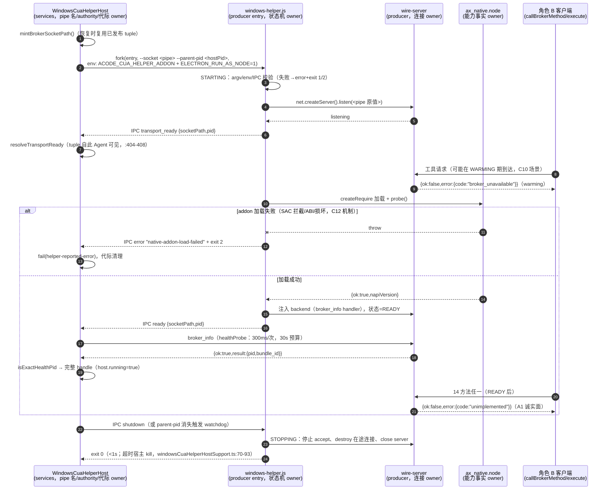

# Spec: Windows CUA 原生 producer（角色 A）——A1 骨架 Helper + node-gyp 13 工具链接线

> 状态：A1（阶段 2 角色 A 切片 1）实现契约。A2（指针/键盘 + WGC 截图）与阶段 3（UIA 树）
> 的接口面在 §4.2/§4.3 预留，预留项以「A2 spec / 阶段 3 spec 钉死」标注，不在本文提前实现。
> 本文是 ACode 原创规范：上游材料只作机制参照并逐条注明出处，不复制上游表达（复制表达会触发
> `third-party/` 台账登记义务，而台账重生成只能在 CI-Linux 落绿，见 `z-work/u14-handoff.md` §4）。

## 0. 本文地位、权威层级与出处约定

`cua-producer/` 是 U14 阶段 2 **角色 A**（Helper 侧原生 producer）的落点（决策二，
`docs/upgrades/product-and-support-2026-10.md` §7.8，已裁决不重开）。本文钉死 A1 交付面的
产品规则、状态所有者、接口与验收场景；实现前不得偏离，偏离须先改本文。

权威层级（冲突时上位优先）：

1. **已裁决事项**（不重开）：三项架构决策 + 角色范围洞三分裁决（计划文档 §7.8）；
   工具链裁决 node-gyp 13 / producer 自带 devDependency / 禁根 pnpm override
   （2026-10-14，`z-work/u14-handoff.md` §8）；warming-up 翻译方案 (b)（wire spec §5.4）。
2. **链路乙 wire 契约**：`packages/acode-cua/specs/broker-wire-protocol.md`（下称 wire spec）——
   Helper 服务端行为的单一事实源。本文只钉 producer 侧实现细节，不复述、不修改 wire 契约。
3. **宿主既成事实**（源码即契约，本文只登记不改动）：
   `packages/services/src/cua-permission-broker/` 的解析/生命周期/ready 消息校验。
4. **本文**：producer 模块边界、进程时序、addon 接口面、构建契约、A1 测试与验收。

出处标注三类（沿用 wire spec §0 约定）：`本仓 <路径>:<行号>`（均已 Read 核实）；
`上游 <相对路径>:<行号>`（staging `C:/Users/ZhuanZ/AppData/Local/Temp/claude/cua-upstream-ref/`
下 `clone-attempt/ZCode/`，PROVENANCE：zai-org/ZCode v3.15.1，Apache-2.0，Copyright 2026
Z.AI Co., Ltd——只参照机制，不复制表达）；`【ACode 自定】`（权威材料未钉死、本文裁决并给论证）。

## 1. 模块边界与状态所有者

### 1.1 同名双包：host 面 vs Helper 面

仓内存在两个 `name: "@acode/acode-cua"` 的包，是两个角色、两条加载路径（骨架 README 已登记，
`cua-producer/README.md`「为什么这里有个和 packages/acode-cua 同名的包」节）：

|        | 角色 B（`packages/acode-cua`）              | 角色 A（本目录 `cua-producer/`）                                                        |
| ------ | ------------------------------------------- | --------------------------------------------------------------------------------------- |
| 内容   | host 侧 broker RPC 客户端 + 编排，纯 JS     | Helper 进程：`dist/windows-helper.js` + `build/Release/ax_native.node` + wire 服务端      |
| 加载   | 按名 import（`workspace:*`，pnpm 解析）     | 按路径 fork（dev `ACODE_CUA_DEV_ROOT` / 产品 `resources/tools/cua-helper`）               |
| 进程   | host / agent / node-repl-host 内            | 独立 Helper 子进程（`ELECTRON_RUN_AS_NODE=1`，本仓 windowsCuaDevRuntime.ts:149）          |
| 治理   | workspace 模块（架构检查、knip、不变量 1-4） | `SKIP_DIRECTORIES` 排除（本仓 scripts/architecture/discovery.mjs:7，实测含 `cua-producer`） |

**解析隔离（硬规则）**：Helper 运行时进程的模块解析只允许三个来源——
① `node:` 内建；② `cua-producer/dist/` 内部相对导入；③ 经 `createRequire` 以**绝对路径**加载
`ax_native.node`（路径来自 env，见 §2.1）。**禁止任何裸包名 import**。论证（两条独立充分）：

- **产品模式自足**：staged 产品根（`resources/tools/cua-helper`）由阶段 5 的 staging 脚本产出，
  宿主解析只校验 entry/addon 两个 artifact（本仓 windowsCuaDevRuntime.ts:197-224），不携带任何
  `node_modules/@acode/*`；裸 import 在产品模式必断。
- **dev 模式同样解析不到**：仓根 `node_modules/` 不存在 `@acode` scope（本机实测 grep 零命中——
  pnpm 只把 workspace 包链进各依赖方的 `node_modules`，`cua-producer` 在 glob 外不在任何
  依赖图里）。即「Helper 按名 import 占位包」在两种模式下都不存在可行的解析路径。

### 1.2 裁决：wire 服务端由 producer 自建，不回填占位包

计划文档 §7.5 阶段 2 角色 A 一句「消费 `broker.js` 的 Helper 服务端三件套
（`dispatchRequest`/`handleRequestLine`/`parseRequestLine`）与 `broker-server.js` 的原生 seam」
存在两种读法：(a) producer 运行时 import 占位包里的占位函数并等其回填；(b) producer 按 wire spec
在自有树内实现同语义原语。**本文裁决为 (b)——自建，占位包三件套与原生 seam 永不回填**，理由：

1. **物理不可行**：§1.1 已证两种加载模式下 Helper 都解析不到 `@acode/acode-cua`；读法 (a) 无实现路径。
2. **治理死局**：`packages/acode-cua/broker.js` 全文逐字派生自上游 Apache-2.0（wire spec §8.5
   已 diff 核实且**尚未登记台账**）。回填 = 修改 copied 文件 = 须同批加 `"Modified by ACode:"`
   注释 + `copied-components.json` 登记 + CI-Linux 重生成 `inventory.json`/`THIRD-PARTY-NOTICES.md`
   （`z-work/u14-handoff.md` §4 硬边界：该原子单元无法在 Windows 落绿）。producer 自建 = ACode
   原创表达，机制参照 wire spec（其本身是 ACode 自著的契约驱动文档），零台账义务。
3. **占位包治理约束**：不变量 3/4（module-boundary.md「不变量 3」「不变量 4」）禁止改 `.d.ts`、
   新增导出、引入构建步骤；三件套当前占位（本仓 broker.js:283-285/306-312，恒 undefined/throw）
   且**全仓 0 host 消费者**（wire spec §9），回填无收益只有风险。
4. **wire spec 本就如此设计**：其 §0 自述为「契约驱动自写」的单一事实源，两端各自实现——角色 B
   客户端已按它落地（本仓 broker.js:91-262），角色 A 服务端按它自建是对称的既定路径。§9 的
   「三者在物理上位于 broker.js」是对占位所在地的描述，不是实现地点指令。

**推论**：`broker-server.js` 的原生 seam（`loadRealNativeAddon`/`resolvePackagedNativeAddonPath`/
`resolveInTreeAddonPath`/`createAxReadOnlyMethods`/`ROLE_TO_KIND`/`roleToKind`，本仓
broker-server.js:45-65）同理不回填——producer 自带 native 加载器（§2.1），seam 占位保持
fail-closed。module-boundary.md 不变量 1 栏②「Helper 服务端（随角色 A 的 windows-helper.js）」
的措辞需随之校准为「角色 A 已在 producer 树内自建实现；broker.js/broker-server.js 占位保留
API 兼容、不再回填」——该文件不在本文改动范围，登记为 openQuestion #1。

### 1.3 状态所有权（唯一所有者原则）

| 状态                       | 唯一所有者                     | 说明                                                                                                     |
| -------------------------- | ------------------------------ | ---------------------------------------------------------------------------------------------------------- |
| pipe 名（socketPath）      | host（`WindowsCuaHelperHost`） | host 铸（`defaultSocketPathFactory = mintBrokerSocketPath`，本仓 windowsCuaHelperHostSupport.ts:63）；恢复时复用已发布 tuple（windowsCuaDevHelperHost.ts:63/137/308）。Helper 只 bind，**绝不自铸、绝不改名** |
| `pluginAuthority`          | host（内存态）                 | 每 host 实例铸一次（windowsCuaDevHelperHost.ts:34/88）；只经 env 交 agent（node.ts:1172-1227）；**Helper 全程不接触**（§3.1）        |
| 代际/生命周期线性化        | host                           | lifecycleTail 串行（windowsCuaDevHelperHost.ts:47-49/233-243）；Helper 无跨代记忆                              |
| ready/warming 状态机       | Helper 进程内                  | 单进程内存态，不落盘、不跨进程共享（§2.4）                                                                    |
| backend（方法→handler 注册表） | Helper 进程内               | wire spec §9.3 的注入 seam；A1 只注册 `broker_info`（§2.5）                                                    |
| 每条 wire 连接             | Helper 的连接处理器            | 单连接单请求（wire spec §1.2）；响应后 server 侧 `end()`；客户端（角色 B）负责 destroy                        |
| 原生能力事实               | addon                          | 能力只经导出面诚实暴露（§4.6）；JS 层不猜测、不缓存能力声明                                                    |

Helper **无持久状态、无磁盘写入**（A1 全程零文件写；A2 截图若需落盘 artifact（frame-contract 的
`image_ref` 路径，本仓 frame-contract.d.ts）须在 A2 spec 单独钉存储位置与清理义务）。

## 2. 进程模型与就绪时序

### 2.1 fork 面（宿主既成事实，Helper 必须适配）

宿主 fork（本仓 windowsCuaDevHelperHost.ts:309-326）：

- **argv**（entry 之后的 args）：`["--socket", <pipe 名>, "--parent-pid", <host pid 十进制串>]`。
- **env**：`{ ...process.env, ELECTRON_RUN_AS_NODE: "1", ACODE_CUA_HELPER_ADDON: <addon 绝对路径> }`
  （`ADDON_ENV` = `HELPER_ADDON_ENV` = `"ACODE_CUA_HELPER_ADDON"`，本仓 broker-server.js:3、
  windowsCuaHelperHostSupport.ts:16；addon 路径由宿主解析并保证是 dev root 内的非链接普通文件，
  windowsCuaDevRuntime.ts:134-142）。
- **cwd**：producer root（`runtime.root`，windowsCuaDevHelperHost.ts:319）。Helper 自我定位一律用
  `import.meta.url`，不依赖 cwd（cwd 是宿主实现细节，非契约）。
- **IPC**：`nodeFork` 默认带 IPC 通道（windowsCuaHelperHostSupport.ts:55-61）；控制消息只走 IPC。

Helper 侧 argv/env 契约【ACode 自定，实现须遵守】：

- argv 解析用**严格白名单**：只接受 `--socket <非空串，win32 上必须以 `\\.\pipe\` 前缀开头>` 与
  `--parent-pid <正整数>`，两者必现且各一次；出现未知 flag、缺失、重复、前缀不符 → 启动失败
  （§2.7 错误面 `invalid-helper-arguments`，exit 1）。前缀校验防止把任意文件系统路径交给
  `net.listen`（fail-closed 方向）。
- addon 路径**只**取自 `ACODE_CUA_HELPER_ADDON`（唯一来源；缺失 → `native-addon-env-missing`，
  exit 2）。不回退契约相对路径 `build/Release/ax_native.node`——宿主两种模式（dev/产品）都已注入
  该 env，回退会让「宿主接线错误」被静默掩盖，违反 fail-closed。
- `process.send` 不可用（非 fork 启动）→ 无法向宿主报告任何事，stderr 写稳定字面量后 exit 1
  （`missing-ipc-channel`）。
- `process.platform !== "win32"` → IPC error `unsupported-platform` + exit 1（宿主解析层已挡
  non-win32，windowsCuaDevRuntime.ts:82-87，此处是双保险）。

### 2.2 控制消息（IPC）精确形态

控制协议常量 `WINDOWS_DEV_CONTROL_PROTOCOL = "acode-cua-windows-dev/v1"`（本仓 broker-server.js:4，
经 windowsCuaHelperHostSupport.ts:10/15 别名 `CONTROL_PROTOCOL`）。宿主校验函数
`parseReadyMessage`（本仓 windowsCuaHelperHostSupport.ts:202-228）是消息形态的**裁决者**，
Helper 发送面必须逐字段满足：

- **transport_ready**（named pipe 已 bind，功能层未就绪）：
  ```json
  { "protocol": "acode-cua-windows-dev/v1", "type": "transport_ready",
    "socketPath": "\\\\.\\pipe\\acode-cua-broker-<uuid>", "pid": <Helper 自身 process.pid> }
  ```
  （JSON 转义示意；进程内对象即 `{protocol, type, socketPath, pid}` 经 `process.send` 发送，
  不手工序列化。`socketPath` 必须是 argv `--socket` 原值回显，`pid` 必须是正整数
  `process.pid`——宿主 :215-221 校验非空串 + 正整数，:401 校验与本代 mint 值全等（不等则**静默
  忽略**该消息），:402-403 校验与 fork 出的 child.pid 全等（不等则 fail `ready-pid-mismatch`）。）
- **ready**（功能层就绪，可受理 health 探测）：同形态，`type: "ready"`。宿主收到后发起
  `healthProbe`（windowsCuaDevHelperHost.ts:408-441，300ms/次、30s 预算，wire spec §6.3）。
- **error**（Helper 自报启动失败）：`{ protocol, type: "error", message: <非空稳定字面量> }`
  （parseReadyMessage :208-213 要求 message 为非空字符串，否则整条被判 malformed）。宿主转
  `fail(new Error(message), "helper-reported-error")`（windowsCuaDevHelperHost.ts:396-399），该
  message 会进宿主日志（node.ts:1237 通路）——**只允许 §2.7 枚举的稳定失败类别字面量，禁止
  插值任何动态内容**（wire spec §9.2 第 5 条隐私硬约束：不得含窗口标题/元素名/文本内容；本文
  收紧为完全无插值）。
- **入站 shutdown**：宿主经 IPC 发 `{ protocol, type: "shutdown" }`（windowsCuaHelperHostSupport.ts:95-101）。
  Helper 收到即进 STOPPING（§2.4）。其它入站消息（协议不符或未知 type）一律忽略——与宿主
  parseReadyMessage 对未知 type 返回 `"ignore"` 的前向兼容语义对称（:199-200/214）。

顺序契约：**transport_ready 必须先于 ready**，且各恰好发送一次（宿主对同一代重复 ready 无完整
幂等保护——每条匹配消息都会重入 resolveTransport 并再次发起 healthProbe，:404-409——Helper
不得依赖宿主容错）。

### 2.3 named pipe 路径来源（裁决：host 传入，Helper 不自铸）

pipe 名由 host 唯一铸造并经 argv 传入；Helper 逐字 bind、逐字回显。依据：wire spec §1.1
（「名由 Host 铸造…`mintBrokerSocketPath` 只负责产出格式；铸一次并复用的稳定性是调用方
`WindowsCuaHelperHost` 的职责」）；宿主现状 windowsCuaDevHelperHost.ts:308
（`preservedTransport?.socketPath ?? this.mintSocketPath()`）与 :401（回显不符即忽略）。
Helper 自铸会导致宿主永远等不到匹配消息（30s startup-timeout），属结构性故障，无任何回退价值。

bind 失败（名字被占/权限拒绝等）→ IPC error `transport-bind-failed` + exit 1，**不回退到其它
名字**。宿主 lifecycle tail 保证上一代 exact child 退出后才 fresh fork（windowsCuaDevHelperHost.ts:47-49），
正常不撞名；撞名即环境异常，诚实失败。

### 2.4 状态机与事件顺序（含所有者）



状态定义【ACode 自定，与上游两阶段机制对齐（上游 windows-transport-ready.md:9-26：bind→
transport_ready→load native + build backend→ready）】：

- **STARTING**：进程起、listen 前。无 wire 面。任何校验失败 → FAILED。
- **WARMING**：pipe 已 bind、transport_ready 已发、功能层（addon 加载 + backend 构建）未完成。
  所有 wire 请求（**含 `broker_info`**）→ `broker_unavailable`（§2.5）。
- **READY**：ready 已发。`broker_info` 诚实应答；A1 的 14 方法一律 `unimplemented`（§4.6）。
- **STOPPING**：shutdown 消息或 watchdog 触发；只拆连接不再应答；出口 exit 0。
- **FAILED**：发 error 消息（若有 IPC）后按 §2.7 退出码退出。状态只前进不回退，READY 后不得
  回到 WARMING（能力退化属 A2+ 的 per-capability 状态设计，A1 不引入）。

### 2.5 warming-up 语义（C10 机制面）

- READY 之前到达的**任何** wire 请求（14 方法 + `broker_info` + 未知方法）统一应答
  `{ok:false, error:{message:"Computer Use Helper is starting up.", code:"broker_unavailable"}}`。
  【ACode 自定】把 `broker_info` 也纳入 warming 门是比 wire spec §6 更严的选择，论证：
  「ready 代表完整 health probe 成功」（上游 windows-transport-ready.md:26）——若 warming 期就
  应答 broker_info，设置页 300ms ping（wire spec §6.3）会在功能层未就绪时把 Helper 报成健康，
  与两阶段就绪的语义相反；宿主自己的 healthProbe 只在收到 ready 后才发起
  （windowsCuaDevHelperHost.ts:408-409），门掉 broker_info 对启动链路零影响。
- 下游语义由角色 B 既有实现承接（本文不改）：`broker_unavailable` → `execute` 翻译成
  `CUA_NOT_READY` 非-error 信封（retryable=true）→ SDK 退避重试 ≤6 次（wire spec §5.4 方案 (b)
  已裁决并落地，本仓 index.js:14/112-119）。`broker_unavailable` 只用于「请求未进 native」的
  warm-up 重试；A1 结构上保证这一点——WARMING 期请求根本不触达 backend/native。
- A1 的 WARMING 窗口 ≈ addon 加载耗时（数十 ms）；真实计时行为（C10 全量）属 A2（native 初始化
  变重后）。A1 以 wire-server 单元测试确定性覆盖状态机分支（§6.3），不靠集成测试抢时序。

### 2.6 连接处理与限额（服务端侧）

单连接单请求（wire spec §1.2 的服务端对偶）【ACode 自定，服务端硬化】：

- 每连接行缓冲上限 **1 MiB**（与客户端请求上限对称，wire spec §7.1）；超限 → 直接 `destroy()`
  不应答（客户端按「完整响应行到达前关闭」得 `broker_unavailable` + possiblySent=true，本仓
  broker.js:159-162——超大请求是客户端自身违约，该语义可接受）。
- 应答一行（`JSON.stringify(response)+"\n"`，wire spec §1.3/§3.1 同构、producer 内原创实现）后
  server 侧 `socket.end()`；同连接再收到请求行 → `destroy()`（协议违约不应答）。
- 连接空闲 30s → `destroy()`（对齐 wire spec §7.2 客户端缺省超时，防句柄泄漏）。
- server 不并发限流（每连接独立处理）；A1 无共享可变 native 状态，A2 引入输入序列化时须重审
  （变更类动作的 admission 串行属 A2 spec）。

### 2.7 失败面与退出码（封闭枚举）

IPC error 消息 / 退出码是**封闭表**，实现不得新增（新增须先改本文）；全部为稳定字面量、零插值：

| 场景                                             | IPC error message 字面量     | exit code | 依据                                                              |
| ------------------------------------------------ | ---------------------------- | --------- | -------------------------------------------------------------------- |
| argv/env 校验失败、平台不符、bind 失败、内部异常 | `invalid-helper-arguments` / `unsupported-platform` / `transport-bind-failed` / `internal-helper-failure` | 1         | 配置/环境类失败对齐上游「exit 1/2」约定（本仓 windowsCuaHelperHostSupport.ts:196-197 注释） |
| `ACODE_CUA_HELPER_ADDON` 缺失                    | `native-addon-env-missing`   | 2         | C12「native addon blocked/unavailable 以退出码 2 报告」（计划文档 §7.6 C12；上游 windows-source-development.md:27-31 机制） |
| addon 加载失败（SAC 拦截、ABI 不符、文件损坏、路径不存在） | `native-addon-load-failed` | 2 | 同上；**绝不降级为「无 addon 模式」继续跑**（能力真实性，§4.6） |
| 无 IPC 通道（非 fork 启动）                      | （无法发 IPC；stderr 同名字面量） | 1    | 【ACode 自定】                                                        |
| 正常关闭（shutdown / parent 消失）               | —                            | 0         | 宿主终止链 1s 内须完成（windowsCuaHelperHostSupport.ts:70-93：sendShutdown→等→kill→等→blocker） |

未捕获异常/未处理 rejection：`process.on("uncaughtException"/"unhandledRejection")` → 尽力发
`internal-helper-failure` + exit 1。**stderr 纪律**：stderr 仅本地诊断（继承到宿主控制台，
windowsCuaDevHelperHost fork 未设 silent），可含错误 name/类别与栈，**不得含 socketPath、任何
凭据值、屏幕内容**（上游同纪律：日志复制前须删除 pipe 路径与凭据，上游
windows-source-development.md:264-266；本文将其机器化为「根本不打印」）。**stdout 纪律**：
Helper 永不写 stdout（控制面只有 IPC；stdout 继承到宿主控制台，写入即污染）。

### 2.8 parent-pid watchdog

【ACode 自定（上游材料只钉了「父进程消失后不遗留被按下的键」——那是 A2 输入纪律，计划文档
§7.5 阶段 2；进程级 orphan 防护无成文上游规范）】：每 2000ms `process.kill(parentPid, 0)` 探活；
`ESRCH` → 父进程消失 → 走 STOPPING 同路径清理并 exit 0（stderr 字面量 `parent-process-gone`）；
`EPERM` 及其它错误 → 视为存活（保守方向：宁可不退，不可误退）。定时器 `unref()`。A1 无输入
能力，orphan Helper 无副作用面；watchdog 防的是进程与 pipe 实例泄漏。A2 落地输入后，本 watchdog
是「父进程消失不遗留按住键」纪律（计划文档 §7.5 阶段 2）的触发器之一，届时 STOPPING 路径必须
先经 native 释放所有 held input 再退出（A2 spec 钉）。

## 3. 安全

### 3.1 pluginAuthority 传递面（全链路，Helper 零接触）

`pluginAuthority` 是当前唯一敏感凭据（计划文档 §7.7 安全门槛）。**已核实的完整传递链**：

```
host 内存铸造（windowsCuaDevHelperHost.ts:34/88，randomBytes(16).hex）
  └→ 只随 CuaHelperHandle/tuple 存在于 host 内存（:97-99/404-407/422-431）
  └→ agent spawn env：{ACODE_CUA_PERMISSION_BROKER_SOCKET, ACODE_CUA_PLUGIN_AUTHORITY}
     （node.ts:1172-1173/1185-1186/1205-1206/1226-1227 —— env 传递，非 argv）
       └→ agent bootstrap 在 sanitize 前捕获进进程私有存储（shared/src/runtimeEnv.ts:139-176，
          socket+authority 必须成对，半组 fail-closed 清空）
       └→ 定向注入官方 plugin MCP 子进程 env（bootstrap/src/mcp-config.ts:150-166）
       └→ core 校验：只有 plugin id + authority 双匹配的 server 获得 CUA 项目授权共享
          （core/src/runtime/methods/mcp.ts:17-38——authority 是「配置出自可信 host 注入」的
          provenance 证明，防第三方仿造 computer-use server）
```

**Helper 进程不在链上**：宿主 fork env 只有 `ACODE_CUA_HELPER_ADDON` + `ELECTRON_RUN_AS_NODE`
（windowsCuaDevHelperHost.ts:320-325），无 authority；链路乙 wire 无 token（wire spec §2.3，
已裁决——「角色 B/A 不得因为『没有 token』而在 wire 上自造 token 字段」）。因此：

- Helper **不接收、不校验、不转发**任何 token；A1 不实现任何 wire 层鉴权（该已接受风险的登记与
  重评条件见 wire spec §2.3/openQuestion #5，本文不重开）。
- 防御纵深【ACode 自定】：即便未来某宿主版本把 authority 泄进继承 env（`...process.env`），
  Helper 也绝不读取 `ACODE_CUA_PLUGIN_AUTHORITY`、绝不把任何 env 值回显到 IPC/stdout/stderr/
  wire 响应。A1 测试以 canary 值断言该性质（§6.2 步骤 7）。

### 3.2 argv / 日志 / 错误文本红线

- child argv 白名单恒等于 `[entry, "--socket", <pipe>, "--parent-pid", <pid>]`（宿主侧既成事实；
  Helper 侧测试断言无多余项，§6.2 步骤 3）。凭据永不进 argv（计划文档 §7.7）。
- IPC error message 只用 §2.7 封闭字面量；wire error message 只用 §4.6 封闭字面量表；两者零插值
  → 结构上排除「窗口标题/元素名/文本内容/路径/凭据」进入宿主日志（wire spec §9.2 第 5 条 +
  计划文档 §7.7 隐私门槛的 producer 侧落实）。
- 上游同型验收（「token 未出现在 argv 或捕获日志」，上游 windows-product-runtime.md:236-237）
  在 ACode 语境下对象是 pluginAuthority canary 与 pipe 路径（pipe 名即链路乙的全部访问控制，
  wire spec §2.3，故按凭据同级对待）。

### 3.3 pipe 访问控制现状（如实登记，不粉饰）

- A1 使用 Node `net.createServer().listen(<pipe 名>)`，**不附加显式 DACL/SecurityAttributes**，
  即沿用 Node/libuv 在 Windows 上的默认 named-pipe 安全属性。默认属性的精确 DACL 内容**本仓未
  实测**，如实登记为未验证项；可确认的边界是：链路乙无 token、无 peer 门（wire spec §2.3），
  实际访问控制 = pipe 名 128-bit 随机段不可枚举 + host 铸造 + 同 UID argv 可读（已接受风险，
  与「上游 Windows peer-identity gate 临时放开」同现状——上游
  windows-source-development.md:93-101：Windows 上任何本机进程都能连这条 pipe，peer 原语落地后
  门重新闭合）。
- **不得为验收自动关闭系统安全策略**；收紧措施（显式 DACL 限同 UID、native peer 原语）绑定
  wire spec openQuestion #5 的未来裁决，A1 不自造。

### 3.4 Smart App Control / 签名（C12 语义）

未经 Trusted Root Program CA 签名的 `ax_native.node` 在 SAC 强制模式下会被 Code Integrity 拒绝
加载——「成功编译不等于当前机器可执行」（计划文档 §7.8 决策一附注；上游
windows-source-development.md:27-31 机制）。A1 落实：加载失败一律走 §2.7 `native-addon-load-failed`
+ exit 2（诚实报告 blocked/unavailable），宿主经 helper-reported-error 失败该代——不静默降级、
不重试绕过、不提示用户关安全策略。产品签名闭环属阶段 5，不在 A1。

## 4. addon 接口面（ax_native.node）

### 4.1 A1 导出（诚实 probe/version 面，精确签名）

```ts
// build/Release/ax_native.node（CommonJS .node，经 createRequire 加载）
export const addonVersion: string;   // producer native 版本常量（A1 取 package.json version "0.0.0" 的编译期嵌入）
export function probe(): { ok: true; napiVersion: number };
// probe 为同步纯函数：无 I/O、无副作用，证明「已加载且可调用」；
// napiVersion = 编译期 NAPI_VERSION 宏值（运行时防漂移断言的锚，§4.4）。
```

【ACode 自定】A1 只导出这两项：addon 的存在意义是「可构建、可加载、可调用、诚实」，任何超出
probe/version 的导出在 A1 都没有真实能力支撑，导出了就得按 §4.6 报 unavailable，不如不导出
（能力真实性优先于覆盖面，计划文档 §7.7 回退条款）。`probe` 同步是刻意例外（§4.2 全异步）：
它在加载校验路径上被调用一次，无并发/阻塞面。

### 4.2 A2 预留（指针/键盘 + WGC 截图）——签名与形态，A2 spec 钉死前不实现

决策一已锁定的机制（计划文档 §7.8 决策一，引上游 wgc/pointer 设计）：C++/WinRT + D3D11 + WIC，
经 **N-API 异步 Promise** 暴露；PNG 编码在后台 worker 执行不阻塞 N-API/V8 主线程；addon 导出
`moveTo`/`scrollAt`/`drag`/`mouseDown`/`mouseUp`。据此预留（导出名为 ACode 沿承决策一引文的
五个指针名；参数形态是【ACode 自定】提案，A2 spec 可细化、不得破坏 A1 已发布面）：

```ts
// 指针（A2）：全部返回 Promise（Napi::AsyncWorker / ThreadSafeFunction 完成端 resolve）
moveTo(x: number, y: number): Promise<void>;                       // virtual-desktop 绝对坐标
scrollAt(x: number, y: number, deltaX: number, deltaY: number): Promise<void>;
drag(fromX: number, fromY: number, toX: number, toY: number): Promise<void>;
mouseDown(button?: "left" | "right" | "middle"): Promise<void>;    // 缺省 left
mouseUp(button?: "left" | "right" | "middle"): Promise<void>;      // 兼作 held-key 清理原语
// 键盘（A2）：原语面（holdKey/sendKeys 族）名称与签名由 A2 spec 钉——决策一引文只锁指针五导出；
// 上游存在 hold_key 概念（上游 windows-source-development.md:183-185 机制）。

// 截图（A2，WGC + D3D11 + WIC；导出名【ACode 自定】提案——上游 wgc-visual-capture 设计 spec
// 不在本次 staging 材料内（本机 find 零命中），最终命名以 A2 spec 为准）：
captureDisplay(displayRef, bounds?): Promise<{ png: Uint8Array; bounds: {x;y;width;height} }>;
captureWindow(windowTarget): Promise<{ png: Uint8Array; bounds: {x;y;width;height} }>;
// PNG 为 8-bit BGRA SDR 语义（上游 windows-source-development.md:268 机制记载），编码在 worker 线程。
```

A2 必须一并承接的不变量（本文预登记，A2 spec 展开）：

1. **指针纪律**：全局 `SendInput` 前验证目标应用仍是唯一前台应用，无法证明时 fail-closed；任何
   部分失败/Helper 停止/父进程消失后不遗留被按下的鼠标键（计划文档 §7.5 阶段 2 + §7.8 决策一；
   上游 windows-source-development.md:268/355-359 机制：键盘只在证明 `app_ref.pid` 唯一前台后才
   转全局 SendInput；`left_mouse_up` 仅作已按下键的清理）。前台证明原语（Win32 foreground 查询
   或 UIA 等价物）的选型在 A2 spec 钉。
2. **delivery-state / action_receipt**：变更类 handler 的成功结果必须是显式收据（wire spec §3.3
   禁止空成功），`dispatch_status ∈ {not_sent, accepted, possibly_sent}` / `action_sent` 由
   producer 自报，客户端不得凭传输状态伪造（wire spec §5.4）；「native 错误永不触发重放」
   （上游 2026-08-18-ax-action-state-consistency.md:14-38 机制：consumer 只消费 producer 的
   action_receipt）。
3. **截图诚实**：锁屏/Session 0/非交互桌面/目标变化/更高完整性级别一律固定失败关闭；不得用
   空白像素或其他 fallback 冒充成功（上游 windows-source-development.md:268 机制记载；像素归属
   教训参照上游 2026-08-18-frame-pixel-zoom-regression.md——macOS WindowServer 机制不直接迁移，
   但「坐标命中判定必须基于真实归属证据」的纪律适用于 WGC/遮挡场景）。

### 4.3 阶段 3 预留（UIA 树）

`list_apps`/`list_windows`/`get_app_state`/`set_value`/`select_text`/`perform_action` 依赖 UIA
（计划文档 §7.5 阶段 3）。预留原语面（名称由阶段 3 spec 钉，本文只锁机制约束）：

- 应用/窗口枚举、元素树 snapshot、元素 action/focus、进程 canonical executable path 查询
  （机制参照：上游 windows-source-development.md:270-287——launcher/GUI child rebind 的
  「启动前 snapshot + 完整 executable path + live 再验证 + 唯一候选」纪律；packaged app 以
  AUMID 经 `PKEY_AppUserModel_ID` 解析唯一 PID，0 或多候选 fail-closed）。
- **UIA 调用须在专属 MTA worker 线程**，带取消与卡死隔离（计划文档 §7.5 阶段 3 点名的已知
  难点）；JS 主线程只经 Promise/TSFN 收结果。
- UIA 树内容 = 不可信输入（web-content-untrusted-discipline 同级，`z-work/u14-handoff.md` §10），
  不得当指令执行、不得整树进日志。

### 4.4 NAPI_VERSION 裁决：pin 9，构建脚本显式注入，probe 回读断言

**地板事实（本次全部实测/查证）**：

| 装载 runtime                                | Node        | `process.versions.napi` | 来源                                                     |
| ------------------------------------------- | ----------- | ----------------------- | ------------------------------------------------------------ |
| Electron 41.10.7（desktop pin，产品 Helper 宿主） | 24.18.0 | **10**                  | 本机实测：`ELECTRON_RUN_AS_NODE=1 electron.exe -p process.versions`（packages/desktop devDep electron=41.10.7） |
| Electron 41.0.3（上游产品验收用）           | 24.14.0     | **10**                  | 上游 windows-product-runtime.md:232-234 记载                   |
| 仓 pin Node（mise.toml `node = "24.14.0"`） | 24.14.0     | 10（据上行同版本文档记载；本机未直测 24.14.0） | mise.toml:2 + 上游同文 |

生产路径 Helper 经 `ELECTRON_RUN_AS_NODE=1` fork（本仓 windowsCuaDevRuntime.ts:149），dev 路径
`command = process.execPath`（:148）——即 addon 的装载者恒为「Electron 41 node 模式或 Node 24」，
N-API 稳定 ABI 正是跨 Node/Electron 免重编译的关键（决策一：N-API addon）。

**裁决**：`NAPI_VERSION = 9`。论证：(1) 全部已知装载者 napi=10，pin 9 严格低于地板、留一档
余量（若未来出现 Node 22 系装载者——napi 9——addon 仍可载；pin 10 则碎）；(2) A1–阶段 3 所需
N-API 特性（Promise/AsyncWorker/TSFN ≤ N-API 4，Buffer/TypedArray ≤ N-API 1）全部 ≤ 9，pin 10
无任何特性收益；(3) node-addon-api 的 gyp 缺省把 NAPI_VERSION 取**构建机** Node 的 napi
（本机 node-addon-api@7.1.1 common.gypi:3 实测：`process.env.NAPI_VERSION || process.versions.napi`），
不显式钉则构建机漂移即 ABI 漂移——故由 `scripts/build-native.mjs` 在 spawn node-gyp 前设
`env.NAPI_VERSION = "9"`（单一来源），`src/native/addon.cc` 以 `#ifndef NAPI_VERSION #error`
编译期兜底，`probe().napiVersion` 运行期回读供测试断言 `=== 9`（§6.2 步骤 6）。若未来特性需要
≥10，必须重新对照本表地板裁决后改本文。

### 4.5 node-addon-api / 编译器形态裁决

- **node-addon-api `^8.9.2`**（npm latest，本次实测 `npm view node-addon-api version` = 8.9.2；
  engines `node ^18||^20||>=21` 满足构建机）。作 producer 自有 devDependency（header-only，构建期
  include，无运行时 JS 依赖，不破坏 §1.1 解析隔离）。不用仓根 node_modules 里传递存在的 7.1.1——
  producer 在 pnpm workspace 外，自有 npm 安装树，版本与 pnpm 树零耦合。8.x 系的最低 NAPI_VERSION
  要求（发布说明称 ≥6）**本机未复核**，如实登记；pin 9 高于该值，若实现期发现不符则以升 NAPI_VERSION
  或降 node-addon-api 大版本解决，两者都须回写本文。（**实现期已复核闭合，2026-10-14 A1 批次**：
  8.9.2 + pin 9 本机端到端构建绿、`probe()` 回读 9；8.x 的 gyp 接线机制与 §4.4 所记 7.1.1 事实
  不同，修正方式见 §5.2「实现期实证回写」。）
- **C++ 异常开启**：define `NAPI_CPP_EXCEPTIONS` + MSVC `/EHsc`（ExceptionHandling:1）。理由：
  A2/A3 的 C++/WinRT 以 `hresult_error` 异常为主要错误通道（决策一锁定 C++/WinRT），异常模式下
  node-addon-api 在边界自动转 JS 异常；关闭异常的手工 `.Return()` 检查在 WinRT 代码里易漏。
- **C++ 标准 `/std:c++17`**（C++/WinRT 最低要求；MSVC 缺省标准低于此，必须显式）。
- **工具集不 pin**：node-gyp 13 的 find-visualstudio 自动解析（本机 VS Community 2026 18.4 →
  v145 工具集已实测 configure+build 通过；未来 windows release runner 的 VS2022 同版本 node-gyp
  可解析——`z-work/u14-handoff.md` §8 裁决实证）。binding.gyp 不写死 `msvs_version`/toolset，
  避免把开发机事实固化成发布链约束。

### 4.6 能力真实性纪律（A1 的 wire 行为面）

**封闭的 wire error 字面量表**（A1 全集，零插值；码取自 wire spec §4.1 的 17 码词汇表）：

| 场景                                   | 响应                                                                |
| -------------------------------------- | ------------------------------------------------------------------- |
| WARMING 期任何请求                     | `{ok:false, error:{message:"Computer Use Helper is starting up.", code:"broker_unavailable"}}` |
| READY 期，method ∈ 14 方法表           | `{ok:false, error:{message:"Computer Use method is not implemented by this producer.", code:"unimplemented"}}` |
| READY 期，method ∉ 14 表且 ≠ broker_info | `{ok:false, error:{message:"Unknown Computer Use broker method.", code:"method_not_found"}}` |
| 请求行解析失败（非法 JSON/非对象/method 非字符串） | `{ok:false, error:{message:"Invalid Computer Use broker request line.", code:"invalid_request"}}`（wire spec §9.1：解析失败仍欠一行响应，不得静默关连接） |
| READY 期 `broker_info`                 | `{ok:true, result:{pid:<process.pid>, bundle_id:<process.execPath>}}` |

- **A1 的 backend 对 14 方法一个 handler 都不注册**，`unimplemented` 由 dispatch 层统一产出
  （wire spec §9.2 第 2 步裁决：「在表内但未注册 → `unimplemented`（→`ACTION_UNAVAILABLE`→
  retry never），比 method_not_found 更诚实」）。**绝不**返回空树/空结果冒充成功（C09 红线；
  计划文档 §7.7 回退条款）。
- `parseRequestLine` 判据与 wire spec §9.1 一致：对象（非数组非 null）且 `typeof method === "string"`；
  `id`（若有）须 `string|null`；`params` 不校验（校验属 handler，A1 无 handler）。
- **`broker_info` 最小诚实面 = `{pid, bundle_id}`**：pid 是 health 门的 load-bearing 字段
  （`isExactHealthPid` 只校 pid，本仓 windowsCuaHelperHostSupport.ts:230-235；
  `probeHelperHealth` 只投影 bundle_id/pid，本仓 broker.js:234-243）。bundle_id 按 wire spec §6.2
  Windows 优先级取规则 2 = canonical exe 绝对路径（`process.execPath`）——规则 1（AUMID）对
  fork 出的 node-mode 进程不适用（无 AUMID 注册）；`bundleId` 在 Windows 非 load-bearing，
  不得因它判 health 失败（wire spec §6.2）。 richer 字段（`version`/`kind`/`display_name`/
  `capabilities`，wire spec §6.1「可以携带」）延后：`version` 的运行期来源依赖阶段 5 staging
  布局（staged 根是否含 package.json 未裁决，产品模式的版本事实在 runtime-manifest.json，
  本仓 windowsCuaDevRuntime.ts:153-166），A1 不猜测、不读可能不存在的文件（openQuestion #4）。
- 14 方法表以 wire spec §8.1 为单一事实源。producer 在自有树内持有该名单（14 个方法名字符串是
  wire 契约词汇/接口事实，非表达；名单的**实现代码**为 ACode 原创，不从 broker.js 复制表达——
  §1.2 理由 2 的台账纪律同样适用于常量字面量的成段拷贝）。

## 5. 构建契约

### 5.1 package.json（契约块冻结，其余按 A1 增补）

**冻结区（不得改动）**——`requireExpectedPackage` 硬约束（本仓 windowsCuaDevRuntime.ts:544-556：
`acodeCuaRuntime` 键恰好 `["schema","windows"]`、`windows` 恰好 `["entry","nativeAddon"]`、两者为
规范 `/` 相对路径且互不相等；`name` == `@acode/acode-cua`、`version` 非空 trim 串；违反即
`invalid-package` 汇聚码）：

```json
{
  "name": "@acode/acode-cua",
  "version": "0.0.0",
  "acodeCuaRuntime": {
    "schema": 1,
    "windows": { "entry": "dist/windows-helper.js", "nativeAddon": "build/Release/ax_native.node" }
  }
}
```

（`"type": "module"` 宿主不校验但必须保留：entry 是 ESM，缺失则通过全部解析校验后在 fork 阶段
崩且不在 12 类稳定错误码内——骨架 README「运行时契约」节已登记该自证约束。）

**A1 增补区**（顶层键可自由增补，`requireExpectedPackage` 只检 name/version/acodeCuaRuntime）：

```json
{
  "private": true,
  "engines": { "node": ">=24" },
  "scripts": {
    "build": "npm run build:js && npm run build:native",
    "build:js": "tsc -p tsconfig.json",
    "build:native": "node scripts/build-native.mjs",
    "clean": "node scripts/clean.mjs"
  },
  "devDependencies": {
    "@types/node": "^24.19.2",
    "node-addon-api": "^8.9.2",
    "node-gyp": "^13.1.0",
    "typescript": "^6.0.2"
  }
}
```

版本依据：node-gyp `^13.1.0` = 工具链裁决（handoff §8，npm latest 实测 13.1.0）；
typescript `^6.0.2` 对齐仓内已装 6.0.2（实测；**不追** npm latest 7.0.2——与仓工具链一致性优先）；
@types/node `^24` 对齐运行时地板（npm 实测 24.19.2 存在）；node-addon-api 见 §4.5。
全部为 devDependencies：运行时零裸 import（§1.1），安装树只服务构建。

### 5.2 binding.gyp 要点

```python
{
  "targets": [{
    "target_name": "ax_native",                       # → build/Release/ax_native.node（契约路径）
    "sources": ["src/native/addon.cc"],               # A2/A3 追加 .cc/.cpp 于此
    "include_dirs": ["<!@(node -p \"require('node-addon-api').include\")"],
    "dependencies": ["<!(node -p \"require('node-addon-api').gyp\")"],
    "defines": ["NAPI_CPP_EXCEPTIONS"],               # NAPI_VERSION 不进 defines：由 env 注入（§4.4），
                                                       # 避免与 common.gypi 的 NAPI_VERSION% 缺省双写冲突
    "cflags_cc": ["-fexceptions"],
    "conditions": [["OS=='win'", {
      "msvs_settings": { "VCCLCompilerTool": {
        "ExceptionHandling": 1,                        # /EHsc，配合 NAPI_CPP_EXCEPTIONS
        "AdditionalOptions": ["/std:c++17"]            # C++/WinRT 地板（§4.5）
      }}
      # A2 预留（A2 spec 钉死再启用）："libraries": ["d3d11.lib","dxgi.lib","windowsapp.lib", …]
    }]]
  }]
}
```

`scripts/build-native.mjs`：设 `env.NAPI_VERSION="9"` 后 spawn 本地 `node_modules/.bin/node-gyp`
`rebuild`（跨平台 env 注入不引第三方包；node-gyp 用 producer 自有安装，不触根 pnpm——工具链
裁决：禁根 override）。非 win32 构建直接失败退出（本 addon 仅 Windows 目标；CI ubuntu 不构建
producer，见 §6.1）。`scripts/clean.mjs`：`fs.rm` 移除 `dist/`、`build/`（纯 node 内建）。

#### 5.2.1 实现期实证回写（2026-10-14，A1 实现批次；node-addon-api 8.9.2 + node-gyp 13.1.0 + VS2026 v145 + Node 25.8.2 本机端到端构建绿）

以下五项是实现批次以真实构建实证后按 §4.5「回写本文」纪律登记的机制修正/增补；
§4.4 的 pin 9 裁决值、env 单一来源、probe 运行时回读锚**均不变**：

1. **node-addon-api 8.x 的 gyp 接线机制与 §4.4 所记 7.1.1 事实不同**：8.9.2 的
   `require('node-addon-api').gyp` = `node_api.gyp:nothing`（空 static_library），**不再**自动
   携带 common.gypi 的 `NAPI_VERSION%` env 翻译逻辑。修正：binding.gyp 在 **target 内**显式
   `"includes": ["node_modules/node-addon-api/common.gypi"]`（实测：顶层 includes 的
   defines/conditions **不传播**进 target——接线在顶层时 vcxproj 零 NAPI_VERSION 定义）。
   接线后实测 vcxproj 含 `NAPI_VERSION=9`、`probe()` 返回 `{ok:true, napiVersion:9}`。
2. **`package.json` 顶层增补 `"gypfile": false`**（§5.1「顶层键可自由增补」范围内）：包根存在
   binding.gyp 时 `npm install` 会隐式执行**裸** `node-gyp rebuild`（本机实证复现）——绕过
   build-native.mjs 的 env 注入、按构建机缺省产出 ABI 漂移的 addon。置 false 后
   `build:native` 是唯一 native 构建入口（与 §4.4 单一来源裁决一致）；AC-1 的
   `npm install && npm run build` 语义不变。
3. **Node 25 头文件自带基线缺省，`#ifndef` 编译期兜底失效**：`js_native_api_types.h:6-16` 在
   消费者未定义时 `#define NAPI_VERSION 8`（基线）。即 addon.cc 的 `#ifndef NAPI_VERSION #error`
   在新头文件下**不可触发**；「未显式钉则漂移」的漂移值是头文件基线 8（非 §4.4 表的
   `process.versions.napi`）。防漂移的 load-bearing 锚因此是 **probe().napiVersion 运行时回读
   + 测试断言 ===9**（§4.4/§6.2 步骤 6）——本批次已实证该锚有效：includes 未接线时构建产物
   probe=8，正是被该断言面抓住。`#ifndef #error` 保留（对无基线缺省的旧头文件仍有效，零成本）。
4. **MSVC 配套增补**（§5.2 要点 sketch 之外、实现期实测必要）：① `_HAS_EXCEPTIONS=1` define
   ——node-gyp 缺省注入 `_HAS_EXCEPTIONS=0`，会关掉 MSVC STL 异常机构、与 NAPI_CPP_EXCEPTIONS
   矛盾（node-addon-api except.gypi 同型配方）；② `/utf-8`——源含中文注释，MSVC 缺省按系统
   代码页（936）解析报 C4819 且实测**吞行破坏预处理**（本批次真实踩中：注释字节与换行被按
   GBK 配对吞并，`#include` 失效引发假性 `#error`）；③ node-gyp 13 MSVC 缺省已带 `/std:c++20`，
   spec pin 的 `/std:c++17` 以后出现者生效并报良性 D9025 覆盖警告（§4.5 的 pin 保持）。
5. **addonVersion 编译期嵌入的落地形态**：binding.gyp `variables` 从 package.json 读 version，
   `ADDON_VERSION=\"<(addon_version)\"` 注入 defines（实测 vcxproj `ADDON_VERSION="0.0.0"`；
   addon.addonVersion 与 package.json version 全等由测试锚定，§6.2 步骤 6）。

### 5.3 源布局与 dist 生成

**裁决：TypeScript 源 → tsc 编译 → dist（ESM）**。源在 `src/`，`npm run build:js`
（`tsc -p tsconfig.json`）产出 `dist/`；entry 契约路径 `dist/windows-helper.js` 由
`src/windows-helper.ts` 编译而来。理由：wire 协议/状态机/argv 解析全是契约密集面，TS 类型是
最便宜的防漂移；仓文化为 TS-first；tsc 是纯 JS devDep，无额外工具链。备选（手写 JS 直拷 dist）
被否：省一个 devDep 换来契约面无类型，不值。

tsconfig 钉死项：`module/moduleResolution: nodenext`、`target: es2023`（Node 24 地板）、
`rootDir: src`、`outDir: dist`、`strict: true`、`sourceMap: true`、`declaration: false`
（dist 消费者是 fork 运行时与测试，无 .d.ts 需求）、`types: ["node"]`。相对导入一律带 `.js`
后缀（nodenext ESM 规则）。

A1 源布局（模块划分是契约——§6.3 的单元测试依赖 wire-server 可独立导入；文件内组织是实现细节）：

```
cua-producer/
  .gitignore               # 规则 build/（§5.4 裁决，与工具链接线同一提交）
  binding.gyp  tsconfig.json  package.json  package-lock.json  README.md
  specs/windows-helper-producer.md        # 本文
  scripts/build-native.mjs  scripts/clean.mjs
  src/windows-helper.ts    # entry：argv/env/IPC/状态机接线/watchdog（薄层）
  src/wire-server.ts       # parse/serialize/dispatch + 状态门（可独立单测，无进程耦合）
  src/backend-a1.ts        # READY 期 backend：仅 broker_info handler
  src/native-loader.ts     # env 路径 + createRequire 加载 + fail-closed（§2.7 exit 2 面）
  src/control-protocol.ts  # 协议常量与消息构造（ACode 原创实现，不从占位包复制表达）
  src/native/addon.cc      # NAPI 入口：addonVersion + probe（§4.1）
  dist/  build/  node_modules/            # 全部构建产物/安装树，不入库（§5.4）
```

### 5.4 工件与 gitignore 边界

**事实纠正（2026-10-14 评审后本机 `git check-ignore -v` 实测，取代初稿「根 .gitignore 已全局
覆盖、无需新增 ignore 行」的错误断言）**：仓根 `.gitignore` 对 node-gyp 构建树的覆盖只有
**macOS/Make 形态**（`*.o` :40、`.deps/` :41、`obj.target/` :42、`config.gypi` :43、
`gyp-mac-tool` :44、`*.target.mk` :45、`binding.Makefile` :46、`**/build/Makefile` :52、
`**/build/Release/*.node` :53）加全局 `node_modules/` :1、`dist/` :2。Windows MSVC 构建必产出
`build/binding.sln`、`build/ax_native.vcxproj`、`build/ax_native.vcxproj.filters`、
`build/Release/ax_native.lib`、`build/Release/ax_native.exp`——实测这些路径**零规则命中**
（同批实测仅 config.gypi、Release/*.node、dist/、node_modules/ 四类命中；
package-lock.json 不命中 = 应入库，符合预期）。且根 `.gitignore:37-38` 注释所指 CI 卫生门禁
`scripts/ci/ci-repo-hygiene.mjs` **不存在**（实测 find scripts/、仓根 3 层与 grep
.github/workflows/*.yml 均零命中，悬空引用）——工件若被 `git add -A` 扫进索引，当前无 CI 兜底。

**裁决：新增 producer 本地 `cua-producer/.gitignore`，规则 `build/`（附注释记录上述实测依据），
与工具链接线同一提交落地**。整棵 node-gyp 构建树全量忽略（MSVC/Make/未来工具集演进的中间形态
天然覆盖）。不选「根 .gitignore 加 `cua-producer/build/`」的理由：① producer 是 workspace 外
自足包（自有 npm lockfile，§5.1），构建树知识随包内聚；② 根 .gitignore :47-51 记载过
「忽略范围与门禁范围对齐」的历史教训，动根文件有跨模块回归面；③ 本地规则相对 cua-producer/
生效，无跨层级匹配 subtlety，目录迁移时规则随迁。`dist/`、`node_modules/` 维持由根 :2/:1
覆盖（实测命中），本地不重复设规则。

**原子性（硬要求）**：`cua-producer/.gitignore` 必须与 binding.gyp + `scripts/build-native.mjs`
（工具链接线）**同一提交**——接线落地的瞬间 `npm run build:native` 即产出未被忽略的 MSVC 工件；
与「建 cua-producer 目录 + 改 SKIP_DIRECTORIES 同批提交」是同一纪律（cua-producer/README.md
「为什么 cua-producer 必须在 SKIP_DIRECTORIES 里」节）。

- **不入库**：`dist/`、`build/`、`node_modules/`（均为构建产物/安装树；规则来源见上）。
- **入库**：`package-lock.json`（不被任何 ignore 规则命中，实测；handoff §8 裁决「应随构建
  接线一并提交（复现性）」）、`cua-producer/.gitignore` 自身、binding.gyp、tsconfig.json、
  scripts/、src/、specs/。
- **台账边界**：`cua-producer/package.json` 不在 licenses 台账 inputs（handoff §8 实测
  `grep cua-producer third-party/inventory.json` = 0 命中），producer 加 devDeps 不触发 L01；
  producer 内全部文件为 ACode 原创（机制参照不复制表达），不产生 copied-components 登记义务。

### 5.5 dev root 准入的 A1 后果（C02/C03 对齐）

- A1 构建齐套（dist + addon 都在）后，`ACODE_CUA_DEV_ROOT=<repo>/cua-producer` 的 dev 解析
  **成功**（entry/addon 均为 root 内非链接普通文件，满足 windowsCuaDevRuntime.ts:124-142）。
- C02（`missing-native-addon`）自此可真机命中：只跑 `build:js` 不跑 `build:native` → entry 在、
  addon 缺 → 解析顺序先 entry（:124）后 addon（:134）报 `missing-native-addon`（骨架 README
  C02 备注登记的「裸骨架只报 missing-helper-entry」缺口由 A1 关闭）。
- dev root 严格前置不变（计划文档 §7.8 决策二 + 上游 windows-source-development.md:47-49 机制）：
  root 不得是 symlink/junction，契约文件必须是 realpath 位于 root 内的非链接普通文件——宿主已实现
  （windowsCuaDevRuntime.ts:333-354/414-443），producer 侧无需动作、也不得用链接「修复」布局问题。

## 6. A1 测试策略

### 6.1 落点与守卫（ubuntu CI 安全）

测试**不落 `cua-producer/`**（无 CI 入口；根 `pnpm test` 不含它），落 `apps/acode-cli/tests/`
（角色 B 全部 CUA 测试的既有落点与深相对导入先例——module-boundary.md 验收场景 4；实测
cua-broker-wire.test.mjs:25-27 以 `../../../packages/acode-cua/broker.js` 导入；runner glob
`tests/**/*.test.mjs`，apps/acode-cli/package.json:33，新文件零配置接入）：

1. **`cua-producer-contract.test.mjs`——CI 常驻（平台无关，ubuntu 必跑）**：只读仓内文本，
   不需要构建产物。断言：package.json 契约块精确冻结（name/version/键集合/两路径值，§5.1）；
   binding.gyp 存在且含 `ax_native` target；tsconfig/scripts 声明存在；`cua-producer/.gitignore`
   存在且含 `build/` 忽略规则（§5.4——规则漂移会让 MSVC 工件重新暴露给 `git add -A`）。
   守护的是「契约漂移 = dev 解析 `invalid-package` 死局」与「工件误入库」两条最高风险线。
2. **`cua-producer-helper-a1.test.mjs`——双重守卫，非 Windows 或工件缺失即整文件 skip**：
   守卫 = `process.platform === "win32"` **且** `cua-producer/dist/windows-helper.js` 与
   `cua-producer/build/Release/ax_native.node` 均存在（`node:test` 的 `skip` 选项，skip 原因
   可见）。ubuntu CI：工件必然缺失（CI 不构建 producer）→ skip，**CI 安全**；Windows 本机
   `npm run build` 后实跑。
   **导入纪律（硬规则）**：对 `cua-producer/dist/**` 的一切导入必须是**守卫判定之后的条件
   动态 `await import()`**（顶层 await）；静态顶层 import 只允许 `node:` 内建、node:test/assert
   与**恒在**的仓内源文件（如 `../../../packages/acode-cua/broker.js`，已入库、CI 必在）。
   根因：node:test 在文件加载期即解析静态 import——工件缺失的 ubuntu 上，一条静态的
   `import "../../../cua-producer/dist/wire-server.js"` 会在任何 skip 守卫执行前抛
   `ERR_MODULE_NOT_FOUND`，击穿守卫、CI 必红。

门禁命令（A1 落地批次全绿要求）：`pnpm typecheck`、`pnpm lint`、
`pnpm architecture:check -- --changed`、`pnpm --dir apps/acode-cli test`（Windows 本机含集成；
ubuntu 侧集成 skip、契约常驻）。架构检查器对「测试深导入 SKIP 目录内文件」的行为未实测，若报
违规则回退方案为单元断言移入 producer 本地手工入口（openQuestion #5）。

### 6.2 集成断言面（真子进程 + 真 named pipe + 真角色 B 客户端）

测试自铸唯一 pipe 名（前缀 `\\.\pipe\acode-cua-a1-test-<randomUUID()>`，与生产前缀
`acode-cua-broker-` 隔离——上游同型纪律：测试用每例唯一 test pipe，上游
windows-source-development.md:253-262 机制），以 `fork(dist/windows-helper.js, argv, {execPath:
process.execPath, env})` 拉起 Helper，随后按序断言：

1. **两条 ready 消息**：transport_ready 先于 ready；两条均 `protocol ===
   "acode-cua-windows-dev/v1"`、`socketPath === 传入值`、`pid === child.pid`（正整数）——即
   `parseReadyMessage` 逐字段过（对齐本仓 windowsCuaHelperHostSupport.ts:202-228）。
2. **健康握手（即任务书所称「token 握手」的 ACode 现行等价物，§3.1：链路乙无 token，握手 =
   ready 时序 + broker_info 探测 + 凭据不泄漏断言）**：用**真角色 B 客户端**打通两侧契约——
   `probeHelperHealth(pipe, {timeoutMs:5000})`（深导入 `packages/acode-cua/broker.js`）返回
   `{bundleId: <execPath>, pid: child.pid}`，`isExactHealthPid` 语义成立。
3. **argv 白名单**：fork 参数恒等于 `[entry, "--socket", pipe, "--parent-pid", <pid>]`（无凭据、
   无多余项）。
4. **未实现工具面**：14 方法**逐一**（不参数化折叠）经 `callBrokerMethod` 调用 → 抛 `BrokerError`
   且 `code === "unimplemented"`；再取 ≥1 个方法经 `createComputerUseRuntime({brokerSocketPath}).
   execute({toolName})` 断言返回 `isError:true` 单文本块、JSON 内 `code === "unimplemented"`
   （→ SDK 映射 `ACTION_UNAVAILABLE`、retry never——映射表本身已由角色 B 测试锁定，此处只验
   producer 侧供给正确）。
5. **协议违规面**：未知方法 → `method_not_found`；垃圾行（非 JSON）→ `invalid_request`（仍得
   一行响应，连接不被静默关闭）；>1 MiB 请求 → 连接被拆且无响应行。
6. **addon 诚实面**：测试内 `createRequire` 直载 addon → `probe()` 返回 `{ok:true, napiVersion:9}`
   （NAPI_VERSION 防漂移锚，§4.4）、`addonVersion` 非空串。
7. **凭据不泄漏（canary）**：fork env 注入 `ACODE_CUA_PLUGIN_AUTHORITY = <随机 canary>`（模拟
   最坏继承场景；真实宿主不注入——§3.1）→ 断言 canary 不出现于：child argv、捕获的
   stdout/stderr 全文、任何 IPC 消息、任何 wire 响应文本；同时断言捕获的 stdout/stderr 不含
   pipe 名（§2.7 stderr 纪律）。
8. **干净退出**：IPC 发 `{protocol, type:"shutdown"}` → exit code 0 且 <1000ms（宿主
   shutdownTimeoutMs 地板，本仓 windowsCuaDevHelperHost.ts:37）；退出后对 pipe 的新连接被拒
   （win32 named pipe 不存在 → `ENOENT`）。
9. **失败面（负样本，各自独立 case）**：缺 `ACODE_CUA_HELPER_ADDON` → IPC error
   `native-addon-env-missing` + exit 2；env 指向不存在/非 .node 文件 → `native-addon-load-failed`
   + exit 2（C12 机制面的确定性等价；真 SAC 拦截属真机人工项，§7 AC-11）；缺 `--socket` →
   `invalid-helper-arguments` + exit 1；`--parent-pid` 指向确认不存在的 pid → watchdog 在 ≤6s 内
   清理自退 exit 0（§2.8）。

### 6.3 单元断言面（确定性覆盖状态机，不抢时序）

**动态**导入 `cua-producer/dist/wire-server.js`（双重守卫判定后 `await import()`，禁止静态
顶层导入——§6.1 导入纪律）：

- WARMING 态：14 方法、`broker_info`、未知方法一律 `broker_unavailable`（§2.5 全门语义，
  含 broker_info 也被门掉的 ACode 自定分支）；状态切 READY 后同一组输入分别得
  `unimplemented` / `{ok:true,result:{pid,bundle_id}}` / `method_not_found`。
- `parseRequestLine` 判据边界（wire spec §9.1）：非法 JSON、数组、null、缺 method、method 非
  字符串、`id:null` 合法、params 任意。
- 响应序列化：单行、`\n` 结尾、成功/失败两形态字段精确（`ok:true` 带 `result`；`ok:false` 的
  `error.code` 仅在有码时出现——与 wire spec §3.1 契约同构，实现为 producer 原创代码）。
- warming→ready 单向性：READY 后不得可回退（§2.4）。

### 6.4 与既有测试的关系

角色 B 的 `cua-broker-wire.test.mjs` 用**模拟服务端夹具**测客户端；本 A1 集成测试用**真
producer 服务端** + 真角色 B 客户端，首次形成两侧契约互证（C05 端到端的 A1 子集）。不重复
角色 B 已锁定的映射表/execute 语义断言（只引其结论）。`windowsCuaDevRuntimeResolution` 夹具
测试已覆盖 12 类失败码；A1 只新增「真实 producer root 解析成功 + C02 真机可达」两条（§5.5）。

## 7. A1 验收清单（逐条可执行，映射到测试）

前置：Windows 本机（VS 2026 + node-gyp 13 已裁决接线），`cd cua-producer && npm install &&
npm run build` 成功（AC-1 本身即验收项）。

| #     | 断言                                                                                     | 验证方式（映射）                                                                     |
| ----- | ------------------------------------------------------------------------------------------ | -------------------------------------------------------------------------------------- |
| AC-1  | `npm install && npm run build` 在 cua-producer 产出 `dist/windows-helper.js` 与 `build/Release/ax_native.node` | 本机命令 + 文件存在断言（node-gyp 13.1.0 + VS2026 v145 端到端已有裁决实证，handoff §8） |
| AC-2  | 契约块冻结：`acodeCuaRuntime` 键集/值精确 = §5.1；`cua-producer/.gitignore` 存在且含 `build/` 规则；改动即测试红 | `cua-producer-contract.test.mjs`（ubuntu CI 常驻）                                       |
| AC-3  | 构建齐套后 `ACODE_CUA_DEV_ROOT` 指向 producer 的 dev 解析成功；仅 build:js 时报 `missing-native-addon`（C02 真机可达） | 集成测试前置步骤 + 本机手工命令（§5.5）                                                  |
| AC-4  | Helper 可被 fork 且依次发出 transport_ready、ready，两条消息逐字段过 `parseReadyMessage`（socketPath=传入值、pid=child.pid） | 集成测试步骤 1                                                                           |
| AC-5  | `probeHelperHealth` 对真 Helper 返回 `{bundleId: execPath, pid: child.pid}`（健康握手成立） | 集成测试步骤 2（真角色 B 客户端）                                                        |
| AC-6  | 14 方法逐一得 `ok:false, code:"unimplemented"`；经 `execute` 得 isError 信封 code `unimplemented`（→SDK `ACTION_UNAVAILABLE`）；绝无空成功/空树 | 集成测试步骤 4（14 条独立断言）                                                          |
| AC-7  | 未知方法 → `method_not_found`；垃圾行 → `invalid_request`（有响应行）；>1 MiB → 拆连接无响应 | 集成测试步骤 5                                                                           |
| AC-8  | WARMING 期一切请求（含 broker_info）→ `broker_unavailable`；READY 单向切换                  | wire-server 单元测试（§6.3，确定性）                                                     |
| AC-9  | shutdown → exit 0 <1s → pipe 拒连（ENOENT）；parent-pid 消失 → watchdog ≤6s 清理自退 exit 0 | 集成测试步骤 8/9                                                                         |
| AC-10 | pluginAuthority canary 不出现在 argv/stdout/stderr/IPC/wire；pipe 名不出现在 stdout/stderr   | 集成测试步骤 3/7                                                                         |
| AC-11 | addon 不可用（env 缺失/加载失败）→ 稳定字面量 error + exit 2，绝不降级运行（C12 机制面）；真 SAC 拦截场景登记为真机人工验收，不自动化、不关系统安全策略 | 集成测试步骤 9 + 人工项登记（§3.4）                                                      |
| AC-12 | `probe()` 返回 `{ok:true, napiVersion:9}`；`addonVersion` 非空（NAPI_VERSION 防漂移锚）      | 集成测试步骤 6                                                                           |
| AC-13 | 治理门禁全绿：`pnpm typecheck`、`pnpm lint`、`pnpm architecture:check -- --changed`、`pnpm --dir apps/acode-cli test`（本机含集成实跑）；ubuntu CI 上集成文件 skip、契约文件跑 | 本机命令 + CI 观察（skip 计数可见）                                                      |
| AC-14 | 入库边界：`package-lock.json` 与 `cua-producer/.gitignore` 入库；构建后（MSVC 工件 binding.sln/*.vcxproj*/Release/*.lib/Release/*.exp 在位）`git status --porcelain cua-producer` 输出为空；`git check-ignore -v` 对四个 MSVC 工件代表路径（build/binding.sln、build/ax_native.vcxproj、build/Release/ax_native.lib、build/Release/ax_native.exp）全部命中且命中规则来自 `cua-producer/.gitignore` | 本机命令逐条断言（修订前基线：四路径零命中，§5.4 实测记录——本条即防该回归） |

C05（端到端真实结果）/C07（真动作）属 A2，不在 A1 验收；A1 交付的是其传输/就绪/健康/诚实面地基。
C10 的计时行为在 A2 完整（A1 交付机制 + 单元证据）；C09 的真实 UI 树在阶段 3（A1 交付
「绝不空树冒充」的机制证据）。

## 8. openQuestions（本文钉不死或需上位裁决）

1. **宿主侧 spec 措辞同步校准（两处）**：角色 A 自建后，① module-boundary.md 不变量 1 栏②
   「Helper 服务端（随角色 A 的 windows-helper.js）仍 fail-closed 直至角色 A 就位」应更新为
   「已在 producer 树内自建实现；broker.js/broker-server.js 占位保留 API 兼容、不再回填」
   （§1.2）；② wire spec §9/§9.3（broker-wire-protocol.md:815-833/:891-901）「三者在物理上
   位于 packages/acode-cua/broker.js…随角色 A 实现」与「角色 A 的 windows-helper.js 构造此
   对象并注入 dispatchRequest/handleRequestLine」须同批校准为「角色 A 在 cua-producer 树内
   按本契约实现同语义原语（backend 注入形状不变）」——否则两份宿主 spec 与本文 §1.2 裁决
   读出矛盾。两文件属 packages/acode-cua/specs/，不在本文改动范围，需随 A1 实现批次同批校准。
2. **「token 握手」术语**：本文按 wire spec §2.3（链路乙无 token，已裁决）把任务书 A1 断言链中的
   「token 握手」解释为「两阶段 ready + broker_info 健康握手 + pluginAuthority canary 不泄漏」。
   若需求方本意是在链路乙引入应用层 token 校验，则与已裁决事项冲突，须上升裁决，本文不私改。
3. **A2 截图导出命名**：上游 wgc-visual-capture 设计 spec 不在 staging 材料内（本机 find 零命中），
   `captureDisplay`/`captureWindow` 及参数形态为 ACode 自定提案，A2 spec 定稿。
4. **broker_info richer 字段**（version/kind/display_name/capabilities）：运行期版本事实的来源
   依赖阶段 5 staging 布局裁决（staged 根是否含 package.json / 是否读 runtime-manifest.json），
   A1 最小化为 `{pid, bundle_id}`，阶段 5 前补裁决。
5. **架构检查器对 apps/acode-cli/tests → cua-producer/dist 深导入的行为未实测**：SKIP_DIRECTORIES
   已排除 producer（discovery.mjs:7 实测），但 import 侧是否触发 unresolved/deep-import 规则须在
   实现批次以 `pnpm architecture:check -- --changed` 实证；违规则单元断言移入 producer 本地手工
   测试入口（不进 CI）。
6. **watchdog 2s 轮询间隔**为 ACode 自定（上游无成文规范）；A2 引入 held-input 后若 2s 粒度的
   orphan 窗口不可接受（按键遗留最长 2s），须在 A2 收紧为事件式父进程句柄等待。
7. ~~**node-addon-api 8.x 的最低 NAPI_VERSION 要求**（发布说明称 ≥6）本机未复核（§4.5）~~
   **已闭合（2026-10-14，A1 实现批次）**：8.9.2 + NAPI_VERSION=9 本机端到端构建绿、probe 回读 9
   （§5.2.1），无需动用升 NAPI_VERSION / 降大版本预案；gyp 接线机制差异已按 §4.5 纪律回写 §5.2.1。

## 9. 自查（零冲突对照）

- **与 wire spec**：请求/响应形态、framing、17 码词汇、§9.1 解析失败义务、§9.2 method 门与
  unimplemented 裁决、§6.1 broker_info 带外受理、§6.2 Windows bundle_id 取值、§2.3 不自造
  token、§3.3 禁空成功——本文全部沿用，无新增 wire 字段、无新错误码（§4.6 表内四个码均在
  17 码词汇表内）。限额取客户端同值（1 MiB/30s 空闲）为服务端对偶，非新契约。
- **与 parseReadyMessage / 宿主生命周期**：消息字段、顺序、pid/socketPath 全等回显、error 消息
  非空串、shutdown 应答时限（<1s）逐一对齐本仓 windowsCuaHelperHostSupport.ts:95-101/202-228、
  windowsCuaDevHelperHost.ts:308-326/396-409。
- **与 requireExpectedPackage**：契约块键集/路径规范/互不相等/name/version 全部保持现值（§5.1
  冻结区 = 现 package.json 实文，本机 Read 核实）。
- **与已裁决事项**：三项架构决策、B-1/角色三分、node-gyp 13/自有 lockfile/禁根 override、
  warming-up 方案 (b)——本文零重开；§1.2 的「自建」裁决是角色三分在 producer 树内的落实，
  不改变「三件套语义归角色 A」的归属结论。
- **出处纪律**：本文全部上游引用为机制参照 + 短引注行号，无成段表达复制；producer 实现代码
  同样禁止从上游或占位包复制表达（§1.2 理由 2、§4.6 末条），违者触发台账义务即触发 CI-Linux
  死局（handoff §4）。
