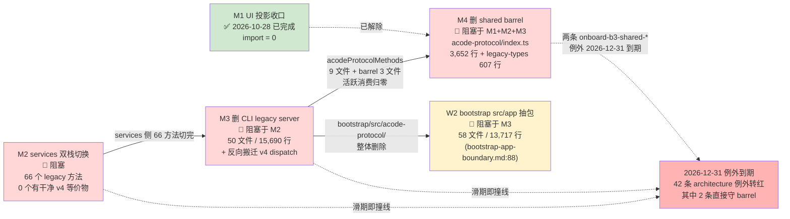

# M3 / M4 / W2 依赖图与启动前置 + 台账漂移处置

审查日期：2026-10-28（Asia/Shanghai）。基线：`fix/project-review-2026-10-26`，提交 `1b56f0b4`（与 origin 同步，相对 origin/main ahead 53 / behind 0）。方法：只读源码审查 + `wc -l` / `git grep` 实测；不修改任何代码。

上游文档：
- [legacy-protocol-convergence-plan.md](../../legacy-protocol-convergence-plan.md)（M1 ✅ 2026-10-28 完成；M2 阻塞）
- [bootstrap-app-boundary.md](../../../apps/acode-cli/specs/bootstrap-app-boundary.md)（W0/W1/W2 定义）
- 上轮 review：[shared-protocol.md](../2026-10-26/shared-protocol.md)、[architecture-governance.md](../2026-10-26/architecture-governance.md)、[cli-core-structure.md](../2026-10-26/cli-core-structure.md)

---

## A. M3 / M4 / W2 依赖图

### A.1 精确依赖关系（mermaid）



**三条阻塞边的精确语义**（全部 file:line 实证）：

1. **M2 → M3**：legacy server 仍派发 services 仍在发的方法。`apps/acode-cli/packages/bootstrap/src/acode-protocol/server.ts:640-678` 实测 **59 个 `case acodeProtocolMethods.*`**（同文件还有 **32 个 `case V4_METHODS.*`**）——`sessionCreate`/`sessionResume`/`sessionList`/`sessionSubagents`/`sessionRead`/`sessionMessages`/`sessionEvents`/`sessionSubscribe`/`sessionSend`/`sessionStop` 等仍活着。services 侧消费方实测：`acodeAgentService.ts` **73 处** `acodeProtocolMethods.*` 调用、`pluginReferenceCatalogRequest.ts` 2 处、`acodeProtocolClient.ts` 是传输载体不算消费（详见 M2 订正）。M2 不把 73+2 处切到 v4，M3 删 server 就是断 production。

2. **M1+M2+M3 → M4**：`acodeProtocolMethods` 在 **12 个活跃消费文件**（实测，非上轮报的 9）：services 3 个（`acodeAgentService.ts` / `acodeProtocolClient.ts` / `pluginReferenceCatalogRequest.ts`）+ bootstrap 9 个（`automation-port.ts` / `browser-control-broker.ts` / `interaction-broker.ts` / `official-mcp-auth-port.ts` / `offpeak-port.ts` / `provider-runtime-headers.ts` / `server-operations.ts` / `server.ts` / `transport.ts`）。M1 完成只解除了 UI 一侧的 `acodeSessionProjection` 桥，没有触碰 barrel 本体。

3. **M3 → W2**：`apps/acode-cli/specs/bootstrap-app-boundary.md:88` 原文「W2：legacy 协议 server 随 docs/legacy-protocol-convergence-plan.md M3 删除后，bootstrap 收敛为「v4 协议服务器 + 装配」」。W2 的前置是 `src/acode-protocol/` 整个目录消失，否则抽出去的「app 包」还要回依赖 legacy server。

**隐藏依赖（不在文档里，本轮实测发现）**：

4. **v4 → legacy 反向 import 已存在 5 处**（违反 v4-bridge.ts:11 自述的「依赖方向只允许旧 → v4」）：
   - `acode-protocol-v4/commands/handlers/goal-compact.ts:17` → `acode-protocol/session-residency.js`
   - `acode-protocol-v4/commands/handlers/session-flow.ts:11` → `acode-protocol/model-execution.js`
   - `acode-protocol-v4/commands/handlers/usage-query.ts:10` → `acode-protocol/usage-stats-builder.js`
   - `acode-protocol-v4/commands/prompt-turn.ts:15` → `acode-protocol/session-residency.js`
   - `acode-protocol-v4/session-header-meta-query.ts:20` → `acode-protocol/server-types.js`

   含义：M3 不是「删目录」而是「**搬迁**」——`server.ts`（1,020 行）的 59+31 case 调度 + `acode-protocol-entrypoint.ts:349` 的 `handleMessage` 绑定 + 这 5 个 v4 文件依赖的 5 个 legacy 模块，都得先搬入 v4 目录或中立叶子，再删目录。文档 2026-10-28 订正已经识别了「搬迁非删除」，这 5 处 import 是进一步的实证。

5. **bootstrap 顶层仍有 1 个对 legacy 的 re-export**：`bootstrap/src/index.ts:71` `export { mapSessionEvent } from "./acode-protocol/session-mapper.js"`。M3 删目录前必须把它一并退役或迁 v4。

6. **`v4-bridge.ts` 6 个过渡钩子**仍在（`:983` `ensureModelReady` / `:995` `afterLegacyStateMutation` / `:1001` `closeSession` / `:1020` `createSessionRecord` / child record registration / `:1389` `resumePersistedSession`），头注明写「随旧协议一同删除」。M3 验收必须包含钩子清零，且这些钩子的执行面要并入 v4 gateway（其中 `closeSession`/`createSessionRecord` 已部分内联进 v4-bridge，但语义对齐的是 `server-operations.ts` 的 legacy op——server-operations 删除前必须把对齐源搬进 v4）。

### A.2 每项启动的具体前置 checklist

#### M3 启动前置（M2 必须完成到什么程度）

文档口径「M2 完成」过于笼统。M3 启动的可勾选前置：

- [ ] **services 侧 `acodeProtocolMethods.*` 调用 = 0**（实测口径：`git grep "acodeProtocolMethods\." -- packages/services/src` 退出码 1）。当前 75 处（`acodeAgentService.ts` 73 + `pluginReferenceCatalogRequest.ts` 2）。
- [ ] **services 侧 legacy **方法**消费 = 0**（按 M2 订正 ②：不数 `acodeProtocolClient` 这个名字——它是永久传输载体；只数方法名）。当前 `acodeAgentService.ts:1257,1803,1824,3890` 仍在调 `V4_METHODS.*`，legacy 66 个方法需逐一有 v4 等价物或退役裁决。
- [ ] **15 个 inbound（agent→host）handler 的 v4 形态协议已完成 spec + 双链路冒烟**（desktop-continuous + web-remote-replayable）。`interactionRequestPermission`/`interactionRequestUserInput`/`automationCreate`/`offPeakCreate`/`computerUseOperationEvent` 等，每条都是「CLI 先发 v4 形态 → host 改 handler」的两侧变更。
- [ ] **14 个部分等价项的产品裁决全部落地**（`goal show/clear` 是否保留、`mode: auto` 是否保留、`close` 与 `delete` 语义边界、`sessionMessages` 分页方向对齐等）。
- [ ] **`sessionSubscribe` 迁移阻塞已解除**（部分依赖 M1 已完成 ✅，剩余是 v4 snapshot 覆盖度）。
- [ ] **`v4-bridge.ts` 6 个过渡钩子的执行面已并入 v4 gateway 或 core**，hook 字段从 binder 接口删除。
- [ ] **5 处 v4 → legacy 反向 import 已解除**（goal-compact/session-flow/usage-query/prompt-turn/session-header-meta-query 的 5 个依赖搬到 v4 目录或中立叶子）。
- [ ] **`bootstrap/src/index.ts:71` `mapSessionEvent` re-export 已迁移或退役**。
- [ ] **CLI 测试基线刷新到当前实测**（上轮文档说 980，实测 `apps/acode-cli/tests/**/*.test.mjs` 现为 **3,151**）。

**M3 真实工作量重估**：不是「纯删除」，是「把 v4 dispatch + entrypoint 装配搬到 v4 目录，再删 legacy 残留」（convergence-plan.md:283-297 的 2026-10-28 订正）。估算包含：59 个 legacy case 删除 + 32 个 v4 case 随 server.ts 一起搬 + 5 处反向 import 解除 + 6 个 hook 收编 + 双链路真实冒烟。

#### M4 启动前置（acodeProtocolMethods 12 个活跃消费文件全部迁走？还是部分？）

**全部 12 个**——少了任何一个都意味着 `acodeProtocolMethods` 这个导出还有消费者，barrel 无法整体删除。Checklist：

- [ ] services 3 文件全部清零：`acodeAgentService.ts` / `pluginReferenceCatalogRequest.ts` / `acodeProtocolClient.ts`（注意 `acodeProtocolClient.ts` 的命中是文件名自指 + 类型联合 `ACodeProtocolMethod | V4Method`，本身不是消费方；M4 验收时该文件需重命名或收窄类型联合到 `V4Method`，否则 grep 仍非零——见 M2 订正 ②）。
- [ ] bootstrap 9 文件全部清零：M3 完成是前提（9 个文件随 `src/acode-protocol/` 目录一并删除）。
- [ ] barrel 内 `acodeProtocolMethods` 与 `acodeProtocolNotifications` 两个非 Schema 导出零消费（`git grep "acodeProtocolMethods\|acodeProtocolNotifications" -- packages/ apps/ | grep -v "acode-protocol/index.ts"` 退出码 1）。
- [ ] `acode-protocol-legacy-types.ts`（607 行）按 2026-10-26 review §2 甄别：被 v4 的 4 个文件（`snapshot.ts:11` / `transport.ts:7` / `script-workflow-management.ts:17` / `telemetry.ts:2`）import 的 6 个 schema 是「幸存面」，不随 barrel 删；其余按类型归属迁 v4 或独立命名。
- [ ] 4 处 v4 → legacy-types import 在 M4 实施期间不能扩面（`scripts/architecture/protocol-boundary.mjs` 已带 6 个幸存 schema 白名单，门禁在位）。
- [ ] barrel 头注「旧协议 client/server 组删除时，本文件整体删除」的两个触发条件都已发生（M3 server 删除 + M2 services 切换）。

#### W2 启动前置（M3 必须完成到什么程度）

按 `bootstrap-app-boundary.md:88`：W2 的前置是 **M3 整体完成**——不是「M3 大部分完成」。Checklist：

- [ ] **M3 全量验收通过**：`bootstrap/src/acode-protocol/` 目录不存在；v4-bridge.ts 不存在；CLI 测试套件（当前 3,151 测）绿；`acode acp` 冒烟通过；desktop 端到端冒烟（起窗口、跑对话、恢复会话）通过。
- [ ] **bootstrap 顶层 105 行的 `index.ts` 只剩 v4 + 装配出口**（`:68` `runACodeProtocolAgent` 已经指向 `acode-protocol-entrypoint.ts`，M3 后该 entrypoint 应当已经被改写为「只装 v4 server」；`:71` `mapSessionEvent` 已退役）。
- [ ] **W1-R3 的引擎族抽包保持稳定**：`@acode/cli-workflow` 已独立（`bootstrap-app-boundary.md:78-87`），bootstrap `src/app/` 只剩 5 个装配接缝（workflow-wiring / workflow-app-facade / workflow-facade / workflow-methods / script-workflow-methods）。W2 在这个基线上评估改名/并入 cli，不是再抽一次。

**W2 真实范围重估**：M3 完成后 bootstrap 还剩约 `src/app/`（58 文件 / 13,717 行实测）+ `src/` 顶层（28 文件 / 6,107 行，含 `index.ts` 105 行）+ `src/lib/` + v4 目录（51 文件 / 21,737 行）。W2 的真正决定是「bootstrap 这个名字是否还成立」——若 v4 服务器 + 装配留在 bootstrap，src/app 全部抽到新包，则 bootstrap 名实相符；否则并入 cli。spec 未给出明确裁决标准，W2 启动前需要先补一节「裁决标准」。

### A.3 50 文件 / 15,690 行 bootstrap legacy server 实测清单

按行数降序。**「可删时机」分类**：

- **A 类（M2 完成后即可删，无 v4 依赖）**：纯 legacy 实现，不被 v4 目录 import。
- **B 类（删前必须搬迁）**：被 v4 目录 import（5 处反向依赖）或被 `src/index.ts` re-export。
- **C 类（v4-bridge 钩子提供方）**：钩子的执行面在这些文件里，删除前需把执行面并入 v4 gateway。

| 文件 | 行数 | 类别 | 删除前置 |
|---|---:|---|---|
| server-operations.ts | 4,058 | A | M2 完成（hooks `closeSession`/`createSessionRecord` 对齐源） |
| v4-bridge.ts | 1,883 | C | 6 钩子收编进 v4 gateway；本文件随之删除 |
| session-mapper.ts | 1,586 | B | `bootstrap/src/index.ts:71` re-export 先退役 |
| server.ts | 1,027 | B | 59 个 legacy case 随 M2 删除；32 个 v4 case **搬到 v4 目录**（M3 核心搬迁动作） |
| interaction-broker.ts | 664 | A | M2 完成（permissions broker 重设计落地） |
| subagent-session-query.ts | 643 | B | `app/subagent-observation.ts:16` import；M3 前先搬到中立叶子或 v4 |
| plugins.ts | 601 | A | M2 完成（plugins 族 15 个 inbound 之一） |
| server-types.ts | 374 | B | `session-header-meta-query.ts:20` import；搬到 v4 目录或中立叶子 |
| provider-diagnostics.ts | 352 | A | spec 已裁决留 bootstrap（`packages/services/specs/provider-diagnostics.md:238`）；但其 dispatch 在 server.ts:710-713，需先迁 v4 方法 |
| session-resident-pool.ts | 326 | A | M2 |
| message-mapper.ts | 299 | A | M2 |
| transport.ts | 295 | A | M2；注意头注 `:370-371` 自述「旧 session/* 删除后这是唯一协议面」——transport 本身**不删**（它是 v4 的载体），删除范围是 legacy dispatch 逻辑 |
| plugin-reference-catalog.ts | 292 | A | M2 |
| usage-stats-builder.ts | 271 | B | `acode-protocol-v4/commands/handlers/usage-query.ts:10` + `app/create-app.ts:71` + `app/session-facade.ts:33` 三处 import；搬到中立叶子 |
| automation-port.ts | 270 | A | M2（automationCreate inbound） |
| saved-workflows.ts | 267 | A | M2 |
| mcp.ts | 200 | A | M2 |
| session-debug.ts | 190 | A | M2 |
| browser-control-broker.ts | 170 | A | M2 |
| storage-startup.ts | 147 | A | M2 |
| workspace-model-runtime.ts | 143 | A | M1 已解除 UI 侧依赖；M2 删 `readWorkspacePresentation`（实测 `:26` `mode: "build"` 硬编码） |
| session-residency.ts | 123 | B | `acode-protocol-v4/commands/handlers/goal-compact.ts:17` + `commands/prompt-turn.ts:15` 两处 v4 import；搬到 v4 目录 |
| offpeak-port.ts | 116 | A | M2（offPeakCreate inbound） |
| workspace-hook-trust.ts | 107 | A | M2 |
| slash-commands.ts | 104 | A | M2 |
| interaction-response-race.ts | 100 | A | M2 |
| provider-runtime-headers.ts | 97 | A | M2 |
| computer-use-operation-event.ts | 88 | A | M2（computerUseOperationEvent inbound） |
| resource-sampler.ts | 86 | A | M2 |
| provider-diagnostics-ports.ts | 79 | A | 同 provider-diagnostics.ts |
| official-mcp-auth-port.ts | 78 | A | M2 |
| runtime-cleanup.ts | 66 | A | M2 |
| skill-reference-catalog.ts | 65 | A | M2 |
| v4-workspace-config.ts | 61 | A | M2 |
| runtime-resources.ts | 60 | A | M2 |
| ai-sdk-warning-logger.ts | 53 | A | M2 |
| protocol-mcp-config.ts | 42 | A | M2 |
| startup-resource.ts | 40 | A | M2 |
| workspace.ts | 35 | A | M2 |
| account-provider-config.ts | 32 | A | M2 |
| model-io-preferences.ts | 28 | A | M2 |
| background-work-owner.ts | 28 | C | v4-bridge.ts:2 `readBackgroundBashOutputFromOwner` import；搬到 v4 目录 |
| process-child-processes.ts | 27 | A | M2 |
| model-execution.ts | 27 | B | `acode-protocol-v4/commands/handlers/session-flow.ts:11` import；搬到 v4 目录 |
| interaction-preferences.ts | 23 | A | M2 |
| dynamic-workflow-policy.ts | 19 | A | M2 |
| off-peak-tool-policy.ts | 17 | A | M2 |
| model-mapper.ts | 17 | A | M2 |
| mapper.ts | 13 | A | M2 |
| permission-options.ts | 8 | A | M2 |

**总计 50 文件 / 15,690 行**（实测 15,697，含 `wc -l` 行尾差异，与文档 15,690 口径一致）。

**B 类汇总（必须搬迁而非删除）**：server.ts / session-mapper.ts / subagent-session-query.ts / server-types.ts / usage-stats-builder.ts / session-residency.ts / model-execution.ts / background-work-owner.ts（**8 个文件**）——这是「M3 = 搬迁 + 删除」的最简证据集。

---

## B. 2026-12-31 例外到期风险

### B.1 42 条例外的精确清单（按层分布）

`architecture-policy.yaml` 实测 42 条 `expires: "2026-12-31"`（行 385-668），分布：

| 层 | 条数 | 例外 id 前缀 | 守护路径数 |
|---|---:|---|---:|
| **cli-workflow** | 14 | `w1r3-max-file-lines-*` (11) + `w1r3-disable-count-*` (3) | 11 + 3 = 14 个文件条目 |
| **contracts** | 17 | `contracts-onboarding-max-file-lines-*` (11) + `contracts-onboarding-disable-count-*` (6) | 11 + 6 = 17 个文件条目 |
| **formal-proof** | 1 | `onboard-formal-proof-over-limit` | 2 文件 |
| **provider** | 2 | `onboard-provider-over-limit` + `onboard-provider-disables` | 4 + 5 文件 |
| **acode-server-cli** | 2 | `onboard-server-cli-over-limit` + `onboard-server-cli-disables` | 3 + 3 文件 |
| **shared** | 2 | `onboard-b3-shared-over-limit` + `onboard-b3-shared-disables` | 26 + 18 文件 |
| **server** | 2 | `onboard-b3-server-over-limit` + `onboard-b3-server-disables` | 9 + 8 文件 |
| **services/session** | 2 | `onboard-b3-session-over-limit` + `onboard-b3-session-disables` | 7 + 8 文件 |

**当前各文件状态（实测 2026-10-28 行数 vs 400 行阈值）**：

- **cli-workflow 11 文件全部仍超 400**：script-workflow-runtime(882) / dynamic-workflow-run-launch(693) / workflow-world-read(649) / dynamic-workflow-run-observation(613) / workflow-driver(603) / dynamic-workflow-run-submit(565) / script-workflow-tool-port(556) / dynamic-workflow-import(556) / workflow-artifact-publish(550) / dynamic-workflow-run-service(576) / workflow-git-world-read(427)。**到期转红**。
- **contracts 11 文件全部仍超 400**：session.events(1373) / session-store.port(1282) / dynamic-workflow-run.port(1068) / workflow/index(892) / event-reducer(587) / browser-control.port(546) / model/index(541) / create-workflow(510) / config/index(479) / target(437) / **hooks/index(205)**。**`hooks/index.ts` 已合规**，到期该路径上的违规会消失，但同 id 下其余 10 个文件仍红（例外是按文件列 paths 的，单文件合规则该文件从违规集中剔除）。
- **formal-proof 2 文件全超**：main(905) / model(920)。**到期转红**。
- **provider 5 文件**：config-service(811) / model-config(629) / provider-config(580) / facades(747) / **resolver(392)**。**resolver 已合规**，其余 4 个仍红。
- **acode-server-cli 3 文件全超**：cli(517) / stage(652) / supervisor(661)。**到期转红**。
- **shared 26 文件全超**：acode-protocol/index.ts(3652) / acode-protocol-legacy-types.ts(607) / 9 个 v4 文件（command 538 / rows 513 / snapshot 576 / transport 1213 / wire-assembler 574 / workflow-runs-delta 517 / workflow-runs-eviction 542 / workflow-runs-reducer 639 / workflow-runs 562）/ acode-task-types-core(1228) / **background-task-controls(404)** 边缘 / bots(610) / browser-use/commands(588) / channels(1342) / coding-plan-subscription(519) / harness-api/methods(428) / credentialKeychain(452) / credentialMasterKey(542) / platform(1125) / task-realtime-core(525) / test-ids(759) / usage-stats(473) / validation(1342) / validationAppSettings(631)。**几乎全到期转红**（background-task-controls 边缘可能擦线）。
- **server 9 文件全超**：translate(861) / http(783) / acodeAgentDevDeploy(438) / deploy(815) / localTarGz(430) / remoteAssetCache(1928) / remoteAssetInstaller(1087) / ssh-backend(768) / wsl-backend(664)。**到期转红**。
- **services/session 7 文件全超**：acodeTaskService(1116) / automationRepo(1502) / automationService(486) / offPeakMockGateway(832) / offPeakTaskRepo(819) / offPeakTaskService(684) / taskIndexRepo(2567)。**到期转红**。注：disables 例外下的 `claudeNativeSessionImportParser.ts`(369) 和 `offPeakRuntimeModel.ts`(357) 已合规。

**总计**：42 条例外守护 **约 90 个文件条目**，其中 **86 个仍违规**（扣除 hooks/index、resolver、claudeNativeSessionImportParser、offPeakRuntimeModel 4 个已合规），**2027-01-01 起 `pnpm architecture:check` 全部转红**（`scripts/architecture/index.mjs:75-88` 的 expired-exception 全局违规 + 各文件 max-file-lines/disable-count 违规同时出现）。

### B.2 关键路径与最大风险 5 条

今日 2026-10-28，距 2026-12-31 还有 **64 天 / 9.1 周**。M2 按 convergence-plan 自评「多周到多月」，最乐观情形也需到 12 月初才能完成 services 切换；M3 还要加上述 8 文件搬迁 + dispatch 搬迁 + 冒烟，最乐观再加 2-3 周；M4 在 M3 完成后才能动。**M2/M3/M4 在 deadline 前完成的概率低**。

**风险最大的 5 条例外**（按 M2/M3 滑期时最先引爆、影响面最广排序）：

1. **`onboard-b3-shared-over-limit`**（`architecture-policy.yaml:568-599`，26 文件）——同时覆盖 barrel（M4 目标）与 9 个 v4 文件。M4 不删 barrel，2027-01-01 立即红 26 个文件 + 1 条 expired-exception。这是最直连 M4 的例外。
2. **`onboard-b3-shared-disables`**（`:600-623`，18 文件）——barrel 同样在 paths 里。与上一条同因同爆。
3. **`onboard-b3-session-over-limit`**（`:653-665`，7 文件）+ **`onboard-b3-session-disables`**（`:666-679`，8 文件）——session 层是 M2 切换的主战场（`acodeAgentService.ts` 73 处调用就在这层附近）。M2 不动，session 例外也无人偿还——15 个文件条目同爆。
4. **`onboard-b3-server-over-limit`**（`:624-638`，9 文件）+ **`onboard-b3-server-disables`**（`:639-652`，8 文件）——server 层与 legacy 退役无直接依赖，但**没人排期偿还**——review §11 修复也未涉及。**独立债务，与 M2/M3 同时到期**。
5. **`contracts-onboarding-max-file-lines-*`**（11 条）——17 个文件条目，按 review §11 边界「按职责拆分偿还（拆一个删一条）」节奏，9.1 周拆 10 个仍超 400 的文件 ≈ 每周 1.1 个，且每个都涉及 contract 改 shape，**赶上 M2/M3 抢工时**。

**最长可推迟的例外**：formal-proof、provider、acode-server-cli 的 5 条（onboard-{formal-proof,provider,server-cli}-*）——独立于 legacy 退役，可由独立批次偿还，不抢 M2/M3 工时。但若完全无人排期，到期同爆。

**裁决建议（不做实施）**：M2 滑动已成事实，应当在 2026-11-15 之前决定二选一：(a) 把 `onboard-b3-shared-*` 与 `onboard-b3-session-*` 4 条例外的 `expires` 推到 2027-Q1 并刷新偿还计划（承认 M2/M3 滑期，保留门禁信号但避免「deadline 天天撞」的告警疲劳）；(b) 守住 2026-12-31，立刻把 M2 当 P0 推进，**同时**砍掉其余例外层（formal-proof / provider / server-cli / contracts / cli-workflow）的本周期工作以腾出工时。两者必居其一；保持现状（不推 expires 也不推 M2）等于默认选择「2027-01-01 起 42 条例外 + 86 个文件全红」。

---

## C. 台账 inventory.json 漂移处置

### C.1 当前漂移的精确内容

实测 `node scripts/licenses.mjs reproducibility --inputs-only`：

```
台账 inputs 与工作树不一致：2902 项中 1 项漂移（mode=inputs-only）
  - packages/client/package.json：哈希不符
      台账 34842bccbb96748d785cd56230ca0e36d230b913cc57ef455680d87c999b939c
      实际 0a81396ec8b4a9c6482088276b98768af309a280ef1dd90c62051bd5403ccf28
```

**根因**：提交 `d1db62b3`（`fix(web,client): 重连模块 bfcache 死界面与 retryNow 孤儿 socket 双 P2 + client dispose 面与首测`）给 `packages/client/package.json` 加了一个 `"test"` script：

```diff
   "scripts": {
     "lint": "oxlint",
-    "lint:fix": "oxlint --fix"
+    "lint:fix": "oxlint --fix",
+    "test": "node --import tsx --test \"tests/**/*.test.ts\""
   },
```

`packages/client/package.json` 是 inventory 登记的 2902 个源文件之一，任何字段变更都会改变其 sha256，触发 inputs 新鲜度门禁。

**与 origin/main 的关系**：`git diff origin/main -- third-party/inventory.json` 实测**为空**——台账与 origin/main 一致；漂移发生在「origin/main 的台账」与「本分支修改后的 packages/client/package.json」之间。这是 W 代理在 1.0.4 修复周期的合法连带，不是缺陷。

### C.2 发版流程的 CI Linux 重生成实操步骤

**当前门禁拓扑**（实测）：

- **`ci.yml:77-78`** 在 push/PR 上跑 `node scripts/licenses.mjs reproducibility --inputs-only`——**只比哈希，不重生成**；这是「开发期信号」，能发现漂移但不修。
- **`licenses-notices.yml`**（专用 workflow）在 `pull_request` 与 `push: branches:[main, "release/**"]` 触发——**全量重生成 + diff 校验 + 上传 artifact**。
- **`release.yml`**（正式发布流水线）**不包含** `licenses` / `inventory` / `notices` 任何步骤（grep 实测 0 命中）——**它假定 release/** 分支推进前 licenses-notices 已经绿了**。

**为什么会卡在发版**：按 `docs/git-collaboration.md:53` 规则「licenses-notices 等专项闸门在 release 分支的推送上全部 success」，release 分支推上去后 licenses-notices.yml 会被 `push: branches:["release/**"]` 自动触发；它内部 `Report diff against committed ledger` 步（`licenses-notices.yml:174`）会因为本漂移失败 → 阻塞合入 main → release.yml 走不到 publish。

**回补台账的具体步骤**（落到 release 流程的固定时机）：

1. **触发**：在 release/** 分支推到远端后，licenses-notices.yml 自动跑（**这是发版流程的第 0 步**，先于 release.yml）；也可以本地 `gh workflow run licenses-notices.yml --ref <release-branch>` 手动派发（workflow_dispatch 触发器，`licenses-notices.yml:28`）。
2. **等失败**：`Report diff against committed ledger` 步会因 `packages/client/package.json` 哈希漂移报非空 diff，整个 job 红。
3. **下载产物**：`Upload regenerated ledgers` 步（`licenses-notices.yml:178-186`，`if: always()`）即便失败也会上传 artifact，文件名固定 `licenses-notices`，包含两个文件：
   - `THIRD-PARTY-NOTICES.md`
   - `third-party/inventory.json`

   下载命令：`gh run download <run-id> -n licenses-notices`（在 release 分支那次失败的 run 上）。
4. **本地落位**：解压后用 `third-party/inventory.json` **覆盖**工作区里的同名文件；`THIRD-PARTY-NOTICES.md` 同理（本次只有 `packages/client/package.json` 变了，理论上看 notices 是否含 client 包内容差异——若只 hash 变内容不变，notices 可能逐字节相同；以实际 diff 为准）。
5. **本地核验**：在干净工作区（不含其他改动）跑 `node scripts/licenses.mjs reproducibility --inputs-only`，应当输出「2902 项源文件哈希全部相符」，exit 0。**不要在本机跑 `node scripts/licenses.mjs notices` 重生成台账**（工具与 fix-status.md:60 都明令禁止——Windows 行尾与平台依赖变体会污染台账；1.0.4 周期对 9 个哈希的处理就是同一条纪律）。
6. **提交回 release 分支**：`git add third-party/inventory.json THIRD-PARTY-NOTICES.md`（如有变化）+ 一条独立提交，消息注明「台账回补：d1db62b3 packages/client test script」，推回 release/** 分支。
7. **重新触发**：push 会再次触发 licenses-notices.yml，这次 `Report diff` 应当为空、job 绿；之后 release.yml 才能走完 publish。
8. **回 main**：release 合入 main 时台账修复随之进 main，origin/main 上的台账与 client/package.json 哈希重新一致。

**这一步骤对应发版流程的「第 0 步」**——release.yml 自己不查台账，**实际拦在 release 分支的 push 触发的 licenses-notices.yml 上**。处置窗口是「release 分支推到远端 → release.yml workflow_dispatch 之前」。**当前这个漂移**（packages/client/package.json）由 W 代理的合法修复引入，按照 fix-status.md:60 主审裁决「交发布流程 CI Linux 重生成」，**无需在本周期单独处理**，下次发版走上面 8 步即可。

---

## 关键证据汇总（file:line）

- M2 阻塞：`acodeAgentService.ts` **73 处** `acodeProtocolMethods.*` 调用；`server.ts:640-678` 59 个 legacy case 仍在派发。
- M3 不是删除是搬迁：`server.ts` 同时承载 59 legacy + 32 v4 case（实测 32 而非文档说的 31，新增 `session/headerMeta`）；`acode-protocol-entrypoint.ts:349` `handleMessage` 直接绑 `ACodeProtocolAgentServer`。
- 5 处 v4 → legacy 反向 import：`goal-compact.ts:17` / `session-flow.ts:11` / `usage-query.ts:10` / `prompt-turn.ts:15` / `session-header-meta-query.ts:20`。
- 6 个 v4-bridge 过渡钩子：`:983/995/1001/1020` + child registration + `:1389`。
- M4 barrel 12 个活跃消费文件：services 3 + bootstrap 9（实测 grep 清单见 A.1 注 2）。
- W2 范围实测：`src/app/` 58 文件 / 13,717 行（比 spec 2026-10-26 实测 13,596 行多 121 行，来自 U 代理的 create-app 接线）。
- 42 条例外分布：cli-workflow 14 / contracts 17 / formal-proof 1 / provider 2 / acode-server-cli 2 / shared 2 / server 2 / session 2。
- 到期机制：`scripts/architecture/index.mjs:75-88` 严格 `<` 比较，2027-01-01 起转红。
- 台账漂移：1 项，`packages/client/package.json` hash `34842bcc…→0a81396e…`，根因 `d1db62b3` 加 `test` script。
- 台账门禁拓扑：ci.yml 只检测，licenses-notices.yml 重生成 + diff，release.yml 不查（依赖 release 分支 push 触发的 licenses-notices）。
