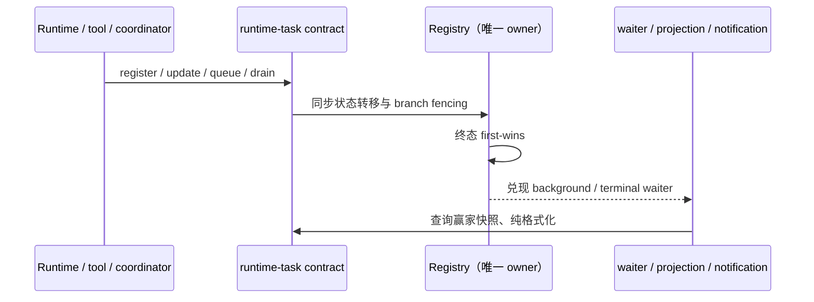

# 架构检查覆盖与 runtime-task 纳管

## 规则与所有者

- `architecture: OK` 只表示已检查范围没有新增违规，不能表示全仓分层、依赖与状态所有权均已通过。
  报告必须列出全仓 discovered source 的 managed / legacy 模块与文件数、实际规则及 legacy 未检查规则；
  `--changed` 的违规子集不改变全仓覆盖统计。
- legacy 文件也解析真实 imports 并加入 reverse dependency graph。来自 legacy 生产源码、指向 managed
  模块的导入必须走该模块公开入口；不能因为 importer 未纳管而绕过新模块边界。白盒测试/评测的
  源码深导入仍不属于生产边界，采用现有 test/eval 分类，不给生产代码新增例外。
- legacy 模块的 `requires`、层定义和公开契约仍不完整，本轮不将 legacy graph 全面标成纳管。
  未声明依赖、无法解析的 workspace 导入、legacy 内部循环、domain IO、层方向与契约规模不在
  legacy 强制范围。全面开启需要
  可复核的存量图基线与分批修复；不得用 HEAD 临时豁免已提交的新债，也不得刷新 baseline 掩盖问题。
- `core/runtime-task` 纳为 managed 纯状态模块：`InMemoryRuntimeTaskRegistry` 是任务快照、pending
  message 与 waiter 的唯一 owner；调用者通过 `contract.ts` 命令与查询，formatter 只读输入并产出文本。
  原有终态 first-wins、branch generation、background/terminal waiter、取消信号与 register 重臂语义不变。
- managed `runtime-task` 的外部依赖只有 CLI contracts 公开入口。CLI contracts 单独登记为 legacy 模块，
  这只提供可解析的边界，不声称其已纳管。通知与 registry 类型归模块内唯一 `types.ts`；XML/截断原语
  单独归 `notification-primitives.ts`，解除 notification 与 workflow 文案格式器的循环。公开 Registry API
  保留 11 个方法，由契约示例验证实现；消费者迁到 contract，core 的包级公开 API 保持兼容。
  `module.ts` 与 `contract.example.ts` 是架构 context / TypeScript 的验证入口，须进入 Knip 分析；
  无消费者的内部 `runtime-task/index.ts` 删除，不删除 `contract.ts` 或 core 包级重导出。
- storage 的浏览器安全服务契约仍归 `contract.ts`；Node 装配工厂、port 类型及 adapters
  从单独的 `node.ts` 公开入口导出。services 的 Node 聚合入口只能经它再导出，不再深入
  storage/app 或 storage/adapters。该入口不新增状态所有者，原扫描/清理生命周期不变。
  同步补齐 storage 的 CONTRACT.md 与可编译契约示例，记录 job owner、取消、旧 job
  事件与最新快照区别以及清理副作用边界，供受控 context 阅读。

## 验收

1. 独立 fixture 同时有 managed 与 legacy 文件：文本、Markdown、JSON 都说明覆盖及未检查规则；
   只改 legacy 文件的 `--changed` 仍报告全仓覆盖。
2. legacy 生产代码导入 managed 私有实现被拒；改成 contract 后通过；白盒测试导入实现允许。
3. runtime-task 无循环、无 IO 依赖、11 方法契约、物理行数满足 managed 门禁；原有终态竞态、通知
   golden、branch generation 与 waiting 行为测试通过。
4. checker 检查既有 baseline 未改写，已有债务与新增违规分开报告；不产生新 ratchet 豁免。

## Resolver 能力（ARCH-04 三缺口，2026-10-22 落地）

checker 的导入解析与边界判定新增四项能力，全部 fail-closed（默认不放宽边界），
配套 fixture 见 `apps/acode-cli/tests/architecture-coverage.test.mjs`：

1. **exports map 解析（缺口①）**：`resolveImport` 的 workspace 分支先查目标包
   `package.json` 的 `exports` 表（支持精确子路径与含单个 `*` 的 pattern，如
   `@acode/server` 的 `./remote/*.js`），命中则按 exports target 解析；未命中再回退
   `<pkgRoot>/src/<subpath>` 约定。补上 remap 型子路径（子路径名 ≠ src 文件名，
   如 `@acode/shared/runtime-env` → `src/runtimeEnv.ts`、`node-repl-browser-broker` →
   `src/browser-use/nodeReplBroker.ts`），这两条约定推不出、纳管前解析为 null。
   **纯 `.d.ts` target 不作架构依赖边**（返回 null）：类型声明不构成运行时模块依赖，
   且 policy 有意不把 `.d.ts` 登记为公开入口（如 `@acode/client/globals` → `src/globals.d.ts`），
   否则会把 desktop→client 的类型 ambient import 误判成 deep-import。
2. **通配公开入口（缺口②）**：模块可声明 `publicEntrypointPatterns`（repo-relative
   posix glob，`*` 单段 / `**` 跨段，必须含 `*`）。`publicEntrypointMatches` 在精确入口
   不命中时再按 glob 匹配。**只放行声明范围内**，范围外 deep-import 仍报违规；未匹配到
   任何文件的 pattern 等同无入口（fail-closed），不会放宽边界。server 的 `remote/*.ts`
   **未收敛为通配**：remote/ 有 47 个非 test `.ts`、当前只 5 个被跨模块消费，通配会把
   公开面从 5 放宽到 47，违反「新 deep-import 仍被检出」，故保留逐一显式登记的 ratchet；
   通配能力留给「目录内全部文件确为公开面」的模块使用。
3. **asset 导入豁免（缺口③）**：`global.assetExtensions` 显式声明静态资源扩展名集合
   （当前 `[.css, .svg, .png, .mp3]`，按仓库实测登记面收窄）。命中的 specifier 是构建期
   资源，不解析、不入反向图、不计入 deep-import / module-dependency /
   unresolved-workspace-import / domain-io。扩展名集合在 policy 声明、**不硬编码在
   checker**；默认空集合 = 不豁免。伪装成 asset 的 TS deep-import（`./foo.ts`）扩展名不在
   集合内，照常按源码边校验。是 ui/web/desktop 纳管前置（ui 有 50+ 处 `@/assets/*.svg|png`
   alias asset 导入，无豁免会误报 unresolved-workspace-import）。
4. **内部边白名单（缺口④，迁移中模块 deep-import）**：模块可声明 `internalEdgeAllowlist`
   （逐条 `{from, to}` repo-relative posix 边，只精确匹配、不做前缀/通配）。当
   `publicEntrypoints` 尚不能覆盖存量实现文件直引时（如 session 的 24 条
   services→session 边），白名单冻结既有边使其合法；deep-import 门禁在目标模块声明了
   任一边界（精确入口 / 通配入口 / 白名单）时生效（`moduleHasBoundary`），未登记的新边
   立即报违规。把「惰性保持合法」变成「新增需显式登记」，止住迁移期内部边增长。
   用法与里程碑见 `packages/services/specs/session-module-boundary.md`。

## ui / web / desktop（及 services / acode-cli）纳管路线图（评估，未实施）

resolver 三缺口修复后，legacy 5 根的纳管前置从「缺解析能力」转为「缺边界声明与存量修复」。
各根剩余前置与工作量（文件数为 discovered 非 test 源码数，超限数取自 baseline
legacy-over-limit，2026-10-22 实测）：

- **web（11 文件，最小）**：需补 `module.ts` + `contract.ts` + 分层定义 + requires。
  web 是壳层（Vite 入口 + 平台注入），边界窄。前置基本只剩「写契约」。预估 0.5-1 人日。
  是下一个最该纳管的根。
- **desktop（262 文件 / 36 超限）**：Electron main + host + renderer。前置：(a) 拆 36 个
  超限文件（或登记 over-limit 例外）；(b) main/host/renderer 三层定义 + domain-io 边界
  （main 持大量 node: IO，需按 server 同款「单层 app」或明确分层）；(c) renderer 的
  `@acode/client/globals` ambient 类型 import 已被 `.d.ts` 排除，asset import 已豁免。
  预估 3-5 人日（超限拆分是大头）。
- **ui（1574 文件 / 176 超限）**：最大根。前置：(a) 176 个超限文件（baseline 最大头，
  需分批拆或例外登记）；(b) `ui-implementation-import` 规则已在 checker 硬编码（禁止
  UI→repo/runtime/services 实现），需确认 ui 的 hooks/store 边界与之一致；(c) 50+ 处
  asset import 已豁免；(d) 需 `module.ts`/`contract.ts` + 分层。工作量最大，建议按子域
  （components / store / hooks / v4）分批纳管。预估 10-15 人日。
- **services（294 文件 / 47 超限，除已纳管的 session/storage）**：fix-status 已定价前置是
  2 个 type-only 环 + 48 超限文件 + resolver 三缺口（后者本轮已修）。剩余：拆超限 + 断
  type-only 环 + 补 `module.ts`/`contract.ts` + 分层（44 个顶层子目录，需按域切分）。
  session↔services 双向耦合是 services 未纳管的直接后果，纳管时统一分层解决。预估 8-12 人日。
- **acode-cli（2107 文件 / 160 超限，大根）**：已按子包分批纳管（contracts / runtime-task /
  workflow* / workflow-run-*），剩余是 core / bootstrap / adapters / cli 等内部包。前置同
  services（超限拆分 + 逐子包契约）。按既有「一子包一模块」节奏推进，不宜整体翻转。

**不实施理由**：本轮只交付 resolver 能力（共同前置）。把任一 legacy 根直接 `managed: true`
会因超限文件（web 除外）与缺失边界声明让门禁立即转红——治理门禁转红不可接受。路线图
按「web → desktop → services → ui / acode-cli 子包」的超限数递增顺序推进，每根纳管前先补
契约与分层、拆或登记超限，保持 `architecture:check` new 0 / regrown 0。

## 明确剩余范围

本次最小闭环不是 `acode-cli` 所有内部包的完整治理：CLI contracts 之外的内部包仍属于 legacy
`acode-cli` 大根。可以解析包名不等于已约束每个包的依赖、exports 或循环；必须继续按模块建立
契约与来源清楚的存量债务清单。桌面 continuous 与手机 replayable 交付仍由各自现有 Host/协议 owner
负责，本模块只提供同一运行时事实的内存快照，不新增远程队列或持久化 owner。
