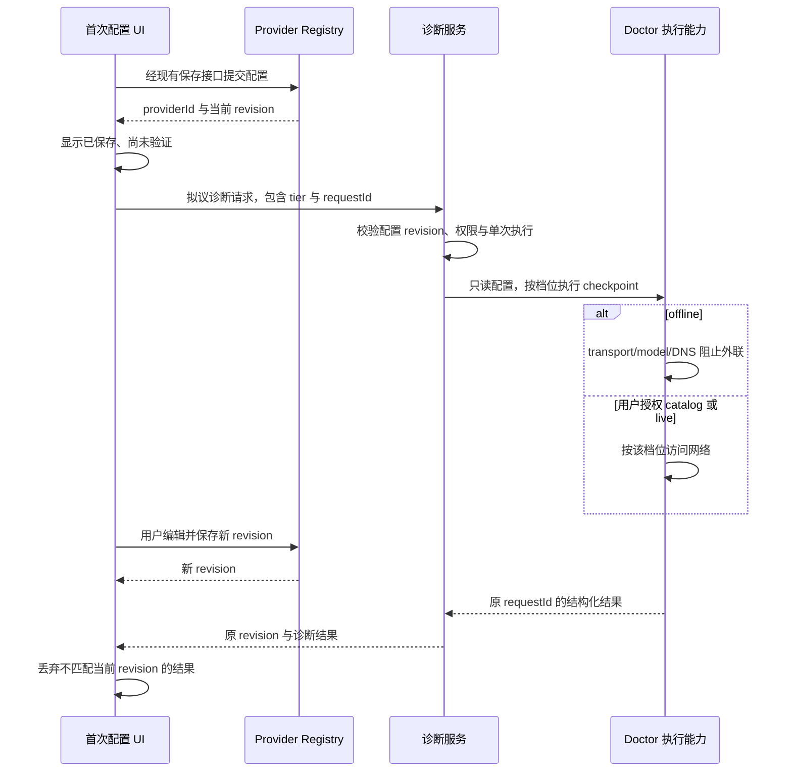

# 产品体验与支持能力升级标准（2026-10）

先为 U07、U08 更新模块 spec 和验收夹具，再实现产品入口；U09 可独立完成文档校准，U11、U12 按依赖顺序推进。

本文细化[项目升级建议](../project-upgrade-recommendations-2026-10.md)中的 U07/U08/U09/U11/U12，以及 2026-10-12 调查 zcode-recovered 后新立的 U14（Windows Computer Use producer），仅定义拟议实施标准，不代表行为已经实现。U07–U12 调查日期为 2026-10-09，U14 调查日期为 2026-10-12，事实以本文链接的当前源码和 spec 为准。U14 章节（§7）于 2026-10-13 阶段 0 开工前经独立核查修订（32 条事实纠正，逐条落进正文对应位置），核查方法为 6 路子系统 file:line 逐条对照 + 真机实测；§7 记录的行数口径、覆盖现状与占位面均以该次核查为基线。

## 1. 共用实施约束

1. 行为修改先更新对应 spec，列清用户规则、唯一状态所有者、接口、失效条件和验收场景。文档自身不能替代模块 spec。
2. UI 通过 `packages/ui/src/hooks/` 访问服务；跨包只用公开入口。平台下载通过 `IPlatformService`，不直接调用 `window.acode`。
3. 所有标为“拟议”的接口、阈值和脚本必须在实施 PR 中确认或调整；正文中的现有常量不能由建议值静默替换。
4. 默认使用合成会话、图片和凭据夹具。模型 live 测试必须显式授权，记录成本边界；本地报告生成不能触发模型请求。
5. 桌面与手机 Web 分别验证；存在恢复时序时分别验证 `desktop-continuous` 与 `web-remote-replayable`。当前没有统一 E2E 命令，实施方需提供实际运行入口和失败证据。

各项工作量按一名熟悉仓库的工程师估算，包含 spec、实现及针对性验证；共享 E2E 设施、外部 provider 等待和额外协议能力不计入重复投入。

## 2. U07：长对话目录索引与窗口外跳转

### 2.1 用户目标与当前边界

用户打开目录即可找到已经索引的历史输入，点击后定位窗口外正文，查看历史期间仍能收到运行状态，并能明确返回最新位置。

当前已有虚拟列表、有界正文窗口与轻量 turn 索引。`getTurnIndexEntries()` 已存在，但生产目录仍使用 `renderUnits`；`loadAllOlder()` 会逐页读取正文再收集索引。证据见 [projection store](../../packages/ui/src/v4/conversationProjectionStore.ts)、[timeline](../../packages/ui/src/v4/ConversationTimeline.tsx)和[turn index](../../packages/ui/src/v4/conversationTurnIndex.ts)。

[内存 spec](../../packages/ui/specs/renderer-memory-budget.md)当前约束是正文最多 1200 行、32 MiB，索引最多 8000 项；[v4 limits](../../packages/shared/src/acode-protocol-v4/core.ts)中单次 `rowsRange` 最多 200 行。历史报告的 4000 行/128 MB 不能用于当前验收。

本项不建设全文搜索，不保证尚未索引的任意远古输入都能立即定位，不扩大 renderer 预算，不在打开目录时扫描全部正文。超过 8000 项的索引淘汰必须可识别；若产品要求完整历史目录，另立 v4 分页目录能力，追加估算 4–6 人日。

### 2.2 状态所有者与接口标准

| 对象                             | 所有者与约束                                                                                                        |
| -------------------------------- | ------------------------------------------------------------------------------------------------------------------- |
| 目录、正文窗口、分页及请求有效性 | `conversationProjectionStore` 唯一拥有；目录组件只读索引和选择状态，不自行合并正文                                  |
| 权威会话与 row identity          | CLI/runtime 投影事实源；UI 不为历史浏览创建第二份权威会话状态                                                       |
| 历史聚焦                         | **拟议**：同一 store 中的有界派生聚焦视图；与尾部正文合计仍受 1200 行/32 MiB 限制                                   |
| 定位入口                         | **拟议**：store 公共 `focusIndexedRow(target)`；参数包含当前会话、generation、rowId，响应包含定位结果和可恢复错误码 |
| 返回最新                         | **拟议**：store 公共 `returnToLive()`；清理聚焦请求和派生正文，恢复尾部滚动意图                                     |

实施前必须在 spec 中裁决窗口语义：建议保留连续权威尾部，历史焦点只作为派生读取；共享总预算由 store 调整，不能各保留 1200 行后再相加。拟议保留尾部 60 行作为起点，须验证连续更新及 rewind 不变量后才采纳。

现有索引项没有 `turnId`；若定位、编辑或 rewind 需要新增稳定实体标识，标为**拟议字段**并同步严格 schema，不能将 UI 推断出的 turn 当作权威值。远端请求继续带 `workspaceIdentity`、`remoteSessionId`，身份 key 使用既有工具生成。

### 2.3 实施步骤（3–5 人日）

1. 更新内存与导航 spec，裁决聚焦窗口语义、索引覆盖范围、预算归属及“返回最新”；先补 >1200 行、索引淘汰和迟到响应测试（0.5–1 日）。
2. 将现有轻量索引接入目录，显示当前可导航范围；沿用 `DESIGN.md` 的组件、主题和国际化（0.5–1 日）。
3. 在 store 实现拟议定位入口、按需页读取、单次有效请求和总预算管理；焦点失效时返回结构化结果（1–1.5 日）。
4. 连接目录点击、历史焦点和返回最新；手机窄屏关闭目录后正文可独立操作，运行状态保持可见（0.5 日）。
5. 执行 store 行为测试及桌面/手机 E2E，记录请求次数、预算计数、截图和 trace（0.5–1 日）。

### 2.4 编号验收场景

| 编号   | 前提                                     | 操作                     | 必须断言                                                 | 证据                                          |
| ------ | ---------------------------------------- | ------------------------ | -------------------------------------------------------- | --------------------------------------------- |
| U07-A1 | 合成会话 6000 行，目标在索引内、正文窗外 | 打开目录，点击该输入     | 打开目录不请求正文；点击定位到正确 row；不全量加载历史   | 目录 E2E、协议请求记录、目标 row 截图         |
| U07-A2 | 会话仍在持续流式输出                     | 浏览历史，再返回最新     | 历史焦点不吞掉权威更新；返回最新显示当前尾部，没有重复行 | 双 delivery mode 夹具、generation 与 row 断言 |
| U07-A3 | 定位请求尚未返回                         | 切换会话或 workspace     | 旧响应被拒绝，新会话正文与目录未被写入                   | 可控延迟测试、请求标识断言                    |
| U07-A4 | 聚焦目标即将被 rewind/edit 移除          | 执行 rewind/edit         | 索引与聚焦一起失效，显示确定的不可定位状态，无无限重试   | 变更前后索引和预算快照                        |
| U07-A5 | 索引输入超过 8000 项，手机窄屏           | 查找已淘汰入口、关闭目录 | 只承诺现有覆盖范围；淘汰可见；目录不遮挡正文操作         | 8001+ 项测试、手机截图                        |

### 2.5 量化门槛与退出条件

- **现有硬约束**：正文合计 ≤1200 行、≤32 MiB；索引 ≤8000 项；每次 `rowsRange` ≤200 行；索引摘要沿用现有 120 字符上限。
- **拟议请求门槛**：打开目录新增正文请求为 0；一次索引内跳转最多 3 个正文请求，超过范围必须明确取消或继续动作，不能后台遍历全部历史。
- **拟议性能门槛**：固定本地 fixture 中目录打开 p95 ≤100 ms，定位 p95 ≤800 ms；远端用受控 150 ms RTT 单列结果，不混入本地数字。
- **拟议生命周期门槛**：同一 store 最多一个有效定位操作；会话切换、关闭或 generation 变化后，旧结果应用次数为 0。预算断言涵盖焦点、尾部和临时 page buffer。
- **验收记录**：至少 30 次操作样本，记录机器、构建形态和 fixture；计时是拟议回归目标，当前尚未实测。

依赖 U03 的交互设施及 U06 的预算计数。索引接入可先交付，服务端完整目录不是阻塞条件。[隐藏面板订阅释放](../../packages/ui/specs/hidden-pane-subscription-release.md)已有 lease 规则继续生效，历史导航不能额外长期持有隐藏订阅。

定位失败保留目录与当前尾部，给出重试或返回最新动作。回退到原目录入口时关闭拟议聚焦能力，保留索引与原有持久数据；不能用恢复“全量正文加载”作为回滚方案。任何预算溢出、错会话写入或旧 generation 污染均阻止上线。

## 3. U08：首次配置与模型故障诊断

### 3.1 用户目标与非目标

用户保存 provider 后知道配置已保存还是已验证，能看到明确故障阶段，并在不重复创建 provider 的前提下重试或稍后验证。

当前[首次配置表单](../../packages/ui/src/login/LoginApiKeyForm.tsx)保存 provider、选择默认模型后标记成功；设置页已有[连通性 hook](../../packages/ui/src/hooks/useModelProviders.ts)和[service](../../packages/services/src/model-provider/providerSettingsConnectivity.ts)。[Provider Doctor spec](../../apps/acode-cli/specs/provider-doctor.md)已定义 offline/catalog/live 分档，GUI 应承接其语义。

本项不自动更换模型、不自动修复或覆盖凭据、不承诺 offline 能证明模型可用，不为首次配置或手机另起 Agent/Host，不将诊断失败等同保存失败。

### 3.2 所有者、权限与拟议契约

Registry 保持 provider 配置与目录的唯一写入方，vault 保持凭据唯一所有者；诊断只读已保存配置并返回 checkpoint。UI 草稿属于表单，`saved/unverified` 与 `validated` 是不同状态，只有匹配当前 revision 的结果才有效。

| 档位    | 已有 Doctor 语义                         | GUI 必须呈现的结果                                                 |
| ------- | ---------------------------------------- | ------------------------------------------------------------------ |
| offline | 本地配置、路由与依赖检查；零网络、零费用 | `tier-passed` 或具体失败；不能标为 `ready`                         |
| catalog | 真实目录或 endpoint 检查；不调用模型推理 | 说明会联网；通过仍为 `tier-passed`                                 |
| live    | 非流式、流式与工具解析的实际 probe       | 显式用户选择；提示可能产生费用；仅满足 Doctor 完整条件时为 `ready` |

**拟议公共服务契约**：`runProviderDiagnostics({ providerId, revision, modelSelection, tier, requestId })` 返回固定 checkpoint ID、状态、稳定错误码和允许展示的修复动作；`cancelProviderDiagnostics(requestId)` 只取消该次诊断。最终命名由模块 spec 决定。

调用路径为 UI hook → service 公共入口 → 既有 Doctor 执行能力的合规适配。GUI 不深导 CLI adapters；若抽共享能力，先以架构上下文确认公开模块边界。首次配置可能没有 workspace，不能硬复用当前要求 workspace 的设置页 probe。

用户选择 catalog/live 只授权本次、该档位的请求；授权不成为持久网络绕过。offline 必须在 HTTP transport、model port 与 DNS 等实际入口阻断网络，不能只根据测试名称保证。保留 Doctor 已登记的 live DNS 残余边界，不宣称本项消除该风险。

### 3.3 事件顺序



### 3.4 实施步骤（4–6 人日）

1. 更新首次配置与诊断 spec，复用 Doctor checkpoint、档位与状态；先补无 workspace、零网络、过期结果和重试幂等测试（0.5–1 日）。
2. 定义拟议 service DTO 与适配路径，保证凭据只在受控执行方解析，返回值不含密钥或密钥派生值（1–1.5 日）。
3. 把保存与诊断状态分开，增加档位选择、运行、取消、失败原因及修复动作；同步中英文（1–1.5 日）。
4. 实现单次执行、revision fencing 与重试，沿用现有 provider 保存接口，不增加写入分支（0.5 日）。
5. 用合成 provider 执行三档测试及桌面/手机 E2E；真实 live 另行授权并登记费用和未覆盖条件（1–1.5 日）。

### 3.5 编号验收场景

| 编号   | 前提                                       | 操作                         | 必须断言                                                                                    | 证据                               |
| ------ | ------------------------------------------ | ---------------------------- | ------------------------------------------------------------------------------------------- | ---------------------------------- |
| U08-A1 | 无 workspace，fixture 中配置合法           | 保存后运行默认诊断           | provider 仅创建一次；显示 saved；offline 网络/DNS/model 调用为 0                            | 首次配置 E2E、调用计数             |
| U08-A2 | 错误密钥、空模型目录、失效凭据引用分别存在 | 选择合适档位诊断             | 各自稳定错误码不同；offline 不伪造远端鉴权结论；草稿与已保存配置可继续编辑                  | Doctor fixture 与 UI 状态表        |
| U08-A3 | live 正在执行                              | 修改模型或 provider revision | 原结果不能标记新配置已验证；live 取消不声称退还已发请求费用                                 | 可控延迟测试、revision 断言        |
| U08-A4 | 上一次请求失败或用户双击                   | 重试、连续点击运行           | 仅一次有效执行；不重复创建 provider；按请求返回终态                                         | 单次执行计数、请求日志             |
| U08-A5 | 断网、策略阻断或模型不支持 tool 分别存在   | 运行 catalog/live            | 不可检查与失败可区分；不支持 tool 遵守 Doctor 的 skipped 规则；仅完整 live 满足规则才 ready | 档位/checkpoint 黄金结果、手机截图 |

### 3.6 量化门槛、依赖与回退

- **既有强约束**：offline 外联次数为 0，模型推理次数为 0；live probe 沿用 Doctor `maxOutputTokens: 64` 并服从模型合法范围；不重复定义 checkpoint 顺序。
- **拟议幂等门槛**：相同 provider/revision/model/tier 的并行有效诊断最多 1 个；一次保存操作创建 provider 最多 1 次；迟到结果对新 revision 的状态写入为 0。
- **拟议响应门槛**：本地 fixture 的 offline p95 ≤300 ms；网络档位按阶段可取消并有明确终态。可配置超时建议为 catalog 15 s、live 30 s，需在 spec 中区分阶段，不用超时修补同步错误。
- **隐私门槛**：DTO、UI、日志和测试快照出现完整密钥、Authorization、密钥派生 hash 的数量均为 0。
- **发布门槛**：桌面/手机和中英文状态一一对应；live 无授权时调用数为 0；12 checkpoint 的 ready 判定严格遵守现有 Doctor spec。

依赖 U03 的交互验证及现有 Doctor 公共适配；U12 只消费脱敏结果，不拥有诊断状态。失败不清空已保存 provider；可保持“已保存、未验证”并稍后诊断。

回退时关闭新增诊断入口，保留原保存流程和配置；不能将失败配置标记为已验证。若发现重复写 provider、绕过 offline 网络门禁或 UI 获得凭据，立即阻止发布。费用请求已发出后只能停止后续阶段，不能承诺撤销既有费用。

## 4. U09：文档事实校准与升级、备份说明

### 4.1 目标与范围

用户能从中英文 README 找到当前能力、凭据保护方式及备份限制，知道同机恢复、跨机迁移和混版运行分别有什么风险。

[中文 README](../../README.zh-CN.md)仍包含 OS keychain 是未来方向的描述；[英文 README](../../README.md)已描述部分新行为，但优先级列表仍需逐条核对。[credential-storage spec](../../packages/services/specs/credential-storage.md)及[master key](../../packages/shared/src/node/credentialMasterKey.ts)、[keychain](../../packages/shared/src/node/credentialKeychain.ts)实现是事实依据。

本项仅改文档与事实索引，不运行真实用户凭据迁移，不读取真实密钥，不导出明文，不改变 cipher、钥匙串、文件锁或自动恢复行为。历史[安全交接](../security-hardening-handoff.md)和设计文档保留时间与历史适用范围。

### 4.2 当前事实必须准确说明

| 主题       | 文档必须保留的当前标准                                                                                                     |
| ---------- | -------------------------------------------------------------------------------------------------------------------------- |
| 材料优先级 | 显式注入 secret > OS keychain > 已存在密钥文件 > `ACODE_CREDENTIAL_SECRET` > 新生成随机材料；不能把 env 一律列为最高优先级 |
| 平台实现   | macOS generic-password；Windows DPAPI(CurrentUser) blob；Linux `secret-tool`/D-Bus，不可用时文件 fallback 与告警           |
| 可用与损坏 | 材料可见但读不出时保留现场并报错；不能静默生成新材料或降级覆盖                                                             |
| 文件迁移   | absent keychain + 既有文件才迁移；写入后逐字节回读通过才删除旧文件；同材料迁移不重加密 v2                                  |
| 版本与混版 | 新写仅 v2，v1 只读；R2 新构建可回退读取分歧材料，host CAS 收敛，CLI 不负责重写，旧构建自身仍会失效                         |

必须解释 Linux 文件模式无法防止整个数据目录外带；keychain 模式主要改善材料与密文分离，不能保护同一已授权 OS 用户下执行的恶意进程。Windows blob 物理同目录、受 OS 身份绑定，不能描述为独立可移植密钥文件。

备份说明按存储模式分开：整目录备份不等于备份 OS 钥匙串；跨机通常需要重新登录/输入 Key，不推荐导出明文材料。钥匙串账户包含 keyFilePath 指纹，换数据目录也要说明身份关联，不能只按“仍在同机”断言必然可解。

分歧文件不能未经检查删除：host 只在读取相应值后收敛，CLI 独有值可能仍依赖它。解密失败留下的是加密 `.corrupt-<hash>.bak`，可找回材料后恢复；不能写成保证自动恢复所有登录态。

### 4.3 文档所有者与拟议索引

模块 spec 拥有行为规则，README 只提供入口与使用边界。**拟议文档索引**按“能力、当前状态、权威 spec、验证层级、最近核对日期”记录，不新增运行时状态或程序接口。

双语更新由同一 PR 负责；历史报告保留原始数字并标注日期，链接当前 spec。发布/升级指南标明 pre-v2、pre-R1、R1、R2 等实际行为代际，不能把所有旧版本统称为“仅认 v1”。

### 4.4 实施步骤（1–2 人日）

1. 列出 README、升级说明、安全交接与模块 spec 的事实矩阵，先定义每条描述的引用和验收检查（0.25 日）。
2. 同步修正中英文的优先级、平台机制、迁移、备份与混版边界，链接当前 spec（0.25–0.5 日）。
3. 新增拟议能力/状态索引和升级说明，标清当前实现、历史证据与未验证能力（0.25–0.5 日）。
4. 核验文档链接、现有命令与两种语言的一致性；只使用合成场景解释，检查不含真实凭据（0.25–0.75 日）。

### 4.5 编号验收场景

| 编号   | 前提                            | 操作                   | 必须断言                                                               | 证据                     |
| ------ | ------------------------------- | ---------------------- | ---------------------------------------------------------------------- | ------------------------ |
| U09-A1 | 中英文 README 各一份            | 对照事实矩阵阅读       | 五级优先级、三种平台机制和 fallback 口径一致                           | 逐项文档 diff、spec 引用 |
| U09-A2 | 合成 keychain/file/env 三类安装 | 按备份章节选择恢复方式 | 同机、跨机与数据目录变化分别说明；不保证复制目录即可恢复 keychain 凭据 | 场景矩阵                 |
| U09-A3 | 合成 pre-R1 与 R2 混版案例      | 阅读回滚和分歧说明     | 不建议删分歧文件；明确 CLI 只读与 host CAS 收敛边界                    | 与既有测试对应的文档例子 |
| U09-A4 | 历史报告和已移除模块引用        | 核验能力索引及链接     | 历史数量有日期；现有功能有源码/spec；已删功能不作为当前命令宣传        | 链接与命令检查结果       |
| U09-A5 | 文档带存储失效例子              | 按故障章节判断恢复动作 | 损坏材料保留现场；加密备份不等于恢复成功；材料丢失可需重新认证         | 文案检查、合成例子       |

### 4.6 量化门槛、依赖与回退

- 本次修改涉及的本地相对链接有效率为 100%；文中可执行命令必须存在于当前 `package.json` 或当前脚本文件。
- 五级材料优先级、三类平台和三类备份模式全部覆盖；中英文事实矩阵差异为 0，不以逐字翻译代替规则一致。
- 完整凭据、密钥、token、真实用户目录或内部服务地址的示例数量为 0。
- 历史统计值全部带日期或历史标签；没有执行的构建、设备及真实模型验证不得写成已通过。
- 文档审校可引用现有[master-key tests](../../packages/shared/tests/credential-master-key.test.mjs)、[keychain tests](../../packages/shared/tests/credential-keychain.test.mjs)和[分歧测试](../../packages/services/test/credentialServiceDivergence.test.ts)，本项不要求新跑真实用户存储。

依赖当前 spec 与源码核对，可与 U01/U02 并行，不依赖任何产品实现。发现实现与 spec 冲突时记录待裁决问题，不擅自用文档创建新的迁移规则。

回退只撤销错误文案和链接，不执行数据回滚。若说明涉及无法确认的恢复能力，删除保证性表述并保留可验证边界；不能为消除文档分歧改写现有密钥或恢复历史模块。

## 5. U11：工具图片使用受授权附件引用

### 5.1 用户目标与当前事实

用户浏览图片密集历史时先看到轻量行内容，图片可见或打开预览时才读取字节，重连后仍能预览，其他 workspace/session 的媒体无法被读取。

当前[toolDisplay schema](../../packages/shared/src/acode-protocol-v4/toolDisplay.ts)的 `node_repl_images` 内联 base64，每张最多 `200 * 1024` 字符、最多两张；[renderer](../../packages/ui/src/ToolCallBlocks/renderers/nodeReplImageGrid.tsx)拼接 data URL。lazy img 延迟解码，不减少 row 中的字节。

当前[v4 Gateway](../../apps/acode-cli/packages/bootstrap/src/acode-protocol-v4/v4-gateway.ts)已按权威 userInput 附件，以及当前 session 的 assistant Markdown artifact ref 授权媒体读取；尚不能直接把这些规则用于工具 row。现有 chunk 读取先整文件物化再切片，并非 Host 真正 range IO。

本项不恢复 fail-closed 的 CUA，不增加任意路径读取，不把模型可控 Markdown 当作跨 session 授权，不提高当前 node-repl 图片生产上限。超大媒体、流式文件 range IO 和通用媒体库另立项。

### 5.2 所有者与拟议接口

| 对象               | 所有者与边界                                                                                            |
| ------------------ | ------------------------------------------------------------------------------------------------------- |
| 持久媒体与存储清理 | 既有 CLI/Host 持久化 owner；新工具图片必须先成功持久化，再发布引用                                      |
| wire metadata      | shared v4；**拟议**工具媒体 display variant，只含稳定 ref、mime、bytes、必要尺寸与校验信息              |
| 工具 row 授权      | Gateway 根据权威 session、rowId/entityId、工具产物归属与 ref 精确校验；客户端 ID 不能转换成任意文件路径 |
| 按需读取           | **拟议** v4 工具媒体读取契约，复用有界 chunk 格式，但具有独立工具 row 授权，不能放宽旧附件接口          |
| renderer 缓存      | UI 媒体读取 hook 唯一拥有 byte-bounded Blob 缓存与 URL 生命周期，正文 store 只持 metadata               |

拟议读取请求贯穿 `workspaceIdentity`、`remoteSessionId`、session、稳定 row target、ref、offset/limit 与请求代际；Host owner/lease 继续负责路由。权限来自权威工具产物，不来自 renderer 自报 MIME、bytes 或路径。

兼容策略为旧 inline row 可读、支持新 variant 的客户端读取新引用。新写入前须有明确 capability/schema 协商；不支持新 variant 的客户端不能收到无法解析的 row。存储引用的寿命与会话历史一致，清理不能让仍可浏览的历史出现静默失效。

### 5.3 实施步骤（6–9 人日）

1. 更新工具 display、媒体授权与内存 spec，先补跨 session/workspace、工具归属、旧 row 兼容和持久化失败测试（1–1.5 日）。
2. 在既有持久化 owner 中外置工具图片，采用稳定引用和完整性校验；写入失败不得发布虚假成功引用（1.5–2 日）。
3. 实现拟议 v4 variant 与读取接口，严格 schema、工具 row 授权、范围限制、过期请求和 capability 协商（1.5–2 日）。
4. 通过 hook 实现可见时读取、预览、受限缓存、URL revoke 和错误状态，兼容旧 inline renderer（1–1.5 日）。
5. 执行图片密集 fixture 的双链路 E2E与预算实验，比较 snapshot/replay、按需读取、renderer/Host 内存（1–2 日）。

### 5.4 编号验收场景

| 编号   | 前提                                          | 操作                         | 必须断言                                                      | 证据                      |
| ------ | --------------------------------------------- | ---------------------------- | ------------------------------------------------------------- | ------------------------- |
| U11-A1 | 新格式合成图片历史，图片未进入视口            | 冷启动并恢复 snapshot/replay | row 没有原图 base64；不预读所有原图；引用与元数据可渲染       | schema 快照、传输字节计数 |
| U11-A2 | 工具 row 的有效稳定 ref                       | 进入视口、打开预览、重连     | 按需读取并正确显示；重复预览复用缓存；重连重新授权            | 桌面/手机截图、读取次数   |
| U11-A3 | 另一个 session/workspace 的 ref 或伪造 target | 调用读取接口                 | 明确拒绝；不能依赖 ref 出现在任意文本就授权；没有文件字节返回 | Gateway 故障夹具          |
| U11-A4 | 旧 inline 历史与旧客户端                      | 打开旧历史，协商能力         | 旧图片可读；新 variant 不发送给不支持客户端；无强制全库重写   | 协议兼容黄金测试          |
| U11-A5 | 读到一半时切换会话、关闭预览或资源失效        | 继续返回旧 chunk             | 旧结果不污染新视图；URL 被释放；错误有终态，无无限读取        | 受控时序、缓存和 URL 计数 |

### 5.5 量化门槛与存储边界

- **当前限额**：通用附件总量 20 MiB、单 chunk 512 KiB；图片生产继续服从既有工具上限。视频预览限额引用 `attachmentPreviewMaxBytes`，不借本项重定义。
- **拟议 UI 缓存**：桌面 ≤16 MiB、手机 ≤8 MiB，预览与缩略图合计计数；读取并发最多 2，缩略图单个建议 ≤64 KiB。须先用 fixture 校准再进入 spec。
- **拟议传输目标**：相同 200 张合成图片、关闭预览的冷 snapshot/replay 字节相对旧格式减少 ≥80%；图片按需读取字节另列，不用排除项伪造总带宽收益。
- **授权门槛**：越权夹具返回媒体字节为 0；会话/generation 变化后旧 chunk 应用为 0；cache key 包含 identity/session/ref 和授权版本，不能仅按文件名缓存。
- **内存证据**：正文仍服从 1200 行/32 MiB；媒体缓存单列但加入 renderer 总量实验。Host 整文件物化、缓存和并发成本必须实测，不把 chunk 大小当成 Host 峰值。

依赖 U03 的图片交互和 U06 的性能设施；协议修改需先检查现有 attachment/artifact 公开能力。初期不要求实现真正 range IO，但预算不达标时先减少并发/缓存或另立 range IO，不能宣传已解决超大文件内存。

引用失效显示明确错误并允许按当前授权重试；不能退回任意本地路径。回退新 producer 时保留新 reader 与已持久化媒体；在新 variant 历史存在后不能直接降级到完全不认识该格式的客户端。任何跨身份读取、持久化引用提前发布或静默损坏历史都阻止发布。

## 6. U12：桌面与手机 Web 本地诊断报告

### 6.1 用户目标与边界

用户通过帮助菜单生成本地诊断文件，预览将包含的内容，自行选择是否提供给维护者；手机离线也能导出客户端已知事实。

当前[Desktop exportLogs](../../packages/desktop/src/main/exportLogs.ts)已有日志整理和脱敏，[帮助动作](../../packages/ui/src/lib/helpMenuActions.ts)已有导出分支，但[帮助菜单](../../packages/ui/src/WorkspaceHelpMenuButton.tsx)未暴露该入口；[Web platform](../../packages/web/src/main.tsx)返回 unsupported。已有[memory diagnostics](../../packages/ui/src/lib/memoryDiagnostics.ts)和 Developer Tools 可作为受控事实来源。

本项不自动上传、不增加遥测、不默认采集会话正文、tool input/output、完整 headers、凭据、用户身份、机器路径或原始截图。Web 只报告自身可获得的数据，不声称已读取 Desktop 全部日志，不为导出另起远程 Host 或诊断模型。

### 6.2 拟议报告契约与状态所有者

**拟议 `LocalDiagnosticReport` schema**：严格 `schemaVersion`，包含生成时间、build/version、平台类型、连接档位、稳定错误码、受限计数、现有 provider 诊断摘要和字段可用性；禁止透传 arbitrary metadata。字段规则由 shared 类型与运行时 schema 共同约束。

| 字段组        | 允许内容                                                 | 必须排除或标记                                             |
| ------------- | -------------------------------------------------------- | ---------------------------------------------------------- |
| 构建/环境     | 应用版本、公开 commit、OS/arch、语言、平台能力           | 用户名、主机名、原始 workspacePath、内部 endpoint          |
| 连接状态      | delivery mode、连接阶段、公开稳定错误码、重连次数        | 会话正文、remote token、headers、带 query/userinfo 的 URL  |
| 性能          | 有界行/索引/缓存计数、公开内存可用性                     | 原始堆快照；Web 无 `performance.memory` 时标记 unavailable |
| Provider 摘要 | 用户选择纳入的既有 tier/checkpoint 状态、码              | API key、凭据引用、Key hash、后台自动启动的新 probe        |
| 可用性        | `collected`、`unavailable`、`not-collected`、`truncated` | 未检查字段不得标记 passed/healthy                          |

各服务保持自己状态的唯一所有者，提供白名单 DTO；UI 只组合预览与范围选择。下载通过现有[IPlatformService](../../packages/shared/src/platform.ts)；如需新下载能力，必须标为**拟议接口**，由 Desktop/Web 各自实现，不能直接访问 native bridge。

Desktop 现有 zip 导出继续可用，与轻量 JSON 的范围分别说明。JSON 不接收完整日志再交 UI 清洗；结构化白名单先收口，Desktop sanitizer 处理需要纳入的本机日志。报告生成期遇断线不重连采集敏感信息，只记录来源不可用。

### 6.3 实施步骤（3–5 人日）

1. 更新支持报告 spec，定义 schema、字段来源、截断、可用性与下载契约；先写合成脱敏和离线测试（0.5–1 日）。
2. 为服务、连接和 renderer diagnostics 提供受限 DTO，不增加业务状态副本，不进行 provider probe（0.5–1 日）。
3. 接入帮助菜单、范围选择与报告预览，经平台下载 JSON；保留 Desktop zip 入口及说明（0.75–1 日）。
4. 完成 token、路径、URL 等脱敏 fixture，复核 Desktop 原有 sanitizer，限制 report 大小与条目数（0.5–1 日）。
5. 执行离线手机、桌面及中英文 E2E，确认失败下载能重试且临时 Blob/URL 释放（0.75–1 日）。

### 6.4 编号验收场景

| 编号   | 前提                         | 操作                           | 必须断言                                                                     | 证据                                      |
| ------ | ---------------------------- | ------------------------------ | ---------------------------------------------------------------------------- | ----------------------------------------- |
| U12-A1 | 手机离线，已有客户端计数     | 预览并下载报告                 | 生成客户端 JSON，无外联；远端字段为 unavailable；不触发 Agent/Host/provider  | 手机 E2E、外联计数                        |
| U12-A2 | Desktop 正常连接             | 导出轻量报告及原有 zip         | 两种范围清楚；zip 保持可用；报告 schema 通过，不附带会话正文                 | 文件检查、Desktop E2E                     |
| U12-A3 | 合成敏感 fixture             | 生成 JSON 与允许范围的日志导出 | Bearer/API key/cookie、query token、URL userinfo、Windows/POSIX 路径均不泄露 | 参数化 fixture、精确 forbidden-value 断言 |
| U12-A4 | 指标缺失、权限拒绝、数量超限 | 生成报告                       | unavailable/not-collected/truncated 分别准确；缺失不伪造健康                 | schema 黄金结果                           |
| U12-A5 | 下载失败或生成时连接改变     | 重试或关闭预览                 | 无重复后台采集；旧结果不混入新范围；临时资源释放；错误可恢复                 | 时序测试、Blob/URL 计数                   |

### 6.5 量化门槛、脱敏与回退

- **拟议大小门槛**：轻量 JSON ≤1 MiB；默认最近 15 分钟、事件摘要最多 200 条，超出显式 `truncated`；准确上限须写入 schema/spec。
- **拟议性能门槛**：固定 fixture 的客户端生成 p95 ≤500 ms，30 次样本；Desktop zip 的磁盘 IO 单列，不与 JSON 混计。
- **网络门槛**：导出流程上传次数为 0、模型请求为 0；手机离线能生成可用文件，确实无法下载时显示当前平台受限，不能声称成功。
- **脱敏门槛**：敏感合成值泄露为 0；覆盖 escaped 字符串、日志跨 chunk 分割、大小写差异及多行值。结构化字段优先白名单，不能只靠单个正则。
- **资源门槛**：预览关闭/下载完成后对象 URL 释放率 100%；字段来源与可用性覆盖率 100%，无 `undefined` 被误当通过。

依赖 U08 的结构化诊断结果仅限“已有结果摘要”，可先导出无 provider 部分；不为等待 U08 启动隐藏 live probe。U03 提供下载交互证据，真实手机浏览器下载限制按平台记录。

回退时隐藏新 JSON 入口，保留 Desktop 原有 zip；不删除用户已下载文件，不改变服务事实。任何凭据/正文泄露、默认上传或缺失字段伪造通过均阻止发布。上线前只使用合成数据审查样例，不收集真实用户数据验证脱敏。

## 7. U14：Windows Computer Use —— 移植上游 Apache-2.0 资产 + 自写原生 producer

### 7.1 用户目标与当前事实

用户希望 ACode 能操控本机桌面应用（读 UI 树、移动鼠标、输入键盘、截图）。当前任何 CUA 请求都返回 `"Computer Use is not available in this build."`。

**调查结论（基线 `dev/0.0.9`，逐项核实）：这不是「从零做一个功能」，而是「填一个边界已完全画好的洞」。** 三个关键事实：

1. **ACode 宿主侧基础设施已建好且已接线**——1706 行 Windows CUA 生产代码（口径见下，2026-10-13 核查）+ 完整 UI 渲染层 + 权限 UI + 桥/broker 传输都在，`node.ts:484` 真实 import、能力谓词已含 win32。占位包只把执行体换成了 fail-closed。**但「CUA 默认 ON」只在 feature-flag 层成立**：`isACodeCuaInternalFeatureEnabled` 默认 true（`node.ts:683` 短路放行，仅显式 `0/false/off` 关闭），Windows host 正是靠它被创建；而插件 enablement 层默认 OFF，判定函数 `isOfficialCuaPluginEnabledForWorkspace`（`broker-server.js:132`）是恒 `return false` 占位。故「host 被创建」不等于「插件被启用」，二者是两层门控。
2. **上游 `zai-org/ZCode` 是 Apache-2.0 开源**（`Copyright 2026 Z.AI Co., Ltd`，7704 stars，ACode 即其 fork），其中 CUA 客户端（58 KB 真实实现，非占位）、skill、Windows Helper 打包脚本、以及 789 KiB 权威规范**都可合法移植**（须署名 + 登记台账 + 过闸门）。
3. **真正缺的只有原生 producer**（`ax_native.node` 等价物 + `windows-helper.js` + 14 个 broker 工具处理器）——上游开源仓库、npm、逆向树**三处都没有**（`binding.gyp`/`IUIAutomation`/`windows-helper.js` 全仓 code search 命中 0）。这是本项唯一必须自写的工程，且契约（14 个工具、10 个变更类方法、错误码映射、两阶段就绪、打包签名闭环）已被上游规范完整定义。

**立项初稿的一处错误已在本版修正**：初稿 §7.2 曾把 `zcode-recovered`（逆向还原树）与 `zai-org/ZCode`（官方开源仓库）混为一谈，据此判「法律阻断、不可搬运」。实际是：逆向树**禁止**复制源码（本仓 `capability-uplift-plan.md` 第 5 节），但官方 Apache-2.0 仓库**允许**复制（须履行署名义务）。混淆二者会白白放弃约 133 KiB 可复用源码与 789 KiB 规范。详见 §7.2、§7.3。

| 层                        | 位置                                                                                                                                                                                 | 现状                                                                                                                                                                                                                                                              |
| ------------------------- | ------------------------------------------------------------------------------------------------------------------------------------------------------------------------------------ | ----------------------------------------------------------------------------------------------------------------------------------------------------------------------------------------------------------------------------------------------------------------- |
| 占位包（12 个导出子路径） | [packages/acode-cua](../../packages/acode-cua) v0.6.3                                                                                                                                | 全部 fail-closed；`loadRealNativeAddon` 抛 `CuaHelperError`；`createComputerUseRuntime().execute()` 直接返回 unavailable                                                                                                                                          |
| node_repl 桥与 broker     | [cua-bridge.ts](../../apps/acode-cli/packages/node-repl-host/src/cua-bridge.ts)（204 行）、[cua-broker.ts](../../apps/acode-cli/packages/node-repl-host/src/cua-broker.ts)（181 行） | **真实源码**：named pipe（win32）/ Unix socket 双形态、`randomBytes(32)` 熵的 hex token（64 字符）+ 先比长度再 `timingSafeEqual`、generation 防陈旧绑定、subagent 拒绝、1 MiB 请求（`MAX_REQUEST_BYTES`）/ 32 MiB 响应（`MAX_RESPONSE_BYTES`）上限                |
| Windows Helper 宿主       | `windowsCuaDevHelperHost.ts`（506）、`windowsCuaDevRuntime.ts`（576）、`windowsCuaHelperHostSupport.ts`（239）                                                                       | **真实源码共 1321 行**，含 fork 生命周期、健康探测、代际管理、路径逃逸校验、稳定错误码（`WindowsCuaDevRuntimeResolutionReason` 共 **12 类**，含 `missing-native-addon` / `artifact-integrity-mismatch` / `invalid-package` / `incompatible-runtime-manifest` 等） |
| Windows 操作指示器 UI     | `windowsCuaOperationIndicator.ts`（403）+ `Content.ts`（82）                                                                                                                         | **真实源码 485 行**                                                                                                                                                                                                                                               |
| 接线                      | [node.ts:484](../../packages/services/src/node.ts) 真实 `import { WindowsCuaHelperHost }`；能力谓词 `node.ts:685` 已含 win32（`platform === "darwin" \|\| platform === "win32"`）    | **已接线，非死代码**                                                                                                                                                                                                                                              |
| CUA cell 识别             | [computer-use-operation-event.ts](../../apps/acode-cli/packages/bootstrap/src/acode-protocol/computer-use-operation-event.ts)                                                        | 已实现，锚点为 `setupComputerUseRuntime`                                                                                                                                                                                                                          |
| 原生 FFI 范式             | [windows-job-object.ts](../../apps/acode-cli/packages/adapters/src/mcp/windows-job-object.ts)（202 行）经 koffi 调 `kernel32.dll`                                                    | **已有成熟范式**；`koffi@2.15.6` 是 adapters 真实依赖，`pnpm-workspace.yaml` 的 `allowBuilds` 已放行                                                                                                                                                              |

即：ACode 作为 ZCode 3.14.x fork（[capability-uplift-plan.md:3](../capability-uplift-plan.md) 自述），保留了完整链路的**形状**，只把执行体换成 fail-closed 占位。`packages/acode-cua/specs/module-boundary.md` 的不变量 3 明写「导出名与类型签名保持与上游真实 CUA 包一致，消费者零改动」——所以只要补上 producer，上述 1706 行宿主代码无需改动即可驱动它。

**行数口径（2026-10-13 核查，取代初稿的「1806 行」——该值无法用任何口径复现）：** 阶段 0 的验收对象是 **5 个宿主文件共 1706 行**：`windowsCuaDevHelperHost.ts` 506 + `windowsCuaDevRuntime.ts` 576 + `windowsCuaHelperHostSupport.ts` 239（三者合计 1321，即上表「Windows Helper 宿主」行）+ `cua-bridge.ts` 204 + `cua-broker.ts` 181。若把 Windows 操作指示器 UI（`windowsCuaOperationIndicator.ts` 403 + `Content.ts` 82 = 485 行）一并计入，则为 2191 行。本文其余处以 **1706 行（5 文件）** 为阶段 0 覆盖对象口径；指示器 UI 属渲染层，不在阶段 0 门槛内。归属须在阶段 0 测试中分清：token 鉴权 + 1 MiB 请求上限 + 双形态 socket 在 `cua-broker.ts`（181 行）；generation 防陈旧 + subagent 拒绝 + 32 MiB 响应上限在 `cua-bridge.ts`（204 行）——初稿曾把两者混称。

**producer 契约（已实现方精确规定，非拟议）。** [windowsCuaDevRuntime.ts:118-145](../../packages/services/src/cua-permission-broker/windowsCuaDevRuntime.ts) 的 `requireExpectedPackage` 要求 `package.json` 满足：

- `name === "@acode/acode-cua"`，`version` 非空
- 存在 `acodeCuaRuntime` 对象，**键恰好**为 `["schema","windows"]`，`schema === 1`
- `windows` **键恰好**为 `["entry","nativeAddon"]`，两者均为规范相对路径且互不相同

**该契约当前在 `packages/acode-cua/package.json` 中缺席**（实测 `acodeCuaRuntime` 不存在），这是 producer 未接的第一个可观测事实。dev 模式经 `ACODE_CUA_DEV_ROOT` 注入开发根（必须是绝对路径），产品模式只读 `resources/tools/cua-helper` 下的 `runtime-manifest.json`。控制协议常量已在占位包里定义：`WINDOWS_DEV_CONTROL_PROTOCOL = "acode-cua-windows-dev/v1"`、`HELPER_ADDON_ENV = "ACODE_CUA_HELPER_ADDON"`。

**启用 Windows 需处理的 darwin 门控完整清单（2026-10-13 核查，取代初稿「两处剩余 darwin 硬编码」的说法——实测远不止两处）。** 分三类：

_（一）15 处 darwin 平台门控_（`process.platform === "darwin"` / `platform !== "darwin"` 一类判定，须按 Windows 语义逐一扩分支或复核，`node.ts` 一个文件内就有 8 处）：

- `node.ts:713`（`shouldEnableDefaultCuaProductHelper` 的 `platform === "darwin" && cuaEnabled`）、`:969`（orphan reaper 仅 darwin 跑一次）、`:1801`（`!== "darwin"` 直接 `return null`）、`:1850`（`desktop-local` service authority 仅 darwin）、`:1886` / `:2012`（两处 `!== "darwin"` 早退分支）、`:2182` / `:2193`（懒启动分支仍 `=== "darwin"` 门控，win32 走 token 模式 acquire，注释已说明，须按实际接线复核而非直接改）。此外 `node.ts:975` 是「darwin → 创建 mac host，否则 Windows host」的宿主分派分支，本身已含 win32 落点，复核时一并计入。
- `cuaAccessibilitySettings.ts:512` / `:606`（两处 `platform !== "darwin"` 早退）、`cuaOsSupport.ts:20`（`!== "darwin"` → `not-applicable`，Windows 一律判为不适用；该文件版本地板常量 `CUA_MINIMUM_MACOS_VERSION` 也全是 macOS 语义）、`cuaSystemSettingsWindowWatcher.ts:112`、`desktopCuaHelperInstaller.ts:33`、`desktopHostProcess.ts:278`（launcher-pid env 仅 darwin 注入）。

_（二）1 处 zod 运行期字面量_：[cuaPermission.ts:8](../../packages/shared/src/acode-protocol-v4/cuaPermission.ts) 的 `platform: z.literal("darwin")`——这是**运行期**校验字面量（不是类型），Windows 权限状态无法通过该 schema，初稿漏了这处。须扩为联合。

_（三）1 处 UI useEffect 门控_：[ComputerUseSection.tsx:107](../../packages/ui/src/settings/ComputerUseSection.tsx) 仅在 `supportsLocalMacWorkspace` 为真时才调 `platform.executeDesktopCommand(GetCuaOsSupport)` 查 OS 支持，Windows 工作区不会触发该查询。须按 Windows 工作区补齐查询入口。

_（四）类型位置引用（非运行期门控，无法构造失败样本）_：[request-access-contract.d.ts:5](../../packages/acode-cua/request-access-contract.d.ts) 的 `platform: "darwin"` 是**类型字面量**（`CuaRequestAccessStatus` 接口成员），阶段 4 扩为联合时与 cuaPermission.ts:8 的运行期字面量一并处理，但它本身不产生运行时拒绝。

> 注意 `node.ts:685` 的能力谓词 `platform === "darwin" || platform === "win32"` **已含 win32**，不属需处理的门控，勿计入清单。

**测试覆盖现状（2026-10-13 开工前基线核查，取代初稿「测试覆盖为零」的说法——已不完全成立）。** 全仓无独立的 CUA 测试文件（`packages/services/tests`、`packages/desktop/tests`、`apps/acode-cli/tests` 无以 cua/computer-use 命名的测试），但 `windowsCuaDevRuntime` 的 12 类 `WindowsCuaDevRuntimeResolutionReason` 中**已有 2 类被覆盖**：`missing-resources-path`（用例 (6)）与 `development-root-not-found`（用例 (6b)），均由 `agent-command-env-gate.test.mjs` 用例 (6)/(6b)（行号以当前检出为准，T5 修复夹具后为 `:152-188`） 提供（注入 `platform:"win32"` + 假 fileSystem，不触真实磁盘）。**剩余 10 类零覆盖**，且既有 2 类用例的夹具 `enoentFs`（行号以当前检出为准，T5 修复后为 `:135-150`；修复前只注入 `stat`）只注入 `stat`，而模块从不调用 `fileSystem.stat`——`lstat`/`realpath` fallback 到真实 fs，故其通过依赖「宿主机不存在 `C:\acode-cua-dev`」这一环境事实，非密封（阶段 0 的 T5 修复）。综上：上述 1706 行生产代码中，`windowsCuaDevHelperHost` / `cua-bridge` / `cua-broker` 三个文件仍**从未被任何测试覆盖**，`windowsCuaDevRuntime` 仅 2/12 类被非密封覆盖——这是风险，也是本项阶段 0 必须先补的部分。（阶段 0 完成后本表述会更新为「12 类全覆盖」，此处记录的是开工时的事实基线。）

### 7.2 许可与可复用资产：两个来源必须严格区分

本节修正立项初稿的一处错误判断。初稿称「法律阻断，不能搬运」，该结论对 `zcode-recovered` 成立、对**官方开源仓库不成立**，混淆二者会白白放弃大量可合法复用的资产。

**来源一：`zcode-recovered`（禁止复制源码）。** 该目录是 ZCode 桌面端 v3.15.1 已签名安装产物的**逆向还原**——无 sourcemap、无 LICENSE/NOTICE，靠 AST + 调试名恢复。其 `plugin.json` 内的 `"license": "MIT"` 是逆向产物内部的自我声明，不构成 Z.ai 的授权。本仓 [capability-uplift-plan.md 第 5 节](../capability-uplift-plan.md) 的硬约束对此依然有效：zoode 产物「禁止再分发」，只可搬运机制设计。**从该树提取代码（包括内联在 5 MB bundle 里的编排引擎）与本项不相容。**

**来源二：`zai-org/ZCode`（Apache-2.0，可复制，须署名）。** 上游已正式开源：`Copyright 2026 Z.AI Co., Ltd`，Apache License 2.0，7704 stars，默认分支 `main`，最近推送 2026-10-10（即 3.15.1 同期）。ACode 本身就是该仓库的 fork（结构完全同源：AGENTS.md / CONTEXT.md / DESIGN.md / architecture-policy.yaml / third-party/ / specs/ / .oxlintrc.json / knip.json / mise.toml）。**Apache-2.0 明确授予复制与制作衍生作品的权利**，义务是保留版权与许可声明、标注修改。本仓已有同类先例：`third-party/copied-components.json` 登记了 shadcn(MIT)、ai-elements(Apache-2.0) 等，字段为 id / referenceRevision / source / file / sha256 / importRevision / provenance / roots / scope / license，且必须过 licenses-notices 闸门。

**官方仓库里可合法复用的真实源码（实测字节数）：**

| 资产                | 官方路径                                                                                                          | 规模                  | 性质                                                                         |
| ------------------- | ----------------------------------------------------------------------------------------------------------------- | --------------------- | ---------------------------------------------------------------------------- |
| CUA 客户端包装      | `apps/zcode-cli/packages/zcode-cua-plugin/scripts/computer-use-client.mjs`                                        | **58154 B / 1203 行** | **真实实现**，非占位。与逆向树版本逐字相同（差异仅行尾），可交叉印证         |
| computer-use skill  | 同上 `skills/computer-use/SKILL.md`                                                                               | 14290 B / 307 行      | 真实提示词与用法                                                             |
| Windows Helper 打包 | `packages/desktop/scripts/prepare-windows-cua-helper.mjs`（41 行）+ `windows-cua-helper-assets.mjs`（**984 行**） | ~1025 行              | 真实 staging/manifest/PE 校验/签名闭环                                       |
| CUA 规范            | `docs/cua/`（14 文件 142803 B）+ `docs/cua-permission-broker/`（9 文件 80950 B）                                  | **~223 KB**           | 权威设计文档，含 broker 协议、Windows 产品运行时、源码开发手册、懒启动、诊断 |

**官方仓库里同样缺失的部分（这才是真正必须自写的）：** `packages/zcode-cua` 在官方仓库里**也是 fail-closed 占位包**，其 README 与 ACode 的 `packages/acode-cua/README.md` **逐字相同**；`zcodeCuaRuntime` 契约键在官方 `package.json` 中同样缺席。全仓 code search 实测：`binding.gyp` / `*.gyp` 命中 **0**、`IUIAutomation` **0**、`filename:windows-helper.js` **0**；`ax_native` 的 17 处命中与 `windows-helper.js` 的 12 处命中**全部落在 `docs/` 里，无一处是源码**。`.gitignore` 引用的 `packages/ax-macos` 经 API 查询返回 `Not Found`，npm 上 `@zcode/zcode-cua` 返回 404。

> **上游资产抓取方式（2026-10-13 核查，供阶段 1 移植参考）：** GitHub REST API 的未认证限流在本核查期已触顶（`core`/`code_search` 的 `remaining=0`，约 1h reset），故**不要**依赖 REST API 批量拉取资产。但 `git clone --depth 1 https://github.com/zai-org/ZCode.git` 与 `raw.githubusercontent.com` 的**单文件 raw 抓取不受该限流**（实测 `git ls-remote` 与 raw 抓取均返回 200/EXIT=0），网络本身可用。阶段 1 移植 133 KiB 源码资产时应走 `git clone --depth 1` 或 raw URL 逐文件抓取，规避 REST 限流。

**结论：原生 producer（Windows 侧的 `ax_native.node` 等价物 + `windows-helper.js` 入口 + broker 方法处理器）是真正的闭源部分，官方开源仓库、npm、逆向树三处都没有。** 因此本项的性质是：**在一份 223 KB 的权威规范约束下，实现一个契约完全已知的原生 producer，并复用 Apache-2.0 的客户端/skill/打包脚本**——而不是从零设计一个功能。这比初稿的估计好得多，因为工具面、错误码、变更语义、就绪时序、打包与签名闭环全部已有成文定义。

**规范已固定的 producer 契约（无需再设计）：**

> **⚠ 2026-10-13 核查补记（权威来源与「需新建工件」）：** 下列 4 组常量表——14 工具名表、10 变更类方法表、`PLATFORM_EXCLUDED_METHODS`、错误码映射表（客户端 `Object.freeze` 数组）——在 `packages/acode-cua` 包内**源码 0 命中**（实测 grep）。它们的权威定义在上游 `computer-use-client.mjs`（§7.2 表列出的 58 KB 真实实现），属**阶段 1 待移植资产**，本仓当前不存在。因此在补实 `dispatchRequest` / `isBrokerMethod` / 错误码映射（阶段 2）之前，**必须先在包内新建这些常量表**——初稿把它们当作「已有事实」引用，但 spec 未把它们列为「需新建工件」，此处补正。下列内容记录的是**上游规范定义的契约**（权威且无需再设计），不是 ACode 包内已存在的符号。

- **14 个 broker 工具**（客户端 `Object.freeze` 数组，权威）：`list_apps`、`list_windows`、`get_app_state`、`left_click`、`scroll`、`left_click_drag`、`type`、`set_value`、`select_text`、`key`、`perform_action`、`paste`、`request_access`、`stop_computer_control`。
- **10 个变更类方法**（决定 `possibly_sent` 判定路径，即「可能已产生副作用、绝不重放」）：`left_click`、`scroll`、`left_click_drag`、`type`、`set_value`、`select_text`、`key`、`perform_action`、`paste`、`stop_computer_control`。**2026-10-13 核查补记：** `possibly_sent` / `delivery-state` 在 ACode 源码中 **0 命中**（仅出现在 `docs/`），即这 10 个方法「绝不重放」的判定路径当前**无实现锚点**。须先在 producer spec 里定义 wire 协议契约（哪条响应携带 delivery-state、如何映射到「不重放」），再落到角色 A 的 dispatch 侧——这是 spec-first 工作项，归阶段 2/3（见 §7.6 C08 的可执行交付物要求）。
- **平台排除机制** `PLATFORM_EXCLUDED_METHODS` 当前为空对象（`open_application` 已于 2026-09-16 在 producer 侧整体删除，启动/激活并入 `get_app_state` 的透明拉起）。机制保留，两侧（producer handler 注册 与 客户端挂载）必须一致，否则模型会看见一个调用即报错的方法。
- **错误码映射** 15+ 条 broker code → SDK code（`permission_denied`→`PERMISSION_DENIED`、`broker_unavailable`→`HELPER_UNAVAILABLE`、`version_mismatch`→`VERSION_MISMATCH`、`unimplemented`→`ACTION_UNAVAILABLE` 等），未知码归 `INTERNAL`，**绝不静默成功**。
- **Windows 产品形态**（`windows-product-runtime.md`）：不复用 macOS 的 `.app`/SEA + TCC 形式；Helper 由安装包内 Electron Node 运行时以 `ELECTRON_RUN_AS_NODE=1` fork，原生 `ax_native.node` 作为安装资源发布于 `resources/tools/cua-helper`，外置运行依赖为 `express` 与 `sharp`（含目标平台 `@img/*` 预编译包）；签名走 electron-builder `signExts(.node/.dll)`，**先签名再用已签名字节刷新 `manifest.sha256`**，随后严格校验 manifest / PE machine / hash / 依赖闭包 / realpath containment。**2026-10-13 核查补记（纠正初稿「express 与 sharp 两者皆无」）：** `express` 并非完全缺席——它已作为 `@modelcontextprotocol/sdk@1.29.0` 的传递依赖存在于 `node_modules`（版本 5.2.1，见 sdk `package.json:111`），只是**未被任何 workspace 包直接声明**；`sharp` 才是真正完全缺席（`node_modules/sharp` 不存在）。原生构建工具链方面 `node-addon-api@7.1.1` + `node-gyp@11.5.0` 已在 `node_modules`（实测）。`koffi` 在 `pnpm-workspace.yaml:26` 的 `allowBuilds` 是裸 `koffi: true`（**无版本号**），其版本 `2.15.6` 固定在 `adapters/package.json:119`。故阶段 1「新增依赖」应精确表述为：`sharp`（含 `@img/*`）为全新引入；`express` 若 producer 直接依赖须显式声明（当前仅传递存在）。
- **两阶段就绪**（`windows-transport-ready.md`）：Windows named pipe 没有 Unix socket 的 `.pending → final` 原子让渡语义，故 Helper 先发 `transport_ready`（仅表示 pipe 已绑定并完成认证配置），再发 `ready`（完整 health probe 成功）。功能层仍在初始化时，工具调用以**可重试**的 `broker_unavailable` 表示 warming-up；动作请求仍遵守 delivery-state，不自动重放可能已发送的副作用。旧 Helper 只发 `ready` 时 Host 将其同时视为 transport ready（向后兼容）。

**一处 ACode 落后于上游的架构差异（必须决策，见 7.7）。** 上游已**整体删除 broker token 鉴权**，改为 native peer-identity（`getPeerCredentials` / code-signature / `parentProcessPid`），`ZCODE_CUA_PERMISSION_BROKER_TOKEN` 在上游只剩「必须被剥离的敌意输入」语义；正式凭据收缩为 socket + `pluginAuthority` 二元组。而 ACode 的 `cua-broker.ts` 仍在使用 token（`assertToken` + `timingSafeEqual`，实测 4 处命中），且全仓无 `getPeerCredentials` / `peerIdentity` 实现。但上游文档同时记载：Windows 侧 peer 校验**尚未落地**，自 producer `37a0c9ef` 起该门在 Windows 上被临时放开（常量 `WINDOWS_PEER_IDENTITY_GATE_TEMPORARILY_OPEN`，因打包版 `app.isPackaged` 注入的 `ZCODE_RUNTIME_ENV=production` 使所有 localDev 判据恒为 false）。即 **Windows 上 token 鉴权仍是当前实际可用的路径**，peer-identity 迁移不是本项前置。

### 7.3 差距盘点：167 个上游 CUA 文件里 ACode 已有 90 个

按 `zai-org/ZCode@main` 的完整 git tree（17876 个条目，`truncated: false`）与 ACode 工作树逐路径比对（`apps/zcode-cli`→`apps/acode-cli`、`packages/zcode-cua`→`packages/acode-cua`、`zcode-protocol`→`acode-protocol`、`zcode-agent`→`acode-agent` 映射后），CUA 相关条目共 178 个，其中 **167 个是文件**（blob）、11 个是目录（tree）。按文件统计：**ACode 已有 90 个、缺 77 个**。

**已有（无需移植）**：整套 UI 渲染层（`packages/ui/src/ToolCallBlocks/renderers/cua.tsx`、`CuaScreenshotSection.tsx`、`cuaActionDetail.ts`、`cuaDetails.tsx`、`cuaErrorDetails.ts`、`cuaScreenshotDetails.ts`、`cuaResultState.ts` 等）、权限 UI（`packages/ui/src/cua-permission/`、`useCuaPermissionStatus.ts`、`V4ComposerCuaEntry.tsx`、`cuaPlatform.ts`）、shared 契约（`cuaAccessibilitySettings.ts`、`acode-protocol-v4/cuaPermission.ts`、`cua-app-snapshot.ts`、`cua-permission-observation.ts`）、desktop main 十个 `cua*.ts` 文件（含 `windowsCuaOperationIndicator` 485 行）、preload/renderer 权限面板、services 的 `cuaHelperInstaller` / `cuaPermissionService` / `cuaPipSession*` / 三个 `windowsCua*` 宿主文件、node-repl-host 的 `cua-bridge.ts` / `cua-broker.ts`、core 的 `official-cua-media.ts`、bootstrap 的 `computer-use-operation-event.ts`。

**缺失且可从上游 Apache-2.0 移植（实测字节数，合计约 133 KiB）**：

| 资产                                          | 上游路径                                                                                            | 字节  |
| --------------------------------------------- | --------------------------------------------------------------------------------------------------- | ----- |
| CUA 客户端（真实实现，非占位）                | `apps/zcode-cli/packages/zcode-cua-plugin/scripts/computer-use-client.mjs`                          | 58154 |
| Windows Helper 打包/manifest/PE 校验/签名闭环 | `packages/desktop/scripts/windows-cua-helper-assets.mjs`                                            | 34386 |
| computer-use skill                            | `.../zcode-cua-plugin/skills/computer-use/SKILL.md`                                                 | 14290 |
| `cua-bridge` 测试                             | `apps/zcode-cli/packages/node-repl-host/test/cua-bridge.test.ts`                                    | 9461  |
| plugin 其余脚本                               | `sync-cache.mjs` 5154 / `check-sdk.mjs` 152 / `resolve-pnpm-invocation.mjs` 1331                    | 6637  |
| producer 检测脚本                             | `packages/desktop/scripts/computer-use-producer.mjs`                                                | 1800  |
| `prepare-windows-cua-helper.mjs`              | 同上目录                                                                                            | 1460  |
| 三个 services 文件                            | `cuaAgentAdmissionGate.ts` 2737 / `stableCuaTransport.ts` 1560 / `cuaStandaloneStatusLaunch.ts` 816 | 5113  |
| dev 环境脚本                                  | `scripts/dev-desktop-cua-env.mjs` 2292 / `scripts/stage-dev-cua-plugin-runtime.mjs` 1686            | 3978  |
| onboarding 测试                               | `.../node-repl-host/test/computer-use-onboarding.test.ts`                                           | 2627  |
| plugin 清单与配置                             | `.zcode-plugin/plugin.json`、`package.json`、`tsconfig.json`、`docs/computer-use.md`                | 小    |

三个 services 文件在 ACode 现有代码中**引用数为 0**（实测 grep），说明它们是上游新增能力而非 fork 时丢失的断链——移植属「引入新特性」，需连同其消费者一起评估，不能只搬文件。

**⚠ 修正初稿的一处实质遗漏：占位包不止原生层，host 侧 broker RPC 也是占位。** 初稿把「必须自写」的范围写成只有原生 producer，这不准确。实测对比 ACode 与上游开源仓库的 `packages/{acode,zcode}-cua/broker.js`：**两者逐字相同**（除 3 处 `ZCODE_`→`ACODE_` 重命名与 socket 前缀），而其中 **5 个函数在两边都是 fail-closed 占位**：

| 占位函数            | ACode 现状                                    | 上游开源现状 |
| ------------------- | --------------------------------------------- | ------------ |
| `callBrokerMethod`  | `throw BrokerError("...not available...")`    | 同           |
| `dispatchRequest`   | `throw CuaHelperError("...not available...")` | 同           |
| `handleRequestLine` | 同上                                          | 同           |
| `parseRequestLine`  | `return undefined`                            | 同           |
| `probeHelperHealth` | `return { bundleId: null, pid: null }`        | 同           |

即：**broker 的 RPC 收发与协议编解码（host 侧客户端 ↔ Helper 服务端的双向链路）在开源仓库里也是占位**，真实实现只存在于逆向 bundle（`class BrokerClient`，约 4.7 MB 处，不可复制）。同包的 `mintBrokerSocketPath` / `resolveBrokerSocketPath` / `serializeResponse` / `okResponse` / `errorResponse` / 错误构造器 则是**真实实现**（两边一致）。**2026-10-13 核查补记（纠正初稿把 `isBrokerMethod` 列为真实实现）：** `isBrokerMethod`（`broker.js:90-92`）与 `isReadOnlyBrokerMethod`（`:94-96`）**不是真实实现**，二者是恒 `return false` 的占位——须与上表 5 个占位函数一并补实，故 host 侧 `broker.js` 待补实的占位实为 **7 个**（详见 §7.4 与 §7.8 决策二 B-1）。`node-repl-host` 侧的 `cua-broker.ts`（Unix socket/named pipe server、token、generation）与 `cua-bridge.ts` 已是真实源码，缺的是它调用的 `@acode/acode-cua` 那 7 个 RPC/判定原语。

**因此「必须自写」的完整范围是两部分（初稿只列了第一部分）：**

1. **host 侧 broker RPC 客户端**（补实 `callBrokerMethod` / `dispatchRequest` / `handleRequestLine` / `parseRequestLine` / `probeHelperHealth` / `isBrokerMethod` / `isReadOnlyBrokerMethod` 共 7 个占位）——这是 `node-repl-host` 与 Helper 之间真正的数据通路，缺它则即使 Helper 存在也连不上。纯 JS、无原生依赖，可参照逆向 bundle 的**机制**（连接管理、refresh marker、standalone helper 懒启动、请求/响应行协议）重写为 ACode 自有实现（依 `capability-uplift-plan.md` 第 5 节，只搬运机制不复制源码）。
2. **Windows 原生 producer**（`ax_native.node` 等价物 + `windows-helper.js` 入口 + 14 个 broker 工具处理器 + Helper 侧 `dispatchRequest`/`handleRequestLine`）——C++/WinRT addon，见决策一。

初稿「这是本项的全部真实工程量所在」的说法据此更正为：**工程量 = 原生 producer（大头）+ host 侧 broker RPC 客户端（小头但不可省）**。后者虽为纯 JS，但它是 host↔Helper 的唯一通路，且上游开源仓库不提供，必须自写。

**另有约 789 KiB / 54 份 CUA 规范文档**（`docs/cua/` 14 份、`docs/cua-permission-broker/` 9 份、`docs/superpowers/{plans,specs}/` 31 份）在 ACode 中全部缺失。它们不是代码而是**权威设计约束**，移植后可直接作为 ACode 的 producer spec 依据（须按 Apache-2.0 保留出处与修改标注），避免自行重新发明已由上游踩过的坑（如 WGC 视觉捕获、指针基础、原生剪贴板、能力真实性、指示器置顶与阴影、frame 像素缩放回归、AX 动作状态一致性）。

### 7.4 所有者与接口

原生控制能力归 **producer**，它按角色分两处（详见 §7.8 决策二）：**角色 A**（Windows 原生 Helper：`ax_native.node` + `windows-helper.js` + 14 个工具处理器）放仓内 glob 外的 `cua-producer/`，其 `package.json` **必须**声明 `name: "@acode/acode-cua"`（`windowsCuaDevRuntime.ts:9` 硬编码 `EXPECTED_PACKAGE_NAME`；**2026-10-13 核查补记：校验点实为「两处运行时 + 一处类型位置」**——运行时校验只有 `:311`（`validateRuntimeManifest` 比对 `manifest.packageName`）与 `:546`（`requireExpectedPackage` 比对 dev 根 `package.json` 的 `name`）两处；`:155` 是 `RuntimeManifest` 接口内的 `packageName: typeof EXPECTED_PACKAGE_NAME` **类型位置引用**，对运行时零影响，无法构造失败样本，不计入「校验」），经路径加载被 fork；**角色 B**（host 侧 broker RPC 客户端，纯 JS）在现有 `packages/acode-cua` 内补实 **7 个**占位函数（推荐 B-1），经 `workspace:*` 按名解析。权限/生命周期状态归 `packages/services/src/cua-permission-broker`；宿主桥与 broker 传输归 `node-repl-host`（已实现，移植上游 `cua-bridge.test.ts` 后即可锁定其行为）；OS 支持判定归 `packages/desktop/src/main/cuaOsSupport.ts`；打包归 `packages/desktop/scripts/`。

占位包待补实的导出面**不按文件划分**（初稿「角色 A=`broker-server.js`、角色 B=`broker.js`/`index.js`」的划分经 2026-10-13 完整消费图核查**证伪**——两个文件里都混着 host 侧与 Helper 侧符号），而按**进程上下文 × 平台 × 是否需原生**三分（裁决依据与逐符号消费点见 §7.8「角色范围洞裁决」）：

- **角色 B（host 侧纯 JS，当前环境可开工，不受工具链阻塞）——补实清单：**
  - `broker.js` host 客户端：`callBrokerMethod`（`:39` throw）、`probeHelperHealth`（`:43` 恒返回 `{bundleId:null,pid:null}`，补实后须返回真实 pid 或明确不可用信号，见 §7.8 B-1 约束）。
  - `broker.js` 共享谓词：`isBrokerMethod`（`:90`）/`isReadOnlyBrokerMethod`（`:94`）恒 `return false`（**2026-10-13 纠正：初稿列为「真实实现」是错的**），须连同新建的 14 方法表 / 10 变更方法表 / `PLATFORM_EXCLUDED_METHODS` / 错误码映射表（未知码→`INTERNAL`）一并补实。
  - `broker.js` 的 `mintBrokerSocketPath`（`:47-50`，真实但缺 win32 分支）：恒返回 `tmpdir/*.sock` 盘符路径，Windows `net.listen` 对其 EACCES——阶段 2 端到端（C05）的真实前置阻塞，须补 win32 named-pipe 分支。
  - `index.js` 的 `createComputerUseRuntime`：`execute` 改为经 `callBrokerMethod` 走真实 socket、返回 CallToolResult 形态。
  - `broker-server.js` 的 **host 编排面 6 项**（Windows 生产路径会执行、纯 JS）：`isOfficialCuaPluginEnabledForWorkspace`（`:132` 恒 false）、marker 三件套 `mark/has/clearCuaProductHelperAgentEnvUnavailable`（`:162`/`:164`/`:168`）、`waitForCuaHelperStartup`（`:150` 忽略 deadline）、`createCuaProductMcpServerResolver`（`:136`）、`isPotentialACodeCuaAgentMcpServer`（`:154`）、`CuaProductHelperWorkspaceRegistry`（`:95`）。（第 7 项 `isScreenCaptureProbeSuccess`（`:158`）经 2026-10-13 核实属 macOS-only 可达、不在 C05 Windows 路径上，归角色 B 但阶段 2 首版不补实——见 §7.8 表下纠正注。）
  - `broker.js` 其余（`resolveBrokerSocketPath`/`serializeResponse`/`okResponse`/`errorResponse`/错误构造器）与 `broker-server.js` 的 `CuaHelperLifecycleManager`（`:67`，**2026-10-13 纠正：是已实现的真实 class，非占位**，`node.ts:1703` host 侧消费）均为真实实现，无需改动。
- **角色 A（Helper 侧 / 原生，阻塞在 C++ 工具链，随 `windows-helper.js` 落地）——补实清单：**
  - `broker.js` 的 **Helper 服务端**三件套：`dispatchRequest`（`:82`）、`handleRequestLine`（`:86`）、`parseRequestLine`（`:59`）——**2026-10-13 纠正：初稿列为「host 侧 RPC 客户端」是错的**，消费图证明三者全仓 0 host 消费者，是未来 `windows-helper.js` 解析行协议、派发到 14 处理器的入口（物理上位于 `broker.js`，逻辑上属 Helper 侧）。
  - `broker-server.js` 的原生/AX seam：`loadRealNativeAddon`（`:45`）、`resolveInTreeAddonPath`（`:53`）/`resolvePackagedNativeAddonPath`（`:49`）、`createAxReadOnlyMethods`（`:57`，Windows 侧为 UIA 只读方法表）、`ROLE_TO_KIND`（`:61`）/`roleToKind`（`:63`）——全仓 0 host 消费者，预期被 `windows-helper.js` 消费。
  - `broker-server.js` 的 refresh marker：`cuaBrokerRefreshMarkerPath`（`:37`）/`publishCuaBrokerRefreshMarker`（`:41`），0 消费者，standalone-helper 懒启动机制。
  - **2026-10-13 核查补记：** `queryScreenCaptureProbe`/`queryPermissionStatus` **不是** `broker-server.js` 顶层导出，而是 `createProductCuaHelperHost` 返回的 **host 对象方法**（`:123`/`:128`）——而 `createProductCuaHelperHost` 本身是 macOS-only（见下），故这两个方法不在 Windows 范围。
- **macOS-only（明确排除出 Windows 范围，阶段 2/3/4 均不触碰，macOS 行为不变）：** `buildHelperOpenArgs`、`isCuaLocalDevelopmentRuntime`、`resolveHelperPermissionSubjectIdentity`、`createCuaHelperInstaller`、`defaultCuaHelperVerifierDependencies`、`createProductCuaHelperHost`、`reapOrphanedHelpers`、`requestHelperAccessibilityPermissionViaLaunchServices`、`requestHelperScreenRecordingPermissionViaLaunchServices`。全部消费点被 `platform === "darwin"` 门控，或仅 `node.ts:112-113` 再导出而无实际调用者。**初稿把 `createProductCuaHelperHost`/`isCuaLocalDevelopmentRuntime`/`buildHelperOpenArgs` 等列入「角色 A（Windows 侧）」是错的**——它们是 macOS 专用路径，Windows 走 `node.ts:1004` 的 `createWindowsCuaHelperHost` → `WindowsCuaHelperHost`（`windowsCuaDevHelperHost.ts`，已实现、已由阶段 0 T2 覆盖）。

`package.json` 必须声明的契约（上游规范原文，ACode 侧键名为 `acodeCuaRuntime`）：

```json
{
  "acodeCuaRuntime": {
    "schema": 1,
    "windows": {
      "entry": "dist/windows-helper.js",
      "nativeAddon": "build/Release/ax_native.node"
    }
  }
}
```

契约对象与 `windows` 子对象**不允许未知字段**；两个 artifact 都必须是规范的 `/` 分隔相对路径，不能相同，不能含反斜杠、绝对路径、空段、`.`、`..`、ADS 冒号或 NUL；消费端不得固定生产者版本号或 artifact 目录。`entry` 是含裸 `import` 的 ESM，故运行时根必须有声明 `"type": "module"` 的 `package.json`（上游标为硬性要求）。**2026-10-13 核查补记（宿主不校验 `type:module`）：** 这条「硬性要求」在上游是硬性，但 **ACode 宿主侧（`windowsCuaDevRuntime.ts`）不做任何强制**——实测全文件无对 `package.json.type` 的读取或断言，缺 `type` 字段（或写成非 `module`）的 producer 会通过全部 12 类解析校验，然后在 `fork` 阶段因 ESM 解析失败而崩溃，**失败点不在 12 类 `WindowsCuaDevRuntimeResolutionReason` 之内**（不可观测为稳定错误码）。故此约束「由 producer 自证」：阶段 1 建 `cua-producer/package.json` 时必须自带 `"type": "module"`，阶段 5 打包校验亦应补一道显式断言，不能依赖宿主拦截。

### 7.5 实施步骤（估 17.5–27.5 人日，六阶段，每阶段可独立交付）

> **2026-10-13 核查：** 阶段 0 估时由 2–3 上调为 4–5 人日（理由见阶段 0），六阶段合计随之由 15.5–25.5 上调为 **17.5–27.5 人日**；其余阶段估时未变。

**阶段 0：重写上游测试 + 补宿主不变量测试（4–5 人日，与三项决策无关，可立即开工）**

> **2026-10-13 核查：估时由 2–3 人日上调为 4–5 人日**（plan1 实测拆解为 4.5 人日）。差距分解有据：`computer-use-onboarding.test.ts` 不可在阶段 0 移植但需调查与登记裁决（+0.25）、上游两份测试是 vitest 而本仓无 vitest 故须重写而非移植（+0.5）、夹具注入面（陷阱 A：须注入 `lstat`/`realpath`/`readFile` 而非 `stat`）与路径分隔符（陷阱 B：夹具键须用 `resolve()`/`join()` 计算）两处需试错才收敛（+0.5）、T2 的 `unref` keepAlive 约束需实测才发现（+0.25）、S1/S2 的 spec 纠正量达 30+ 处（+0.5）。标题措辞由「移植」改为「重写」，理由见下。

先用 **node:test 重写**（非移植）上游 `cua-bridge.test.ts`（9461 B），落 `apps/acode-cli/tests/cua-bridge.test.mjs`；**`computer-use-onboarding.test.ts` 阶段 0 不移植，改挂阶段 1**（理由见下两条硬伤）。再为现有 1706 行（5 文件，其中 12 类失败码已有 2 类由 `agent-command-env-gate.test.mjs` 用例 (6)/(6b)（行号以当前检出为准，T5 修复夹具后为 `:152-188`） 覆盖、剩 10 类零覆盖，见 §7.1）的 Windows CUA 宿主代码补不变量测试（`windowsCuaDevRuntime` 的 12 类解析失败原因、路径逃逸拒绝、契约键精确匹配；`windowsCuaDevHelperHost` 的代际/停止竞态/健康探测；broker 的 token 校验与 1 MiB / 32 MiB 上限）。测试用注入式 `fileSystem` 夹具构造 producer 契约的正/负样本，不需要真实 producer 存在。**此阶段即使不做 producer 也有净收益**：当前这些生产代码基本零覆盖，任何改动都是盲改。

**阶段 0 的两处硬伤（2026-10-13 核查确认，均须在阶段 0 记录、不在阶段 0 修复）：**

1. **`computer-use-onboarding.test.ts` 依赖倒置，不可在阶段 0 移植**：其被测对象 `computer-use-client.mjs` 在 ACode 仓内不存在（实测 find 零命中），是 §7.3 的**阶段 1** 待移植资产；且该测试主题是上游客户端的「文档输出策略」（参考按需取用、宿主不主动推），与阶段 0 门槛列举的三组不变量（`windowsCuaDevRuntime` / `windowsCuaDevHelperHost` / broker 上限）无交集。故**移出阶段 0、改挂阶段 1**（随 `computer-use-client.mjs` 一起移植）。
2. **本仓无 vitest，「移植」实为「重写」**：上游两份测试均 `import { describe, expect, it, vi } from "vitest"`，而 ACode 无 vitest（实测 `node_modules/vitest` 不存在、`pnpm-lock.yaml` 0 命中、全部 `package.json` 无 vitest 依赖），测试栈是 `node:test` + `node:assert/strict`。故**不引入 vitest**（引入需新增依赖 + 改 CI + 过 licenses 登记，且与既有约定分裂），而是用 `node:test` **重写**为等价覆盖。

**测试落点前置事实（2026-10-13 核查）：** `node-repl-host` 与 `acode-cua` **都无 test 脚本**——`node-repl-host/package.json` 的 `scripts` 仅 `build`/`typecheck`/`lint`（无 `test`），`packages/acode-cua/package.json` **无 `scripts` 键**。上游把测试放 `node-repl-host/test/`，移植到 ACode 须先补测试入口或改放 `apps/acode-cli/tests/`（走现有 runner，其 `package.json:33` 的 glob `tests/**/*.test.mjs` 已覆盖新文件，零配置改动）。故阶段 0 的 broker/bridge 测试（T3/T4）落 `apps/acode-cli/tests/`，用相对路径 `../packages/node-repl-host/src/*.ts` 与深路径 `../../../packages/acode-cua/*.js` 导入（按名 import 从该位置 `ERR_MODULE_NOT_FOUND`，实测）；**不把任何测试放进 `packages/acode-cua/`**（该模块 `managed:true` 会把测试当生产源码严格检查，且无 test 脚本跑不到）。

**T4（`apps/acode-cli/tests/cua-bridge.test.mjs`）不登记 `third-party/copied-components.json`（2026-10-13 裁决）：** 该测试是把上游 vitest 用例**换框架重写**为 node:test（断言、夹具、导入路径全部重写），属独立创作而非复制上游「表达」——Apache-2.0 §4 的署名义务附着于复制/派生的表达，不附着于「测同一组不变量」这个想法。且登记会把一个会被反复迭代的测试文件的 sha256 钉进 notices 清单（`generate-third-party-notices.mjs:70` 校验 LICENSE 快照、`:85` 把 files 写进 copiedInventory），以后每次改 T4 都要在 CI Linux 上重生成台账，是既有 8 个组件（追踪稳定上游源码）不会遇到的维护陷阱；闸门的 `modifiedFiles` 机制（`:78-83`）假设被登记的是「从上游复制进来、需标注修改」的源码，把本地原创测试塞进这个模型是语义误配。**正确做法**：T4 文件头保留诚实的出处注释（说明「重写自上游 zai-org/ZCode Apache-2.0 的 cua-bridge.test.ts，因本仓测试栈是 node:test 故为等价覆盖的重写而非逐字移植」），但**不在文件内写 `Modified by ACode:` 字面量、不改 `copied-components.json`**。**此裁决只影响 T4**：阶段 1 真正移植上游源码（`computer-use-client.mjs`、`windows-cua-helper-assets.mjs` 等）时，那些是复制表达，必须登记 + 写 `Modified by ACode:`（若修改过），本裁决不外推到阶段 1。

> 初稿曾在本阶段写「在 `packages/acode-cua/package.json` 声明 `acodeCuaRuntime` 契约」——**该说法错误，已删除**。契约校验的对象是 dev root / staged helper root 处的 `package.json`（`resolveDevelopmentRuntime` 读 `join(root, PACKAGE_JSON)`），而非仓库内的占位包；占位包也没有 `entry`/`nativeAddon` 两个 artifact，在它那处声明等于写下永不被读取、且指向不存在文件的假元数据。契约声明属阶段 1（随 `cua-producer/` 落地）。

**阶段 1：建 producer 目录骨架 + 移植规范与 Apache-2.0 资产（1.5–2.5 人日）**
按决策二建 `cua-producer/`（角色 A：`name: "@acode/acode-cua"` + `acodeCuaRuntime` 契约声明），**并在同一提交内**把 `cua-producer` 加入 `scripts/architecture/discovery.mjs` 的 `SKIP_DIRECTORIES`（两步是原子改动，缺第二步会让架构检查器的 `@acode/acode-cua` 映射被劫持到 producer 目录，实测已证实）。**2026-10-13 核查补记（discovery 语义，建目录与改 SKIP 必须同一提交的根因）：** `SKIP_DIRECTORIES`（`discovery.mjs:7`）是 **`Set`**（`new Set(["node_modules","dist","out",".git",".acode"])`），非数组；深度守卫是 `depth > 6`（`:32`/`:61`，即扫 0..6 共 7 层）；`discoverWorkspacePackages` 用 `packages[manifest.name] = root`（`:44`）建表——**同名后写覆盖前者**，胜出者取决于 `readdir` 的原始顺序（未 sort，非确定性）。故「建 `cua-producer/package.json`（声明 `@acode/acode-cua`）」与「把 `cua-producer` 加进 `SKIP_DIRECTORIES`」必须在**同一提交**内完成，否则映射劫持的胜出方不确定。角色 B 的落地路径已裁决为 **B-1**（在 `packages/acode-cua` 内补实，见 §7.8 决策二），其实现在阶段 2；本阶段只做 `module-boundary.md` 不变量 1 收窄的登记草案。移植 54 份规范文档（保留出处与修改标注），写 producer spec（模块边界、Windows 权限模型、失败码、降级语义、两阶段就绪时序）。同步移植 133 KiB 源码资产并登记 `third-party/copied-components.json`（含 `referenceRevision` 指向上游 commit、`sha256`、`provenance`、`scope`、`license: Apache-2.0`）。**依赖引入（2026-10-13 核查纠正初稿「express 与 sharp 两者皆无」）：** `sharp`（含 `@img/*` 预编译包）为**全新引入**（`node_modules/sharp` 实测不存在）；`express` 已作为 `@modelcontextprotocol/sdk@1.29.0` 的传递依赖存在（`node_modules` 内 5.2.1），若 producer 直接依赖须**显式声明**（当前仅传递存在，未被任何 workspace 包直接声明），并按上游口径移植 `sharp-package-assets.mjs`（ACode 缺此脚本）。**另登记（待裁决，2026-10-13）：** `packages/acode-cua` 本包 license 存在既有不一致——`package.json:6` 为 `MIT`，`README.md:9` 为 `Apache-2.0`；建议阶段 1 移植前统一为 `Apache-2.0`（与上游一致），此为一处待用户裁决项，阶段 0 不改。适配决策二记载的偏离：上游 staging 脚本缺省解析 `node_modules/@zcode/zcode-cua`，ACode 无此缺省路径，需增加指向 `cua-producer/` 的解析或构建期显式传 `ACODE_CUA_HELPER_RUNTIME_PACKAGE_DIR`。

**阶段 2：最小可用链路——host 侧 RPC 客户端 + Helper 指针/键盘（5–8 人日）**
本阶段目标是让端到端链路**首次跑通**（验收 C05），故角色 A 与角色 B 必须一起落地：

- **角色 B（host 侧纯 JS，当前环境可开工，不受 C++ 工具链阻塞）**：按 §7.8「角色范围洞裁决」的三分补实（完整清单见 §7.4）。核心：`broker.js` 的 host 客户端 `callBrokerMethod` / `probeHelperHealth` + 共享谓词 `isBrokerMethod` / `isReadOnlyBrokerMethod`（2026-10-13 核查：后两个初稿误列为「真实实现」，实为 `broker.js:90-96` 恒 `return false` 占位）+ `index.js` 的 `createComputerUseRuntime`；`broker-server.js` 的 host 编排面 6 项（`isOfficialCuaPluginEnabledForWorkspace` / marker 三件套 / `waitForCuaHelperStartup` / `createCuaProductMcpServerResolver` / `isPotentialACodeCuaAgentMcpServer` / `CuaProductHelperWorkspaceRegistry`；第 7 项 `isScreenCaptureProbeSuccess` 经核实 macOS-only、阶段 2 首版不补实，见 §7.8 表下纠正注）。需在 `module-boundary.md` 登记不变量 1 的收窄，**精确到函数**（host 侧已实现；Helper 服务端 `dispatchRequest` 系、原生层、mac-only 面仍 fail-closed）。参照逆向 bundle 的**机制**（连接管理、refresh marker、standalone helper 懒启动、请求/响应行协议）重写为 ACode 自有实现，**不复制逆向源码**（`capability-uplift-plan.md` 第 5 节）。**前置阻塞（须在补实前处理）：** `mintBrokerSocketPath`（`broker.js:47-50`）无 win32 分支须补 named-pipe 分支；14 工具名表 / 10 变更方法表 / `PLATFORM_EXCLUDED_METHODS` / 错误码映射表须先在包内新建（§7.2 补记）；`possibly_sent`/delivery-state 的 wire 协议契约须 spec-first 定义（§7.6 C08）。**2026-10-13 裁决（原「范围洞待裁决」已闭合）：** `broker-server.js` 的 host 编排面 7 项已裁决并入角色 B；`dispatchRequest`/`handleRequestLine`/`parseRequestLine` 经消费图核查是 **Helper 服务端**（0 host 消费者）归**角色 A**，不属角色 B；`createProductCuaHelperHost` 是 **macOS-only**（Windows 走已实现的 `WindowsCuaHelperHost`），既非角色 A 也非角色 B 的 Windows 工作项。
- **角色 A（Helper 侧原生，阻塞在 C++ 工具链——node-gyp 11.5.0 不识别本机 VS 2026，须用户裁决工具链，见 §7.8 决策一附注）**：`windows-helper.js`（尚不存在）+ `ax_native.node` + 14 工具处理器，消费 `broker.js` 的 Helper 服务端三件套（`dispatchRequest`/`handleRequestLine`/`parseRequestLine`）与 `broker-server.js` 的原生 seam（`loadRealNativeAddon`/`createAxReadOnlyMethods`/`ROLE_TO_KIND` 等）。角色 A 与角色 B 须同批落地才能端到端跑通（C05），但角色 B 可先行并对 fixture socket 单测，角色 A 解阻后对接。
- **角色 A（Helper 侧原生）**：按决策一以 C++ N-API addon 实现 `left_click`、`scroll`、`left_click_drag`、`type`、`key`、`paste` 与 `stop_computer_control`（addon 导出 `moveTo`/`scrollAt`/`drag`/`mouseDown`/`mouseUp`，经 `ELECTRON_RUN_AS_NODE=1` fork Helper entry 加载）。截图（WGC + D3D11 + WIC）可与指针同期或紧随其后，因上游已把它与指针同属 addon 职责。**2026-10-13 核查补记（Helper 须真正发就绪消息）：** 角色 A 的 `windows-helper.js` **必须真正发送 `transport_ready` 与 `ready` 两条控制消息**——`windowsCuaHelperHostSupport.ts:195` 的注释引用的 `windowsDevHelperMain.ts` 在 ACode 仓内**不存在**（实测 find 零命中，是悬空引用），故不能假定有一个现成的 Helper main 会发这些消息；Helper entry 须自建该发送逻辑，且消息形态须满足 `parseReadyMessage`（`:202-228`）的校验（`protocol` 匹配、`ready`/`transport_ready` 须带非空 `socketPath` 与正整数 `pid`，否则被解析为 null/ignore）。悬空注释引用登记为阶段 2 清理项（改注释或补文件），阶段 0 不动。

经 `ACODE_CUA_DEV_ROOT` dev 模式接进现有宿主验证端到端，不改产品打包。上游已记载 dev 模式的严格前置：根不能是 symlink/junction，`package.json` 与契约 entry/nativeAddon 必须是非链接普通文件且 `realpath` 位于该 root 内，准入失败不回退安装包资源。须承接指针规范的两条纪律：全局 `SendInput` 前验证目标应用仍是唯一前台应用、无法证明时 fail closed；任何部分失败/Helper 停止/父进程消失后不遗留被 CUA 按下的鼠标按钮。

**阶段 3：UI 树读取（4–7 人日）**
Windows UI Automation 对应 macOS 的 AX 树，`list_apps` / `list_windows` / `get_app_state` / `set_value` / `select_text` / `perform_action` 依赖它。这是工作量与风险的主要来源。上游 `docs/superpowers/specs/` 已有 pointer-foundation、wgc-visual-capture、native-clipboard、ax-action-state-consistency、frame-pixel-zoom-regression 五份设计可直接参照，避免重踩坑（含 UIA MTA worker、UIA 取消与卡死隔离等已知难点）。

**阶段 4：平台判定、权限契约与两阶段就绪收口（1–2 人日）**

> **2026-10-13 核查：措辞由「实现两阶段就绪」下调为「收口剩余判定面」。** 初稿把本阶段写成「实现 `transport_ready`→`ready` 两阶段就绪」，**高估了工作量**：Host 侧的解析/等待/消费链路已在 `packages/services` 完整落地——`windowsCuaHelperHostSupport.ts:202-228` 的 `parseReadyMessage` 已接受 `transport_ready`（`:214` 对未知 type 返回 `"ignore"`，`:215-221` 校验 socketPath/pid），`node.ts:1155-1160` 已消费 `host.waitForTransport` 并产出 `broker_unavailable` 的 warming-up 语义。本阶段真正剩下的只有四处判定面收口：

- `request-access-contract.d.ts:5` 的 `platform` **类型字面量**扩为联合（当前硬编码 `"darwin"`）；
- `cuaPermission.ts:8` 的 `z.literal("darwin")` **运行期字面量**扩为联合（**初稿漏了这处运行期字面量**，它与上一条一个是类型、一个是 zod schema，须分别处理）；
- `cuaOsSupport.ts:20` 的 `resolveCuaOsSupport` 增加 Windows 分支与版本地板（当前 `platform !== "darwin"` 一律 `not-applicable`）；
- 复核 `node.ts:2182/2193` 懒启动分支——reader 核实对「启用 Windows」**无需改动**（win32 已走 token 模式 acquire），复核确认即可，不作为改动项计入工作量。

两阶段就绪的 warming-up 语义（`broker_unavailable` 可重试）与 delivery-state 不重放已在 Host 侧就位，阶段 4 只补上述判定面，不重写就绪链路。

**阶段 5：产品打包、签名与完整性校验（2–3 人日）**
移植 `windows-cua-helper-assets.mjs`（984 行）+ `prepare-windows-cua-helper.mjs` + `computer-use-producer.mjs`，产出 `bundled-tools/win32-{x64|arm64}/cua-helper`；electron-builder `extraResources` + `signExts(.node/.dll)`；**先签名最终目录中的 `.node`/`.dll`，再用已签名字节刷新 `manifest.sha256`**，随后严格校验 manifest / PE machine / hash / 依赖闭包 / realpath containment。须处理 Windows Smart App Control：未经 Trusted Root Program CA 签名的 `ax_native.node` 会被 Code Integrity 拒绝加载，「成功编译不等于当前机器可执行」——不得为通过验收而自动关闭系统安全策略。

### 7.6 编号验收场景

| 编号     | 前置条件                                                                                                       | 操作                                                     | 必须满足的断言                                                                                                                                                                                                                                                                                       | 证据                          |
| -------- | -------------------------------------------------------------------------------------------------------------- | -------------------------------------------------------- | ---------------------------------------------------------------------------------------------------------------------------------------------------------------------------------------------------------------------------------------------------------------------------------------------------- | ----------------------------- |
| C01      | 阶段 0 完成，producer 仍为占位                                                                                 | 跑移植 + 新增的宿主不变量测试                            | 全绿；覆盖 `windowsCuaDevRuntime` 全部 12 类失败原因与路径逃逸拒绝                                                                                                                                                                                                                                   | 测试输出与覆盖率              |
| C02      | 契约已声明，`ACODE_CUA_DEV_ROOT` 指向缺 addon 的根                                                             | 解析 Windows runtime                                     | 以 `missing-native-addon` 稳定失败，不抛底层 IO 文本                                                                                                                                                                                                                                                 | 错误码断言                    |
| C03a     | 契约 `windows` 多一个键 / `entry === nativeAddon` / 路径含 `..` 或反斜杠（**dev 模式**，`ACODE_CUA_DEV_ROOT`） | 解析 Windows runtime（dev 链）                           | 以 `invalid-package` 拒绝（dev 链 `requireExpectedPackage` **前置**调用 `isCanonicalRelativeArtifactPath`，`:553`；键必须精确匹配，路径必须规范）                                                                                                                                                    | 错误码断言                    |
| C03b     | 同一路径非法输入（**packaged 模式**，`resources/tools/cua-helper`）                                            | 解析 Windows runtime（packaged 链）                      | 以 `invalid-artifact-path`（`:372`，`resolveManifestArtifact` 推迟校验）或 `incompatible-runtime-manifest`（`entry===addon`，`:321`）拒绝——**与 dev 模式报不同码**，断言须按模式分别写死                                                                                                             | 错误码断言（dev/pkg 分列）    |
| C04-夹具 | 注入 `isSymbolicLink()===true` 或 `realpath !== 输入`（内存 fileSystem 夹具，**ubuntu CI 可跑，阶段 0 交付**） | 解析 Windows runtime                                     | 准入失败且**不回退**安装包资源（断言 visited 路径中零个 packaged 前缀），dev root 报 `development-root-not-found`、packaged root 报 `invalid-runtime-manifest`（码不对称）                                                                                                                           | 错误码 + 无回退断言           |
| C04-真机 | `ACODE_CUA_DEV_ROOT` 是**真机** symlink/junction（`mklink /J`，需 Windows 写盘 + 特权，**阶段 5 延后子项**）   | 解析 Windows runtime                                     | libuv 把 `IO_REPARSE_TAG_MOUNT_POINT` 归入 symlink 语义，`lstat().isSymbolicLink()===true` → 准入失败不回退（依赖 Node/libuv 事实，非本仓源码，阶段 0 只读未验证）                                                                                                                                   | 真机 junction 实证            |
| C05      | producer 就绪，Windows 真机                                                                                    | 模型发一次 CUA cell（含 `setupComputerUseRuntime` 引导） | broker 建 named pipe、鉴权通过、`execute` 返回真实结果而非 unavailable；**并断言 `host.running === true`**（2026-10-13 补记：`transport_ready` 在 healthProbe 之前 resolve，仅看「Agent 拿到 env 元组」会把 split-brain 半工作状态误判为通过——须同时断言完整 handle 就位，即 `host.running===true`） | 端到端 trace + `running` 断言 |
| C06      | 同上，subagent 作用域                                                                                          | 从子代理发 CUA cell                                      | 被拒绝（`Computer Use is not available in subagent`），不触达原生层                                                                                                                                                                                                                                  | 拒绝路径断言                  |
| C07      | producer 就绪                                                                                                  | 截图 + 鼠标 + 键盘各一次                                 | 三项动作真实生效；截图字节有界；动作可被 `stop_computer_control` 中断                                                                                                                                                                                                                                | 真机录屏与中断时序            |
| C08      | producer 就绪                                                                                                  | 10 个变更类方法各触发一次失败注入                        | 每次均按 `possibly_sent` 语义处理：不自动重放可能已产生的副作用                                                                                                                                                                                                                                      | delivery-state 断言           |
| C09      | producer 就绪                                                                                                  | `list_apps` / `list_windows` / `get_app_state`           | 返回真实 UI 树；阶段 3 未完成时须显式报 `unimplemented`→`ACTION_UNAVAILABLE`，**绝不返回空树冒充成功**                                                                                                                                                                                               | 树文本、元素计数、错误码      |
| C10      | Helper 功能层仍在初始化                                                                                        | 立即发工具调用                                           | 返回可重试的 `broker_unavailable`（warming-up），而非失败或假成功；`ready` 后同一调用成功                                                                                                                                                                                                            | 两阶段就绪时序记录            |
| C11      | 未知 broker 错误码                                                                                             | 触发一次                                                 | 归 `INTERNAL`，绝不静默成功                                                                                                                                                                                                                                                                          | 错误码映射断言                |
| C12      | `ax_native.node` 未签名且 Smart App Control 强制                                                               | 启动 Helper                                              | live smoke 以退出码 2 报告 native addon blocked/unavailable，不静默降级                                                                                                                                                                                                                              | 退出码与诊断                  |
| C13      | 产品安装包                                                                                                     | 校验 `resources/tools/cua-helper`                        | manifest / PE machine / sha256 / 依赖闭包 / realpath containment 全部通过；篡改任一 `.node` 字节即 `artifact-integrity-mismatch`                                                                                                                                                                     | 校验步骤日志与篡改对照        |
| C14      | 非 Windows 平台                                                                                                | 启用 CUA                                                 | macOS 保持既有语义；Linux 明确 not-applicable，不产生半成品路径                                                                                                                                                                                                                                      | 三平台判定矩阵                |
| C15      | 移植的 Apache-2.0 资产                                                                                         | 跑 licenses-notices 闸门                                 | `third-party/copied-components.json` 登记完整（source/sha256/license/provenance），台账可复现，闸门绿                                                                                                                                                                                                | 闸门 run 与台账 diff          |

**验收场景修订说明（2026-10-13 核查）：**

- **C03 拆为 C03a(dev) / C03b(packaged)**：初稿「以 `invalid-package` 或 `invalid-artifact-path` 拒绝」的措辞掩盖了**模式相关分裂**。实测：同样 `entry` 含 `..`，dev 模式报 `invalid-package`（`requireExpectedPackage` 前置校验路径规范，`:553`），packaged 模式报 `invalid-artifact-path`（`resolveManifestArtifact` 推迟校验，`:372`）。根因是 dev 链前置调用 `isCanonicalRelativeArtifactPath`，而 packaged 链的 `validateRuntimeManifest` 对 `entry`/`addon` 只查 `typeof === "string"`（`:319-320`）与互不相同（`:321`），把规范性校验全部推迟到 `resolveManifestArtifact`。两链都 fail closed，无安全缺口，但**断言必须按模式分别写死期望码**，不能用「或」含糊。
- **C04 拆为夹具层 / 真机层**：初稿「symlink/junction → 准入失败」混了两层验证。**夹具层**（注入 `isSymbolicLink()===true`，ubuntu CI 可跑）覆盖的是模块判定逻辑，是阶段 0 的主交付物；**真机 junction 实证层**（`mklink /J` 后观察 libuv 的 `lstat`）需 Windows 写盘与特权，依赖的是 Node/libuv 事实而非本仓源码，**延后到阶段 5**，本次只读未验证。
- **C08 须补 spec-first 前置与可执行交付物**：初稿两份计划都只字面提及 `possibly_sent`，无可执行验证工作项。补记为——(1) **spec-first 前置**：`possibly_sent`/delivery-state 在 ACode 源码 0 命中（仅 `docs/`），须先在 producer spec 定义 wire 协议契约（哪条响应携带 delivery-state、如何映射到「不重放」），再落到角色 A 的 dispatch 侧，归阶段 2/3；(2) **可执行交付物**：C08 须交付「10 个变更类方法**各注入一次失败 → 断言不自动重放**」的测试/验证脚本（10 个方法逐一独立断言，不得参数化只断一次），归阶段 2/3。
- **C13 的 `artifact-integrity-mismatch` 只在 packaged 模式可达**：hash 校验链路（`readRequiredArtifact` + `hashBytes`，`:217-224`）**只存在于 packaged 模式**（`resolvePackagedRuntime`），dev 模式（`resolveDevelopmentRuntime`）完全无 hash 调用，故 dev 模式**不可达** `artifact-integrity-mismatch`。且 `hashPattern = /^[0-9a-f]{64}$/u`（`:292`）**只接受小写**，manifest 写大写 SHA256 会归 `incompatible-runtime-manifest` 而非 `integrity-mismatch`——提示阶段 5 的 `windows-cua-helper-assets.mjs` 必须对摘要 `toLowerCase()`。
- **C01/C02 的 `invalid-package` 是汇聚码，负样本须逐一独立成 case**：`requireExpectedPackage` 的 catch（`:564-566`）为**空**，≥11 类不同根因（文件缺失/是目录/是 symlink/realpath 逃逸/非文本/非对象/name 不符/version 未 trim/契约键不精确/路径非规范/entry===addon）全部映射到同一 `invalid-package`，底层错误文本刻意丢弃。故阶段 0 测试须**每个根因独立成一个 case**，不能参数化只断一次码。

### 7.7 量化门槛与退出条件

- **阶段 0 门槛（必须先过）**：覆盖 `windowsCuaDevRuntime` 全部 **12 类** `WindowsCuaDevRuntimeResolutionReason`（`unsupported-platform`、`development-root-not-absolute`、`development-root-not-found`、`invalid-package`、`missing-helper-entry`、`missing-native-addon`、`missing-resources-path`、`resources-path-not-absolute`、`invalid-runtime-manifest`、`incompatible-runtime-manifest`、`invalid-artifact-path`、`artifact-integrity-mismatch`）、路径逃逸拒绝、契约键精确匹配；broker 的 token 不等长与不等值均拒、请求超 1 MiB 拒、响应超 32 MiB 拒。**覆盖现状口径（2026-10-13 开工前基线，取代初稿「1806 行零覆盖」）：** 阶段 0 对象是 **1706 行（5 文件**：`windowsCuaDevHelperHost` 506 + `windowsCuaDevRuntime` 576 + `windowsCuaHelperHostSupport` 239 + `cua-bridge` 204 + `cua-broker` 181；含指示器 UI 485 则 2191）。12 类失败码中已有 **2 类**（`missing-resources-path`、`development-root-not-found`）由 `agent-command-env-gate.test.mjs` 用例 (6)/(6b)（行号以当前检出为准，T5 修复夹具后为 `:152-188`） 覆盖（且夹具非密封，T5 修复），**剩 10 类零覆盖**；`windowsCuaDevHelperHost`/`cua-bridge`/`cua-broker` 三文件从未被覆盖。**阶段 0 未完成前不得改动宿主代码。**
- **阶段 0 登记但不在本阶段修的宿主缺口（「已登记待办」，2026-10-13 核查补记，阶段 0 只登记不动码）：**
  - **`mintBrokerSocketPath` 无 win32 分支**（`broker.js:47-50`）：恒返回 `tmpdir/*.sock` 盘符路径，Windows `net.listen` 对其 EACCES；`WindowsCuaHelperHost` 默认消费它（`windowsCuaHelperHostSupport.ts:63` 的 `defaultSocketPathFactory = mintBrokerSocketPath`），而 `node.ts:1018` 构造 host 时未覆盖 `mintSocketPath`。这是 C05（Windows 端到端）在真机跑通的**真实前置阻塞**，登记为**阶段 2 前置**（阶段 0 不动码）。
  - **split-brain 半工作状态**：`transport_ready` 在 healthProbe **之前** resolve（`windowsCuaDevHelperHost.ts:404-408`），而占位 `probeHelperHealth` 恒返回 `{bundleId:null,pid:null}` → `isExactHealthPid` 恒 false → 即使角色 A 交出真 Helper，完整 `start()` 也必然以 `health-pid-mismatch` 失败；但 `waitForTransport` 已成功、Agent 拿到 env 能连 pipe，表现为「半工作」。故 C05 验收须断言 `host.running===true` 而非只看 env 元组（已写入 §7.6 C05）。登记。
  - **`broker-server.js` host 侧占位面**（`isOfficialCuaPluginEnabledForWorkspace` 恒 false、`waitForCuaHelperStartup` 忽略 deadline、`mark`/`has`/`clearCuaProductHelperAgentEnvUnavailable` 三件套 no-op 等 7 项）既不在初稿角色 A 也不在初稿角色 B 工作项内，却被 `node.ts` 生产 CUA 主路径按名调用——补实 A+B 后生产路径仍全死，且 fail-closed marker 的 no-op 使本节「回退门槛」整体失效。**此洞已于 2026-10-13 裁决**：7 项并入角色 B（详见 §7.8「角色范围洞裁决」）。裁决同时纠正初稿一处误分——`createProductCuaHelperHost` 是 macOS-only（`node.ts:975` darwin 门控；Windows 走 `:1004` 的 `WindowsCuaHelperHost`，已实现且被阶段 0 T2 覆盖），**不属此洞**。阶段 0 仅登记，补实在阶段 2。
- **安全门槛**：CUA 是最高权限能力（可操控整机）。保留 subagent 拒绝、broker 鉴权、请求/响应字节上限；原生层不得接受来自模型的任意路径或 DLL 名；截图与 UI 树内容按 `web-content-untrusted-discipline` 同等对待（不可信输入，不得当指令执行）；`pluginAuthority` 是当前唯一敏感凭据，不得出现在 child argv、进程标题、日志、错误文本、telemetry 或可复制 UI 文本中。
- **隐私门槛**：日志与事件载荷只记 reason/artifact/errorName（`node.ts` 现有诊断已如此），绝不落屏幕内容；诊断报告（U12）若纳入 CUA 事实，只记计数与可用性，不记内容。**2026-10-13 核查补记（child-controlled message → 宿主日志的隐私残留通路）：** `windowsCuaDevHelperHost.ts:398`（`ready.type === "error"` → `fail(new Error(ready.message), "helper-reported-error")`）→ `node.ts:1237`（`logger.warn` 记 `cuaHelperStartErrorDetail(error)`）存在一条把**子进程可控文本**写进宿主日志的通路。当前 Helper 是占位（不发 error message），故未实际发生；但角色 A 落地后，若上游实现把失败元素名/窗口标题/UI 树内容写进该 message，会把屏幕内容带进日志。故 **producer spec 须补一条硬约束：`helper-reported-error` 的 message 不得含窗口标题/元素名/文本内容**（只允许稳定的失败类别字面量）。登记为阶段 2/3 的 spec 工作项。
- **回退**：producer 未就绪时保持占位包 fail-closed 语义（返回 unavailable，不静默降级）。任何阶段失败不得让 CUA「看起来可用」——`packages/acode-cua/specs/module-boundary.md` 不变量 1 是硬约束。**能力真实性优先于覆盖面**：宁可少实现几个方法并显式报 `ACTION_UNAVAILABLE`，也不得返回空结果冒充成功（上游 `2026-07-29-windows-cua-capability-truthfulness` 即此议题）。
- **许可门槛**：从 `zai-org/ZCode`（Apache-2.0，`Copyright 2026 Z.AI Co., Ltd`）移植的每一份资产都必须登记进 `third-party/copied-components.json`（字段齐备：id / referenceRevision / source / file / sha256 / importRevision / provenance / roots / scope / license），保留上游版权与许可声明、标注 ACode 侧修改，并过 licenses-notices 闸门（C15）。**从 `zcode-recovered` 逆向树复制任何源码仍被禁止**（本仓 `capability-uplift-plan.md` 第 5 节：zoode 产物禁止再分发，只可搬运机制设计）。引入的第三方原生库（如 `sharp` 及其 `@img/*` 预编译包、`express`）同样须登记。
- **平台门槛**：Windows x64 与 arm64 双架构均需 PE machine 校验通过；`ubuntu`/`linux` 明确 not-applicable；macOS 行为不因本项改变（ACode 无 macOS Helper 资产，上游 macOS 走签名 `.app` 下载路径，不在本项范围）。**CI 覆盖边界（2026-10-13 核查）：** `.github/workflows/ci.yml` 只有 `runs-on: ubuntu-latest`（`:28`/`:86` 两处，无 matrix、无 Windows runner）。故 C01/C02/C03(a+b)/C04(夹具层) 可在现有 ubuntu CI 完成（模块 `:114-115`/`:370-371` 的双 `isAbsolute`/`normalize` 处理正是为在非 Windows 主机校验 Windows runtime 而备）；C05/C07/C09/C10/C12/C13 依赖真机人工验收（无 producer 且 CI 无 Windows runner）。licenses 台账的**权威重生成须在 CI Linux** 上做——Windows 本机重生成因行尾与平台变体不一致，产物不可提交。

### 7.8 三项架构决策（2026-10-12 已裁决）

立项初稿把这三项列为「待用户对齐」。核实上游规范与实测仓库治理行为后，**两项已被上游文档直接锁定、一项经实测确定可行方案**，故本节改为裁决记录而非待决清单。

#### 决策一：原生控制层 = C++ N-API addon（B）。**上游已锁定，A 与 C 被上游显式否决。**

初稿把 A/B/C 并列为开放选项，这是错的——上游 `docs/superpowers/specs/2026-07-29-windows-cua-wgc-visual-capture-design.md` 的「已确认方案」写明：「采用现有 Windows C++ addon `ax_native.node`，增加 **C++/WinRT + D3D11 + WIC** 实现，并通过 **N-API 异步 Promise** 暴露给 TypeScript」，并在「未采用的方案」里逐条否决了 A 与 C：

- **否决 C（外部进程 / sidecar）**：「Rust/napi-rs sidecar：会新增进程、工具链、发布物和协议边界，不适合当前 source Helper 的快速闭环」。
- **否决 A 的截图路径**：非目标明确排除「用 **BitBlt、PrintWindow、PowerShell、外部命令、Electron `desktopCapturer`** 或私有二进制作为 fallback」——而 A（koffi + Win32）的窗口截图只能靠这些手段。
- **输入层同样在原生 addon 内**：`windows-cua-pointer-foundation-design.md` 记载 addon 导出 `moveTo`、`scrollAt`、`drag`、`mouseDown`、`mouseUp`，并要求「在全局 `SendInput` 前验证目标应用仍是唯一前台应用；无法证明时 fail closed」。即鼠标键盘不是「Win32 via koffi」，而是 addon 内实现并带前台窗口身份校验。

**结论**：走 B（`node-addon-api` + C++/WinRT，截图用 WGC + D3D11 + WIC，PNG 编码在后台 worker 执行不阻塞 N-API/V8 主线程）。这不是偏好选择而是既有设计决策，偏离它会同时让 789 KiB 上游规范失去适用性。

B 的已知代价须如实登记：引入 MSVC + C++/WinRT 工具链与跨 arch（x64/arm64）预编译；与 `apps/acode-cli/AGENTS.md`「保持默认发布路径为标准 Node.js CLI 打包方式」存在张力——缓解方式是把 addon 构建限制在 desktop 打包链路（`prepare:windows-cua-helper`），CLI 发行包不含 addon，从而不影响 CLI 默认发布路径。`node-addon-api` 与 `node-gyp` 已在 `node_modules`（实测），`koffi@2.15.6` 也已在 `pnpm-workspace.yaml` 的 `allowBuilds` 放行。

另须承接上游两条已记载的 Windows 特性：（1）**Smart App Control 强制模式下未经 Trusted Root Program CA 签名的 `ax_native.node` 会被 Code Integrity 拒绝加载**，「成功编译不等于当前机器可执行」，此时 live smoke 以退出码 2 报告 native addon blocked/unavailable——**不得为通过验收而自动关闭系统安全策略**；（2）上游记载的**能力真实性纪律**：未实现的截图/剪贴板能力必须报 unavailable/unknown，「不得返回空值或 no-op 成功」，否则模型会把「能力未实现」误认为「操作成功」。

#### 决策二：producer 放仓内、但在 pnpm workspace glob 之外。**用户裁决；实测发现一处硬约束并验证规避机制。**

用户选定「仓内但在工作区 glob 外」。核实与实测确认该选择可行，但**必须先处理一个同名包冲突**：

**硬约束**：`windowsCuaDevRuntime.ts:9` 硬编码 `EXPECTED_PACKAGE_NAME = "@acode/acode-cua"`，并在**两处运行时**校验（`:311` `validateRuntimeManifest` 比对 `manifest.packageName`、`:546` `requireExpectedPackage` 比对 dev 根 `package.json` 的 `name`）；`:155` 是 `RuntimeManifest` 接口内的 `packageName: typeof EXPECTED_PACKAGE_NAME` **类型位置引用**，对运行时零影响、无法构造失败样本（2026-10-13 核查：初稿把「三处校验」并列不准确，实为「两处运行时 + 一处类型位置」）。故 producer 的 `package.json` **必须**声明 `name: "@acode/acode-cua"`——与仓内现有占位包**同名**。上游同处钉的是 `@zcode/zcode-cua`，机制相同。因此初稿「新建 `packages/acode-cua-producer`」的选项被本约束否决（包名不符会以 `invalid-package` 直接拒绝）。

**实测到的冲突**：`scripts/architecture/discovery.mjs` 的 `discoverWorkspacePackages` 从仓库根向下扫描（`depth > 6` 守卫，`:32`/`:61`，即扫 0..6 共 7 层）收集所有 `package.json`，用 `packages[manifest.name] = root`（`:44`）建表——**同名时后写覆盖前者**，胜出者取决于 `readdir` 原始顺序（未 sort，非确定性）。实测（在仓库根建 `cua-producer/package.json` 声明 `name: "@acode/acode-cua"`）：该表的 `@acode/acode-cua` 映射被**劫持**到探针目录，真实占位包 `packages/acode-cua` 从映射中消失。这会污染架构检查器的 workspace 包解析。

**已验证的规避机制**：把 producer 目录名加入 `discovery.mjs:7` 的 `SKIP_DIRECTORIES`（现为 **`Set`** `new Set(["node_modules","dist","out",".git",".acode"])`，非数组——2026-10-13 核查纠正初稿「现为 `[...]`」的数组写法）。实测该 patch 生效后：`@acode/acode-cua` 解析恢复为 `packages/acode-cua`、探针目录被排除、收集包数保持 36 不变、`pnpm architecture:check --changed` 仍为 OK / new 0。**spike 已完整还原**（`git checkout -- discovery.mjs`，工作树干净、`SKIP_DIRECTORIES` 恢复原值、探针目录已删）。

**裁决方案**：producer 源码放仓内顶层 `cua-producer/`（不被 `packages/*`、`apps/acode-cli`、`apps/acode-cli/packages/*`、`apps/acode-cli/tools/*` 任一 glob 匹配，实测确认），并**必须**同步把 `cua-producer` 加进 `discovery.mjs` 的 `SKIP_DIRECTORIES`。这两步是一个原子改动，缺第二步会破坏架构检查器的包解析。仓内顶层目录在 glob 外已有 8 个先例（`config`/`docs`/`harness`/`patches`/`public`/`scripts`/`third-party`/`z-work`），且 `third-party/native-search/` 已是「仓内原生工具源、无 `package.json`、经 `build:native-search` 构建」的先例。

**不采用（角色 A 的放置）**：把角色 A（原生 producer）整体替换进 `packages/acode-cua` 占位包——那会与 `module-boundary.md` 不变量 4「布局冻结：扁平 `.js`/`.d.ts`、无 `src/`、无构建步骤」直接冲突（原生 producer 必然带 `src/` + addon 构建步骤），且非 Windows 构建会失去 fail-closed 行为，12 个导出子路径、`architecture-policy.yaml`、`knip` 入口全需重写。**注意这与 B-1 不矛盾**：B-1 是「在占位包内补实**角色 B 的 7 个纯 JS 函数**」（不引入 `src/`、不引入构建步骤、不破坏不变量 4，只在 `module-boundary.md` 登记不变量 1 的收窄），而本条否决的是「把**角色 A 的原生产物**塞进占位包」——两者对象不同，见下「⚠ 裁决后核实发现」的角色拆分。

**与上游形态的一处已知偏离（须登记）**：上游 `windows-cua-helper-assets.mjs` 的 `resolveWindowsCuaHelperSourceRoot` 在无显式 env 时**缺省解析 `node_modules/@zcode/zcode-cua`**（即 producer 是独立安装的包），而 ACode 的 `windowsCuaDevRuntime.ts` **没有** node_modules 缺省路径，只有 `ACODE_CUA_DEV_ROOT`（dev）与 `resources/tools/cua-helper`（产品）两条。故移植该 staging 脚本时必须适配这一差异：要么为 ACode 增加指向 `cua-producer/` 的缺省解析，要么在构建期显式传 `ACODE_CUA_HELPER_RUNTIME_PACKAGE_DIR`。上游 pointer 规范的「关联仓库：`z-code`、`C:\Users\dev\zcode-cua`」也印证 producer 在上游是**独立目录/仓库**，本仓选择把它放进仓内是有意偏离，理由是让 release 构建能在 `windows-latest` runner 上本地编译、消除外部供应链依赖。

**⚠ 裁决后核实发现：`@acode/acode-cua` 承担两个角色，解析路径不同，「放 glob 外」只解决其中一个。** 这一点此前未拆清，现据实补正——它不推翻用户的选择，但**收窄其适用范围**，并派生出的角色 B 子决策已于同日裁决为 B-1（见下）。

- **角色 A：Helper 侧原生 producer**（`ax_native.node` + `windows-helper.js` + 14 个工具处理器）。经 **路径加载**：dev 走 `ACODE_CUA_DEV_ROOT`、产品走 `resources/tools/cua-helper`，由 `windowsCuaDevHelperHost` 以 `process.execPath` + `ELECTRON_RUN_AS_NODE=1` fork。**放 `cua-producer/`（glob 外）完全可行**——它不进 workspace 解析图，靠路径被 fork，不参与按名 import。用户的选择对这个角色成立。
- **角色 B：Host 侧 broker RPC 客户端**（§7.3 表里 `broker.js` 的 **7 个**占位函数 `callBrokerMethod`/`dispatchRequest`/`handleRequestLine`/`parseRequestLine`/`probeHelperHealth`/`isBrokerMethod`/`isReadOnlyBrokerMethod` + `index.js` 的 `createComputerUseRuntime`；2026-10-13 核查纠正：初稿此处写「5 个」漏了 `isBrokerMethod`/`isReadOnlyBrokerMethod` 这两个恒 `return false` 占位）。经 **按名 import**：`node-repl-host/src/server.ts:17` 从 `@acode/acode-cua` 导入 `createComputerUseRuntime`，**5 个** workspace 包（node-repl-host / services / desktop / adapters / core，2026-10-13 核查纠正初稿「三个包」——实测按名声明 `"@acode/acode-cua": "workspace:*"` 的是这 5 个）的 `package.json` 均以 `workspace:*` 依赖它 → **pnpm 只会解析到 workspace 内的 `packages/acode-cua` 占位包**。放 glob 外的 `cua-producer/` **不会被这些按名 import 解析到**。故角色 B 若仍留在占位包，host 侧永远 fail-closed，即使 Helper 存在也连不上——整条链路不通。

**上游如何解决**：上游让真 producer 是一个**已安装的包**（`catalog:` pin → `node_modules/@zcode/zcode-cua`），在同名解析路径上 **shadow** 开源占位包，并用 `computer-use-producer.mjs` 读 `package.json.zcodeCuaPlaceholder` 标志区分「占位 vs 真实」。ACode 当前用 `workspace:*`（非 catalog），且占位包**没有** `acodeCuaPlaceholder` 标志（实测缺席），也无 `computer-use-producer.mjs` 检测脚本（实测缺失）。

**角色 B 的落地路径 = B-1（2026-10-12 用户裁决，残留子决策已闭合）**：

- **B-1（已选定）**：角色 B 的 **7 个**函数**直接在 `packages/acode-cua` 内实现**（补实占位；2026-10-13 核查纠正初稿「6 个」——含 `isBrokerMethod`/`isReadOnlyBrokerMethod` 两个恒 false 占位）。合规性已核实：这些函数只需 node 内建（`node:net` 是 builtin，实测；`node:crypto`/`node:os`/`node:path` 已在用），**满足 `module-boundary.md` 不变量 2「只 import node 内建、`requires: []`」**；实现真实逻辑会使不变量 1「fail-closed」对这 7 个函数不再成立——但那**正是本特性要达成的行为变更**，需在 `module-boundary.md` 显式登记为「host 侧 RPC 客户端已实现，helper 侧与原生层仍 fail-closed 直至 producer 就位」。角色 A 仍留在 glob 外的 `cua-producer/`，两者解耦：host 侧纯 JS 连 socket，原生只在被 fork 的 Helper 进程里。选定理由：host 侧 RPC 客户端纯 JS、无原生依赖、逻辑边界清晰（连 socket + 行协议编解码），放进现有占位包不引入构建步骤、不破坏不变量 2/4，改动面最小；角色 A 的原生 producer 才是需要独立目录与构建链的部分，放 glob 外正合适。
- **B-2（未选定，记录备查）**：引入上游的 shadow 机制——把 **5 处** `workspace:*`（node-repl-host / services / desktop / adapters / core）改为可解析到 `cua-producer/` 的 catalog/file: 链接，移植 `computer-use-producer.mjs` 检测脚本，给占位包加 `acodeCuaPlaceholder: true`。角色 A/B 同处一个包身份、靠安装态切换。好处是与上游 789 KiB 规范逐字对齐、未来跟随上游演进零翻译；代价是改动 5 个包的依赖声明 + 引入 pnpm catalog 机制 + 移植检测脚本，且 `workspace:*`→catalog 的切换会影响所有非 CUA 构建的解析。**未选定的原因**：B-2 的 shadow 机制在「producer 是外部独立安装的闭源包」场景才必要，而本项 producer 就在仓内、随 release 一起构建，无需 shadow；且 catalog 切换的爆炸半径（所有非 CUA 构建）远超其收益。若将来 producer 转为外部独立分发的闭源包，应重新评估 B-2。

**B-1 的落地约束（阶段 2 实施时必须遵守）**：

- 只能 import node 内建模块（不变量 2），不得为角色 B 引入任何 workspace 依赖或第三方包，否则 `requires: []` 与「单层 `layers: { app: "." }`」的架构登记需一并修订。
- 必须在 `packages/acode-cua/specs/module-boundary.md` 登记不变量 1 的收窄，且措辞要精确到函数：`callBrokerMethod` / `dispatchRequest` / `handleRequestLine` / `parseRequestLine` / `probeHelperHealth` / `isBrokerMethod` / `isReadOnlyBrokerMethod` / `createComputerUseRuntime` **八个**为已实现（前七个在 `broker.js`、末一个在 `index.js`；2026-10-13 核查纠正初稿「六个」——漏了 `isBrokerMethod`/`isReadOnlyBrokerMethod`），其余（helper 侧、原生层、PiP、installer）仍 fail-closed。**不得把收窄写成整包不再是占位**——角色 A 就位前整条链路仍不可用。
- 失败语义须与既有占位一致地 fail-closed：Helper 不存在/未就绪/鉴权失败时抛 `BrokerError`/`CuaHelperError`，不得静默返回成功；`probeHelperHealth` 探测失败须返回「不可用」而非 `{ bundleId: null, pid: null }` 这种看似成功的空值（该空值形态正是当前占位的返回值，补实后必须改为真实探测结果或明确的不可用信号）。
- 角色 B 的行为变更会改变 `computer-use-operation-event.ts` 与 UI 渲染层的可观测输出（此前恒为 unavailable 文本），阶段 2 须同步复核 CUA cell 识别与 UI 降级分支不会因真实结果形态而误判。**2026-10-13 核查补记（复核点不止 `computer-use-operation-event.ts`，且真正对结果形态敏感的是渲染层）：** `computer-use-operation-event.ts` 的复核 spec 指对了，但它不是唯一敏感点。真正对结果**文本形态**敏感的是 `packages/ui/src/ToolCallBlocks/renderers/cuaResultState.ts`——`:36-52` 依赖字面量 `"Structured content:"` 与 `"\n\n{"` 定位 JSON，`:27-32` 的 `parseCuaTextAppState` 正则 `/^app:\s+([A-Za-z0-9.-]+)\s+pid=\d+\s+"([^"\r\n]+)"\s*$/mu` **硬编码 macOS bundle-id 形态**；`cuaErrorDetails.ts:32` 依赖字面量 `"Error executing tool"` 标记。角色 B 补实后若真实结果不带这些标记，UI 会**静默降级**成通用展示（不报错、不假成功，但应用身份丢失）。故阶段 2 的复核须把 `cuaResultState.ts` / `cuaErrorDetails.ts` 一并纳入，Windows producer 的结果文本须兼容这些标记或同步改渲染层。

**这对阶段划分的影响**：§7.5 阶段 1 的「建 `cua-producer/` 目录」只覆盖角色 A；角色 B（host 侧 7 函数补实 + `module-boundary.md` 不变量 1 的登记修订）应并入阶段 2（最小可用 producer），因为两者要一起才能让端到端链路首次跑通（C05）。

#### 角色范围洞裁决（2026-10-13 已裁决：选项一之**精化版**——按进程上下文 × 平台 × 是否需原生三分，而非「整个 broker-server.js 归 B」或「新立角色 C」）

**裁决依据：** 对 `broker-server.js` 全部 29 个导出做了完整消费图核查（每个符号的 host/Helper 消费者、`platform` 门控、占位/真实形态，逐点 file:line）。核查证明 spec 初稿把 `broker-server.js` 当作一个同质「host 侧占位面」是错的——它实际按**进程上下文 × 平台 × 是否需原生**分成三类，只有第一类是真正的洞。据此裁决，**不采用**初稿的「选项一（整个 broker-server.js host 面并入 B）」或「选项二（新立角色 C）」，而采用精化的三分：

**① 真正的洞 = host 侧 + Windows 生产路径会执行 + 纯 JS + 当前占位 → 归角色 B（扩 B-1 范围，阶段 2 与 broker.js/index.js 同批落地，无需 C++ 工具链）：**

| 符号                                                | 占位形态                                         | host 消费点（Windows 会执行）                                                                                                                                            |
| --------------------------------------------------- | ------------------------------------------------ | ------------------------------------------------------------------------------------------------------------------------------------------------------------------------ |
| `isOfficialCuaPluginEnabledForWorkspace`            | 恒 `false`（`:132`）                             | `node.ts:1698`（`isCuaEnabledForContext`，平台无关）——插件 enablement 默认 OFF 的根因                                                                                    |
| `mark/has/clearCuaProductHelperAgentEnvUnavailable` | no-op / 恒 false / no-op（`:162`/`:164`/`:168`） | `node.ts` mark 3 处（`:583`/`:586`/`:1231`）、has 8 处（`:1102`/`:1115`/`:1142`/`:1163`/`:1179`/`:1197`/`:1221`）、clear 1 处（`:1110`）——fail-closed 机制整体失效的根因 |
| `waitForCuaHelperStartup`                           | 忽略 `deadlineMs` 直接 await（`:150`）           | `node.ts:1159`/`:1191`（Windows `waitForTransport` 分支）——有界 deadline race 失效的根因                                                                                 |
| `createCuaProductMcpServerResolver`                 | passthrough / throw（`:136`）                    | `node.ts:1025`（darwin/win32 汇合后）                                                                                                                                    |
| `isPotentialACodeCuaAgentMcpServer`                 | 恒 `false`（`:154`）                             | `node.ts:789`（代际失效过滤形同虚设）                                                                                                                                    |
| `CuaProductHelperWorkspaceRegistry`                 | `setEnabled(){}` no-op（`:95`）                  | `node.ts:1685`                                                                                                                                                           |

> **2026-10-13 主循环核实纠正（原表列 7 项，其中 `isScreenCaptureProbeSuccess` 经核实属 macOS-only 可达，移出本表）：** `isScreenCaptureProbeSuccess`（`broker-server.js:158`）的唯一消费者 `runCuaScreenCaptureReadinessProbe`（`node.ts:729-742`）只在 `getStatus` 的 `:1975` 被调，而 `:1975` 被 `shouldUseCuaPermissionService`（`node.ts:709-714`，`platform === "darwin" && cuaEnabled`）门控——Windows 上 `getStatus` 在 `:1894-1902` 早退返回 not-enabled，**永不触达 probe**（`:1971-1974` 探针注释亦全是 macOS TCC/WindowServer 语义）。故它是 macOS-only 可达、**不在 C05 Windows dev 路径上**，归角色 B 但**阶段 2 首版不补实**（保持占位不影响 Windows）；若未来 Windows 接入 screen-capture 探针（阶段 3+）再随该特性补实。**故 Windows 关键路径上真正须随阶段 2 首版补实的 host 编排面是上表 6 项**（marker 三件套计 1 项）。

这批全部满足 B-1 前提（纯 JS、只 import node 内建、不破坏不变量 2/4），故并入角色 B、**不新立角色 C**（新立角色只增协调成本，无边界收益——它们与 broker.js 的 host 客户端是同一类东西：占位包内的 host 侧纯 JS）。角色 B 的边界定义据此**改写**为：「管 `broker.js`（host 客户端 + 共享谓词/方法表）、`index.js`、以及 `broker-server.js` 的 host 编排面（上表 7 项）」。

**② Helper 侧 / 原生 → 归角色 A（`cua-producer/`，阻塞在 C++ 工具链，见 §7.8 决策一附注）：** `loadRealNativeAddon` / `resolvePackagedNativeAddonPath` / `resolveInTreeAddonPath` / `createAxReadOnlyMethods` / `ROLE_TO_KIND` / `roleToKind`（6 个原生/AX seam，全仓 **0 host 消费者**，预期被尚不存在的 `windows-helper.js` 消费）+ `cuaBrokerRefreshMarkerPath` / `publishCuaBrokerRefreshMarker`（2 个 refresh marker，0 消费者，standalone-helper 懒启动机制）。

**③ macOS-only → 明确排除出 Windows 范围（阶段 2/3/4 均不触碰；macOS 行为不变，§7.7 平台门槛）：** `buildHelperOpenArgs`、`isCuaLocalDevelopmentRuntime`、`resolveHelperPermissionSubjectIdentity`、`createCuaHelperInstaller`、`defaultCuaHelperVerifierDependencies`、`createProductCuaHelperHost`、`reapOrphanedHelpers`、`requestHelperAccessibilityPermissionViaLaunchServices`、`requestHelperScreenRecordingPermissionViaLaunchServices`。全部消费点被 `platform === "darwin"` 门控（`node.ts:975`/`:969`/`:1801`、`cuaAccessibilitySettings.ts:512`/`:606`、`desktopCuaHelperInstaller.ts:33`），或（两个 LaunchServices）仅 `node.ts:112-113` 再导出、全仓无实际调用者。

**裁决同时纠正 spec 初稿的两处角色误分（据消费图证据）：**

- **纠正一：`createProductCuaHelperHost` 不属「洞」，它是 macOS-only。** 初稿 §7.8 line 636 把它列进 host 侧洞是错的——它在 `node.ts:986` 的调用被 `:975` `if (platform === "darwin")` 门控；**Windows 走 `:1004` 的 `createWindowsCuaHelperHost` → `WindowsCuaHelperHost`**（`windowsCuaDevHelperHost.ts`，是**已实现的真实 host 代码**、已由阶段 0 的 T2 覆盖代际/两阶段/停止竞态）。故 Windows 的 host 编排**不缺** `createProductCuaHelperHost`，缺的是上表①那 7 项。
- **纠正二：`broker.js` 的「5 个 host 侧 RPC 占位」实为 client/server 两半。** 消费图证明 `dispatchRequest`/`handleRequestLine`/`parseRequestLine`（`broker.js:82`/`:86`/`:59`）**全仓 0 host 消费者**，是 **Helper 服务端**原语（未来 `windows-helper.js` 解析行协议、派发到 14 处理器的入口），应随**角色 A** 实现（虽物理上位于 `broker.js`）；只有 `callBrokerMethod`/`probeHelperHealth` 是 **host 客户端**（角色 B）。`isBrokerMethod`/`isReadOnlyBrokerMethod` 是两侧共享的**方法注册表谓词**（纯 JS），归角色 B。初稿 §7.3/§7.4 把这 5 个笼统称「host 侧 broker RPC 客户端」不准确。

**裁决后的角色 B（阶段 2，纯 JS，当前环境可开工）完整补实清单：**

- `broker.js`：host 客户端 `callBrokerMethod` / `probeHelperHealth`；共享谓词 `isBrokerMethod` / `isReadOnlyBrokerMethod` + 新建 14 方法表 / 10 变更方法表 / `PLATFORM_EXCLUDED_METHODS` / 错误码映射表（未知码→`INTERNAL`）；`mintBrokerSocketPath` 加 win32 named-pipe 分支。
- `index.js`：`createComputerUseRuntime` 的 `execute` 经 `callBrokerMethod` 走真实 socket、返回 CallToolResult 形态。
- `broker-server.js`：上表① 的 **6 项** host 编排占位（`isOfficialCuaPluginEnabledForWorkspace` / marker 三件套 / `waitForCuaHelperStartup` / `createCuaProductMcpServerResolver` / `isPotentialACodeCuaAgentMcpServer` / `CuaProductHelperWorkspaceRegistry`）随阶段 2 首版补实；第 7 项 `isScreenCaptureProbeSuccess` 归角色 B 所有但经核实 macOS-only 可达（不在 C05 Windows 路径），阶段 2 首版不补实（见 §7.8 表下纠正注）。
- **不属角色 B**（留角色 A，随 `windows-helper.js`）：`dispatchRequest` / `handleRequestLine` / `parseRequestLine`。

**对阶段划分的影响：** 角色 B（扩围后）在阶段 2 与角色 A 同批落地才能让端到端跑通（C05）；但角色 B 是纯 JS、**不受 C++ 工具链缺口阻塞**，可先行实现并对 fixture socket 单测（如阶段 0 的 T3/T4 对 node-repl-host broker 所做），角色 A 解阻后再对接。`module-boundary.md` 不变量 1 的收窄登记须精确到函数：上列角色 B 清单为「已实现」，Helper 侧（`dispatchRequest` 系）、原生层、mac-only 面、PiP、installer 仍 fail-closed。

#### 决策三：broker 鉴权保留 token，peer-identity 迁移作独立后续项。**上游现状已锁定。**

上游已整体删除 broker token、改用 native peer-identity（`getPeerCredentials` / code-signature / `parentProcessPid`），`ZCODE_CUA_PERMISSION_BROKER_TOKEN` 在上游只剩「必须被剥离的敌意输入」语义。但同一份 `windows-source-development.md` 明写：**Windows 侧 peer 校验尚未落地**，自 producer `37a0c9ef` 起该门在 Windows 上被临时放开（常量 `WINDOWS_PEER_IDENTITY_GATE_TEMPORARILY_OPEN`），原因是打包版 `app.isPackaged` 注入的 `ZCODE_RUNTIME_ENV=production` 让所有 localDev 判据恒为 false。

**结论**：ACode 保留现有 token 鉴权（`cua-broker.ts` 的 `assertToken` + `timingSafeEqual`）是 Windows 上**当前唯一可用路径**；peer-identity 迁移应作为独立后续项，不阻塞本项。须承接上游同处的两条纪律：`pluginAuthority` 是当前唯一敏感凭据，不得出现在 child argv、进程标题、日志、错误文本、telemetry 或可复制 UI 文本中；且不得把 CUA 的 broker token 与 browser-use 的 `*_BROWSER_BROKER_TOKEN` 混为一谈（两条独立链路）。

#### 三项决策与阶段的关系

决策一与决策三**不阻塞任何阶段**（已由上游锁定，只需遵循）。决策二**阻塞阶段 1**（producer 目录布局与 `SKIP_DIRECTORIES` 的原子改动是移植资产的前置）。**阶段 0 与三项决策全部无关**，可立即开工并有独立净收益。

> **2026-10-13 核查附注：** 三项架构决策本身仍是**已裁决**状态（本节标题与上文裁决原文保留不变）。决策二派生的 B-1 曾存在一个**角色范围洞**（`broker-server.js` host 侧占位面归谁），已于 2026-10-13 经完整消费图核查**裁决**（见上「角色范围洞裁决」小节）：采用精化的三分——host 侧纯 JS 占位 7 项归角色 B（其中 6 项在 Windows C05 关键路径、随阶段 2 首版补实，第 7 项 `isScreenCaptureProbeSuccess` 经二次核实属 macOS-only 可达、阶段 2 首版不补实；不新立角色 C），Helper 侧/原生 8 项归角色 A，macOS-only 9 项排除出 Windows 范围；并纠正初稿两处误分（`createProductCuaHelperHost` 是 mac-only 非洞；`broker.js` 的 `dispatchRequest` 系是 Helper 服务端非 host 客户端）。**裁决不推翻决策二**，只是把 B-1 的函数清单从「7 个」精确到「broker.js host 客户端 + 共享谓词 + broker-server.js 6 项 host 编排（+1 项 macOS-only 延后）」。角色 B 是纯 JS，**不受 C++ 工具链缺口阻塞**，阶段 2 可先行；角色 A 阻塞在 node-gyp/VS 版本缺口（须用户裁决工具链）。

---

## 8. 交付资料与进入实现的条件

每项交付需附 spec diff、模块/接口边界、编号验收结果、执行命令和机器可读计数；存在交互时附桌面与手机截图/trace。测试未运行、平台未覆盖和真实 provider 未授权分别列出，不把静态检查写成运行结果。

当前 root `pnpm typecheck`、`pnpm lint` 与模块测试入口按仓库脚本执行；新 E2E 入口由 U03 建设后给出。性能门槛实施前先跑基线，如需调整，保留原建议、实测证据和批准后的 spec 值。

下一项具体工作：更新 `renderer-memory-budget.md`，裁决 U07 历史聚焦与连续尾部的共享预算，并补充 U07-A1/U07-A3 的测试夹具。
