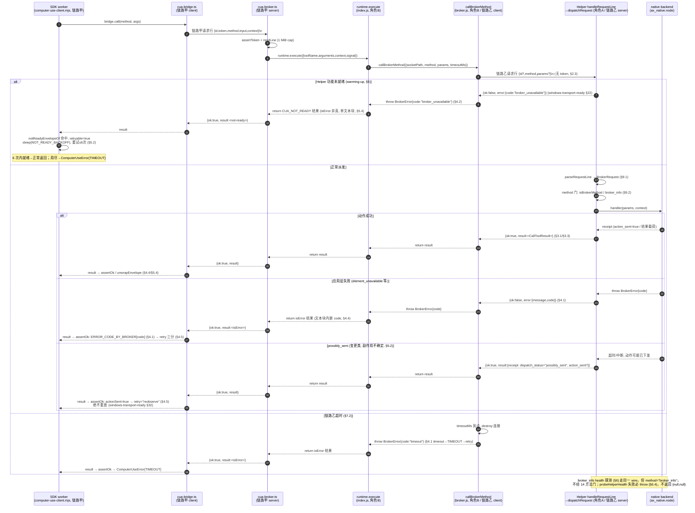

# Spec: 链路乙 broker wire 协议（host RPC 客户端 ↔ Helper broker 服务端）

## 0. 本文地位与出处标注约定

本文件是 **链路乙**（host 侧 broker RPC 客户端 ↔ Helper broker 服务端）wire 协议的权威契约，
是阶段 2 **角色 B**（host 客户端：`callBrokerMethod` / `probeHelperHealth` / 共享谓词，见
`docs/upgrades/product-and-support-2026-10.md` §7.8「角色范围洞裁决」）与 **角色 A**（Helper
服务端：`parseRequestLine` / `dispatchRequest` / `handleRequestLine` + native backend）实现
共同遵守的单一事实源。

链路乙的实现体在上游开源侧同样是 stub（上游 `packages/zcode-cua` 也是占位包，
`callBrokerMethod`/`probeHelperHealth`/`dispatchRequest`/`handleRequestLine`/`parseRequestLine`
在 `packages/zcode-cua/broker.js` 里都是占位，实体在闭源仓），因此本文是「**契约驱动自写**」
的契约文档。每条契约必须带出处，出处有三类：

- **上游开源代码**：`C:/Users/ZhuanZ/AppData/Local/Temp/claude/cua-upstream-ref/upstream/`
  下的 Apache-2.0 官方文件，标注 `上游 <相对路径>:<行号>`（PROVENANCE：zai-org/ZCode
  v3.15.1，HEAD `aac4755666d09fdcd70272fcf063c077a639015f`）。
- **本仓源码**：标注 `本仓 <相对路径>:<行号>`（均已用 Read 核实）。
- **ACode 自定**：上游材料无法钉死的条目，显式标注 `【ACode 自定，角色 A/B 须遵守】` 并给论证。

已裁决事项不重开：三项架构决策（`docs/upgrades/product-and-support-2026-10.md` §7.8）+ 角色范围洞
三分裁决（同节「角色范围洞裁决」小节）。本文只在这两项裁决的框架内钉 wire 契约。

### 0.1 链路甲 / 链路乙 术语区分（强制，防止混淆）

本仓存在**两条**独立的 CUA NDJSON-over-socket 链路，术语、字段名、鉴权、错误形态**均不同**，
任何实现与测试都不得混用：

| 维度     | **链路甲**（已实现，阶段 0 T3/T4 覆盖）                                                              | **链路乙**（本文，阶段 2 角色 A/B 待实现）                                                                                                                              |
| -------- | ---------------------------------------------------------------------------------------------------- | ----------------------------------------------------------------------------------------------------------------------------------------------------------------------- |
| 两端     | node_repl SDK worker ↔ node-repl-host broker                                                         | host RPC 客户端 ↔ Helper broker 服务端                                                                                                                                  |
| 代码位置 | 本仓 `apps/acode-cli/packages/node-repl-host/src/cua-broker.ts`（server）/ `cua-bridge.ts`（client） | 本仓 `packages/acode-cua/broker.js`（client `callBrokerMethod`/`probeHelperHealth` = 角色 B；server `parseRequestLine`/`dispatchRequest`/`handleRequestLine` = 角色 A） |
| 请求字段 | `{ id, token, method, input, context }`（cua-bridge.ts:172）                                         | `BrokerRequest { id?, method, params? }`（broker.d.ts:57-61）——**用 `params`，不是 `input`+`context`**                                                                  |
| 鉴权     | **有 bearer token**，每请求携带并 `timingSafeEqual` 校验（cua-broker.ts:30/84/108-115）              | **无应用层 token**（见 §2.3）                                                                                                                                           |
| 成功响应 | `{ id, ok:true, result, responseMeta? }`（cua-broker.ts:99）                                         | `{ ok:true, result }`（broker.js:63-65）——**不回显 id、无 responseMeta**                                                                                                |
| 失败响应 | `{ id, ok:false, error:<字符串> }`（cua-broker.ts:103）——**error 是裸字符串**                        | `{ ok:false, error:{ message, code? } }`（broker.js:67-72）——**error 是对象，带 code**                                                                                  |
| id 用途  | 客户端**强校验** `payload.id === id`（cua-bridge.ts:190），防串扰                                    | id **可选、仅信息性**；靠「单连接单请求」对齐响应（见 §2.2）                                                                                                            |
| 请求上限 | 1 MiB（cua-broker.ts:13）                                                                            | 见 §7（建议沿用 1 MiB）                                                                                                                                                 |
| 响应上限 | 32 MiB（cua-bridge.ts:9）                                                                            | 见 §7（建议沿用 32 MiB）                                                                                                                                                |

**framing 互证**：两条链路都用 NDJSON「读到 `\n` 为止」的行分隔 JSON。链路甲的
`readLine`（cua-broker.ts:149-181）与 `sendCuaBrokerRequest` 的按 `\n` 切分（cua-bridge.ts:180）
是**已实现且被测试覆盖**的真实参照，链路乙的 framing 与之同构（见 §1.3、§2.1、§3.1），
但**载荷字段不同**（甲 `input`/`context`+token vs 乙 `params` 无 token）。

**分层关系**：一次模型侧 CUA 调用依次穿过 `SDK(computer-use-client.mjs) → 链路甲 → runtime.execute
(index.js, 角色 B) → 链路乙(callBrokerMethod) → Helper(角色 A) → native`，结果原路返回。
`ERROR_CODE_BY_BROKER` 映射、`CUA_NOT_READY` 重试、`possibly_sent` 三分的**最终消费者是 SDK**
（`computer-use-client.mjs`，位于链路甲 worker 侧），但它们的**产生源在链路乙的 `result`/`error`**。
本文钉链路乙这一段；跨到链路甲/SDK 的衔接点在 §5.4、§10 显式标出。

---

## 1. 传输（Transport）

### 1.1 socket 形态

**win32：named pipe，`\\.\pipe\` 前缀。**

- 现状：`mintBrokerSocketPath`（本仓 broker.js:47-50）**只有 posix 分支**
  （`join(dir ?? tmpdir(), \`acode-cua-broker-${randomUUID()}.sock\`)`），无 win32 分支——
这是 §7.8 B-1 明确的前置阻塞（`docs/upgrades/product-and-support-2026-10.md:525`
「`mintBrokerSocketPath`（broker.js:47-50）无 win32 分支须补 named-pipe 分支」）。
- 参照链路甲命名规则：本仓 `apps/acode-cli/packages/node-repl-host/src/cua-broker.ts:27-28`
  的 win32 分支为 `` `\\.\pipe\acode-node-repl-cua-${randomUUID()}` ``（源码里写作
  `\\\\.\\pipe\\acode-node-repl-cua-${randomUUID()}`）。
- **【ACode 自定，角色 B 须遵守】链路乙 win32 pipe 名格式建议**：
  `` `\\.\pipe\acode-cua-broker-${randomUUID()}` ``（源码模板字面量写作
  `` `\\\\.\\pipe\\acode-cua-broker-${randomUUID()}` ``）。
  - **风格一致**：沿用链路甲的 `\\.\pipe\acode-*-<uuid>` 形态与 `randomUUID()` 随机段。
  - **不冲突**：链路甲前缀是 `acode-node-repl-cua-`，链路乙前缀是 `acode-cua-broker-`，
    两个前缀互不为对方前缀，同一台机器上不可能撞名。
  - **去掉 `.sock` 后缀**：named pipe 不是文件系统节点，`.sock` 后缀是 posix 语义，
    win32 分支不带（链路甲同样不带，cua-broker.ts:28）。
  - **不用 `path.join` 拼 pipe 路径**：named pipe 名不是文件路径，必须用模板字面量直接构造；
    `path.join` 会规范化分隔符、破坏 `\\.\pipe\` 前缀（链路甲即用模板字面量，cua-broker.ts:27）。
  - **win32 分支忽略 `options.dir`**：pipe 命名空间是全局 `\\.\pipe\`，与 `dir` 无关；
    `SocketPathOptions.dir`（broker.d.ts:49-52）在 win32 分支不参与拼名。
    【ACode 自定，角色 B 须遵守】

**posix（darwin / linux）：`tmpdir()/*.sock`。**

- 保持现状：`join(dir ?? tmpdir(), \`acode-cua-broker-${randomUUID()}.sock\`)`（本仓 broker.js:47-50；上游`packages/zcode-cua/broker.js:47-50`同构，仅前缀`zcode-`↔`acode-`之差）。darwin 的稳定 socket 推导见`docs/cua-permission-broker/2026-09-21-cua-helper-lazy-startup-spec.md` §3.1:71
（`resolveBrokerSocketPath()` 纯推导，零 IO）。

**稳定性（win32）**：pipe 名是「Host app 进程铸一次的稳定名（含随机段；模块级 singleton；
Host 重建复用同名；跨 app 运行必不相同）」——上游
`docs/cua-permission-broker/2026-09-21-cua-helper-lazy-startup-spec.md` §3.1:72、§四:206。
`mintBrokerSocketPath` 本身只负责**产出格式**（每次调用一个新 uuid）；「进程内铸一次并复用」
的稳定性是**调用方**（`WindowsCuaHelperHost`，本仓
`packages/services/src/cua-permission-broker/windowsCuaHelperHostSupport.ts:63`
`defaultSocketPathFactory = mintBrokerSocketPath`）的职责，不在本函数内实现单例。

### 1.2 连接生命周期

`connect → write 请求行 → read 响应行 → end/destroy`，**单连接单请求**（one request per
connection）：

1. host 客户端 `callBrokerMethod`（角色 B）对 `socketPath` 建一条新连接
   （`node:net` `createConnection`；`node:net` 是 builtin，满足不变量 2，见 §7.8:634）。
2. `connect` 后写入**一行**请求：`JSON.stringify(request) + "\n"`（见 §2.1）。
3. 读取**一行**响应（读到 `\n` 为止），`JSON.parse`（见 §3.1）。
4. 收到响应后 `end`/`destroy` 连接。

参照链路甲客户端 `sendCuaBrokerRequest`（本仓 cua-bridge.ts:150-204）：`createConnection`
→ `once("connect")` 写一行（:171-173）→ `on("data")` 累积到 `\n`（:174-181）→ `finish` 里
`socket.destroy()`（:164）。链路乙同构，但**不做 id 回显校验**（§2.2），且**无 token**（§2.3）。

**连接失败即 fail-closed**：`connect` 报 `ENOENT`/`ECONNREFUSED`（Helper 未 bind）或读不到
完整响应行即断开，`callBrokerMethod` **必须抛 `BrokerError`**（不得静默返回 undefined / 空对象），
与占位失败语义一致（本仓 broker.js:39-41 占位即 `throw new BrokerError(...)`；CONTRACT.md
「以 BrokerError / CuaHelperError 拒绝」）。错误 `code` 见 §4。

### 1.3 framing

- 行分隔：UTF-8 JSON + 单个 `\n`。响应行的 `\n` 由 `serializeResponse` 逐字产出：
  `` `${JSON.stringify(response)}\n` ``（本仓 broker.js:78-80 ≡ 上游
  `packages/zcode-cua/broker.js:78-80`，**权威开源契约**）。
- 读取方按「第一个 `\n` 之前的字节」切一行（链路甲 readLine 语义，cua-broker.ts:159-162）。
- 一行必须是**完整、单一的 JSON 值**；不得跨行、不得在一行里塞多个 JSON、不得用裸 `\n` 转义。

---

## 2. 请求行（Request line）

### 2.1 形状

请求行 = `JSON.stringify(BrokerRequest) + "\n"`，其中：

```ts
interface BrokerRequest {
  id?: string | null; // 可选、仅信息性（见 §2.2）
  method: string; // 必填，须是 §8 的 14 方法之一
  params?: unknown; // 可选，方法参数（见 §8 各方法）
}
```

（出处：本仓 broker.d.ts:57-61 ≡ 上游 `packages/zcode-cua/broker.d.ts:57-61`，**权威开源契约**。）

- **字段名是 `params`，不是链路甲的 `input`/`context`**（§0.1）。角色 A 的 `parseRequestLine`
  只认 `method`/`params`/`id`；角色 B 的 `callBrokerMethod` 只发这三个键。
- `method` 必填且必须是字符串；缺失或非字符串 → 解析失败（§9.1）。
- `params` 形态是 `unknown`，由各方法自定（§8）；`parseRequestLine` 不校验 `params` 内部结构，
  校验发生在 `dispatchRequest` 派发到具体 handler 时（§9.2）。

### 2.2 `id` 生成规则

- **【ACode 自定，角色 B 须遵守】** `id` 若存在，用 `randomUUID()`（`node:crypto`，已在
  broker.js:1 导入）生成，参照链路甲（本仓 cua-bridge.ts:155 `const id = randomUUID()`）。
- **`id` 在链路乙是可选、仅信息性的**（日志/关联用），**不用于响应对齐**：
  `BrokerResponse`（broker.d.ts:63-66）**不含 id 字段**，链路乙靠「单连接单请求」（§1.2）
  对齐响应。这与链路甲**根本不同**——链路甲 `BrokerResponse` 回显 id 且客户端强校验
  `payload.id === id`（cua-bridge.ts:183-190）。角色 B **不得**在链路乙实现 id 回显校验
  （响应里没有 id 可校），角色 A **不得**被要求回显 id。
- `id` 允许为 `null`（broker.d.ts:58 `string | null`）；`null` 与缺省同义（不携带关联信息）。

### 2.3 无 token —— 安全边界与已接受风险（强制显式声明）

**链路乙当前无应用层鉴权 token。** `BrokerRequest`（broker.d.ts:57-61）只有 `id`/`method`/`params`
三个键，**没有 token 字段**。这是刻意现状，不是遗漏：

- **决策三**（token 保留在链路甲）：bearer token 只在链路甲（node_repl worker ↔ node-repl-host）
  使用（本仓 cua-broker.ts:30/84/108-115、cua-bridge.ts:172）；链路乙不引入第二个 token。
- **链路乙的安全性依赖 pipe 路径私密性**：
  1. pipe/socket 名含 `randomUUID()` 128-bit 随机段（§1.1），不可枚举；
  2. 名由 **Host 铸造**（`mintBrokerSocketPath` / `WindowsCuaHelperHost`），攻击者不可控；
  3. Helper 经 **fork argv `--socket <稳定pipe名>`** 接收该名
     （上游 `docs/cua-permission-broker/2026-09-21-cua-helper-lazy-startup-spec.md` §3.3:158）。

**已接受风险（必须写明）**：

- **argv 暴露削弱「路径私密性」**：Helper 经 fork argv 收 pipe 名，而 argv 对**同 UID** 的进程
  列表（`ps` / `Get-Process` 命令行）可见。因此一个同 UID 的本地攻击者若读到 fork argv，即拿到
  pipe 名并可连接、驱动 Helper。这与上游 macOS 设计里「leaked token lets any same-agent process
  drive the Helper」是同一类 confused-deputy 面（上游
  `docs/cua-permission-broker/zcode-cua-permission-broker.md`:25），macOS 用 bearer token +
  **peer 验证**（`getpeereid` + `LOCAL_PEERPID` + 代码签名 launcher 门）关闭它。
- **Windows peer-identity gate 当前临时放开**：上游 Windows 侧「peer 门现状（M8 fail-closed，
  缺 4 个 native peer 原语）」（`docs/cua-permission-broker/2026-09-21-cua-helper-lazy-startup-spec.md`
  §3.3:171），即 Windows 目前既无 token 也无 peer 门。链路乙沿用这一现状：**无 token、无 peer 门**，
  安全性只剩 pipe 名随机性 + Host 铸造 + argv 传递，而同 UID argv 可读使其**不是强边界**。
- **裁决**：这是**已接受风险**，与「上游 Windows peer-identity gate 临时放开」是同一现状，
  不在阶段 2 关闭。**当 native peer 原语落地后必须重新评估**（补 peer 门或引入链路乙 token）。
  在关闭之前，Windows CUA 能力面本身 fail-closed（§3.3:171），故实际暴露面受限。
- 角色 B/A **不得**因为「没有 token」而在 wire 上自造 token 字段——那会破坏
  `BrokerRequest` 契约（broker.d.ts:57-61）与决策三。

---

## 3. 响应行（Response line）

### 3.1 形状（两侧 broker.js 的真实开源代码，逐字引用）

响应行 = `serializeResponse(response)` = `` `${JSON.stringify(response)}\n` ``。
以下三段在**本仓 broker.js 与上游 `packages/zcode-cua/broker.js` 逐字一致**（已 diff 核实：
仅 `ZCODE`↔`ACODE` env 名与 CRLF/LF 之差，正文相同），是**权威开源契约**：

```js
// 本仓 broker.js:63-65 ≡ 上游 packages/zcode-cua/broker.js:63-65
export function okResponse(result) {
  return { ok: true, result };
}

// 本仓 broker.js:67-72 ≡ 上游 packages/zcode-cua/broker.js:67-72
export function errorResponse(message, options = {}) {
  return {
    ok: false,
    error: { message, ...(options.code ? { code: options.code } : {}) },
  };
}

// 本仓 broker.js:78-80 ≡ 上游 packages/zcode-cua/broker.js:78-80
export function serializeResponse(response) {
  return `${JSON.stringify(response)}\n`;
}
```

补充（同文件、同权威性）：

```js
// 本仓 broker.js:74-76 ≡ 上游 packages/zcode-cua/broker.js:74-76
export function errorResponseFromException(error) {
  return errorResponse(error instanceof Error ? error.message : String(error));
}
```

因此两种规范响应形态：

- **成功**：`{ "ok": true, "result": <值> }`。
- **失败**：`{ "ok": false, "error": { "message": <字符串>, "code"?: <字符串> } }`。
  - `code` **仅在 `options.code` 为真值时出现**（broker.js:70 的展开）；`errorResponseFromException`
    **不带 code**（只传 message），故由它产出的失败响应 `error` 只有 `message`。

### 3.2 类型契约与防御性读取

`BrokerResponse`（broker.d.ts:63-66）是 `{ ok: boolean; [key: string]: unknown }`——**开放索引签名**，
`result` / `error` **未在接口里声明**，它们是 `okResponse`/`errorResponse` 的**运行时约定**。
故：

- 角色 B（`callBrokerMethod`）读响应时**必须防御性读取**：先看 `ok`，`ok===true` 取 `result`
  （可能缺省，见 §3.3），`ok===false` 取 `error.message`/`error.code`（`error` 可能非对象/缺 code，
  须容错）。
- `ok` 不是布尔、或响应不是对象 → 视为协议违规，`callBrokerMethod` 抛 `BrokerError`
  （code `internal`，见 §4）。**绝不静默成功**。

### 3.3 成功响应必须携带 result（禁止空成功）

- 成功的 broker 调用**必须**带一个 `result` 值。`okResponse(undefined)` 会序列化成 `{"ok":true}`
  （`JSON.stringify` 丢弃 `undefined` 值键），角色 B 读到的 `result` 为 `undefined`——这是
  **协议违规**，角色 A **不得**对任何 14 方法产出空成功。
- 变更类方法（§8 的 10 个 `MUTATING_METHODS`）即使语义上「成功即 void」，也**必须返回显式收据**
  （receipt），携带 `action_sent` / `dispatch_status` 等键（出处：SDK 的 `receiptOf` 只从
  `state_id`/`frame_id`/`action_sent`/`dispatch_status`/`state_sync_status`/`code`/`reason`/
  `snapshot_mode`/`base_state_id` 里挖，上游
  `apps/zcode-cli/packages/zcode-cua-plugin/scripts/computer-use-client.mjs:184-195`）。
  空成功会让 `possibly_sent`/`action_sent` 判定失去载体（§5.3）。
- `result` 的**内部形态**是一个 MCP `CallToolResult` 状载荷（`{ content: [...], isError?, structuredContent?, _meta? }`），
  因为它最终要穿过链路甲回到 SDK 被 `textBlocks`/`receiptOf`/`unwrapEnvelope` 消费
  （上游 computer-use-client.mjs:161-166/168-202/1114-1129）。链路乙只钉「`result` 是承载
  MCP 结果的对象」，其字段细节归 producer/角色 A 的工具结果 spec（§5、§8 只钉 wire 相关部分）。

---

## 4. 错误语义（Error codes）

### 4.1 broker 错误码 → SDK 错误码：17 条映射表全文

下表**逐字照录**自上游
`apps/zcode-cli/packages/zcode-cua-plugin/scripts/computer-use-client.mjs:76-94`
（`ERROR_CODE_BY_BROKER`，`Object.freeze`）。**左列（broker code）是链路乙
`error.code`（§3.1）与结果收据 `code`（§4.4）的合法取值词汇表**；右列是 SDK 内部码。

| broker code（链路乙 wire 值） | SDK code（consumer 侧） |
| ----------------------------- | ----------------------- |
| `permission_denied`           | `PERMISSION_DENIED`     |
| `not_authorized`              | `NOT_AUTHORIZED`        |
| `launch_failed`               | `LAUNCH_FAILED`         |
| `invalid_request`             | `INVALID_APP`           |
| `element_unavailable`         | `ELEMENT_UNAVAILABLE`   |
| `not_settable`                | `NOT_SETTABLE`          |
| `not_selectable`              | `NOT_SELECTABLE`        |
| `action_unavailable`          | `ACTION_UNAVAILABLE`    |
| `foreground_required`         | `FOREGROUND_REQUIRED`   |
| `controller_busy`             | `CONTROLLER_BUSY`       |
| `broker_unavailable`          | `HELPER_UNAVAILABLE`    |
| `version_mismatch`            | `VERSION_MISMATCH`      |
| `stale_socket`                | `HELPER_UNAVAILABLE`    |
| `timeout`                     | `TIMEOUT`               |
| `unimplemented`               | `ACTION_UNAVAILABLE`    |
| `method_not_found`            | `INTERNAL`              |
| `internal`                    | `INTERNAL`              |

**未知码 → `INTERNAL`**：SDK 的 `assertOk` 用
`ERROR_CODE_BY_BROKER[brokerCode] ?? "INTERNAL"`（上游 computer-use-client.mjs:286）。
即链路乙发出一个不在上表的 `code`，SDK 归为 `INTERNAL`——**绝不静默成功**。

**【ACode 自定，角色 A 须遵守】** 角色 A 的 `dispatchRequest`/handler 产出的
`error.code`（§3.1）**必须取自上表左列的 17 个 broker code**（或明确接受被归为 `INTERNAL`）。
`broker.js` 已提供的错误构造器（本仓 broker.js:32-37 ≡ 上游 broker.js:32-37）覆盖其中 6 个：
`notAuthorized`→`not_authorized`、`notSelectable`→`not_selectable`、`notSettable`→`not_settable`、
`elementUnavailable`→`element_unavailable`、`actionUnavailable`→`action_unavailable`、
`foregroundRequired`→`foreground_required`。其余码（`permission_denied`/`launch_failed`/
`invalid_request`/`controller_busy`/`broker_unavailable`/`version_mismatch`/`stale_socket`/
`timeout`/`unimplemented`/`method_not_found`/`internal`）由角色 A 直接以
`errorResponse(message, { code })` 或 `new BrokerError(message, { code })` 产出。

### 4.2 host 客户端（角色 B）对失败响应的处理

- `callBrokerMethod` 收到 `{ ok:false, error }` **必须抛 `BrokerError`**
  （`new BrokerError(error.message, { code: error.code })`），**不得**返回 `result` 或 undefined。
  `BrokerError`（本仓 broker.js:8-15 ≡ 上游 broker.js:8-15）默认 `code = "unavailable"`；
  当响应 `error.code` 存在时应透传该 code。
- 这保证失败沿调用链冒泡为**类型化错误**（AGENTS.md「不依赖错误文本做流程判断；用稳定的
  错误类型/错误码」），且 SDK 侧能从 `BrokerError.code` 恢复 broker code 做 §4.1 映射。

### 4.3 绝不静默成功（fail-closed 红线）

任何「拿不到确定成功」的情形——连接失败、响应非法 JSON、`ok` 非布尔、`ok:false`、
`ok:true` 但缺 `result`、超时——**都必须抛错**（`BrokerError`/`CuaHelperError`），
绝不返回看似成功的空值。出处：CONTRACT.md「绝不静默降级为『看起来可用』」；
`docs/upgrades/product-and-support-2026-10.md:641`（B-1 约束「失败语义须…fail-closed…
不得静默返回成功」）；SDK 侧 `assertOk` 的 `?? "INTERNAL"`（computer-use-client.mjs:286）。

### 4.4 结果内 code（应用层错误 vs 传输层错误）

broker code 有**两个可出现的位置**，SDK 两处都读：

1. **传输层**：`BrokerResponse.error.code`（§3.1）——`{ ok:false, error:{ message, code } }`。
   角色 B 转成 `BrokerError{ code }`（§4.2）。
2. **应用层**：`{ ok:true, result }` 里，`result` 作为 MCP 结果，其 `content` 文本块内嵌
   `{ code }` 或 `{ error:{ code } }`，或收据顶层 `code`。SDK 的 `brokerErrorCodeOf` 依次从
   文本块的 `parsed.code ?? parsed.error.code`、再从收据 `code` 里挖（上游
   computer-use-client.mjs:220-228）。

`assertOk`（上游 computer-use-client.mjs:278-297）的判定：`isError===true` 或
`dispatch_status==="possibly_sent"` 才抛错；抛错时 `code = isError ? (ERROR_CODE_BY_BROKER[brokerCode] ?? "INTERNAL") : "TIMEOUT"`。
即：**一个 `ok:true` 但 `result.isError===true` 的应用层错误**，其 code 走 §4.1 映射；
**一个 `dispatch_status==="possibly_sent"` 但 `isError` 非真**的结果，code 固定为 `TIMEOUT`
且 `actionSent=true`（§5.3）。角色 A 须把应用层失败放进 `result`（`isError:true` + 文本块 code），
把传输/派发层失败放进 `error`（§3.1）——两条路都最终被 SDK 归一。

### 4.5 REOBSERVE / NEVER_RETRY 派生集与 retry 三分

`ComputerUseError.retry` 的三分（上游 computer-use-client.mjs:96-129，逐字照录语义）：

```
REOBSERVE_CODES  = { ELEMENT_UNAVAILABLE, STALE_STATE, STRUCTURED_STATE_UNAVAILABLE }   // :97-101
NEVER_RETRY_CODES = { CONTROLLER_BUSY, CONTROL_STOPPED, PERMISSION_DENIED, NOT_AUTHORIZED,
                      VERSION_MISMATCH, ACTION_UNAVAILABLE, NOT_SETTABLE, NOT_SELECTABLE }  // :102-111

retry =
  actionSent            ? "reobserve"     // 可能已下发 → 必须先重新观察，绝不盲重试
  : NEVER_RETRY.has(code) ? "never"       // 结构性不可重试
  : REOBSERVE.has(code)   ? "reobserve"   // 状态过期 → 重新观察后可重试
  :                       "retry";        // 其余（含 HELPER_UNAVAILABLE / TIMEOUT / INTERNAL）可原样重试
```

- `actionSent` **默认 false**（`this.actionSent = actionSent === true`，:120）是**故意的保守方向**：
  只有收据明确 `action_sent===true` 或 `dispatch_status==="possibly_sent"` 时才置 true
  （`assertOk`:292 `actionSent: actionSent || dispatch === "possibly_sent"`）。反过来（默认 true）
  会让模型对一个从未下发的动作放弃重试（:118-119 注释）。
- **注意派生集里的码不全是 §4.1 右列的 broker 映射目标**：`STALE_STATE`/`STRUCTURED_STATE_UNAVAILABLE`/
  `CONTROL_STOPPED` 是 **SDK 内部产生**的码（如 `bindTarget`:329 的 `STALE_STATE`、
  `appStateOf`:549 的 `STRUCTURED_STATE_UNAVAILABLE`），不由链路乙 broker code 映射而来。
  链路乙只需保证 §4.1 的 broker code 词汇正确；三分逻辑在 SDK 侧执行。
- 由 §4.1：`broker_unavailable`/`stale_socket`→`HELPER_UNAVAILABLE`（不在任一集 → `retry`）；
  `timeout`→`TIMEOUT`（→`retry`）；`controller_busy`→`CONTROLLER_BUSY`（→`never`）；
  `permission_denied`/`not_authorized`→`never`；`element_unavailable`→`ELEMENT_UNAVAILABLE`（→`reobserve`）。
  这些是 warming-up（§5）与动作失败重试行为的下游后果。

---

## 5. `CUA_NOT_READY` 信封（冷启动 warming-up）

### 5.1 逐字契约

`CUA_NOT_READY` 是 **producer 刻意设计的机器可读冷启动契约**（上游
computer-use-client.mjs:247-262 注释）。它是一个 **非 error 结果**（`isError` 非真）、
**单个文本块**，文本块内容是如下 JSON：

```json
{
  "kind": "CUA_NOT_READY",
  "reasonCode": "broker_not_accepting",
  "retryable": true,
  "message": "...is starting up... Retry the same tool call after a brief wait."
}
```

（出处：上游 computer-use-client.mjs:251-253 注释给出的原文；`NOT_READY_KIND = "CUA_NOT_READY"`
定义于 :263；`notReadyEnvelopeOf` 的识别逻辑 :267-274。）

SDK 识别规则 `notReadyEnvelopeOf(result)`（上游 computer-use-client.mjs:267-274）：

1. `if (result?.isError === true) return undefined;` —— **`isError:true` 的结果永不被当作 not-ready**。
2. 遍历文本块，`JSON.parse` 后 `parsed.kind === "CUA_NOT_READY"` 命中即返回该载荷。

### 5.2 `possibly_sent ⇒ retryable=false`（防重放红线）

- not-ready 信封的 `retryable` 字段决定 SDK 是否重试：**`possibly_sent` 的动作 ⇒
  `retryable=false`，绝不重放**（上游 computer-use-client.mjs:254 注释
  「possibly_sent ⇒ retryable=false，绝不重放；marker 在途 ⇒ 可重试」）。
- 这与 §5.1 的 `isError` 门是双重保险：一个可能已产生副作用的动作**不会**被包装成
  `retryable:true` 的 not-ready，也不会在 `assertOk` 里被当作可重试。
- SDK 的重试循环（上游 computer-use-client.mjs:895-924）：`for(attempt=0;;attempt++)`，
  `bridge.call` → `notReadyEnvelopeOf`；命中且 `retryable===true` 且 `attempt < NOT_READY_MAX_ATTEMPTS-1`
  则 `sleep(NOT_READY_BACKOFF_MS[...])` 后重试；否则（`retryable!==true` 或达上限）抛
  `ComputerUseError`，code = `retryable===true ? "TIMEOUT" : "CONTROLLER_BUSY"`（:906-920）。
  - `NOT_READY_MAX_ATTEMPTS = 6`、`NOT_READY_BACKOFF_MS = [250, 500, 750, 1000, 1500]`
    （上游 computer-use-client.mjs:264-265，逐字）。第 6 次（index 5）用 backoff 数组末位 1500ms
    （`Math.min(attempt, len-1)`，:922）。

### 5.3 warming-up 语义与 Windows 两阶段就绪

- Windows named pipe 无 Unix socket 的 `.pending → final` 原子让渡语义，故 Helper 冷启动分两阶段：
  `transport_ready`（pipe 已 bind + 认证配置完成，**不代表** UIA/截图/输入就绪）与 `ready`
  （完整 health probe 成功）。功能层仍在初始化时，**工具调用由 broker 以可重试的
  `broker_unavailable` 响应表示 warming-up**（上游
  `docs/cua-permission-broker/windows-transport-ready.md`:5、:22-23、:26）。
- 约束（上游 windows-transport-ready.md:32）：**`broker_unavailable` 只能用于「未发送请求」的
  warm-up 重试；动作请求仍遵守 delivery-state，不自动重放可能已发送的副作用。** 这是 §5.2
  防重放红线在 warming-up 场景的具体化：warming-up 期的 `broker_unavailable` 天然
  `actionSent=false`（请求根本没进 native），故可重试；一旦动作可能已下发，只能走
  `possibly_sent`（§4.4/§5.2），不得借 warming-up 之名重放。
- lazy-startup 侧的 warmup-retry 窗：Windows 首调 fork 后「warmup-retry(2s 窗)」
  （上游 `docs/cua-permission-broker/2026-09-21-cua-helper-lazy-startup-spec.md` 图2:113）。

### 5.4 与 `BROKER_UNAVAILABLE_ENV` 的衔接 + warming-up 期 `execute` 返回什么

**三个不同的「unavailable」概念，必须分清（本仓核实）：**

1. **`BROKER_UNAVAILABLE_ENV`（spawn-env 信号，非 wire 响应）**：本仓
   `packages/services/src/node.ts:1116-1120`/`1143-1147`/`1163-1168`/`1197-1202` 在 Helper
   未就绪时，spawn env 返回 `{ [BROKER_UNAVAILABLE_ENV]: "broker_unavailable: ..." }`
   **而不是** `{ BROKER_SOCKET_ENV, ACODE_CUA_PLUGIN_AUTHORITY_ENV_KEY }` 元组
   （健康时返回元组，node.ts:1171-1174/1184-1187/1204-1207/1225-1228）。这是 **host→agent 的
   spawn admission**（「这次 spawn 不给你 CUA socket」），**不是链路乙 wire 响应**。
   `BROKER_UNAVAILABLE_ENV = "ACODE_CUA_PERMISSION_BROKER_UNAVAILABLE"`（本仓 broker.js:6）。
   fail-closed 理由：返回空 env 会让 agent 按无 broker 凭据启动 MCP 子进程、绕过已授权 Helper
   （node.ts:1130-1132 注释）。
2. **`broker_unavailable`（链路乙 wire 错误码）**：§4.1 表里的 broker code，warming-up 期由
   broker 产出（windows-transport-ready.md:22），映射 SDK `HELPER_UNAVAILABLE`（→`retry`）。
3. **`CUA_NOT_READY`（SDK-facing 非 error 结果信封）**：§5.1，producer 工具/runtime 层给 SDK 的
   机器可读 warm-up 信号，SDK 退避重试 6 次。

**warming-up 期 `runtime.execute`（本仓 index.js，角色 B）返回什么——从 SDK 的 `call`/`unwrapEnvelope`
路径核实（本仓核实 + 上游核实）：**

- SDK 的 not-ready 重试循环只对 **`bridge.call` 的返回值**（一个结果对象）生效
  （上游 computer-use-client.mjs:900-901）。`bridge.call` 的值来自链路甲 server 的响应
  `{ ok:true, result }`（本仓 cua-broker.ts:99），而该 `result` 是 `runtime.execute` 的返回值
  （cua-broker.ts:90-97）。
- **关键约束（本仓核实）**：链路甲 server 的 `handleSocket` 对 `runtime.execute` 的**抛错**会走
  catch，发 `{ ok:false, error:<字符串> }`（本仓 cua-broker.ts:100-104）；链路甲 client 收到
  `ok!==true` 会 **throw**（cua-bridge.ts:191），于是 SDK 的 `call()` 直接 reject——**绕过
  not-ready 重试循环**。因此，**为了让 §5.2 的 CUA_NOT_READY 退避重试契约生效，
  `runtime.execute` 在 warming-up 期必须『返回』（不抛）一个 `isError` 非真、单文本块装
  `CUA_NOT_READY` JSON 的 `CallToolResult`**（§5.1）。若 execute 改为抛错，not-ready 会被
  链路甲转成 error 字符串，SDK 的 `notReadyEnvelopeOf` 因 `isError===true`（或直接 reject）而
  永不命中——这正是上游 computer-use-client.mjs:255-262 记录的历史 bug 形态（信号被丢掉）。
  【ACode 自定，角色 B 须遵守；依据：本仓 cua-broker.ts:90-104 + cua-bridge.ts:191 + 上游
  computer-use-client.mjs:267-274/895-924】
- 换言之：**warming-up 期 execute 返回 not-ready 信封（非 error 结果），不返回 isError 结果、
  不抛错。** SDK 收到后退避重试至多 6 次；6 次内 Helper 就绪则正常返回，仍 not-ready 则 SDK 抛
  `ComputerUseError{ code:"TIMEOUT" }`（retryable 用尽，:912）。
- **`unwrapEnvelope` 只在 `call()` 返回非 not-ready 结果后运行**（上游
  computer-use-client.mjs:1114-1129、1140 `unwrapEnvelope(await call(...))`）：它对
  「单一 text block」结果 `JSON.parse` 解封，多块/图像原样返回。故 not-ready 信封不会到达
  `unwrapEnvelope`（它在 `call()` 内被拦截重试）。
- **【已裁决 2026-10-13（原 openQuestion #1）：采用方案 (b)】** warming-up 期由 Helper/链路乙产出
  `broker_unavailable` 传输错误（`ok:false`，windows-transport-ready.md:22），再由
  `runtime.execute`（角色 B，`index.js`）翻译成 `CUA_NOT_READY` **非 error** 结果信封。
  裁决理由：(1) 链路甲 `cua-broker.ts:100-104` 会把 `execute` 的**抛错**降成
  `{ok:false, error:<message 字符串>}`——**错误码在这一层丢失**，而 SDK 的 `brokerErrorCodeOf`
  只从 result 对象读码，故 `execute` 必须 return 而非 throw；(2) (b) 的分层更清晰
  （broker 报传输态、runtime 面向 SDK 归一），且 Helper 侧无需了解 SDK 信封格式，
  角色 A 只需按 windows-transport-ready.md 已有的 `broker_unavailable` 语义实现。
  **实现锚点**：`index.js` 的 `WARMING_UP_BROKER_CODES = {broker_unavailable, stale_socket}`
  → `notReadyResult(reasonCode, retryable, message)`；`execute` 全程不抛（除入参非法前的
  早退也返回 isError 结果）。测试见 `apps/acode-cli/tests/cua-runtime-execute.test.mjs`。
- **【possibly_sent 的两条来源必须区分（实现时发现并裁决）】**：
  - **传输层歧义**（客户端可判）：请求行已写出但拿不到收据（超时 / 连上后断开 / 非法响应）。
    `broker.js` 在 `callBrokerMethod` 抛的 `BrokerError.details.possiblySent` 上报此事实，
    `execute` 据此产出 `CUA_NOT_READY{reasonCode:"possibly_sent", retryable:false}`——
    SDK 的 `call()` 环见 `retryable !== true` 直接抛 `ComputerUseError(CONTROLLER_BUSY)`，
    不再退避重试，即 C08「绝不自动重放可能已产生的副作用」。
    **置位时机是同步的**（`connect` 后立即置位，不等 write flush 回调）：保守方向要求
    一旦调用 `write` 就假定动作可能已送达，否则超时 race 下会漏报。
  - **应用层 ok:false 不置 possiblySent**（`details.possiblySent = false`）：那是 Helper 的
    **明确回信**——它已受理并拒绝，不属歧义。`broker_unavailable`/`stale_socket` 更是
    Helper 权威声明「未受理」，必须保持可重试。
  - **producer 自报 possibly_sent**（角色 A 的判断）：经 **`ok:true` 的收据**携
    `dispatch_status:"possibly_sent"` / `action_sent:true` 上报，`execute` **原样透传**
    （上游 `receiptOf`/`assertOk` 即从此读取），客户端不得凭传输状态伪造或改写。
  - 初版实现曾把应用层 `ok:false` 一律置 `possiblySent=true`，导致 `broker_unavailable`
    被误判为不可重试、warming-up 重试环失效——由 `cua-runtime-execute.test.mjs` 的
    `stale_socket` 用例抓出并修正（bug 根因记于 `broker.js` 该处注释）。
- **§7.2 的分级超时已在 `index.js` 落实**：变更类方法（`isBrokerMethod && !isReadOnlyBrokerMethod`）
  传 `MUTATING_CALL_TIMEOUT_MS = 10_000`，只读观察类（`get_app_state` 带截图 + UIA 遍历）
  沿用 `broker.js` 的 30s 缺省。

---

## 6. health 探测契约（`probeHelperHealth`）

### 6.1 wire 行为：探测发什么 method、响应体字段

- **响应体字段 `bundle_id` / `pid` 是权威的**：`broker_info` 载荷「必须包含能在无额外依赖下
  可靠获得的字段」，逐字列出 `kind` / `bundle_id` / `display_name` / `version` / `pid` /
  `app_bundle_path` / `code_signing_identifier` / `team_identifier` / `signature` /
  `stable_identity` / `warnings`（上游
  `docs/cua-permission-broker/zcode-cua-permission-broker.md`:65-78）。其中 `pid` 与 `bundle_id`
  即 `HelperHealth { bundleId, pid }`（本仓 broker.d.ts:24-27）的来源。Host「launches that helper …
  **waits for `broker_info`**」（同文:18），且 Windows「ready、health、`broker_info` PID 完全一致」
  （上游 `docs/cua/windows-product-runtime.md`:237）。
- **探测的 wire method 名——上游未把它钉成「broker socket 上的 RPC method 字符串」**：上游材料把
  `broker_info` 记为**握手/载荷概念**（control channel 上「ready + broker_info」，windows-transport-ready.md:18；
  以及「waits for broker_info」），而 `HelperHealth` 是它在 health 探测里的 `{bundleId,pid}` 投影。
  材料**没有**明确写「`probeHelperHealth` 向 socketPath 发送 `method:"broker_info"` 请求行」。故：
  - **【ACode 自定，角色 A 须遵守】** 探测 = 向 `socketPath` 发一条链路乙请求行
    `{ method: "broker_info" }`（无 params），Helper 以
    `{ ok:true, result:{ bundle_id, pid, ... } }` 响应；`probeHelperHealth` 从 `result` 取
    `bundle_id`→`bundleId`、`pid`→`pid`，返回 `HelperHealth`。method 名 `broker_info` 与上游
    概念对齐（强证据），但「它是 broker socket 上的 RPC method」这一步是 ACode 自定绑定。
  - `broker_info` **不在 §8 的 14 方法表内**——它是**带外 health/身份探测方法**，与工具方法分属
    不同命名空间。角色 A 的 `dispatchRequest` 须把 `broker_info` 作为 health 方法单独受理
    （不走 `isBrokerMethod` 的 14 方法门；否则会被判 `method_not_found`，见 §9.2）。
    【ACode 自定，角色 A 须遵守】
  - `broker_info` 响应**可以**携带 §6.1 首条列出的全部字段（`kind`/`version`/`display_name`/…），
    `probeHelperHealth` 只投影 `bundle_id`/`pid`；额外字段供权限/诊断消费者读取，不影响 health 判定。

### 6.2 `HelperHealth.bundleId` 在 Windows 上的取值语义

- 类型：`bundleId: string | null`（本仓 broker.d.ts:24-27 ≡ 上游 broker.d.ts:24-27）。
- **macOS**：`bundle_id` 是 CFBundle id；产品 Helper 必须是 `dev.zcode.cua-helper`（ACode 侧
  对应 `dev.acode.cua-helper`，本仓 broker-helper-constants.js:4），present-but-wrong 时
  **产品启动必须以 `CuaHelperError` 失败**（上游 zcode-cua-permission-broker.md:23；
  理由：TCC 授权会属于错误进程身份）。
- **Windows**：**Helper 进程本身无 CFBundle id / 无 AUMID**（它是 `ELECTRON_RUN_AS_NODE=1` fork 的
  node 进程，非 packaged app）。上游对 Windows 身份表述如下——但**都是关于『被控目标 app』的身份，
  不是『Helper 自身』的身份**：
  - 「Windows 的 `bundle_id` 可能是 AUMID」（上游 `docs/cua/cua-tool-app-identity-summary.md`:192）；
  - 「packaged app 必须由 `bundle_id` 传入精确 AUMID」，`ApplicationFrameHost.exe` 既不是 AUMID
    也不能证明应用身份（上游 `docs/cua/windows-source-development.md`:281-282）；
  - 「Windows 普通应用使用 canonical exe 绝对路径。窗口存在有效 AUMID 时优先使用 AUMID」
    （上游 `docs/cua/2026-08-19-cua-target-app-display-metadata-spec.md`:69-70）。
  - 上游材料**没有**对「Windows **Helper 自身**的 `HelperHealth.bundleId` 取什么值」作直接表述。
- **【ACode 自定，角色 A 须遵守】** 因此钉定 Windows Helper 自身的 `broker_info.bundle_id`
  （→ `HelperHealth.bundleId`）取值优先级：
  1. 若 fork 出的 Helper 进程注册了 AUMID，则取该 **AUMID**；
  2. 否则取 Helper 的 **canonical exe 绝对路径**（fork 的 `process.execPath`，即
     `CuaHelperHandle.helperAppPath` 同源，本仓 windowsCuaDevHelperHost.ts:428）；
  3. 都拿不到则 `bundleId = null`。
  - **`bundleId === null` 在 Windows 上不得被当作 health 失败**：Windows 的 health 门只校 **PID**
    （见 §6.3），`bundleId` 在 Windows 非 load-bearing。这与 macOS 的 present-but-wrong→fail
    （zcode-cua-permission-broker.md:23）是**平台差异**：macOS 校 bundle 身份（TCC owner），
    Windows 无 TCC、无 bundle 身份门。

### 6.3 轮询语义（`ProbeHelperHealthOptions`）

`ProbeHelperHealthOptions { timeoutMs?, pollIntervalMs?, perTryTimeoutMs? }`
（本仓 broker.d.ts:38-42 ≡ 上游 broker.d.ts:38-42）：

- `timeoutMs`：整体探测预算（在此时间内轮询直到成功或超时）。
- `pollIntervalMs`：两次尝试之间的间隔。
- `perTryTimeoutMs`：单次尝试（一次 `broker_info` 往返）的超时。
- **消费点（本仓核实）**：`defaultHealthProbe(socketPath, timeoutMs) = probeHelperHealth(socketPath, { timeoutMs })`
  （本仓 windowsCuaHelperHostSupport.ts:64-65），被 `WindowsCuaHelperHost` 以
  `this.startupTimeoutMs` 调用（windowsCuaDevHelperHost.ts:409），`startupTimeoutMs` 默认
  `DEFAULT_STARTUP_TIMEOUT_MS = 30_000`（windowsCuaDevHelperHost.ts:36/84）。即**启动 health 探测
  的整体预算 = 30s**，只传 `timeoutMs`，`pollIntervalMs`/`perTryTimeoutMs` 走 `probeHelperHealth` 内部默认。
- **设置页 300ms 探针**：`getStatus` 用「probe（**300ms ping**，不拉起）」
  （上游 `docs/cua-permission-broker/2026-09-21-cua-helper-lazy-startup-spec.md` §3.5:183、图5:150）。
  这是一次**短预算、不拉起**的单 ping，对应 `probeHelperHealth(socketPath, { timeoutMs: 300 })`
  或等价的单次尝试。设置页随后「poll ping(≤5s)」等就绪（图5:151）。
- **【ACode 自定，角色 B 须遵守】缺省值建议**（上游无成文默认）：
  - `perTryTimeoutMs` 默认 **300ms**（对齐设置页单 ping 预算，§3.5:183）；
  - `pollIntervalMs` 默认 **100ms**（300ms 单 ping + 100ms 间隔 ⇒ 30s 预算内约 75 次尝试，
    足以覆盖 Windows fork bind 的 ~300-500ms（lazy-startup 图2:110）到完整 native 就绪）；
  - `timeoutMs` **无内部默认**——由调用方传（启动 30s、设置页 300ms）；缺省时建议取 30_000ms
    对齐 `DEFAULT_STARTUP_TIMEOUT_MS`（本仓 windowsCuaDevHelperHost.ts:36）。

### 6.4 失败语义：探测失败必须 throw，不得返回 `{bundleId:null,pid:null}`

**契约**：`probeHelperHealth` 探测失败（连接被拒 / 超时 / `broker_info` 响应非法 / `ok:false`）
**必须 throw**（`CuaHelperError` 或 `BrokerError`，带诚实的 code），**不得**返回
`{ bundleId:null, pid:null }`。出处：`docs/upgrades/product-and-support-2026-10.md:641`
（§7.8 B-1 约束第 3 条：「`probeHelperHealth` 探测失败须返回『不可用』而非 `{ bundleId: null, pid: null }`
这种看似成功的空值」）；当前占位恰恰返回该空值（本仓 broker.js:43-45 ≡ 上游 broker.js:43-45），
补实后必须改。

**论证：为什么 throw 比 `{null,null}` 更诚实（两者在唯一消费者处都 fail-closed，但 throw 更优）**

- **两者都 fail-closed**：唯一消费 `HelperHealth` 的判定是 `isExactHealthPid(health, childPid)`
  （本仓 windowsCuaHelperHostSupport.ts:230-235）：
  `Number.isInteger(health.pid) && health.pid > 0 && health.pid === childPid`。
  - `{bundleId:null, pid:null}`：`Number.isInteger(null)===false` → 返回 false →
    windowsCuaDevHelperHost.ts:418-419 `fail(new Error("health-pid-mismatch"), "health-pid-mismatch")`。
  - `throw`：被 windowsCuaDevHelperHost.ts:409-441 的 `.then(onFulfilled, onRejected)` 的
    **rejection 分支**捕获 → `fail(error, "health-failed")`（:440）。
  - 两条路都让 `start()` 失败（fail-closed），**都不会**误判为健康。
- **但 throw 的错误码更诚实**：
  1. `{null,null}` 把所有失败原因压成一个**看似成功的空探测**，消费者只能报泛化的
     `health-pid-mismatch`（「pid 不匹配」——但真相可能是 pipe 根本没 bind / 连接被拒 / 超时，
     与「pid 不匹配」无关），**丢失了原因**。
  2. `throw` 携带真实 code（如 `broker_unavailable`=连接被拒、`timeout`=超时、
     `helper_unavailable`=响应非法），消费者报 `health-failed` 并保留底层 error，诊断可回溯到
     「transport refused vs timeout vs malformed」——符合 AGENTS.md「用稳定的错误类型/错误码」
     与「抛出或包装错误时保留原始错误原因」。
  3. `{null,null}` 是「静默降级为看起来可用」的一种（空成功），直接违反 §4.3 红线与 CONTRACT.md；
     throw 是显式失败，语义无歧义。
- **结论**：钉死 throw。占位的 `{bundleId:null,pid:null}`（broker.js:43-45）是**必须消除**的
  「假成功空值」，不是可保留的 fallback。

---

## 7. 限额与超时（Limits & timeouts）

### 7.1 请求/响应字节上限

**上游无成文限额**（`packages/zcode-cua/broker.js` 的 `callBrokerMethod` 是 stub，无 byte cap）。
故自定，沿用**链路甲的既有限额**（已实现、已测试）：

- **【ACode 自定，角色 B 须遵守】请求行上限 = 1 MiB**（`1024 * 1024`）。
  - 论证：链路甲请求上限即 1 MiB（本仓 cua-broker.ts:13 `MAX_REQUEST_BYTES = 1024*1024`，
    超限 reject「exceeded 1 MiB」，:154-157）。链路乙请求 `{id?,method,params?}` 中，`params`
    最大的场景是 `type`/`paste`/`set_value` 携带文本——1 MiB 对单次键入/粘贴文本极宽裕；
    截图**不在请求内**（截图是响应，见下）。沿用 1 MiB 与链路甲一致，无需另立常量。
- **【ACode 自定，角色 B 须遵守】响应行上限 = 32 MiB**（`32 * 1024 * 1024`）。
  - 论证：链路甲响应上限即 32 MiB（本仓 cua-bridge.ts:9 `MAX_RESPONSE_BYTES = 32*1024*1024`，
    超限 finish「exceeded the 32 MiB limit」，:176-178）。链路乙响应 `{ok:true,result}` 的 `result`
    内含**截图字节**（`get_app_state`/`list_windows` 带 `include_screenshot` 时，图像以 base64
    装在 `content` 的 image 块，上游 computer-use-client.mjs:509-513 `imageBytesOf` 从
    `block.data` base64 解码）。全屏 PNG 的 base64 可达数 MiB，32 MiB 是**传输层 DoS 天花板**，
    与链路甲一致。

**与 frame-contract / host-display-contract 上限的关系（本仓核实）：**

- `OFFICIAL_CUA_IMAGE_INLINE_BASE64_BYTES = 200 * 1024`（本仓 frame-contract.js:5 ≡ frame-contract.d.ts:3）：
  **单张内联图像的 base64 上限 200 KiB**；超过即不内联，改走 `image_ref`（locator/authority，
  frame-contract.d.ts:5-8/18-21）。故**典型响应远小于 32 MiB**——32 MiB 是病态/多图响应才逼近的
  硬天花板，不是功能限额。二者不冲突：200 KiB 管「单图是否内联」，32 MiB 管「整条响应行是否拒绝」。
- `CUA_APP_ASSOCIATIONS_MAX_META_BYTES = 16 * 1024`（本仓 host-display-contract.js:3）：
  app-associations `_meta` 上限 16 KiB，同样远小于 32 MiB，不冲突。
- **结论**：链路乙的 32 MiB 响应上限**大于且独立于** frame-contract 的 200 KiB 单图内联上限与
  host-display-contract 的 16 KiB meta 上限；后两者把常规响应压到远低于 32 MiB，32 MiB 只作
  传输层拒绝阈值。角色 B 超限即抛 `BrokerError`（不静默截断），符合 §4.3。

### 7.2 `CallBrokerMethodArgs.timeoutMs` 缺省值

`CallBrokerMethodArgs { socketPath, method, params?, timeoutMs? }`
（本仓 broker.d.ts:29-34 ≡ 上游 broker.d.ts:29-34）。`timeoutMs` 是**单次 broker 方法调用**的超时。

- **【ACode 自定，角色 B 须遵守】缺省 `timeoutMs = 30_000ms`**。
  - 论证：对齐既有 30s 预算——`DEFAULT_STARTUP_TIMEOUT_MS = 30_000`
    （本仓 windowsCuaDevHelperHost.ts:36）与 health 探测整体预算（§6.3）。一次带截图 + UIA 树遍历的
    `get_app_state` 可能耗时数秒，30s 缺省给足慢观察的余量，同时不至无限挂起。
  - 超时行为：`timeoutMs` 到点即中止等待、`destroy` 连接、**抛 `BrokerError{ code:"timeout" }`**
    （§4.1 `timeout`→SDK `TIMEOUT`→`retry`，§4.5）。**不得**因超时返回空成功（§4.3）。
  - **变更类动作建议由调用方传更短 `timeoutMs`**：`left_click`/`type`/`key` 等应快速返回，
    调用方（runtime/角色 B）宜按方法类别传较小超时，避免一个卡住的变更动作占满 30s。
    此为建议，非强制（缺省仍 30s）。
  - 与 §6.3 的 `perTryTimeoutMs` 区分：`perTryTimeoutMs` 是 health 探测**单次尝试**的超时
    （建议 300ms），`CallBrokerMethodArgs.timeoutMs` 是**工具方法调用**的超时（缺省 30s）；
    `probeHelperHealth` 内部对 `broker_info` 的每次尝试用 `perTryTimeoutMs`，整体用 `timeoutMs`。

---

## 8. 14 方法表与只读/变更划分

以下三张表**逐字照录**自上游
`apps/zcode-cli/packages/zcode-cua-plugin/scripts/computer-use-client.mjs`（Apache-2.0）。
它们将被**逐字复制进本仓 `packages/acode-cua/broker.js`**（模块私有、**不导出**、**不改
`broker.d.ts`**——不变量 3「API 兼容：导出名与类型签名保持一致」，本仓 specs/module-boundary.md:48；
`docs/upgrades/product-and-support-2026-10.md:525` 角色 B「新建 14 方法表 / 10 变更方法表 /
`PLATFORM_EXCLUDED_METHODS` / 错误码映射表」，§7.4:464「须先在包内新建」）。

### 8.1 `COMPUTER_METHOD_NAMES`（14 个，`Object.freeze`，上游 :30-45）

```js
const COMPUTER_METHOD_NAMES = Object.freeze([
  "list_apps",
  "list_windows",
  "get_app_state",
  "left_click",
  "scroll",
  "left_click_drag",
  "type",
  "set_value",
  "select_text",
  "key",
  "perform_action",
  "paste",
  "request_access",
  "stop_computer_control",
]);
```

这是链路乙 `BrokerRequest.method`（§2.1）的**合法取值全集**。`isBrokerMethod(method)`
（本仓 broker.d.ts:92）= `COMPUTER_METHOD_NAMES.includes(method)`（补实后；当前占位恒 false，
broker.js:90-92）。`broker_info`（§6.1）是**带外 health 方法，不在此 14 内**。

### 8.2 `MUTATING_METHODS`（10 个，`Set`，上游 :60-71）

```js
const MUTATING_METHODS = new Set([
  "left_click",
  "scroll",
  "left_click_drag",
  "type",
  "set_value",
  "select_text",
  "key",
  "perform_action",
  "paste",
  "stop_computer_control",
]);
```

- **只读方法 = 14 − 10 = 4 个**：`list_apps`、`list_windows`、`get_app_state`、`request_access`
  （上游 :59 注释 + PREAMBLE 核实）。`isReadOnlyBrokerMethod(method)`（本仓 broker.d.ts:93）
  = `isBrokerMethod(method) && !MUTATING_METHODS.has(method)`（补实后；当前占位恒 false，broker.js:94-96）。
- 变更类方法「成功即 void，失败抛错；这一集合决定 `possibly_sent` 的判定路径」
  （上游 :59 注释）——即 §4.4/§5.2 的 delivery-state 只对变更类方法有意义。

### 8.3 `PLATFORM_EXCLUDED_METHODS`（`Object.freeze({})`，上游 :57）

```js
const PLATFORM_EXCLUDED_METHODS = Object.freeze({});
```

- 当前为**空对象**：`open_application` 已于 **2026-09-16 在 producer 侧整体删除**（不再只是 darwin
  排除）——启动/激活并入 `get_app_state` 的透明拉起，模型面不再有独立启动/激活原语（上游 :52-56 注释）。
- 保留空表是因为「按平台收缩」这个**机制**本身仍需要，下一个平台专属工具直接往里加（上游 :56 注释）。

### 8.4 平台排除机制的两侧一致性（强制）

**producer handler 注册与客户端挂载必须由同一张 `PLATFORM_EXCLUDED_METHODS` 驱动，两侧一致**
（上游 :47-51 注释：「那边不注册 handler，这边不挂到 `cua.computer` 上，两侧必须一致，否则模型
看得见一个调用即报错的方法，又会去猜替代写法」；本仓 `docs/upgrades/product-and-support-2026-10.md`
§7.2/§7.4 的平台排除一致性要求）：

- **客户端挂载侧**（上游 computer-use-client.mjs:1135-1142，权威开源代码）：
  `const excluded = new Set(PLATFORM_EXCLUDED_METHODS[platform] ?? []);`
  `for (const methodName of COMPUTER_METHOD_NAMES) { if (excluded.has(methodName)) continue; … 挂到 computer[methodName] }`。
- **producer handler 注册侧**：上游事实源为 `zcode-cua/src/tools/manifest.ts` 的
  `TOOL_PLATFORM_EXCLUSIONS`（上游 :48-49 注释指认，该文件不在本次上游材料内）。
- **契约**：某方法在某平台被排除时，**producer 不注册其 handler**（否则链路乙会对一个
  「不该存在」的方法响应，或反之 `method_not_found`），**客户端也不挂载**（否则模型看得见调用即报错
  的方法）。当前 `PLATFORM_EXCLUDED_METHODS = {}`，故 14 方法在所有平台都注册 + 都挂载。
  角色 A（handler 注册）与 SDK（挂载）必须共用这张表的同一份内容。

### 8.5 许可归属（Apache-2.0 逐字复制的登记方案）

三张常量表 + §4.1 错误码映射表复制自 Apache-2.0 的
`apps/zcode-cli/packages/zcode-cua-plugin/scripts/computer-use-client.mjs`。登记方案（主循环建议，
本文采纳并**评估修正**）：

**主循环建议方案**：`third-party/copied-components.json` 新增一条目——
`roots` 指 `packages/acode-cua/broker.js` **单文件**；`scope` 限定「**仅常量表部分**」；
`modifiedFiles` 含 `packages/acode-cua/broker.js`；broker.js 文件内加 `"Modified by ACode:"` 注释。
这满足机械闸门 `scripts/generate-third-party-notices.mjs:78-84` 的两条硬要求：
（1）每个 `modifiedFiles` 必须落在某 `roots` 内（:80-81，否则 `Modified source outside copied roots`）；
（2）每个 `modifiedFiles` 文件正文必须含字面量 `"Modified by ACode:"`（:82-83，否则
`Missing file-local modification notice`）。

**评估——有一处必须修正（scope 过窄，会 under-declare）：**

- **核实事实（diff 证实）**：本仓 `packages/acode-cua/broker.js` 与上游
  `packages/zcode-cua/broker.js` **全文逐字一致**（仅 `ZCODE`↔`ACODE` env 名与 CRLF/LF 之差；
  已 `diff` 核实「CONTENT-IDENTICAL after rename」）。`index.js` 同样与上游 `index.js` 逐字一致。
  即 broker.js 里**已存在**的大量代码——`BROKER_SOCKET_ENV`/`BROKER_UNAVAILABLE_ENV` 常量、
  `BrokerError`/`CuaHelperError` 类、`isCuaHelperError`、6 个 `brokerErrorFactory` 错误构造器、
  `okResponse`/`errorResponse`/`errorResponseFromException`/`serializeResponse`（§3.1 的权威开源
  envelope/framing）、`mintBrokerSocketPath`/`resolveBrokerSocketPath`——**都是上游 Apache-2.0 的
  逐字派生**，而**不只是**未来要加的常量表。
- **且当前 `third-party/copied-components.json` 无 `acode-cua` 条目**（本仓核实：现有 8 条
  shadcn/ai-elements/Fig/Material Icon/agent-browser/VS Code/Superpowers/React Best Practices，
  无 acode-cua）。故 broker.js/index.js 的既有逐字派生**目前未登记**——这是一处**先于本特性存在**
  的归属缺口。
- **反对理由（对「scope 仅常量表部分」）**：把 scope 写成「仅常量表部分」会 **under-declare**
  真实的派生范围。机械闸门以**文件**为粒度（:80-83 检查文件是否在 roots、是否含修改声明），
  不按行范围；一个文件一旦进 `modifiedFiles`，其**整份**都被视为「copied root 内被修改的源」。
  scope 句子若只说「常量表」，与文件实际全文派生的事实不符，会误导后续维护者与合规审查。
- **修正建议（本文采纳）**：登记 broker.js 时，`scope` 应写为**覆盖全文派生**，例如：
  「envelope/framing 助手（`okResponse`/`errorResponse`/`errorResponseFromException`/
  `serializeResponse`）、`BrokerError`/`CuaHelperError` 类与错误构造器、socket-path 铸造
  （`mintBrokerSocketPath`/`resolveBrokerSocketPath`）、BROKER env 常量，以及新增的
  `COMPUTER_METHOD_NAMES`/`MUTATING_METHODS`/`PLATFORM_EXCLUDED_METHODS`/`ERROR_CODE_BY_BROKER`
  常量表——均派生自上游 `packages/zcode-cua/broker.js` 与
  `apps/zcode-cli/packages/zcode-cua-plugin/scripts/computer-use-client.mjs`；ACode 修改包括
  env 前缀 `ZCODE_`→`ACODE_`、win32 pipe 分支、7 个占位函数的真实实现」。`roots` 仍可指
  broker.js 单文件（+ 视情况 index.js），`modifiedFiles` 含 broker.js，文件内加
  `"Modified by ACode:"` 注释——这三点主循环方案正确，予以保留。
- **时序约束（原子提交）**：登记条目、`"Modified by ACode:"` 文件内注释、常量表新增，
  **必须在同一提交**内落地。缺注释 → 闸门 :82-83 失败；缺登记 → 归属缺失。因 broker.js 当前
  **不含** `"Modified by ACode:"`，登记不能早于加注释。（注：改 broker.js/copied-components.json
  是**角色 B 阶段 2** 的代码/治理改动，不是本 spec 文件的改动；本文只钉方案。）
- **`referenceRevision` / `sha256` / `source` / `provenance` / `license`**：条目须含
  `license:"Apache-2.0"`、`source` 指向上游 LICENSE、`referenceRevision` 指向上游 commit
  `aac4755666d09fdcd70272fcf063c077a639015f`（v3.15.1）、`sha256` 存 license 快照、
  `provenance` 记录来源与「原 import revision」事实——对齐现有 Apache-2.0 条目
  （ai-elements / agent-browser）的字段形态（本仓 copied-components.json:14-24/190-212）与
  `docs/upgrades/product-and-support-2026-10.md:520`（「含 referenceRevision 指向上游 commit、
  sha256、provenance、scope、license: Apache-2.0」）。
- **本包 license 不一致（先于本特性、需另行裁决）**：`packages/acode-cua/package.json:6` 为 `MIT`，
  而 broker.js/index.js 派生自 Apache-2.0 上游。`docs/upgrades/product-and-support-2026-10.md:520`
  已把「统一为 Apache-2.0」登记为**待用户裁决项**（阶段 0 不改）。本文不重开该裁决，仅指出：
  登记常量表归属时应与该 license 统一裁决**协调**（Apache-2.0 派生文件落在 MIT 声明的包里存在
  license 兼容表述问题），见 openQuestions。

---

## 9. Helper 服务端（角色 A）：`dispatchRequest` / `handleRequestLine` / `parseRequestLine`

本 spec 同时是**角色 A** Helper 服务端的契约（同一 wire 两端）。三者在物理上位于
`packages/acode-cua/broker.js`，但**全仓 0 host 消费者**，是 Helper 服务端原语，随角色 A 实现
（`docs/upgrades/product-and-support-2026-10.md`:671/678 裁决：`dispatchRequest`/`handleRequestLine`/
`parseRequestLine` 归角色 A，**不属**角色 B）。签名（本仓 broker.d.ts:68/83-90 ≡ 上游 broker.d.ts）：

```ts
function parseRequestLine(line: string): BrokerRequest | undefined;
function dispatchRequest(
  backend: NativeAutomationBackend,
  request: BrokerRequest,
): Promise<BrokerResponse>;
function handleRequestLine(backend: NativeAutomationBackend, line: string): Promise<BrokerResponse>;
type NativeAutomationBackend = Record<string, unknown>; // broker.d.ts:77
interface BrokerHandler {
  (params: unknown, context?: unknown): Promise<unknown>;
} // broker.d.ts:79-81
```

### 9.1 `parseRequestLine`：解析失败的响应义务

- `parseRequestLine(line)`：`JSON.parse(line)`，成功且为**带字符串 `method` 的对象** → 返回
  `BrokerRequest`；否则（非法 JSON / 非对象 / 缺 `method` / `method` 非字符串）→ **返回 `undefined`**
  （签名 `BrokerRequest | undefined`，broker.d.ts:68；当前占位恒返回 undefined，broker.js:59-61）。
  **【ACode 自定，角色 A 须遵守】** 判据：`parsed` 是对象（非数组、非 null）且
  `typeof parsed.method === "string"`；`id`（若存在）须是 `string | null`，`params` 任意。
- **`handleRequestLine` 在 `parseRequestLine → undefined` 时仍欠一个响应**：wire 是「请求行 → 响应行」
  一对一（§1.2），角色 A **必须**回一行 `BrokerResponse`，**不得**静默不响应或关连接了事
  （否则角色 B 侧读不到响应行 → 抛错，但那是超时/断开路径，诊断性差）。
  - **【ACode 自定，角色 A 须遵守】** 解析失败 → `handleRequestLine` 返回
    `errorResponse("…invalid request…", { code: "invalid_request" })`（§3.1/§4.1）。
    选 `invalid_request` 而非 `method_not_found`：解析失败意味着**请求行本身不是合法
    `BrokerRequest`**（协议违规），而不是「合法请求指向未知方法」。
    - 下游后果：`invalid_request` → SDK `INVALID_APP`（§4.1）——语义上偏「app 无效」，对传输解析错误
      略勉强，但 17 码词汇表里**没有**更贴切的通用 client-error 码；`method_not_found`→`INTERNAL`
      是给「格式正确但方法未知」的（§9.2）。角色 A 在解析失败时用 `invalid_request`，接受其被
      SDK 归为 `INVALID_APP`。（若将来需要区分，须在 §4.1 词汇表新增码——那是 wire 契约变更，
      须两侧同改，见 openQuestions。）
  - `handleRequestLine` 的实现约定：`const req = parseRequestLine(line); if (!req) return
errorResponse(msg, { code:"invalid_request" }); return dispatchRequest(backend, req);`
    （即 handleRequestLine = parseRequestLine + dispatchRequest 的组合，返回 `BrokerResponse`，
    由上层 Helper server `serializeResponse` + 写回 socket）。

### 9.2 `dispatchRequest`：非 14 方法 → `method_not_found`

- `dispatchRequest(backend, request)`：
  1. **method 门**：`request.method` 必须是 §8.1 的 14 方法之一（`isBrokerMethod`），**或** §6.1 的
     带外 `broker_info`。**否则返回 `errorResponse(msg, { code: "method_not_found" })`**
     （任务钉死；下游 → SDK `INTERNAL`，§4.1，上游 computer-use-client.mjs:92）。
     **【ACode 自定，角色 A 须遵守】** `broker_info` 走 health 分支（返回 §6.1 的
     `{bundle_id,pid,...}`），不进 14 方法的 handler 派发。
  2. **handler 解析**：`const handler = backend[request.method]`；`backend` 是**扁平的
     method-name → handler 记录**（`NativeAutomationBackend = Record<string, unknown>`，broker.d.ts:77）。
     `handler` 缺失或非函数 → `errorResponse(msg, { code: "method_not_found" })`
     （注册表说该方法存在但 backend 没实现，等同未知方法；也可用 `unimplemented`→`ACTION_UNAVAILABLE`，
     见下）。**【ACode 自定，角色 A 须遵守】** 建议：method 不在 14 表内 → `method_not_found`；
     method 在表内但 backend 未注册 handler（如平台排除却仍收到调用）→ `unimplemented`
     （§4.1 `unimplemented`→`ACTION_UNAVAILABLE`→`never`，比 `method_not_found`→`INTERNAL`→`retry`
     更诚实：平台不支持的动作不该被重试）。
  3. **调用**：`const result = await handler(request.params, context?)`（`BrokerHandler`，broker.d.ts:79-81；
     `context` 可选）。成功 → `okResponse(result)`（§3.1，`result` 是 MCP `CallToolResult` 状载荷，§3.3）。
  4. **错误映射**：handler 抛错时——
     - `BrokerError`（有 `code`）→ `errorResponse(error.message, { code: error.code })`
       （透传 broker code，§4.1/§4.2）；角色 A 用 §4.1 的 6 个构造器（本仓 broker.js:32-37）
       或直接 `new BrokerError(msg,{code})` 产出。
     - 其它异常 → `errorResponseFromException(error)`（broker.js:74-76），**不带 code** →
       SDK `brokerErrorCodeOf` 挖不到 code → `?? "INTERNAL"`（§4.1）。即**未编码异常安全兜底为
       INTERNAL，绝不静默成功**（§4.3）。
  5. **helper-reported-error 的隐私约束（跨 spec 硬约束）**：若失败经 control channel 以
     `{protocol, type:"error", message}` 上报（本仓 windowsCuaHelperHostSupport.ts:188/208-212，
     windowsCuaDevHelperHost.ts:396-399 → node.ts:1237 `logger.warn`），其 `message` **不得含
     窗口标题/元素名/文本内容**，只允许稳定的失败类别字面量——否则把屏幕内容带进宿主日志
     （`docs/upgrades/product-and-support-2026-10.md:586` 登记的隐私残留通路；该 message 是子进程可控文本）。
     这是 wire **响应**（`errorResponse.message`）之外、经 control channel 的旁路，角色 A 须一并遵守。

### 9.3 backend 注入形状

- `NativeAutomationBackend = Record<string, unknown>`（本仓 broker.d.ts:77 ≡ 上游 broker.d.ts:77）：
  一个**扁平对象**，键 = 方法名（§8.1 的 14 个 + `broker_info`），值 = `BrokerHandler`
  （`(params, context?) => Promise<unknown>`）。角色 A 的 `windows-helper.js` 构造此对象并注入
  `dispatchRequest`/`handleRequestLine`。native 能力（`ax_native.node` 导出的
  `moveTo`/`scrollAt`/`drag`/`mouseDown`/`mouseUp` 等，`docs/upgrades/product-and-support-2026-10.md:527`）
  由各 handler 内部调用，**不出现在 wire 上**——wire 只见方法名 + params + 结果。
- `backend` 是**依赖注入**的 seam：占位构建里 `dispatchRequest`/`handleRequestLine` 直接
  `throw new CuaHelperError("Computer Use is not available in this build.")`（本仓 broker.js:82-88），
  不接 backend；角色 A 就位后才注入真实 backend。

---

## 10. 事件顺序图（mermaid）

一次模型侧 CUA 动作调用穿过链路甲→链路乙→native 的完整时序，含 **not-ready/warming-up 分支**、
**超时分支**、**possibly_sent 分支**。链路乙（本文契约）在图中以 `CallBroker`↔`Helper` 段为核心；
`runtime.execute` 的调用方（链路甲 `cua-broker.ts`）作为上游上下文画出。



**图中 load-bearing 事实的出处**：链路甲请求/响应形态与 token（本仓 cua-bridge.ts:172/183-191、
cua-broker.ts:84/99/103）；链路乙请求无 token（broker.d.ts:57-61，§2.3）；warming-up
`broker_unavailable`（windows-transport-ready.md:22）；not-ready 非 error 结果 + SDK 退避重试
（computer-use-client.mjs:267-274/895-924，§5.1/§5.2/§5.4）；possibly_sent → reobserve 绝不重放
（computer-use-client.mjs:283/292、windows-transport-ready.md:32，§4.5/§5.2）；超时 → TIMEOUT
（§4.1/§7.2）；health 探测 throw（§6.4）。

---

## 11. 自查（与 broker.d.ts 零冲突 / 与链路甲不混淆）

### 11.1 与 `packages/acode-cua/broker.d.ts` 签名零冲突（逐字核对）

本文所有 wire 契约**只使用 broker.d.ts 已声明的类型与函数，不新增/不改任何导出签名**
（不变量 3，module-boundary.md:48）。逐条核对：

| broker.d.ts 声明                                                                      | 本文引用处     | 冲突？                                        |
| ------------------------------------------------------------------------------------- | -------------- | --------------------------------------------- |
| `BrokerRequest { id?: string\|null; method: string; params?: unknown }` (:57-61)      | §2.1/§2.2      | 无（照录）                                    |
| `BrokerResponse { ok: boolean; [key:string]: unknown }` (:63-66)                      | §3.1/§3.2      | 无（开放索引签名，result/error 是运行时约定） |
| `parseRequestLine(line): BrokerRequest \| undefined` (:68)                            | §9.1           | 无                                            |
| `okResponse(result): BrokerResponse` (:69)                                            | §3.1           | 无（逐字实现 broker.js:63-65）                |
| `errorResponse(message, {code?}): BrokerResponse` (:70)                               | §3.1/§4        | 无（逐字 broker.js:67-72）                    |
| `errorResponseFromException(error): BrokerResponse` (:71)                             | §3.1/§9.2      | 无（broker.js:74-76）                         |
| `serializeResponse(response): string` (:72)                                           | §1.3/§3.1      | 无（broker.js:78-80）                         |
| `CallBrokerMethodArgs { socketPath; method; params?; timeoutMs? }` (:29-34)           | §7.2           | 无                                            |
| `callBrokerMethod<T>(args): Promise<T>` (:36)                                         | §1.2/§4.2      | 无                                            |
| `ProbeHelperHealthOptions { timeoutMs?; pollIntervalMs?; perTryTimeoutMs? }` (:38-42) | §6.3           | 无                                            |
| `probeHelperHealth(socketPath, options?): Promise<HelperHealth>` (:44-47)             | §6             | 无                                            |
| `HelperHealth { bundleId: string\|null; pid: number\|null }` (:24-27)                 | §6.1/§6.2      | 无                                            |
| `mintBrokerSocketPath / resolveBrokerSocketPath(options?): string` (:54-55)           | §1.1           | 无（win32 分支是实现细节，不改签名）          |
| `SocketPathOptions { dir?; env? }` (:49-52)                                           | §1.1           | 无（win32 忽略 dir 是行为约定，签名不变）     |
| `NativeAutomationBackend = Record<string, unknown>` (:77)                             | §9.3           | 无                                            |
| `BrokerHandler (params, context?) => Promise<unknown>` (:79-81)                       | §9.2/§9.3      | 无                                            |
| `dispatchRequest(backend, request): Promise<BrokerResponse>` (:83-86)                 | §9.2           | 无                                            |
| `handleRequestLine(backend, line): Promise<BrokerResponse>` (:87-90)                  | §9.1           | 无                                            |
| `isBrokerMethod(method): method is BrokerMethod` (:92)                                | §8.1/§9.2      | 无                                            |
| `isReadOnlyBrokerMethod(method): boolean` (:93)                                       | §8.2           | 无                                            |
| `BrokerError` / `CuaHelperError` / `isCuaHelperError` (:4-15)                         | §4.2/§6.4/§9.2 | 无                                            |
| `BROKER_SOCKET_ENV` / `BROKER_UNAVAILABLE_ENV` (:1-2)                                 | §5.4           | 无                                            |

**新增的模块私有常量**（`COMPUTER_METHOD_NAMES`/`MUTATING_METHODS`/`PLATFORM_EXCLUDED_METHODS`/
`ERROR_CODE_BY_BROKER`，§4.1/§8）**不导出、不进 broker.d.ts**（任务约束「模块私有、不导出、
不改 .d.ts」；不变量 3）。`broker_info` method 名（§6.1）是 wire 字符串常量，也不新增类型导出。

### 11.2 与链路甲（cua-broker.ts / cua-bridge.ts）术语不混淆

见 §0.1 的对照表。要点重申：链路乙用 `params`（非 `input`/`context`）、**无 token**、
error 是**对象** `{message,code?}`（非链路甲的裸字符串）、响应**不回显 id**（靠单连接单请求对齐，
非链路甲的 id 强校验）。任何角色 A/B 实现与测试都不得把链路甲的 token/id-echo/input-context
语义搬进链路乙，反之亦然。两条链路唯一共享的是 **NDJSON read-to-`\n` framing**（§1.3，互证）。

---

## 12. openQuestions（钉不死、需主循环/用户裁决）

1. ~~**warming-up 翻译层归属（§5.4）**~~ **【已裁决 2026-10-13：方案 (b)】**——见 §5.4「已裁决」条：
   Helper 产 `broker_unavailable` 传输错误、由 `runtime.execute`（角色 B）翻译成 `CUA_NOT_READY`
   非 error 信封。已实现并测试（`cua-runtime-execute.test.mjs`）。同时裁决了 possibly_sent 的两条
   来源区分（传输层歧义 vs producer 自报收据）与 §7.2 分级超时的落实。
2. **解析失败的 broker code（§9.1）**：`parseRequestLine → undefined` 用 `invalid_request`
   （→SDK `INVALID_APP`，语义偏 app）是 17 码词汇表内的次优选择。是否需要在 §4.1 词汇表**新增**
   一个通用 client-error 码（如 `malformed_request`→`INTERNAL`）？新增码是 wire 契约变更，须两侧
   同改 + 更新 SDK 的 `ERROR_CODE_BY_BROKER`，故留裁决；当前钉 `invalid_request`。
3. **`acode-cua` 包 license 统一（§8.5）**：`package.json:6` 为 `MIT`，而 broker.js/index.js 逐字
   派生自 Apache-2.0 上游。`docs/upgrades/product-and-support-2026-10.md:520` 已把「统一为
   Apache-2.0」登记为待用户裁决项。登记常量表归属须与该裁决协调（Apache-2.0 派生文件落在 MIT
   包内的 license 兼容表述）。本文不重开裁决，仅标依赖关系。
4. **既有 broker.js/index.js 逐字派生的补登记（§8.5）**：本仓核实 broker.js/index.js **全文**
   逐字派生自上游且**当前未在 copied-components.json 登记**（先于本特性的归属缺口）。是否在本特性
   一并补登记**整份**既有派生（本文建议：是，且 scope 覆盖全文而非仅常量表），还是仅登记新增常量表？
   涉及 third-party 治理，需主循环/用户确认登记范围。
5. **链路乙是否最终需要 peer 门 / token（§2.3）**：当前「无 token + 无 Windows peer 门」是已接受
   风险（对齐上游 Windows peer gate 临时放开）。native peer 原语落地后是否给链路乙补 peer 门或
   token，属安全边界演进，需在未来 spec 裁决；本文只钉当前现状与风险。
6. **`callBrokerMethod` 的 `timeoutMs` 缺省 30s 是否偏大（§7.2）**：对变更类动作（click/type）
   30s 缺省偏长。是否按方法类别（只读 vs 变更）设不同缺省，或一律由调用方显式传？本文钉统一缺省
   30s + 建议变更类传更短值，最终策略可在角色 B 实现时细化。
