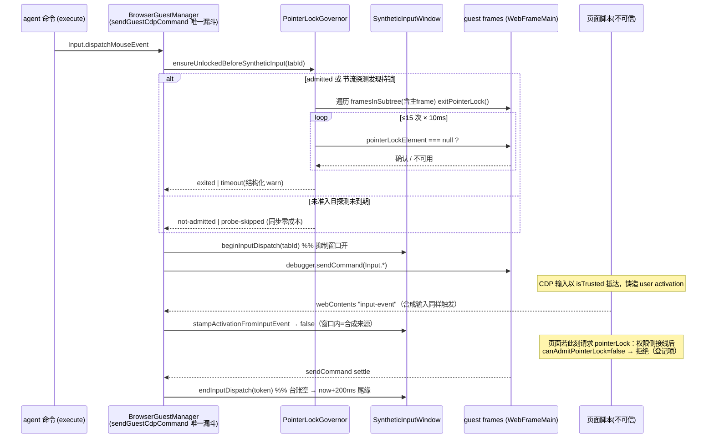
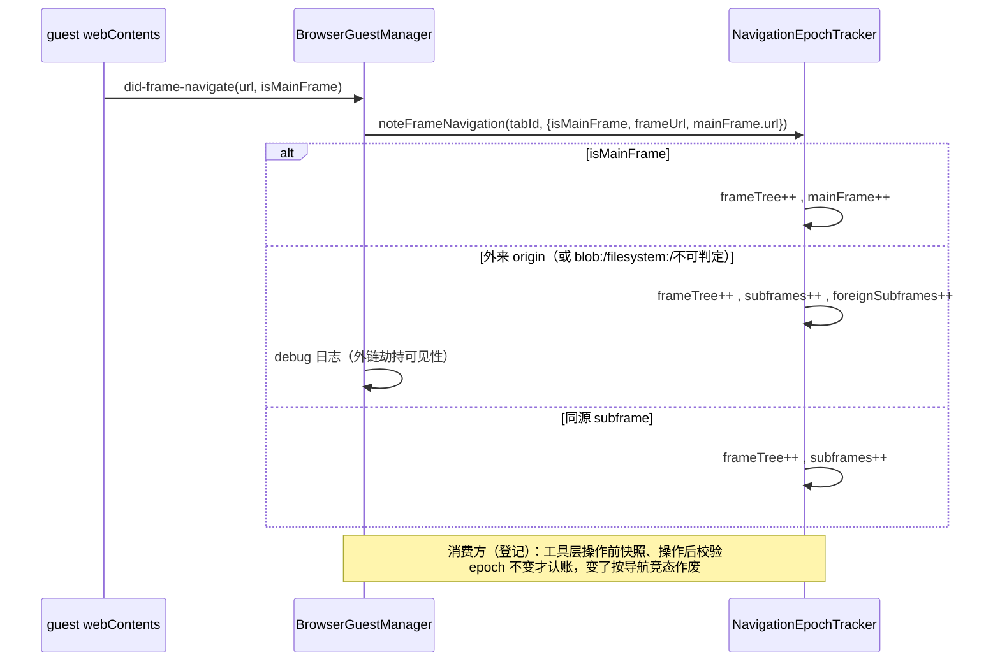

# Spec：内嵌浏览器 pane 宿主治理件（admission ticket / 导航 epoch 分轨 / 名单查询守卫 / 合成输入抑制 / pointer-lock 强制退出）

> 状态：**部分实施**。件 1/2/4/5 的机制模块与 guest manager 最小挂点已落地（件 1 的
> enforcement、件 5 的权限侧准入接线待编排，见「接线状态」）；件 3 判定为**登记**
> （现有实现已结构性覆盖，残余窗口写明）。机制来源：外部桌面应用「嵌入浏览器 pane
> 宿主治理」工程范式（第二轮价值提取研究文档 T2-m8 节，zoode 研究产出；还原工程证据
> `index.chunk-CHpJbW9_.js:190356-190433,:202610-202660,:134753-134778,:133310-133318,
:134010-134018,:199852-199863,:201226-201306,:205884-205950,:206879-206894`、
> `claudePagePreview.js:37-104`）。按边界纪律只搬运机制设计，实现为 ACode 自有代码；
> 任何外部厂商/产品代号不得进入代码与本 spec。

## 背景与现状

ACode 内嵌浏览器（IAB）是 renderer 内 `<webview>` guest + main 侧 CDP 控制面：

- `browserView/browserGuestManager.ts` 已有 **tab owner/generation 治理**：
  `BrowserGuestExecutionContext`（browserId+browserGeneration+windowId+workspaceKey+
  sessionId+remoteSessionId+clientMode 组成 scopeKey）做所有权隔离；`guestGeneration`
  在 guest 替换时递增，`assertCurrentGuest` 在每次 CDP 下发前拒绝 stale guest；
  CDP detach 有「detaching 生命周期 + pending 命令计数」双屏障。
- 全部 agent 输入都是 **CDP 合成输入**（`Input.dispatchMouseEvent/KeyEvent`），且
  收敛在唯一漏斗 `sendGuestCdpCommand`。CDP 合成输入抵达页面时是 `isTrusted` 事件、
  会铸造页面侧 user activation，也会触发 webContents 的 `input-event`——宿主此前
  **没有任何手段**区分真实用户手势与 agent 合成输入（未监听 `input-event`）。
- `desktopSessionPermissionPolicy.ts` 静态矩阵对「任意网页」session 无条件放行
  `pointerLock`（网页对等体验）；页面可在 agent 操作期间取得 pointer lock，锁定期
  鼠标被劫持，CDP 坐标输入失真。main 侧此前没有强制退出链。
- guest 有固定 preload 注入面（`will-attach-webview` + `nodeIntegrationInSubFrames`，
  见 `desktopWindowChrome.ts`），但 preload 入口与共享通道注册表不在本件所有权内。
- 站点权限持久表 `EmbeddedBrowserSitePermissionController/Store` 判定链是同步内存
  快照（`getCachedTable`），首载读盘经 mutationQueue 串行；guest manager 此前
  **不监听任何导航事件**（`did-navigate`/`did-frame-navigate` main 侧零接线）。

对照结论：owner/generation 语义是「拒绝过期绑定」，不覆盖本 spec 五件的
「新鲜凭据单次消费 / 文档级导航分轨计数 / 名单查询时效守卫 / 合成输入可信度标记 /
锁劫持强制退出」语义，逐件取舍见下。

## 逐件取舍总表

| #   | 机制                              | 判定                                                | 理由（摘要）                                                                                                                                                                                                                                                                                           |
| --- | --------------------------------- | --------------------------------------------------- | ------------------------------------------------------------------------------------------------------------------------------------------------------------------------------------------------------------------------------------------------------------------------------------------------------ |
| 1   | one-shot admission ticket         | **实现（机制+挂点，enforcement 默认关）+ 登记接线** | owner/generation 只拒 stale 绑定，无「consent 凭据 mint 后单次消费」语义；ACode 暂无 consent mint 面，默认开启会拒掉全部 claimTab，故 enforcement 置为显式开关，接线登记                                                                                                                               |
| 2   | 导航 epoch 分轨                   | **实现（跟踪+查询面）+ 登记消费**                   | `guestGeneration` 是 per-tab 单轨且只在 webview 重建时递增，文档级导航（尤其外来 subframe）main 侧不可见——分轨是纯增量；工具层「操作后 epoch 不变才认账」的竞赛作废需要 shared meta 扩展，超出所有权，登记                                                                                             |
| 3   | 站点名单查询 epoch 守卫           | **登记（语义已结构性覆盖）**                        | ACode 名单查询与判定之间无 async gap（同步内存快照；首载读盘串行于 mutationQueue 且读到的是最新态），不存在参考实现里「异步分类查询期间策略重载」的 fail-open 窗口；残余的 prompt 挂起期竞态写明并登记（需改控制器/存储，超出所有权）                                                                  |
| 4   | 合成输入抑制窗口 + 真实输入激活戳 | **实现**                                            | agent 输入 100% 经 CDP 且以 isTrusted 抵达页面并触发 `input-event`；宿主需要抑制窗口把窗口期内「看起来像用户手势」的信号标记为合成来源，防止页面内脚本借合成输入自触发权限升级/弹窗循环。**不是**拦 agent 自己的驱动：agent 的 CDP 下发不经过该判定                                                    |
| 5   | pointer-lock 强制退出链           | **实现（host 侧等价）+ 登记权限侧接线**             | ACode 有 preload 注入面但入口文件超出所有权；main 侧 `WebFrameMain.framesInSubtree + executeJavaScript` 可等价实现「广播退出→遍历 frame→轮询确认→waiter 等实际退出」，且能覆盖参考实现刻意跳过的主 frame（ACode 整页皆不可信内容，主 frame 同样可持锁）；权限请求侧的准入判定接线（index.ts 禁改）登记 |

## 产品规则

### 件 1：one-shot admission ticket（`browserView/browserPaneAdmissionTicket.ts`）

- 凭据键 = `(scopeKey, targetKey, tier)` 三元组；`tier` 闭集 `"site" | "high-risk"`。
- `mint` 写入台账并返回随机 ticketId；TTL 120s（对齐参考实现 `12e4`）；mint 时惰性
  GC 全部过期条目（含 tombstone）。
- `consume` **单次消费**：命中即删除并写 tombstone（保留至 TTL 期满），返回闭集
  判定：`ok` / `expired`（超 TTL，不落 tombstone）/ `consumed`（命中 tombstone =
  复用，区别于从未 mint）/ `missing`。拒绝路径必须结构化 info 日志（tier 入日志，
  不落凭据键之外的用户数据）。
- guest manager 挂点：`claimTab`（agent 接管 human tab = 交互准入的最近似点）。
  enforcement 由构造参数 `governance.enforceClaimAdmissionTicket` 控制，**默认 false**：
  关闭时 claimTab 行为与现状完全一致；开启时无有效凭据即拒（error code
  `backend_unavailable`，message 点名 admission ticket 缺失/过期/已消费）。
- manager 暴露 `mintTabClaimTicket(context, tabId, tier)` / 消费结果查询，供未来
  consent 面（renderer 确认 UI 或协议命令）接线；接线前生产无 mint 方（登记）。

### 件 2：导航 epoch 分轨（`browserView/browserTabNavigationEpochs.ts`）

- per-tab 四计数器（对齐参考实现字段语义）：
  - `frameTree`：任何 frame 导航都递增（frame 树形态变化信号）；
  - `mainFrame`：主 frame 提交导航递增；
  - `subframes`：任意 subframe 导航递增；
  - `foreignSubframes`：**外来** subframe 导航递增——subframe URL 的 origin 与主
    frame 当前 URL origin 不同即外来；非 http(s) 协议仅 `blob:`/`filesystem:` 计为
    外来（可承载远端内容）；主 frame URL 不可读或解析失败时保守计为外来。
- 事件源：guest `did-frame-navigate`（参数序 event, url, code, text, isMainFrame,
  ...），挂在既有 `setupActivityTracking` 事件骨架内随 `activityCleanup` 注销；
  guest 替换后重新接线，计数器按 tabId 存续（文档历史属于 tab 不属于 guest 实例）。
  外来 subframe 递增时落 debug 日志（tabId+计数，不落 URL 全文——日志卫生）；
  manager 暴露 `getTabNavigationEpochs(tabId)` 快照查询（null = 未知 tab），
  tab 关闭时清理条目。
- **消费登记**：参考实现的消费方式是工具层操作前快照 epoch、操作后校验「mainFrame
  epoch 不变（只读工具）/ subframe epoch 也不变（交互工具）」，变了按导航竞态作废
  结果。ACode 的对应扩展点是 `BrowserResponseMeta` 或新 browser 命令
  （`packages/shared`），超出本件所有权——登记为接线项。

### 件 3：站点名单查询 epoch 守卫——登记，不实现

判定依据（对照 `embeddedBrowserSitePermissionController.ts` 与 `Store`）：

- 参考实现需要 epoch 守卫，因为其名单查询是**真异步分类查询**（await 期间策略可
  重载）：查询前捕获策略 epoch，await 后变化即返回 `epoch-changed`，调用方按
  unverified 走 fail-closed（error 而非放行）。
- ACode 的「名单」= 站点权限持久表，查询链没有可被重载穿过的窗口：
  同步探测 `checkPermission` 全同步读内存快照（未加载 = 空表 = 不放行）；
  `handlePermissionRequest` 的 `getCachedTable() ?? await readTable()` 中 readTable
  先 await mutationQueue（读到的是全部已提交变更后的最新态），随后判定到
  `callback(true/false)` 之间**无任何 await**——单线程 JS 内决策原子；denied
  档全为同步拒绝，无放行型兜底。
- 结论：「名单版本过期仍放行」的 fail-open 窗口在 ACode 结构性不存在，加守卫是
  无消费方的死代码 → **登记，不实现**。
- **残余窗口登记**（真实但更窄）：prompt 挂起期内设置页 reset/clear 该 origin，
  随后用户点「始终允许」，`applyAction` 写入覆盖刚才的 reset（last-write-wins）；
  参考实现的 epoch 守卫会把该窗口判为 undecided。收敛需要 store 版本计数 +
  `resolvePrompt` 结算复查（变化按 deny-once 结算并 warn），两文件均不在本件
  所有权 → 登记为后续项。

### 件 4：合成输入抑制窗口 + 真实输入激活戳（`browserView/browserSyntheticInputWindow.ts`）

语义边界（关键）：ACode 的 browser-use 本来就是 agent 经 CDP 驱动。抑制窗口防的是
**页面内脚本借合成输入自触发权限升级/弹窗循环**（CDP 输入以 isTrusted 抵达页面并
铸造 user activation，页面可借此 window.open / 请求 pointerLock / 触发手势门控逻辑），
**不是**拦 agent 自己的驱动——CDP 下发路径不经过窗口判定，窗口只影响宿主侧对
「看起来像用户手势」信号的可信度标记与件 5 的准入判定。

两条时间轴（对齐参考实现的 input/activation 双窗分离）：

- **输入抑制窗口**（过滤 `input-event` 归因）：每次 `Input.*` CDP 下发 begin 一个
  token（`suppressedUntil = now + 35s` cap，覆盖卡死下发；对齐参考 `35e3`）；下发
  settle（含 rejection）后 end token：台账空 → `now + 200ms` 短尾缘（覆盖输入事件
  在途），非空 → `min(原 until, 最晚 begin + 35s)`；end 时惰性 GC 超 35s 僵尸
  token。`stampActivationFromInputEvent(tabId, eventType)`：窗口活跃 → false（该
  「手势」按合成来源处理，不落任何宿主手势账目）；窗口外且类型在闭集
  `mouseDown | rawKeyDown | keyDown` → 记 `lastRealGestureAt` 并返回 true。挂点：
  `sendGuestCdpCommand` 唯一漏斗对 `Input.*` begin/end（try/finally 必结算）；
  `setupActivityTracking` 增加 `input-event` 监听做 stamp。
- **合成激活窗口**（供件 5 准入与未来 consent 面）：`Input.*` 与
  `Runtime.evaluate/callFunctionOn` 且 `params.userGesture === true` 的下发铸造
  激活 token；`syntheticActivationLive` = 有在途 token 或 `now < activationUntil +
5s + 1s`（覆盖 Chromium ~5s transient activation 尾巴 +1s 裕量）。
- tab 关闭时 `dropTab`；不需要参考实现的 detach sentinel：ACode 的 token 生命周期
  = 单次 CDP send 的 promise，settle 必结算（finally），无「token 横跨整个工具
  操作、detach 后无人结算」的悬挂面；35s cap 兜底卡死下发。真实手势戳当前消费方：
  件 5 准入判定输入；未来 consent 面（「最近有真实手势」条件）复用（登记）。

### 件 5：pointer-lock 强制退出链（`browserView/browserPointerLockGovernor.ts`）

host 侧等价实现（不依赖 preload；差异与理由见「与参考机制的差异」）：

- **准入台账**：`markAdmitted(tabId, guestId)` / `clearAdmitted(tabId)`；
  `canAdmitPointerLock({ paneVisible, syntheticActivationLive, recentSyntheticDispatch })`
  纯判定 = pane 可见 且 35s 内无 CDP 派发记录 且 合成激活窗口不活跃（对齐参考
  `admitArtifactPointerLock`：真实用户在场才允许页面拿锁；agent 操作期间页面
  请求锁 → 拒绝，掐断「借合成输入自触发权限升级」）。权限请求侧接线登记。
- **强制退出链**（`ensureUnlockedBeforeSyntheticInput`，在 `Input.*` 下发前 await）：
  1. 已准入 guest → 每次输入派发前直接走退出链（对齐参考在每次工具 CDP 操作前
     await 退出的语义）；
  2. 未准入 → 节流探测（同 tab 2s 至多一次）：遍历 `mainFrame.framesInSubtree`
     **含主 frame**，逐 frame `executeJavaScript("document.pointerLockElement !==
null")`；发现持锁 → 隐式 `markAdmitted`（权限矩阵现状无条件放行，持锁事实即
     准入事实）并走退出链；
  3. 退出链：逐 frame 下发 `document.exitPointerLock()`（单 frame 失败不中断）→
     **15 次 × 10ms 轮询确认**每 frame `pointerLockElement === null` → waiter 等
     实际退出：全部 frame 确认或不可用即 settle `exited`；轮次耗尽 settle
     `timeout`；
  4. 结果闭集：`not-admitted | no-frames | exited | timeout | guest-unavailable |
probe-skipped`；`timeout` 走结构化 warn（tabId/guestId/frameCount/
     pendingCount/elapsedMs，非保留键，不落 URL）；
  5. 单 flight per tab（并发派发共享）；整链硬 deadline（轮询预算 + 单次
     executeJavaScript 竞态超时），**任何结果都不阻塞、不拒绝后续输入派发**
     （防御纵深件不能反噬主链路）；
  6. `exited` 后清 admitted（页面再拿锁经权限接线或节流探测重新准入，稳态零
     成本）；主 frame 导航（`did-navigate`）同样清 admitted（新文档不继承旧文档
     的锁准入）。不可用 frame（destroyed/detached/脚本抛错）一律按「已退出」
     收敛，绝不因个别 frame 异常挂死等待。

## 状态所有者

| 状态                                            | 所有者                                         | 形态                                                                        |
| ----------------------------------------------- | ---------------------------------------------- | --------------------------------------------------------------------------- |
| admission ticket 台账（mint/tombstone/TTL）     | **main**（BrowserGuestManager 持有 ledger）    | 内存 Map，键 `(scopeKey, targetKey, tier)`，惰性 GC；进程生命周期，不持久化 |
| 导航 epoch 计数（per-tab 四轨）                 | **main**（同上，tracker 按 tabId 键控）        | 内存计数器；guest 替换不清零，tab 关闭清理                                  |
| 合成输入/激活窗口（per-tab token 台账 + until） | **main**（同上）                               | 内存；tab 关闭清理；不跨进程共享                                            |
| pointer-lock 准入台账 + 退出 flight             | **main**（同上，governor 按 tabId 键控）       | 内存；guestId 换代自动重置；tab 关闭清理                                    |
| 站点权限持久表（件 3 相关，未改动）             | **main**（EmbeddedBrowserSitePermissionStore） | 现状不变                                                                    |

四个治理件全部是 main 侧平台层状态：不进 session/task 业务状态，不持久化，
不广播给 renderer（renderer 无需也不应消费这些内部治理账目）。

## 接口

新增文件（`packages/desktop/src/main/browserView/`，全部零 electron 顶层导入、
依赖注入时钟/日志/frame 访问器，可单测）：

```ts
// browserPaneAdmissionTicket.ts
export type BrowserPaneAdmissionTier = "site" | "high-risk";
// 模块内部（不导出，仓库 knip 纪律：只导出被跨模块导入的面）：
// type BrowserPaneAdmissionConsumeOutcome = "ok" | "expired" | "consumed" | "missing";
export class BrowserPaneAdmissionTicketLedger {
  mint(input: { scopeKey; targetKey; tier }): string; // → ticketId
  consume(input: { scopeKey; targetKey; tier }): {
    ok: boolean;
    reason: BrowserPaneAdmissionConsumeOutcome;
  };
}

// browserTabNavigationEpochs.ts
export interface BrowserTabNavigationEpochSnapshot {
  frameTree;
  mainFrame;
  subframes;
  foreignSubframes;
}
export function isForeignSubframeNavigation(
  frameUrl: string | null,
  mainFrameUrl: string | null,
): boolean;
export class BrowserTabNavigationEpochTracker {
  noteFrameNavigation(
    tabId,
    input: { isMainFrame; frameUrl; mainFrameUrl },
  ): { foreignSubframe: boolean };
  snapshot(tabId): BrowserTabNavigationEpochSnapshot | null;
  dropTab(tabId): void;
}

// browserSyntheticInputWindow.ts
export class BrowserSyntheticInputWindow {
  beginInputDispatch(tabId): symbol;
  endInputDispatch(tabId, token): void;
  beginActivation(tabId): symbol;
  endActivation(tabId, token): void;
  isInputSuppressed(tabId): boolean;
  syntheticActivationLive(tabId): boolean;
  hasRecentSyntheticDispatch(tabId, withinMs): boolean;
  stampActivationFromInputEvent(tabId, eventType: string): boolean;
  lastRealGestureAt(tabId): number | null;
  dropTab(tabId): void;
}

// browserPointerLockGovernor.ts
// 模块内部（不导出）：type BrowserPointerLockExitOutcome =
//   "not-admitted" | "no-frames" | "exited" | "timeout" | "guest-unavailable" | "probe-skipped";
export interface BrowserPointerLockFrameHandle {
  isUnavailable(): boolean;
  run(script: string): Promise<unknown>;
}
export class BrowserPointerLockGovernor {
  markAdmitted(tabId, guestId): void;
  clearAdmitted(tabId): void;
  noteMainFrameNavigation(tabId): void;
  canAdmitPointerLock(input: {
    paneVisible;
    syntheticActivationLive;
    recentSyntheticDispatch;
  }): boolean;
  ensureUnlockedBeforeSyntheticInput(
    tabId,
    guestId,
    readFrames: () => BrowserPointerLockFrameHandle[],
  ): Promise<BrowserPointerLockExitOutcome>;
  dropTab(tabId): void;
}
```

同理，各模块的 `*Options`（ledger/tracker/window/governor）与 synthetic 窗口常量
（35s cap / 200ms 尾缘 / 6s 激活尾巴 / 35s 近因窗）均为模块内部声明，不导出。

`BrowserGuestManager` 挂点（最小增量）：

- 构造参数追加可选 `governanceOptions: BrowserPaneGovernanceOptions`（追加位，不动
  既有参数序；接口不导出，同 ResidencyOptions 先例）：
  `{ enforceClaimAdmissionTicket?, admissionTicketTtlMs?, pointerLockPollIntervalMs?,
pointerLockMaxPolls?, pointerLockProbeThrottleMs?, now?, warn? }`。
- 新公开方法：`mintTabClaimTicket(context, tabId, tier)`（consent 面接线点）、
  `getTabNavigationEpochs(tabId)`（工具层接线点）、
  `canAdmitGuestPointerLock(webContentsId)` / `markGuestPointerLockAdmitted(webContentsId)`
  （权限侧接线点，按 webContentsId 反查 tab）。
- `claimTab` 命令分支：enforcement 开启时先 `consume`，失败按闭集 reason 拒绝。
- `setupActivityTracking`：+`did-frame-navigate`（epoch 分轨）、+`input-event`
  （激活戳）、+`did-navigate`（清 pointer-lock 准入，对齐参考语义）。
- `sendGuestCdpCommand`：`Input.*` → 退出链 await + 抑制窗口 begin/end +
  激活 token；`Runtime.evaluate/callFunctionOn` 且 `userGesture:true` → 激活 token；
  全部命令（含只读）更新「最近派发时刻」近因账目。
- `closeTab` / `closeWindow`：治理状态 `dropTab`；`closeSession` / `closeWindow`：
  ticket 台账 `dropScope`。

**不进 acode-protocol-v4 / channels.ts**：四件治理状态都是 main 内部账目，没有
renderer/CLI 消费面；未来 consent mint 面需要新命令时再进协议（登记）。

## 事件顺序

合成输入抑制 + pointer-lock 退出链（同一次 agent 点击的完整时序）：



真实用户手势（对照路径）：OS 输入 → guest → `input-event` → 窗口外 →
`stampActivationFromInputEvent` 返回 true → `lastRealGestureAt` 落账 →
（接线后）权限侧 `canAdmitPointerLock` 可为 true，页面正常拿锁。

导航 epoch 分轨：



## 验收场景（tests/embedded-browser-pane-governance.test.mjs）

1. **ticket 单次消费**：mint → consume ok；同键再 consume → `consumed`；未 mint 键 →
   `missing`；TTL 过期 → `expired`；tier/target/scope 任一不同 → `missing`（键隔离）；
   mint 惰性 GC 过期条目。
2. **claimTab enforcement**：开关关（默认）→ 无票照常 claim（现状不变）；开关开 →
   无票拒绝、mint 后成功且票据单次消费（第二次 claim 需重新 mint）。
3. **epoch 分轨**：主 frame 导航只增 mainFrame/frameTree；同源 subframe 只增
   subframes/frameTree；跨 origin subframe 增 foreignSubframes；`blob:`/`filesystem:`
   计外来；`about:blank` 不计外来；主 frame URL 不可读 → 保守计外来；计数器跨
   guest 替换存续、随 tab 关闭清理。
4. **抑制窗口**：begin → isInputSuppressed=true → stamp 返回 false（合成来源）；
   end（台账空）→ 200ms 内仍 suppressed、之后解除；并发 token 时 end 一个不收窗
   （min(原 until, 最晚 begin+35s)）；cap 内僵尸 token 被 GC；窗口外闭集事件类型
   stamp=true 且落 lastRealGestureAt，非闭集类型（mouseUp/char/mouseWheel）=false。
5. **激活窗口**：Input 派发期间 syntheticActivationLive=true；settle 后 6s（5+1）内
   仍 live、之后解除；userGesture:true 的 Runtime.evaluate 同样铸造；false 的不铸造。
6. **pointer-lock 退出链**：未准入 → `not-admitted` 且不触碰 frame；探测发现主 frame
   持锁 → exitPointerLock 下发 + 轮询确认 → `exited` 且 admitted 被清除；持锁 frame
   始终不确认 → 15 轮后 `timeout` + 结构化 warn（含 frameCount/pendingCount/elapsedMs，
   不含 URL）；frame 中途 destroyed/detached → 按已退出收敛；并发两次 ensure 共享
   单 flight；退出链抛错/超时都不向调用方 reject（输入派发主链路不受反噬）；
   节流窗内第二次探测 `probe-skipped`；`canAdmitPointerLock` 三条件判定表
   （可见 × 激活窗口 × 35s 派发记录）。
7. **did-navigate 清准入**：markAdmitted → 主 frame 导航 → 再 ensure 按未准入处理。
8. 回归：既有 desktop 测试全绿（guest manager 挂点不改变默认行为——enforcement 关、
   未准入 guest 的 Input 派发路径只多一次同步 no-op 判定）。

## 与参考机制的差异（ACode 适配，逐条理由）

1. **退出链覆盖主 frame**：参考实现的 preload 只在 subframe 装退出器（其主文档是
   自家可信页面，锁治理对象是 artifact subframe）；ACode 整个 guest 都是不可信网页，
   主 frame 同样可持锁 → host 侧遍历含主 frame。
2. **host 侧 executeJavaScript 等价 preload 广播**：参考实现经固定 preload 的 IPC
   通道广播退出 + 页内 15×10ms 轮询回报；ACode 的 preload 入口文件不在本件所有权，
   而 main 侧 `WebFrameMain.executeJavaScript` 对跨源 frame 同样可用，退出与确认
   都能在 host 侧闭环，无需新 IPC 通道注册。轮询预算保持 15×10ms 语义（host 侧
   另加整链 deadline 兜底冻结 renderer）。
3. **subframe trusted pointerdown 上报（1s 节流）不移植**：参考实现用它喂「弹窗
   手势归因账目」与「find-consent mint 近合成遥测」；ACode 无这两个消费面，且
   webContents `input-event` 不区分 frame、已覆盖「真实手势戳」语义（件 4）。
   未来若需要 per-frame 手势归因，再走 preload 面（登记为可选项）。
4. **抑制窗口按单次 CDP send 计 token**，不按整个工具操作：ACode 的 send 漏斗
   promise settle 必结算（finally），无参考实现的 detach 悬挂面；操作间隙 >200ms
   的激活尾巴由独立的合成激活窗口（5s+1s live 尾）覆盖，两窗分工与参考一致。
5. **节流探测补位**：参考实现的准入标记来自其权限请求接线；ACode 该接线暂缺
   （登记），为使退出链在接线前仍有防御价值，加 2s 节流的全 frame 持锁探测，
   发现持锁即隐式准入。接线完成后探测自然退化为兜底。
6. **`exited` 后清准入**：参考实现靠 did-navigate/render-process-gone 清；ACode
   两者都清（did-navigate 挂点保留，另在退出成功后即清），稳态输入派发零成本。

## 接线状态（登记项，均不在本件所有权）

| 接线                               | 触点                                                                                                                                                             | 现状                                                        |
| ---------------------------------- | ---------------------------------------------------------------------------------------------------------------------------------------------------------------- | ----------------------------------------------------------- |
| pointer-lock 权限请求侧准入        | `desktopSessionPermissionPolicy.ts` 的 pointerLock 分支 consult `canAdmitPointerLock` + 放行时 `markGuestPointerLockAdmitted`；wiring 在 `main/index.ts`（禁改） | 未接；接前退出链靠节流探测兜底，`canAdmit` 判定无生产调用方 |
| claim consent 面（ticket mint 点） | renderer/CLI 的用户确认流 → 新 IPC 或协议命令 → `mintTabClaimTicket`；随后开启 `enforceClaimAdmissionTicket`                                                     | 未接；enforcement 默认关，claimTab 行为与现状一致           |
| 导航 epoch 工具层消费              | `packages/shared` 的 `BrowserResponseMeta` 扩展或新 browser 命令暴露 epochs；工具侧操作前后快照比对、竞态作废                                                    | 未接；main 侧跟踪与 `getTabNavigationEpochs` 查询面已就绪   |
| 件 3 残余窗口收敛                  | store 版本计数 + controller `resolvePrompt` 复查                                                                                                                 | 登记为后续项（见件 3）                                      |
| （可选）preload per-frame 手势上报 | guest preload 入口 + 通道注册表                                                                                                                                  | 登记为可选未来项（见差异 3）                                |
