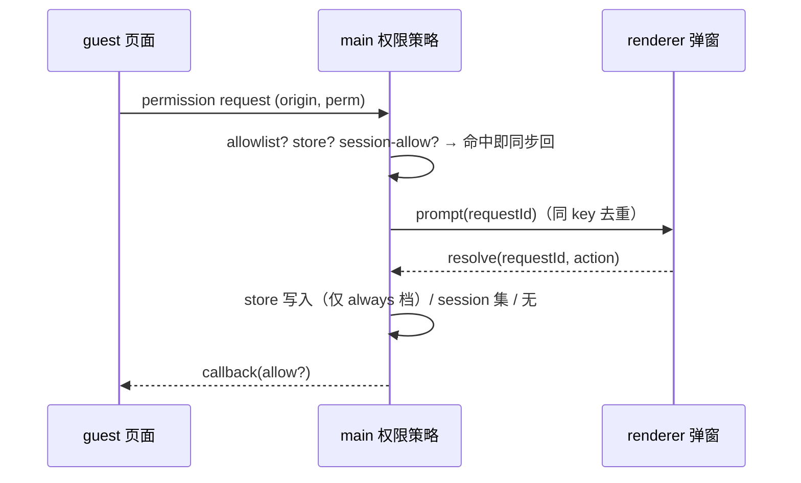

# ACode：嵌入式浏览器站点权限管理

## 背景与目标

`desktopSessionPermissionPolicy.ts`（安全加固 P2 #2b）目前是纯静态矩阵：默认拒绝 +
`fullscreen` / `clipboard-sanitized-write`（任意网页 session 另有 `pointerLock`）放行，
未识别权限一律同步 denied。结果是嵌入浏览器里网站的摄像头/麦克风/通知/定位请求被
**静默**拒绝，用户没有任何可见反馈，也无法表达「这个站点我信任」。

本 spec 引入**站点级权限管理**：可询问权限保持默认拒绝，但未决请求弹出权限对话框，
用户可选「始终允许 / 本次会话允许 / 始终阻止 / 本次拒绝」；「始终」档持久化到磁盘，
设置页提供按 origin 的管理面。静态矩阵的 fail-closed 纪律不变：不可询问权限依旧
同步拒绝，没有任何 prompt 路径。

## 产品规则

- **可询问权限集合**（闭集，代码常量）：`camera`、`microphone`、`geolocation`、
  `notifications`、`midi`、`midiSysex`。集合之外（含未来 Electron 新增）一律同步
  denied 并 warn——与现行策略同一档。
- `media` 权限按 `mediaTypes` 细分进 camera/microphone 后走同一条链。
- 四档动作：
  - `allow-always`：写 store（origin → permission → `"allow"`）；
  - `allow-session`：只写内存 session-allow 集合（该 Electron session 生命周期内）；
  - `block-always`：写 store `"deny"`；
  - `deny-once`：什么都不写。
- 弹窗期间**同一 (origin, 细分权限集合) 去重**：并发请求共享同一个未决 Promise。
  去重键必须用 `media` 细分后的子权限集合（camera/microphone 等，排序后拼接），**不能**
  用原始 `permission` 字符串。原因：并发的 `media(video)` 与 `media(audio)` 会命中同一个
  `origin\0media` 键，后到的音频请求没有自己的弹窗、直接继承摄像头弹窗的决策被静默放行
  （fail-open 隐私泄露），违背「`media` 按 `mediaTypes` 细分后逐项征求同意」的产品规则。
  按细分集合去重后，只有解析出**同一**同意范围的并发请求才共享 Promise；需要不同子权限
  的请求各自弹窗。
- `clipboard-read` / `usb` / `hid` / `serial` / 屏幕捕获**不在**可询问集合：屏幕捕获与
  设备选择保持同步拒绝（zcode 3.15.1 有 source picker，ACode 本轮不做，登记为后续项）。
- 同步探测（`setPermissionCheckHandler`）只认 store 的 `"allow"` 与 session-allow；
  从不触发弹窗。

## 状态所有者

| 状态 | 所有者 | 形态 |
| --- | --- | --- |
| 持久站点决策 | **main**（唯一写者） | `userData/embedded-browser-site-permissions.json`：`{ [origin]: { [permission]: "allow" \| "deny" } }`，整体读写、写入原子（tmp+rename） |
| 会话级允许 | **main** | 内存 `Map<origin, Set<permission>>`，session 销毁即失效 |
| 未决弹窗 | **renderer**（展示） | zustand store（仿 `alertDialogStore.ts`），数据来自 main 推送 |

store 文件属于平台层持久化，不进任何 session/task 业务状态；不迁移、不版本化
（损坏时 warn 后按空表继续）。

## 接口

桌面 IPC（通道名全部登记进 `packages/shared/src/channels.ts` 的 `PlatformChannels`；
registrar 走功能域模式——新建 `desktopSitePermissionIpc.ts` 导出
`registerDesktopSitePermissionIpcHandlers()`，挂到 `desktopMainIpcPlatform.ts` 的既有挂载点；
**不进 acode-protocol-v4**——浏览器权限是平台能力，不是会话协议）：

```ts
// main → renderer（发送到嵌入浏览器所在窗口）
EmbeddedBrowserPermissionPrompt     { requestId, origin, permission, mediaTypes? }
// renderer → main
EmbeddedBrowserPermissionResolve    { requestId, action }
// 管理面（设置页 BrowserSettingsSection）
GetEmbeddedBrowserSitePermissions     → { [origin]: { [permission]: "allow"|"deny" } }
ResetEmbeddedBrowserSitePermission    { origin, permission }
ClearEmbeddedBrowserSitePermissions   ()
```

持久化 store 以 `browserView/browserTabRecoveryStore.ts` 为模板（内存快照 + mutationQueue
串行 + tmp-rename 原子写 + 损坏文件隔离 `.corrupt-<ts>`），新文件
`browserView/embeddedBrowserSitePermissionStore.ts`。改造
`desktopSessionPermissionPolicy.ts` 时保持纯函数 `resolveDesktopPermissionRequestDecision`
为 fail-closed 默认（不可询问集合同步拒绝不变）；录制临时 partition 的豁免
（`:103-107` 注释语义）不被新 store 覆盖。

`requestId` 由 main 生成（随机 UUID）；resolve 回一个未知/过期 id 时 main 记 warn 并按
`deny-once` 结算（不抛错——弹窗可能已被用户关闭）。

## 事件顺序



弹窗目标窗口：嵌入浏览器所在窗口（与 CUA 权限面板同一窗口解析规则）；目标窗口
不可用时同步 denied 并 warn，不排队。

## 验收场景

1. 未决 camera 请求 → 弹窗「<origin> 想使用摄像头」→ allow-always → 刷新后同 origin
   camera 直接放行且无弹窗；notifications 仍弹。
2. allow-session → 重启 app 后再次请求重新弹窗。
3. 设置页能看到 origin 列表、逐项重置、一键清空；重置后请求重新弹窗。
4. store 文件损坏 → warn + 空表继续，app 不崩。
5. 断开（弹窗窗口关闭/超时无 UI 响应路径不存在——resolve 永远可达）：未知 requestId
   resolve → warn + deny-once。
6. `desktopSessionPermissionPolicy` 现有单测全绿 + 新增：可询问集合判定、四档动作
   落点、去重、check-handler 镜像、损坏文件容错。
7. 并发 `media(video)` 与 `media(audio)`（disjoint mediaTypes）各自弹窗、各自征求同意：
   对摄像头弹窗 allow-always **只**写 `camera=allow`，音频请求**不得**继承摄像头决策被放行，
   必须挂在自己的弹窗上（去重键用细分集合而非原始 `permission`）。

i18n：`browser.permission.*`（wantsToUse / siteInfo / settings / saved / readError /
saveError / allowAlways / allowSession / blockAlways / deny / close / camera /
microphone / geolocation / notifications / midi 等按实现裁剪），en-US 与 zh-CN 同步。
