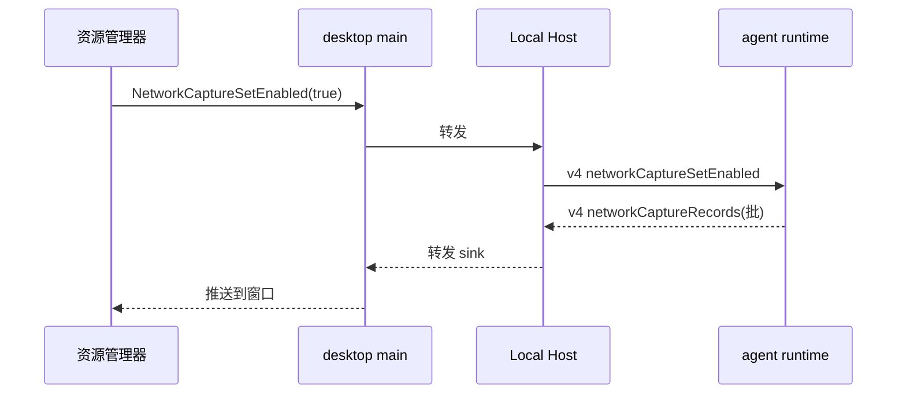

# ACode：运行时网络观测（agent 进程内）

## 背景与目标

资源管理器新增 network tab，展示 **agent 运行时进程**的出站 HTTP 请求（LLM 网关、
WebFetch/WebSearch、http 形态 MCP）。上游 zcode 3.15.1 用进程内观测 + 通知上报
（LocalRuntimeNetworkCapture/RequestObservationStore）；ACode 同构实现，**不走**
http-mitm-proxy（避免与设置页用户代理共用 env 键互相覆盖、避免 CA 注入与
「下次启动 agent 生效」语义）。

范围诚实边界：只覆盖 agent runtime 进程内发出的请求；Bash 等子进程的网络不可见
（上游同样只标 `processType:"cli"`）。

## 采集（apps/acode-cli，contracts/adapters/bootstrap）

- 拦截点两处互斥分工（2026-10-11 实机修订：单点 global fetch 包装会漏掉
  WebFetch public egress——该路径走 node:http/https 自定义传输分支，绕过 global fetch）：
  ① `bootstrap/src/acode-protocol-v4/network-capture-observation.ts` 包装 global fetch
  （plain 传输分支与模型网关 ai-sdk）；② `adapters/src/http/index.ts` 的自定义传输分支
  （代理 / 自定义 CA / public egress DNS 预检）在 resolve/reject 点经 contracts 的
  `recordNetworkCaptureObservation` sink 补记（sink 注册表与相位 ALS 同住
  `contracts/src/network-capture-phase.ts`，依赖方向 adapters → contracts ← bootstrap）。
  一个请求恰好一行：plain 分支只被 ① 记，自定义分支只被 ② 记。
- 记录 `{ method, url, status, startedAt, durationMs, phase }`；环形缓冲 ≤ 500 条 +
  每 10s/满 50 条批量上报。
- **脱敏纪律**：不记 headers（无凭据落盘）、不记 body；URL 剥 userinfo；query 值
  只保留参数名清单（值截断为 `<redacted>`）。
- 开关：默认关。v4 命令 `networkCaptureSetEnabled { enabled, captureId? }`（host→
  agent，只进 v4；方法表 + capabilities）；开启时 agent 逐批发 v4 事件
  `networkCaptureRecords { captureId, records[] }`；关闭即停发并清缓冲。
  **host 级语义**（2026-10-11 实机修订）：RM 开关面向「本 host 的全部 agent」，而 v4
  命令按 workspace 路由只到一个 agent、workspace agent 又按需 spawn——单点路由会让
  后 spawn 的 agent 永远不被观测。acodeAgentService 因此持有 wire 状态
  （`networkCaptureWireState`）：目标 workspace 成功后循环补发池内其余 client，新
  client 入池（spawn / re-wire）时立即补发；关闭即清空状态并同样扇出。

## 桌面链路（packages/desktop + services + ui）

- Host 收 v4 事件 → 转发持有资源管理器窗口的 renderer（经既有
  resource-manager preload 的 subscribe 模式）。
- 资源管理器：`ResourceManagerTab` 加 `"network"`（`ResourceManagerApp.tsx` tab 表 +
  i18n id + 新 Section）；列（时间/方法/URL/状态/耗时），过滤框（子串），清空按钮，
  分页（前/后，每页 50）。
- 开关按钮在 network tab 内：renderer → main IPC（`PlatformChannels` 新
  `NetworkCaptureSetEnabled`/`NetworkCaptureGetState`）→ host → agent v4 命令；
  agent 重启后开关状态由 main 记忆并在新会话 attach 时重发。
- **发送方鉴权（ID 空间纪律）**：`NetworkCaptureSetEnabled` 是变更操作，只允许资源
  管理器窗口发起。鉴权必须在 **同一 ID 空间**内比较——`event.sender.id`（WebContents
  id）对 资源管理器窗口的 `webContents.id`，与既有 `setResourceUsageSamplingActive` /
  `getResourceUsageSnapshot`（`resourceManagerWindow.ts:78/87`）同一取值口径。
  **绝不能**拿 `event.sender.id` 去比 `BrowserWindow.id`：Electron 的 WindowId 与
  WebContentsId 是两套彼此独立的整数计数器（见 `desktopWindowIds.ts`），本 App 还会
  创建大量无窗口的 webContents（`<webview>` guest、WebContentsView/CUA、辅助 renderer、
  DevTools），RM 窗口的 `webContents.id` 必然 > 其 `BrowserWindow.id`。混用两种后果：
  合法 RM 发送方被判 `forbidden`（本特性静默失效，违背验收场景 1），或某个
  `webContents.id` 恰好等于 RM `BrowserWindow.id` 的无关 renderer 越权开关（鉴权旁路）。
  因此资源管理器暴露两个各自品牌的取值点：`getResourceManagerWindowId()`（WindowId，供
  `BrowserWindow.fromId` 推送记录）与 `getResourceManagerWebContentsId()`（WebContentsId，
  供发送方鉴权）；两者不可互换。`NetworkCaptureGetState` 是纯读取，不限制发送方。
- i18n：`resourceManager.network.*`（description/filter/clear/unavailable/count/
  previous/next/time/process/method/empty/noMatches）。

## 事件顺序

## 验收场景

1. 开启后 agent 发起一次 WebFetch → network tab 出现一行（方法/URL 脱敏后/状态/
   耗时）；query 里的 token 值显示为 `<redacted>`。
2. 关闭 → 不再有新行；缓冲清空。
3. 过滤子串命中；清空按钮清 UI；分页可用。
4. agent 重启 → 开关保持，新请求继续出现。
5. 单测：interceptor 记录与脱敏（mock fetch）、环形缓冲上限、批量上报批大小；
   v4 命令/事件 schema 校验测试。
6. remote workspace：经远端 host 同链路可用（事件透传）。
7. 发送方鉴权：资源管理器窗口（其 `webContents.id` 与 `BrowserWindow.id` 不相等，模拟
   真实 App 里 webContents 计数器超前的常态）发 `NetworkCaptureSetEnabled(true)` 必须放行
   并转发 host；`webContents.id` 恰等于 RM `BrowserWindow.id` 的无关 renderer 必须被
   `forbidden` 拒绝（防鉴权旁路）；RM 窗口未开时任何发送方一律 `forbidden`。
   单测（`tests/network-capture-sender-authorization.test.mjs`）以 `loadMain` 转译注入跑
   真实模块，但两套 id 是**手挑常量**（RM_WINDOW_ID=2 / RM_WEBCONTENTS_ID=3），只证明判定
   逻辑，不证明真实 Electron 里两套计数器的关系。
8. 真机 Electron 验收（`packages/desktop/scripts/e2e-network-capture-auth.mjs`，
   `pnpm --filter @acode/desktop e2e:netcapture-auth`）：补场景 7 的缺口——由 **Electron
   亲自分配**两套 id 计数器，串起**真实 `openResourceManager()` 单例 + 真实构建出的
   `out/preload/resourceManager.cjs`（真 `contextBridge` 桥）+ 真跨进程 `ipcRenderer.invoke`
   → 真 `isResourceManagerSender`**。harness 先建 3 个 offscreen webContents 推高
   webContents 计数器，复现真实 App 里 `webContents.id > BrowserWindow.id` 的分叉前提。
   2026-10-12 实测（Windows / Electron Chrome 146）：真实 `BrowserWindow.id=1` 而
   `webContents.id=4`（`event.sender.id=4`，即鉴权真正比对的值）——
   - 修复后：合法 RM 经真实桥开关返回 `{success:true}`，`GetState` 记忆 `enabled=true`
     且生成 `captureId`；挂同一真实 preload 但非 RM 单例的另一真实窗口发同一开关返回
     `{success:false,error:"forbidden"}`（不借道）；
   - 破坏对照 `--control`（把当前源码里的修复**机械逆回**旧 WindowId 口径后经内存插件构建进
     同一 harness、同一真实 Electron 运行时；对照自洽于工作树，不依赖 `git show HEAD`，因此
     修复与 harness 同批提交后仍可长期复现）：同一分叉下合法 RM 开关返回
     `{success:false,error:"forbidden"}`、`GetState` 记忆 `enabled=false`——旧 bug 在真实
     Electron 里复现（拿 `sender.id` 比 `BrowserWindow.id`，二者本就不等）。
   构建注意：真实 main 模块被 esbuild 打成 ESM，需注入 `createRequire` banner 兜底内联的
   CJS 依赖（yaml 等），否则 `require("process")` 在纯 ESM 下抛 Dynamic require 不支持
   （与 `f9ed896` server-cli 同一手法）；隔离走 `--user-data-dir`，不可覆盖 `USERPROFILE`
   （实证会让 Electron 在 `app.whenReady()` 前以 STATUS_BREAKPOINT 崩）。临时目录与进程树
   在两个方向都验证清理干净。
   harness 自身的保真纪律（两条，破坏对照的结论可信度依赖它们）：
   - **产物新鲜度守护**：本 harness 验的是真实构建产物 `out/preload/resourceManager.cjs`，
     跑之前比它与 `src/preload/resourceManager.ts` 的 mtime，产物更旧就 fail-loud 并给出
     重建命令——否则「改了桥没重建」会拿旧桥验收新代码而静默通过（口径同
     `apps/acode-cli/evals/runner-report.mjs` 的 `checkDistFreshness`）。
   - **破坏对照不落盘**：`--control` 的 HEAD 源码经 esbuild 插件（虚拟 namespace +
     `resolveDir` 指向真实 `src/main`）**只在内存里**供出，绝不写进 `src/main`。src 树被
     tsconfig include 与 oxlint 扫描，落盘副本一旦因信号中断留在盘上会污染下一轮门禁。
   两个真机 harness 共用的 Electron 运行时骨架（二进制解析、argv、带超时 spawn、进程树
   清理、checkpoint 记账）收敛在 `scripts/e2e-electron-harness.mjs`，机制层单份实现。
