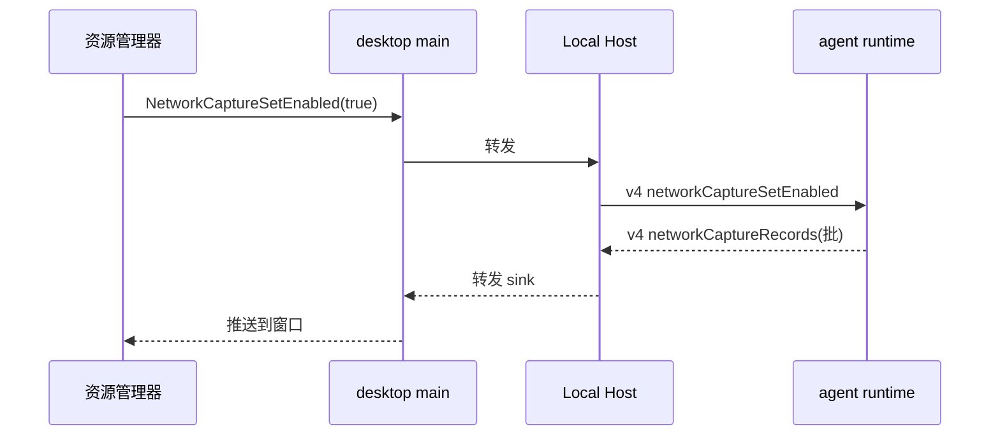

# ACode：运行时网络观测（agent 进程内）

## 背景与目标

资源管理器新增 network tab，展示 **agent 运行时进程**的出站 HTTP 请求（LLM 网关、
WebFetch/WebSearch、http 形态 MCP）。上游 zcode 3.15.1 用进程内观测 + 通知上报
（LocalRuntimeNetworkCapture/RequestObservationStore）；ACode 同构实现，**不走**
http-mitm-proxy（避免与设置页用户代理共用 env 键互相覆盖、避免 CA 注入与
「下次启动 agent 生效」语义）。

范围诚实边界：只覆盖 agent runtime 进程内发出的请求；Bash 等子进程的网络不可见
（上游同样只标 `processType:"cli"`）。

## 采集（apps/acode-cli，contracts/adapters/bootstrap）

- 拦截点两处互斥分工（2026-10-11 实机修订：单点 global fetch 包装会漏掉
  WebFetch public egress——该路径走 node:http/https 自定义传输分支，绕过 global fetch）：
  ① `bootstrap/src/acode-protocol-v4/network-capture-observation.ts` 包装 global fetch
  （plain 传输分支与模型网关 ai-sdk）；② `adapters/src/http/index.ts` 的自定义传输分支
  （代理 / 自定义 CA / public egress DNS 预检）在 resolve/reject 点经 contracts 的
  `recordNetworkCaptureObservation` sink 补记（sink 注册表与相位 ALS 同住
  `contracts/src/network-capture-phase.ts`，依赖方向 adapters → contracts ← bootstrap）。
  一个请求恰好一行：plain 分支只被 ① 记，自定义分支只被 ② 记。
- 记录 `{ method, url, status, startedAt, durationMs, phase }`；环形缓冲 ≤ 500 条 +
  每 10s/满 50 条批量上报。
- **脱敏纪律**：不记 headers（无凭据落盘）、不记 body；URL 剥 userinfo；query 值
  只保留参数名清单（值截断为 `<redacted>`）。
- 开关：默认关。v4 命令 `networkCaptureSetEnabled { enabled, captureId? }`（host→
  agent，只进 v4；方法表 + capabilities）；开启时 agent 逐批发 v4 事件
  `networkCaptureRecords { captureId, records[] }`；关闭即停发并清缓冲。
  **host 级语义**（2026-10-11 实机修订）：RM 开关面向「本 host 的全部 agent」，而 v4
  命令按 workspace 路由只到一个 agent、workspace agent 又按需 spawn——单点路由会让
  后 spawn 的 agent 永远不被观测。acodeAgentService 因此持有 wire 状态
  （`networkCaptureWireState`）：目标 workspace 成功后循环补发池内其余 client，新
  client 入池（spawn / re-wire）时立即补发；关闭即清空状态并同样扇出。

## 桌面链路（packages/desktop + services + ui）

- Host 收 v4 事件 → 转发持有资源管理器窗口的 renderer（经既有
  resource-manager preload 的 subscribe 模式）。
- 资源管理器：`ResourceManagerTab` 加 `"network"`（`ResourceManagerApp.tsx` tab 表 +
  i18n id + 新 Section）；列（时间/方法/URL/状态/耗时），过滤框（子串），清空按钮，
  分页（前/后，每页 50）。
- 开关按钮在 network tab 内：renderer → main IPC（`PlatformChannels` 新
  `NetworkCaptureSetEnabled`/`NetworkCaptureGetState`）→ host → agent v4 命令；
  agent 重启后开关状态由 main 记忆并在新会话 attach 时重发。
- i18n：`resourceManager.network.*`（description/filter/clear/unavailable/count/
  previous/next/time/process/method/empty/noMatches）。

## 事件顺序

## 验收场景

1. 开启后 agent 发起一次 WebFetch → network tab 出现一行（方法/URL 脱敏后/状态/
   耗时）；query 里的 token 值显示为 `<redacted>`。
2. 关闭 → 不再有新行；缓冲清空。
3. 过滤子串命中；清空按钮清 UI；分页可用。
4. agent 重启 → 开关保持，新请求继续出现。
5. 单测：interceptor 记录与脱敏（mock fetch）、环形缓冲上限、批量上报批大小；
   v4 命令/事件 schema 校验测试。
6. remote workspace：经远端 host 同链路可用（事件透传）。
