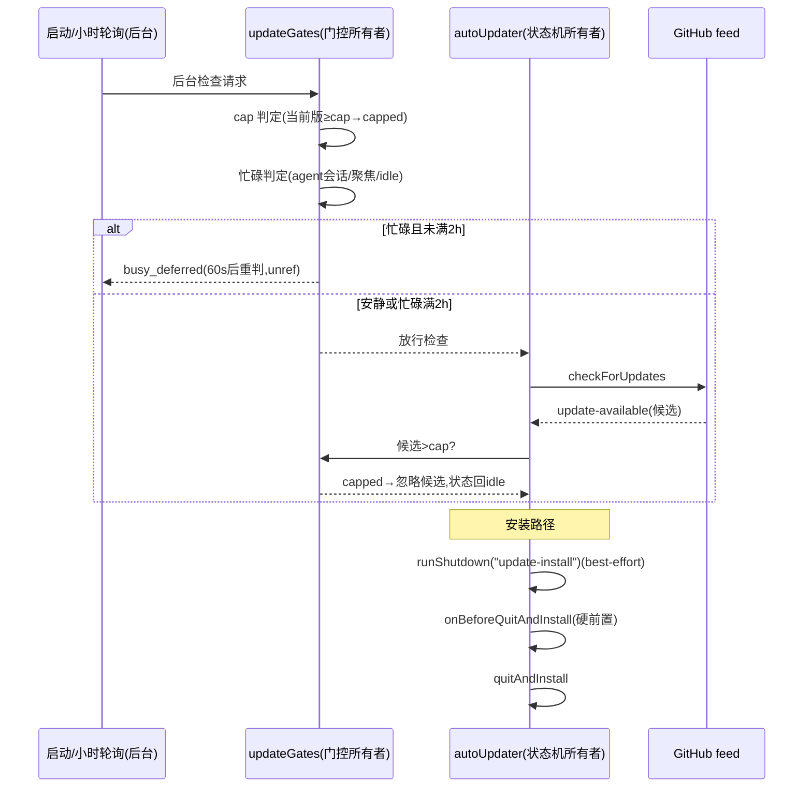

# 更新门控三件增量与网络端点注册表骨架

状态：已实施（2026-10-15，价值提取第二轮 T1-s3 三件增量 / T1-s4 注册表骨架 / T2-s7② beforeInstall 调用侧）。
代码：`packages/desktop/src/main/updateGates.ts`（门控计算，新）、`packages/desktop/src/main/networkEndpointRegistry.ts`（端点注册表，新）、
`packages/desktop/src/main/autoUpdater.ts`（接线）、`packages/desktop/src/main/desktopNetworkPolicy.ts`（注册表消费点）。
测试：`packages/desktop/tests/update-gates.test.mjs`。
既有更新链路 spec 见 `github-updates.md`（本文不改变其 feed/provider/手动检查承诺，只增加门控层）。

## 范围

- 更新器三件增量：dangerousMaxVersion 封顶（`capped`）、宿主忙碌感知延迟后台检查（`busy_deferred`）、门控原因闭集（结构化 `gateReason`）。
- beforeInstall 调用侧：`quitAndInstall` 前调用关停注册表的 update-install 段（注册表模块本身不在本文范围）。
- 网络端点注册表骨架 + 一期消费：按 host+path 查询登记用途、未登记出站面 warn 诊断（不阻断）。
- 登记不做（触发条件见文末「登记项」）：sidecar 全链更新、被阻断请求合成 503、三档隐私开关、阻断策略。

## 规则与边界（更新门控）

- **唯一所有者**：`updateGates.ts` 是门控判定（cap 比较、忙碌累计、gateReason 闭集与结构化日志）的唯一所有者；
  `autoUpdater.ts` 仍是更新状态机/single-flight/下载取消的唯一所有者，只消费门控结论，不重复实现比较逻辑。
- **cap 配置面**（现有更新配置来源调查结论：app 设置 schema 在 shared 不可扩展；managedPolicy.ts 是 shared strict
  schema 且只覆盖 permission；env/argv 已有 P1-7「打包版忽略」先例）：
  1. `InitAutoUpdaterOptions.updateGates.maxVersion`——显式注入，打包/开发均生效（注入方是 main 进程代码，信任边界与
     `onBeforeQuitAndInstall` 相同；企业配置层落地后由该入口接入）。
  2. env `ACODE_UPDATE_MAX_VERSION` / argv `--acode-update-max-version`——**仅非打包构建生效**（与更新源覆盖 P1-7 同一哲学；
     cap 只能收紧更新，注入方向安全，但打包版仍不吃用户态 env，避免「静默断更」不可诊断）。
  3. cap 值非法（semver 不可解析）→ **fail-closed 按 capped 处理**（不更新）并 warn；不猜语义、不放行。
- **cap 语义**：当前版本 ≥ cap → 不发起检查；候选版本 > cap → 忽略该候选（状态回 idle）。两种情况 gateReason 均为
  `capped`，日志附 `cap`、`currentVersion`、候选场景附 `candidateVersion`。手动检查同样受 cap 约束（cap 是安全上限，
  不是后台策略），手动路径闭环反馈 `up-to-date`，不悬在 checking。
- **忙碌感知延迟**（只作用于后台检查 `startup`/`poll`；手动检查/通道刷新是用户显式意图，不延迟）：
  - 联合信号：活跃 agent 会话数（注入 `hostBusySignals.getRunningAgentSessionCount`，接线需求见下）＋任一窗口聚焦
    （`BrowserWindow.getFocusedWindow`，缺省实现）＋系统空闲秒数（`powerMonitor.getSystemIdleTime`，缺省实现，
    powerMonitor 不可用时按 0 处理）。
  - 安静判定：系统空闲 ≥ 300s，或无聚焦窗口持续 ≥ 30s；**安静且 agent 会话数为 0** 才算安静（agent 在跑时即使失焦/空闲
    也视为忙——更新安装会替换 resources/glm 等随包资源，避开 agent 活跃期）。
  - 忙碌累计 `busyMs`：按相邻采样间隔累计，间隔 > 45min 视为「不在场」，不累计且清 unfocused 计时。
  - 延迟重试 60s（unref 定时器，single-flight：同一时刻至多一个延迟重试定时器）；`busyMs` 满 2h 强制检查
    （「宿主已持续忙碌 N 小时，仍执行后台更新检查」语义），避免长任务宿主永不更新。
  - 延迟时记结构化 gateReason=`busy_deferred`（每个延迟 episode 只在首次采样记一条，避免 60s 一条刷屏）；恢复检查时记
    「安静恢复」或「忙碌超时强制」转换日志。
- **gateReason 闭集**（12 值，全部进结构化日志；上下文对象**禁用 `status` 键**——日志上下文保留键——统一用 `gateReason`）：

  | gateReason             | 产生点（现有原因归并）                                                                                    |
  | ---------------------- | --------------------------------------------------------------------------------------------------------- |
  | `capped`               | 当前版≥cap / 候选>cap / cap 值非法 fail-closed（新增）                                                    |
  | `busy_deferred`        | 宿主忙碌推迟后台检查（新增）                                                                              |
  | `stale`                | 「ignore stale update channel=…」（旧通道迟到结果）                                                       |
  | `invalid_feed`         | setFeedURL 失败 / feed 配置不可用（新增捕获，原先未处理会炸 init）                                        |
  | `invalid_pointer`      | dev 自定义 feed 覆盖 URL 不可解析（新增校验）                                                             |
  | `disabled_by_policy`   | 产品 flavor 禁用更新器（「disabled for this desktop product flavor」）；企业策略 autoUpdate.disabled 预留 |
  | `not_packaged`         | 「skip …: not packaged」（开发运行时跳过检查/下载/手动检查）                                              |
  | `already_in_flight`    | 「check already in flight」（single-flight defer，含通道刷新 defer）                                      |
  | `state_conflict`       | 「skip poll: state=…」「update already ready」「download already in progress/requested」                  |
  | `user_skipped_version` | 「ignore skipped update …」（用户跳过版本）                                                               |
  | `fetch_failed`         | 检查/下载网络失败（handleAutoUpdateFailure 的 check/download 来源）                                       |
  | `install_failed`       | 退出准备失败 / ready 后 staging 失败（prepare quit and install failed 等）                                |

  `invalid_pointer` 当前唯一产生点是 dev feed 覆盖校验；保留在闭集内是为 sidecar/pointer 化 feed（登记项）预留。

- **forceUpdateGuard.ts 收编调查结论**：该文件是审计版 stub（`maybeBlockStartupForForceUpdate` 恒返回
  `{blocked:false}`，无版本比较、无远端配置读取），**没有可收编的 cap 语义**；cap 门控落在 `updateGates.ts`，
  guard 维持 stub 不动（github-updates.md 既有承诺）。

## beforeInstall 调用侧（关停注册表接线约定）

- 接口形状与关停注册表（`shutdownTasks.ts` 的 `ShutdownTaskRegistry`）对齐：

  ```ts
  interface UpdateShutdownRunner {
    runShutdown(kind: "update-install", options?: { reason?: string }): unknown;
  }
  // InitAutoUpdaterOptions.shutdownRunner?: UpdateShutdownRunner
  ```

  `kind="update-install"` 即注册表三名单中 beforeInstall ∪ stopsChildProcesses 段
  （更新器重启安装前的收敛面）；更新器只按 kind 触发，不感知任务清单，
  ShutdownRunResult 证据由注册表所有者自行落盘。

- 事件顺序（`quitAndInstallUpdate` 内）：

  ```text
  用户/强更触发安装
    → shutdownRunner.runShutdown("update-install")    # flush 窗口状态/持久化 hints 类；best-effort：
                                                      # 失败 warn 不阻断安装（状态丢失可恢复，文件锁不同级）
    → onBeforeQuitAndInstall()                        # host/agent 子进程回收与 resources/glm 文件锁释放；
                                                      # 硬前置：失败中止安装（现有语义不变）
    → autoUpdater.quitAndInstall()
  ```

- **接线需求（index.ts，归关停注册表所有者）**：`initAutoUpdater({...})` 增传
  `shutdownRunner`（`createShutdownTaskRegistry` 实例即满足 `UpdateShutdownRunner` 形状）与
  `hostBusySignals.getRunningAgentSessionCount`
  （index.ts 已有 `getRunningAgentSessionCount()`，直接传入即可）。**忙碌门控是显式 opt-in**：未注入
  `hostBusySignals` 时不启用忙碌延迟（保持现有「后台检查立即执行」行为，agent 会话数无法凭空获得）；注入后
  三信号联合生效，缺省信号（聚焦/空闲）由 autoUpdater 用 electron API 补齐。update-install 段未接线时跳过
  （无 warn）——均为安全方向。

## 网络端点注册表（骨架）

- **单一登记表**：`networkEndpointRegistry.ts`。每个对外用途一条：

  ```ts
  { id, toggleKey?, labelKey, endpoints: [{ host, path?, pathSuffix?, exactPath?, origin: "main"|"renderer"|"subprocess", purposeKey, followRedirects? }] }
  ```

  `labelKey`/`purposeKey` 是 i18n 键（**ui locales 不在本任务所有权内，键清单见交付报告**）；`toggleKey` 关联现有官方服务
  开关（登记信息，一期不消费）；`path` 为前缀匹配，`exactPath:true` 时 `path` 全等匹配，`pathSuffix` 为后缀匹配，
  三者皆缺省时按 host 级登记（任意路径命中）。host 匹配为全等（小写、去尾点）；子域通配登记为后续。

- **首批条目（只读盘点，不改任何请求路径）**：
  1. `update-feed`：`api.github.com`（`/repos/Curl-007/ACode/releases` 前缀，origin main）、`github.com`
     （`/Curl-007/ACode/releases/download/` 前缀，origin main，followRedirects）、`objects.githubusercontent.com` 与
     `release-assets.githubusercontent.com`（release 资产下载重定向目标，host 级，origin main）。
  2. `official-plugin-cdn`：`cdn-zcode.z.ai`（`/zcode/official-plugin/` 前缀，origin subprocess，市场 manifest/插件包；
     `/zcode/electron/releases/` 前缀，origin main，随包资源 CDN——remoteCdn.ts/desktopRuntimeEnv.ts 现状）、
     `zcode.z.ai`（host 级，origin subprocess，官方平台 API 按路径归属开关——归属规则单源在
     `officialPlatformPolicy.resolveOfficialServiceForUrl`，注册表不复制路径词表避免双表漂移）；
     toggleKey 登记 `officialServices.marketplace`。审计版默认开关全关＝这些端点默认不出站（officialPlatformPolicy
     的 webRequest 拦截仍是唯一阻断所有者）。
  3. `official-platform-account`：`api.z.ai`（host 级，origin renderer，OAuth/业务面——desktopMainIpcRemote/
     desktopWindowChrome 导航白名单现状）；toggleKey 登记 `officialServices.account`。
  4. `provider-api`（**类别条目，endpoints 为空**）：模型 provider baseUrl 是用户逐 provider 配置的动态 host
     （provider-data-schema `api.baseUrl`），无法静态登记；请求从 Host/agent 子进程发出，不经 Electron session，
     webRequest 观察面天然不可见。入表仅为盘点完整性：诊断日志不会（也不需要）覆盖该类别。
- **一期消费点**：`desktopNetworkPolicy.ts` 提供
  - `lookupRegisteredNetworkEndpoint(url)`：按表查询某 host+path 的登记用途（返回 usageId/labelKey/purposeKey/origin/toggleKey）；
    URL 不可解析 → null。
  - `diagnoseUnregisteredEgress(url, {origin, logger})`：未登记出站面 warn 级诊断（**不阻断**）；按 host+origin 去重
    （有界集合，防浏览面刷爆日志）；日志只落 host+path，**不落 query**（URL query 可能带 token，redaction 对齐
    feedbackPrivacy 既有承诺）。
  - `createEgressDiagnosticsObserver(logger)`：返回 `(details:{url}) => void` 回调，供**唯一** onBeforeRequest 所有者
    （`desktopOfficialPlatformPolicy.ts`）组合调用——Electron 每 session 每事件只允许一个 webRequest 监听器，
    本模块**不得**自行 `onBeforeRequest` 注册，否则会顶掉官方平台阻断。**接线需求（登记）**：official-platform
    监听器内组合 observer（defaultSession 与 renderer 流量；embedded-browser partition 是用户自有浏览面，
    不组合、不诊断）。
- **fail-closed**：注册表构建（冻结静态表）失败 → 一律按「全部未登记」处理并 warn 一次；查询返回 null，
  诊断按未登记路径走（保守方向：多报不漏报）。注册表模块自身无 IO、无网络，构建失败仅剩运行时异常一类。

## 事件顺序



## 登记项（本轮不做，触发条件）

- **sidecar 全链更新**（捆绑 CLI/agent 二进制带外更新：远端 flag 三分/签名 manifest/spread 错峰/原子换目标）：
  触发条件＝产品决定为 acode-server-cli / bundled-agents 建立独立带外更新链。gateReason 闭集已为其预留
  `invalid_pointer`；cap/忙碌门控可直接复用 `updateGates.ts`。
- **被阻断请求合成 503**：触发条件＝出现可改写响应的请求拦截面（Electron `onBeforeRequest` 只能 cancel；合成 503 需要
  `protocol.handle`/`debugger` 级拦截或主进程代理层）。当前无该面，登记不做。
- **三档隐私开关**（essential telemetry / nonessential telemetry / nonessential services）：no-telemetry 红线下
  ACode 无任何遥测端点（specs/no-telemetry.md），三档开关无消费对象。注册表在审计版形态的用途＝**网络面审计清单**
  （对外用途全量登记、可查询、可诊断）与企业面阻断策略的数据先行件。
- **阻断策略（企业面）**：注册表一期只诊断不阻断；触发条件＝企业配置层（managed→local→remote 分层）落地后，
  按 toggleKey/用途把「未登记或已禁用用途」升级为阻断，届时阻断决定与出处缓存一并设计。

## 验收

- `update-gates.test.mjs`：cap 判定（当前版≥cap/候选>cap/非法 cap fail-closed/无 cap 放行）、忙碌 tracker
  （聚焦/agent 忙→延迟；idle≥300s 或失焦≥30s 且无 agent→放行；45min 间隔不累计；2h 强制检查）、
  gateReason 闭集成员与结构化日志键（含 `status` 保留键禁用断言）、注册表查询（前缀/后缀/全等/host 级/未登记 null）、
  fail-closed（注入抛错 registry source→全部未登记+warn）、autoUpdater 集成（capped 阻断检查与候选、
  busy 延迟后台检查且手动检查不延迟、shutdownRunner 先于 onBeforeQuitAndInstall 与 quitAndInstall 调用、
  非法 dev feed URL→invalid_pointer 不发起检查）。
- 既有 `github-updates.test.mjs` 不回归（feed/manual/download/install 承诺不变）。
- `pnpm typecheck`、`pnpm lint`、`pnpm architecture:check --changed` 通过；真实安装包升级链路需发布后另行验证。
