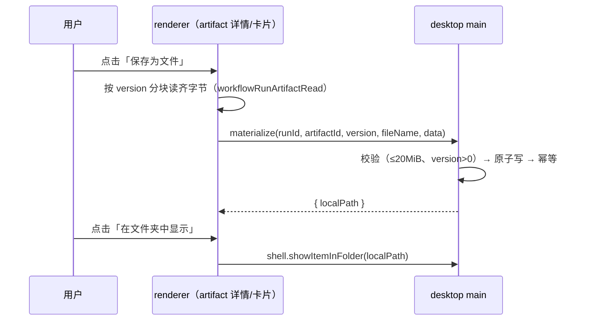

# ACode：workflow artifact 文件物化

## 背景与目标

动态工作流的用户面产物（`packages/shared/src/acode-protocol-v4/workflow-artifacts.ts`）
已经能经 `workflowRunArtifactRead` 分块拉到 renderer（预览用），但用户无法把一个
产物**落成磁盘上的文件**再交给系统工具（打开/分享）。本 spec 定义「物化」：renderer
把它已持有的产物字节发给 desktop main，main 写入一次性落盘目录并返回本地路径，
UI 提供「保存为文件 / 在文件夹中显示」。

刻意采用 renderer 持字节下沉的模型（与 zcode 3.15.1 同形）：权威在 journal，renderer
本来就要为预览分块读字节；远程 workspace 下这是唯一不需要 main 直接访问远端文件系统
的路径。main 侧无状态、无缓存职责。

## 产品规则

- 入口（每个内容产物 `file`/`markdown` 的卡片与详情）：「保存为文件」。物化完成后
  追加动作「在文件夹中显示」（`shell.showItemInFolder`）。
- 看板类产物（chart/table/metrics/board，无字节）不提供物化；`file` 的 `sourcePath`
  已有「在工作区显示」动作，保持不变——物化是另一条路径（版本快照落盘，不依赖
  工作区文件还存在）。
- 单次物化上限 **20 MiB**（与 `PROTOCOL_V4_LIMITS.attachmentMaxBytes` 同一量级，
  超限直接拒绝并提示）；`version` 必须是 journal 里存在的版本号。

## 落盘规则（main 唯一实现）

```
<dataRoot>/tmp/workflow-artifacts/<runId 段>/<artifactId 段>/v<version>/<清洗后的文件名>
```

（`<dataRoot>` 跟随 tempTextAttachment 的既有约定与自定义 dataBaseDir，而非裸 userData。）

- `<runId|artifactId 段>`：原 id 若含路径不安全字符则替换为 `-` + 短哈希（防碰撞、
  防穿越）；`v<version>` 是数字，天然安全。
- 文件名清洗：去路径分隔符、控制字符、首尾空白点；Windows 保留名
  （`con/prn/aux/nul/com1-9/lpt1-9`，大小写不敏感）加前缀 `_`；空结果回退
  `<artifactId>.bin`。
- 原子写：先写 `<同目录>/.<uuid>.partial`（flag `wx`），`rename` 到目标；目标已存在
  且字节相同 → 直接返回（幂等），不相同 → 覆盖前先删目标再 rename（同一版本被
  物化两次视为同内容，覆盖语义安全）。
- 目录属 `tmp` 性质：不注册清理器（复用 userData/tmp 的既有清理约定，若无可不清理，
  单产物 ≤ 20 MiB 有界）。

## 接口（desktop IPC，平台层，不进 v4）

通道登记进 `PlatformChannels`（`packages/shared/src/channels.ts`），registrar 模式
（新建 `desktopWorkflowArtifactIpc.ts` 挂 `desktopMainIpcPlatform.ts` 既有挂载点）：

```ts
MaterializeWorkflowArtifactFile
  { runId, artifactId, version, fileName, data: Uint8Array }  // 结构化克隆直传字节
  → { localPath: string }
```

「在文件夹中显示」复用既有 `OpenInFileManager`（`desktopMainIpcPlatform.ts`，路径经
`normalize+realpath` 边界）。renderer 侧经 `IPlatformService` 暴露（不直接
`window.acode`，见 AGENTS.md UI 边界）。remote workspace 同样可用（字节已在
renderer；不触碰远端路径，无 WSL/SSH 特判问题）。

## 事件顺序



## 验收场景

1. `markdown` 产物物化 → 文件内容逐字节等于该版本 `workflowRunArtifactRead` 拼接结果；
   重复物化同一版本 → 幂等返回同一路径。
2. 文件名 `CON.txt` → 落盘为 `_CON.txt`；文件名带 `../` → 清洗后不出目录。
3. >20 MiB 拒绝，UI 明确报错（i18n），不写任何文件。
4. remote workspace 会话内同样可物化（字节经 renderer）。
5. 单测：路径段清洗、Windows 保留名、原子写与幂等、上限拒绝（mock fs）。
6. i18n：`chat.toolCall.workflow.artifact.saveAsFile / savedAsFile / showInFolder /
   saveFailed / tooLarge`（en-US + zh-CN）。
