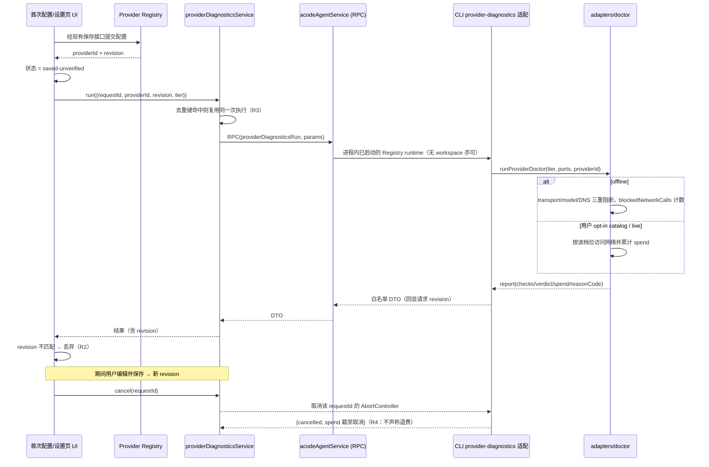

# Provider 诊断服务（U08：首次配置与模型故障诊断）

> **已退役（2026-10-30）**：用户裁决前端不需要「模型诊断」，服务面随之移除。
> 删除面：`packages/services/src/model-provider/providerDiagnosticsExecutor.ts`、
> `packages/services/src/acode-agent/providerDiagnosticsRpc.ts`、
> `providerFacadeServices` 的 `runProviderDiagnostics`/`cancelProviderDiagnostics`
> 成员与校验器、`acodeAgent` 的 RPC 注册/参数校验/descriptor 表项、
> `acodeAgentService` 的客户端实现、`node.ts` 的 executor 装配、
> bootstrap `acode-protocol-v4/provider-diagnostics(-ports).ts` 与 server 接线。
> 本 spec 仅作历史记录保留。保留面：CLI `acode doctor --provider` 命令与
> `apps/acode-cli/packages/adapters/src/doctor/*`、`packages/shared/src/providerDiagnostics*.ts`
> 线协议词表、`apps/acode-cli/specs/provider-doctor.md`。

用户在保存 provider 后能区分**「已保存、尚未验证」**与**「已验证」**，能看到明确的故障阶段与可执行的修复动作，并能在**不重复创建 provider** 的前提下重试或稍后验证。

立项依据 [docs/upgrades/product-and-support-2026-10.md §3](../../../docs/upgrades/product-and-support-2026-10.md)（U08）。档位、检查点、`tier-passed`/`ready` 判定、offline 零网络双重强制的**唯一真源**是 [apps/acode-cli/specs/provider-doctor.md](../../../apps/acode-cli/specs/provider-doctor.md)（R1-R7 与 12 检查点表）——本 spec 只定义**服务面契约**，不复制也不重定义 Doctor 语义，凡涉及档位/checkpoint 一律以指针指向该文件。

本项**不做**（与提案非目标一致）：不自动更换模型、不自动修复或覆盖凭据、不承诺 offline 能证明模型可用、不为首次配置或手机另起 Agent/Host、不将诊断失败等同保存失败、不新增第二条 provider 配置写入路径。

## 产品规则

### R1 保存态与验证态是三态，不是两态

| 状态 | 含义 | 何时进入 | 能否声称模型可用 |
| --- | --- | --- | --- |
| `saved-unverified` | 配置已落盘并进入 Registry | 保存接口返回 `providerId` + `revision` 后 | **否** |
| `validated` | 仅 `live` 档全 12 检查点通过（Doctor `ready`） | 诊断结果 `verdict === "ready"` 且 `revision` 匹配当前 | 是 |
| `tier-passed` | 所选档通过但未达 `ready` | 诊断结果 `verdict === "tier-passed"` 且 `revision` 匹配 | **否**（offline/catalog 不给重档背书） |

`offline` 档通过**绝不能**呈现为「模型可用」；UI 必须保留 Doctor 的「轻档不越档背书」语义（provider-doctor.md R2）。

### R2 revision fencing（迟到结果零写入）

- `revision` 的所有者是 Provider Registry（`ProviderSettingsView.revision`，`packages/provider/src/facades.ts:190`）。诊断**只读**该 revision，不推进它。
- 请求携带发起时的 `revision`；结果**必须回显同一个 revision**（`revision` 是结果的必填字段，缺失即 schema 拒绝）。
- UI 侧不变量：`result.revision !== currentRevision` 的结果**丢弃**，不写入任何验证态。提案门槛「迟到结果对新 revision 的状态写入为 0」由这条机械保证。
- 服务侧不变量：结果里的 `revision` 只能是「请求时的 revision」，不得替换成执行时的最新 revision——否则 fencing 失效。

### R3 单次执行与幂等

- 相同 `(providerId, revision, modelId, tier)` 的**并行有效诊断最多 1 个**。双击、重试、并发请求都收敛到同一次执行，返回同一终态。
- 去重键归一：`providerId` 与 `modelId` 原样参与（不做大小写折叠，与 Registry 事实同源）；`modelId` 缺席时按空串参与，使「未指定模型」与「指定某模型」不互相合并。
- 幂等边界是**执行去重**，不是缓存：终态返回后同一键的新请求是**新的一次执行**（用户显式重试要真跑一遍）。
- 一次保存操作创建 provider 最多 1 次；诊断**永不**创建或修改 provider。

### R4 取消语义（只取消该次，不谎报退费）

- `cancelProviderDiagnostics(requestId)` 只取消 `requestId` 对应的那一次执行，不影响同 provider 的其它请求。
- 取消是 best-effort 控制面：通知失败不抛，返回 `cancelled: false`——调用方语义 = 丢弃回包，由 R2 的 revision fencing 兜底（与既有 `cancelWorkspaceGenerateText` 同一纪律）。
- **已发出的 live 请求不能被取消追回**：`catalog`/`live` 档在取消前可能已产生 `spend.billableCalls` / `spend.catalogCalls`。取消结果**尽力**携带截至取消时刻的 spend 事实（Doctor 若在取消前已返回部分报告则带上；否则 `spend` 缺席 = 花费未知）。两种形态下 UI 都**不得**呈现为「已退还费用」，只能呈现「已停止后续阶段，已发生的调用无法撤销」（提案 §3.6 回退段原文）。**绝不**把未知花费填成 0——那等于承诺退费。
- 取消后的终态是 `status: "cancelled"`，不是 `failed`，也不是 `completed`。

### R5 skipped 与 failed 必须可区分（U08-A5）

四态 `passed` / `failed` / `skipped` / `blocked` 逐字沿用 Doctor（provider-doctor.md R2/R3），不得折叠：

- `skipped` = 本档不运行该检查点，**或**该检查点的前置未满足而刻意不发请求（端点未过出口校验、凭据不可用、端点不支持目录列举、模型不支持 tool call）。`skipped` **不计入通过**。
- `failed` = 检查点运行了且结论是否定的。
- `blocked` = 检查点需要的外部依赖不可用（如凭据库不可解密），诊断**无法证明**结论。
- UI 必须把「不可检查」与「检查失败」呈现为不同视觉与不同文案；把 `skipped` 画成失败会误导用户去修一个没坏的东西，画成通过则是越档背书。

### R6 稳定错误码，不做文本匹配

- 结果携带**闭集**稳定错误码（`providerDiagnosticsErrorCodeSchema`）。派生只依据**结构化事实**：首个未通过检查点的 `(id, status)` 二元组，加上 Doctor 检查点上的结构化 `reasonCode`。
- **禁止**用 `detail` 文本、异常 message 或正则匹配判定错误类别（根 AGENTS.md「不依赖错误文本做流程判断」）。为此本项给 Doctor 的检查点结果增加结构化 `reasonCode`（见 R7）。
- `detail` 是给人看的展示文本，已由 Doctor redactor 脱敏；它**不参与**任何分支判定。

### R7 对 Doctor 契约的最小增量（additive，不回改既有语义）

为让 GUI 区分「错误密钥」与「空目录」（U08-A2），需要目录探测的 HTTP 状态这类结构化事实。本项对 Doctor 做**一处 additive 扩展**：

- `ProviderDoctorCheckResult` 增加可选 `reasonCode`（闭集，见 `providerDoctorCheckReasonCodes`）。
- **只加在内存报告上，不加进 JSONL 账本事件**——账本 schema（`schemaVersion: 1`）与既有覆盖视图逐字不变，避免动已落盘证据的 schema。
- 不新增/重命名/重排任何 checkpoint id；不改 12 点顺序；不改 `tier-passed`/`ready` 判定。
- provider-doctor.md 同步登记该字段。

### R8 隐私门槛（承重不变量）

DTO、UI、日志、测试快照中出现完整密钥 / `Authorization` 值 / 密钥派生 hash 的数量均为 **0**。

- 凭据只在**受控执行方**（CLI agent 进程内的 Doctor）解析；返回值不含密钥或密钥派生值。
- 结果里的 `detail` 沿用 Doctor redactor 的产物（provider-doctor.md R5）；服务层与 UI **不再**做任何「采集后过滤」——白名单 schema 是结构性排除。
- DTO 全部 `.strict()`：任何未登记字段（尤其 `apiKey` / `authorization` / `keyHash` 形态）在 parse 时被拒，不依赖生产侧自律。
- `revision` 是 Registry 事实（整数），不是凭据派生物，允许出现。
- `endpointHost` 允许出现（只 host，不含 query/header/凭据，同 Doctor R5）；`baseUrl` 全串**不进** DTO。

### R9 档位授权只对本次生效

- 用户选择 `catalog` / `live` 只授权**本次、该档位**的请求；授权不成为持久网络绕过，不落盘、不复用。
- `live` 需要**显式用户 opt-in**（会产生费用）；服务层强制：`tier === "live"` 而请求未带 `liveOptIn: true` → 直接失败 `live-opt-in-required`，**零**模型调用。
- `offline` 的零网络不由本层保证，而由 Doctor 的双重强制保证（provider-doctor.md R2：blocked http transport + models port + dnsLookup）。本层只**如实上报** `blockedNetworkCalls`；`> 0` 即视为不变量被违背，结果标 `offline-network-blocked`。

### R10 超时（拟议，分阶段）

- 建议 `catalog` 15 s、`live` 30 s，与 Doctor 既有 `probeTimeoutMs`（缺省 30 s）对齐；本层不另设会掩盖同步问题的兜底超时。
- 超时是**明确终态**（`failed` + `execution-failed`），不是静默挂起。
- **拟议/未实现**：分阶段（连接 / 目录 / 探针）细粒度超时目前复用 Doctor 的单一 `probeTimeoutMs`；按阶段拆分登记为后续项，本轮不做。

## 状态所有者

```
packages/shared/src/providerDiagnostics.ts        DTO schema + 稳定错误码闭集 + parse（契约真源）
packages/services/src/model-provider/             服务面：接口、descriptor allowedMethods、参数校验
  providerDiagnosticsService.ts                     单次执行去重 + revision 回显 + 取消路由（唯一所有者）
packages/services/src/acode-agent/acodeAgentService.ts  RPC 调用面（方法名注册 + client 路由）
apps/acode-cli/packages/bootstrap/src/acode-protocol/provider-diagnostics.ts
                                                  CLI 侧适配：把既有 runProviderDoctor 接成协议入口
apps/acode-cli/packages/adapters/src/doctor/      检查点判定与档位强制（既有，本项只 additive 加 reasonCode）
packages/ui/src/lib/providerDiagnostics.ts        UI 纯决策逻辑（fencing / 三态 / 档位文案 / 修复动作映射）
packages/ui/src/hooks/useProviderDiagnostics.ts   UI 状态编排（不含判定逻辑）
```

事实所有者不变：provider 配置与模型目录仍归 Registry，凭据仍归 vault，检查点判定仍归 Doctor。诊断服务**只读取与转述**，不缓存 provider 事实，不新增写入路径。

## 事件顺序



## 接口契约

### 请求（`providerDiagnosticsRequestSchema`，`.strict()`）

| 字段 | 类型 | 必填 | 说明 |
| --- | --- | --- | --- |
| `requestId` | string(≥1) | 是 | 调用方生成的关联键；取消与去重都按它 |
| `providerId` | string(≥1) | 是 | Registry 快照内的 provider id |
| `revision` | int ≥0 | 是 | 发起时的 `ProviderSettingsView.revision`；结果必须回显 |
| `tier` | `offline`\|`catalog`\|`live` | 是 | 缺省由 UI 决定（首次配置默认 `offline`），schema 不设默认值以免静默升档 |
| `modelId` | string(≥1) | 否 | 缺席时 Doctor 按 R1 缺省顺序选目标模型 |
| `liveOptIn` | boolean | 否 | `tier === "live"` 时必须为 `true`，否则 `live-opt-in-required` |

提案 §3.2 的 `modelSelection` 在本契约里**拆为 `providerId` + `modelId`**：`reasoningLevel` 与 `maxOutputTokens` 由 Doctor 自己按 spec R3 固定（`maxOutputTokens: 64`、取第一个合法档位），让 UI 传它只会造出一个 UI 无权决定、且必须被忽略的假接口面。

### 结果（`providerDiagnosticsResultSchema`，`.strict()`）

| 字段 | 类型 | 说明 |
| --- | --- | --- |
| `requestId` | string | 回显，供调用方匹配 |
| `providerId` | string | 回显 |
| `revision` | int | **回显请求值**（R2 fencing 的机械基础，必填） |
| `tier` | enum | 实际执行的档位 |
| `modelId` | string? | Doctor 实际选中的目标模型 |
| `status` | `completed`\|`failed`\|`cancelled` | 终态三值 |
| `verdict` | `ready`\|`tier-passed`\|`failed` | 逐字沿用 Doctor（仅 `status === "completed"` 时有意义） |
| `errorCode` | 闭集 enum? | `status !== "completed"` 时必填 |
| `checkpoints` | array(12) | 12 个检查点，**id 集合恰为闭集且各出现一次**（schema `superRefine` 强制） |
| `remediationActions` | array(闭集 enum) | UI 可渲染成按钮/链接的动作白名单，映射 i18n |
| `nextStepCommands` | array(string) | Doctor R7 已白名单化的可粘贴命令，**仅展示**，UI 绝不执行 |
| `spend` | 对象? | `billableCalls`/`catalogCalls`/`promptTokens`/`outputTokens`/`totalTokens`/`hasTokenData`。**可选**：拿到 Doctor 报告时才有；取消/无运行时/执行抛错时**缺席 = 花费未知**，绝不填 0 冒充「没花钱」（R4 诚实基线）。`status === "completed"` 时必填（schema `superRefine` 强制） |
| `blockedNetworkCalls` | int ≥0 | offline 档 >0 即不变量被违背（R9） |
| `endpointHost` | string? | 只 host（R8） |
| `startedAt`/`finishedAt` | string | ISO |

### 取消（`cancelProviderDiagnostics(requestId)`）

返回 `{ requestId, cancelled, spend? }`。`cancelled: false` 表示该 requestId 已不在飞（已完成/未知），**不是错误**。

### 错误码闭集（`providerDiagnosticsErrorCodeSchema`）

按派生来源分组；每个码都是稳定的对外契约，**只增不改不删**（改码等于改 UI 文案映射）：

- 请求/环境：`invalid-request`、`no-agent-runtime`、`live-opt-in-required`、`revision-mismatch`、`provider-unknown`
- 执行生命周期：`cancelled`、`execution-failed`、`offline-network-blocked`
- offline 检查点（`#1`-`#6`）：`config-source-unavailable`、`config-schema-invalid`、`endpoint-shape-invalid`、`credential-missing`、`credential-undecryptable`、`catalog-not-declared`、`model-route-unresolved`
- 网络检查点（`#7`-`#9`）：`endpoint-not-public`、`credential-rejected`、`catalog-empty`、`catalog-unreachable`、`catalog-unsupported`、`model-not-listed`
- live 检查点（`#10`-`#12`）：`live-probe-failed`、`tool-call-unsupported`

`credential-missing`（引用悬空/未配置）、`credential-rejected`（密钥被端点拒绝）、`catalog-empty`（2xx 但无模型）三者互不相同，是 U08-A2 的机械断言面。

## 无 workspace 的首次配置（已核实 + 剩余限制）

**已核实**：Doctor 的 ports 全部**不依赖 workspace**——registry 快照来自进程级 Provider Registry runtime（配置文件路径由 `ACODE_BUILTIN_PROVIDER_CONFIG_FILE_ENV` / `ACODE_PERSONAL_PROVIDER_CONFIG_FILE_ENV` / homedir 解析），凭据来自 `~/.acode/v2/credentials.json`，账本落用户数据目录。协议 worker 启动时**已经**起了一个进程级 registry runtime（`apps/acode-cli/packages/bootstrap/src/acode-protocol-entrypoint.ts:174`），因此诊断**无需**创建 workspace ACodeApp——提案 §3.2 担心的「不能硬复用要求 workspace 的设置页 probe」在本实现里不成立：本路径不经过 `createWorkspaceACodeApp`。

因此 CLI 侧适配走**进程级**入口（对齐 `getAppUsageStats` 对进程级事实的路由：`acodeAgentService.ts:3794`），而不是 `testProviderModelConnectivity` 的 workspace app 路径。

**剩余限制（如实登记，未伪造）**：进程级路由需要一个**已存在的 agent 进程**。首次配置发生在 `WelcomeScreen`（`packages/ui/src/WelcomeScreen.tsx`），此时可能还没有任何 workspace 被打开，`activeClientsByWorkspaceKey` 为空 → 无 agent 进程可承载诊断。此时：

- 服务返回 `status: "failed"` + `errorCode: "no-agent-runtime"`，**零**网络/DNS/模型调用（U08-A1 的调用计数断言因此天然成立）。
- UI 保持 `saved-unverified`，明确告知「已保存、尚未验证」并提供「稍后在设置中验证」的出口——对齐提案 §3.6「失败不清空已保存 provider；可保持『已保存、未验证』并稍后诊断」。
- 设置页始终有 workspace，三档能力在那里**完整可用**。

**拟议/未实现**：为真正的「零 workspace 首启」提供诊断，需要一个进程级、无 workspace 的 agent 承载体（或把 Doctor 能力下沉到 host 侧）。后者会让 root 包依赖 `apps/acode-cli/packages/adapters`，违反提案「GUI 不深导 CLI adapters」与包依赖方向；前者属于提案明确排除的「不为首次配置另起 Agent/Host」。故本项**不实现**，登记为后续架构决策项。

### 已核实限制：账号型 provider 的凭据检查点在本路径不可判定

协议 worker 启动进程级 registry runtime 时**不传 `standalone`**
（`acode-protocol-entrypoint.ts:174` → `startProcessProviderRegistryRuntime(runtimeEnv)`），因此
`process-provider-registry-runtime.ts:181-188` 的 `providerRuntimeHeadersPort` **缺席**——账号事实由
Host 经 `syncAccountProviderConfig` 下发，worker 不自持账号凭据。

后果（如实登记，不掩盖）：`access.type === "zhipu-account"` 的 provider，其
`credential_available` 检查点走 `credential-probe.ts:158-164` 的「探测端口未注入」分支 →
`status: "missing"` → 本 DTO 派生 `credential-missing` / `failed`。**即使用户已登录**也会如此。

- 这是 Doctor 自己的判定，本项**不覆盖、不改写**（R5：不重定义 Doctor 语义）。
- **BYO API Key provider 不受影响**：`probeApiKeyAccess` 走注入的 `vault`
  （`credential-probe.ts:89-139`），凭据库在 worker 内可用。首次配置表单
  `LoginApiKeyForm` 创建的正是 `api-key` / `zhipu-coding-plan-api-key` 形态
  （`LoginApiKeyForm.tsx:101`），因此**首配主路径完整可用**。
- offline 档的 #1-#3、#5、#6（配置源、schema、端点形态、目录声明、模型路由）对**所有** provider
  类型都可判定；只有 #4 凭据检查点受此限制。
- 账号型 provider 的完整诊断仍走 CLI：`acode doctor --provider=<id>`（它由
  `provider-doctor-command.ts:196-218` 用 standalone headers port 装配 `accountAuth`）。

**拟议修复选项（需架构决策，本轮不做）**：① 让 GUI 诊断路径也能发
`interactionRequestProviderRuntimeHeaders` 反向请求——但该请求签名要求 `workspace`
（`provider-runtime-headers.ts:21`），与「诊断不绑定 workspace」冲突，需要新增一个
workspace-less 变体；② 让协议 worker 以 standalone 形态启动——违反「账号事实由 Host 下发」
的既有边界。两者都超出本项范围，登记为跨文件决策项。

### 已评估并否决的载体方案

| 方案 | 否决理由 |
| --- | --- |
| 复用 `resolveGlobalSavedWorkflowCarrier` 的管理面回落 | 回落会经 `getPluginManagementClient` **拉起新进程**，违反提案「不为首次配置另起 Agent/Host」 |
| 复用 `getAppUsageStats` 的「任一活跃 client」 | 它不排除远程 runtime；远程 runtime 的 home 与凭据库不在本机，诊断结论对本地首配无意义。本项只选**本地**活跃 runtime（`isLocalActiveWorkspaceClient`） |
| 借用 agent spare 预热池（`acodeAgentSparePrewarm.ts` 的 `peek()`） | spare 是 workspace-unbound 的待命进程，看似理想，但 `sparePool` 是 `ACodeAgentProcessManager` 的私有成员，只暴露 `take()`（认领即消费并触发补位）。**只借用不认领**会开出一条无人拥有的进程使用路径，且 spare 的就绪态与 idle-exit TTL 语义都是为「首个 getClient 认领」设计的，不是为长期只读查询设计的。属于新生命周期边界，不在本项范围 |
| 在 `@acode/core` 加 runtime method（任务书建议的路径） | **结构性不可行**：`packages/core/package.json` 的依赖里没有 `@acode/adapters` / `@acode/provider` / `@acode/provider-node`（已实测确认），而 `runProviderDoctor` 在 `@acode/adapters/doctor`。core 层拿不到 Doctor 与其 Port 类型，硬加依赖会让 core 反向依赖 adapters。故本项落在 bootstrap 协议层（它已依赖 adapters，且已是 `providerRuntimeHeadersPort` 等协议适配的装配点） |

## 验收场景

映射提案 §3.5 的 U08-A1..A5。测试落点见每条「证据」。

| 编号 | 前提 | 操作 | 必须断言 | 证据 |
| --- | --- | --- | --- | --- |
| U08-A1 | 无 workspace，fixture 配置合法 | 保存后运行默认（offline）诊断 | provider 仅创建一次；状态为 `saved-unverified`；网络/DNS/model 调用数为 0 | `packages/services/test/providerDiagnosticsService.test.ts`（去重 + `no-agent-runtime` 零调用）；`apps/acode-cli/tests/provider-diagnostics-adapter.test.mjs`（offline 注入计数 ports 全 0） |
| U08-A2 | 错误密钥 / 空目录 / 失效凭据引用分别存在 | 选合适档位诊断 | 三者稳定错误码互不相同；offline 不伪造远端鉴权结论；草稿与已保存配置仍可编辑 | `apps/acode-cli/tests/provider-diagnostics-adapter.test.mjs`（三码分别派生）；`packages/shared/test/providerDiagnostics.test.ts`（闭集与 `.strict()`） |
| U08-A3 | live 正在执行 | 修改模型或 provider revision | 原结果不能标记新配置已验证；取消不声称退还已发请求费用 | `packages/ui/test/providerDiagnostics.test.ts`（revision 不匹配 → 丢弃）；`packages/services/test/providerDiagnosticsService.test.ts`（取消回包带 spend，无退费语义字段） |
| U08-A4 | 上次失败或用户双击 | 重试、连续点击运行 | 仅一次有效执行；不重复创建 provider；按请求返回终态 | `packages/services/test/providerDiagnosticsService.test.ts`（并发同键 → 执行计数 1，两个 requestId 都拿到同一终态） |
| U08-A5 | 断网 / 策略阻断 / 模型不支持 tool 分别存在 | 运行 catalog/live | `skipped` 与 `failed` 可区分；不支持 tool 遵守 Doctor `skipped` 规则；仅完整 live 满足规则才 `ready` | `apps/acode-cli/tests/provider-diagnostics-adapter.test.mjs`（四态逐字透传，`tool_call_parse` 为 `skipped` 而非 `failed`） |
| U08-P1 | 任意档结果 | 序列化 DTO 与写日志 | 文本中完整密钥 / `Authorization` / 密钥派生 hash 出现数为 0 | `packages/shared/test/providerDiagnostics.test.ts`（`.strict()` 拒敏感字段名）；`apps/acode-cli/tests/provider-diagnostics-adapter.test.mjs`（真实明文 key fixture 下序列化零泄漏） |

## 回退

关闭新增诊断入口即回退：保存流程与配置逐字不变，UI 退回「保存后标记成功」。回退**不得**把失败或未验证的配置标记为已验证。若发现重复写 provider、绕过 offline 网络门禁、或 UI 侧获得凭据，立即阻止发布。费用请求已发出后只能停止后续阶段，不能承诺撤销既有费用。
