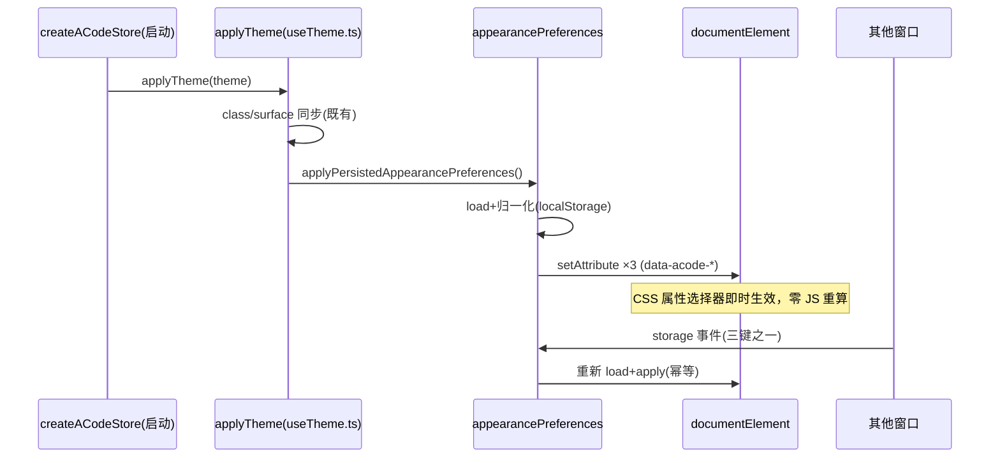

# ACode UI：多轴外观偏好契约（根 DOM data-* 属性驱动）

## 背景与目标

第二轮价值提取 T2-r2：厂商把用户偏好/平台/无障碍统一暴露为根 DOM `data-*` 属性
（证据：`MainWindowPage-BD9CWQ83.css` 的 `[data-density=…]`/`[data-text-size=…]`/
`[data-reduce-motion=true]`（70 处）/`[data-motion=…]` 选择器面；
`quick-window.html` 根属性集 `data-density="comfortable"` 等），CSS 属性选择器
消费，零 JS 重算、零 prop 钻透。

ACode 现状（实查）：

- `packages/ui/src/useTheme.ts` 仅写单一根属性 `data-acode-browser-theme-surface`
  （外加 `dark`/`theme-zai-*` class）；
- `styles.css` 的 `data-acode-*` 属性（stream-animate 族）是组件级动画开关，非全局
  偏好轴；
- `prefers-reduced-motion` 仅 OS 级媒体查询（styles.css 14 处 @media + 6 处组件
  `matchMedia`），无 in-app 覆盖；
- 设置面仅有 UI 字号滑杆（`--ui-font-size`，12–20px）与代码预览 fontSizePx。

本波移植三轴：**density（comfortable|compact）/ text-size（sm|md|lg）/
reduce-motion（auto|reduce，in-app 覆盖 OS）**。厂商其余轴（motion=lockstep|wave、
font、reveal、platform）不移植，登记为备选。

## 产品规则

- **R1 三轴闭集**：`density ∈ {comfortable, compact}`（默认 comfortable）、
  `textSize ∈ {sm, md, lg}`（默认 md）、`reduceMotion ∈ {auto, reduce}`（默认
  auto）。任何入口的值先过归一化：闭集外（含 null/垃圾字符串）一律收敛到默认，
  不抛错、不透传开放字符串。
- **R2 根 DOM 属性面**：三轴上收为 `document.documentElement` 的
  `data-acode-density` / `data-acode-text-size` / `data-acode-reduce-motion`。
  中性命名沿用仓库 `data-acode-` 前缀族（与 `data-acode-browser-theme-surface`、
  组件级 `data-acode-stream-animate` 同族），不占用裸 `data-density` 等语义名，
  避免与片段/组件局部属性撞名。三档全部显式写出（含 auto/默认档）：CSS 只按
  需要 gate 具体值，显式属性利于调试与未来加档。
- **R3 消费面 = CSS 属性选择器，零 JS 重算**：组件按 opt-in 渐进消费；未适配组件
  在任一轴值下保持默认观感（渐进增强，不破坏）。轴值变化不触发任何 React 重渲染
  ——属性写入即生效。本波落示范消费点（styles.css，不全量改造）：
  1. `.side-pane-open-tab-button`（density=compact 收紧高度/行距）+
     `.side-pane-open-tab-button-label`（text-size 调档位）；
  2. 会话流式动画块（`data-acode-*-animate` 族）与 `.wf-*` 运动词汇的
     reduce-motion 属性 gate（与既有 OS @media 档双门并存）。
- **R4 reduce-motion 语义**：`auto` = 跟随 OS（既有 `@media
  (prefers-reduced-motion: reduce)` 面原样保留，不受属性影响）；`reduce` = in-app
  强制降级，覆盖 OS 为 no-preference 的情形。CSS 无法把媒体查询与属性选择器合并
  进同一条规则，故 in-app 档以属性 gate **复制**同一 kill 集（示范点两处）；
  全量迁移（styles.css 其余 @media reduce 块 + 组件 matchMedia 6 处的双门化，或
  引入统一时长变量机制）登记不做。既有 OS 块中 collapsible 两选择器的
  `animation:none` 缺 `!important`（基规则带 `!important` 压 Radix inline），
  OS 档下实际压不住——既有缺陷，属性 gate 侧带 `!important` 做对，OS 块修复另行。
- **R5 持久化 = 现有设置面（localStorage）**：复用
  `readSafeLocalStorage`/`writeSafeLocalStorage`（与 theme=`acode-theme`、
  UI 字号=`acode-ui-font-size-px` 同一设置面与工具函数）。键：`acode-density` /
  `acode-text-size` / `acode-reduce-motion`。跨窗口同步走 `storage` 事件订阅
  （`subscribeToAppearanceStorageChanges`，uiFontSize 同款；storage 事件只在同源
  **其他**窗口触发，天然防回环，符合 AGENTS.md 广播字段纪律）。
- **R6 应用路径收口**：新模块 `lib/appearancePreferences.ts` 独占三属性的写入
  （校验/读写/应用/订阅）。`useTheme.ts` 的 `applyTheme` 在主题同步后调用
  `applyPersistedAppearancePreferences()`——对齐 `syncBrowserThemeSurface` 的
  「根属性在主题应用点收口」模式；`applyTheme` 是主窗口 store 创建、setTheme、
  system 主题变化的公共路径（R2-07 后 `useTheme` hook 已删除，theme 写入唯一收口
  `store.setTheme`），各窗口零新增接线即获得属性面。
  未来设置页 setter 直接调 `setAppearancePreferences`（写 localStorage + 应用），
  不经主题绕路。
- **R7 与 `--ui-font-size` 的关系**：现有 Appearance 字号滑杆（12–20px）仍是
  `--ui-font-size` 的**唯一写入者**；text-size 轴不写该变量，只在 opt-in 组件上
  调排版档位（示范点用 `var(--text-ui-lg)`/`var(--text-ui-sm)`），避免双写入路径。
  两表面（三档轴 vs 数值滑杆）是否合并为单一产品面，登记产品决策。

## 状态所有权

- 轴值唯一事实源 = localStorage（用户本机偏好，与 theme 同级；无服务端事实，
  不进 AppSettings/settingService——升级到跨设备同步登记为后续）。
- 根 DOM 三属性唯一写入者 = `lib/appearancePreferences.ts`。
- 组件样式只读（CSS 属性选择器），JS 侧不读回属性做分支（读偏好走
  `loadAppearancePreferences()`，不查 DOM）。
- Zustand store 字段与 BROADCAST_FIELDS 接入**本波不做**（无设置 UI 消费方；
  接线时按 `uiFontSizePx` 先例：字段 + setter + 广播分发 + 防回环标记）。

## 事件顺序

未来设置页写入路径：控件 → `setAppearancePreferences(patch)` → 归一化 →
localStorage → apply（同窗口即时）→ storage 事件 → 其他窗口 apply。

## 验收场景

1. 归一化闭集：三轴各以合法值原样通过；`null`/`""`/`"huge"`/数字等垃圾收敛默认
   （comfortable/md/auto）。
2. `applyAppearancePreferences` 对注入的假根对象写满三属性（含 auto 档显式写出）；
   无 document 环境（SSR/裸 node 测试）不抛错、静默跳过。
3. `setAppearancePreferences` 部分补丁：只改 density 时其余两轴保持既持久值；
   写入后 localStorage 三键为归一化后的闭集值。
4. storage 订阅只响应三键；其他键事件不触发重应用；退订后不再响应。
5. styles.css 示范点：`[data-acode-density="compact"]` 收紧 side-pane 开页签几何；
   `[data-acode-text-size="lg"|"sm"]` 调标签档位；`[data-acode-reduce-motion=
   "reduce"]` 下流式动画与 wf 运动词汇归零（与 OS @media 档并存不互斥）。
6. `applyTheme` 调用后三属性在场（useTheme.ts 收口路径）。
7. 测试：`packages/ui/test/appearancePreferences.test.ts`（场景 1/2/3/4/6；
   场景 5 为 CSS 面，人工/后续 E2E 核验，选择器文本由测试钉住防漂移）。

## 登记项（本波不做）

- 设置页 UI 接线：Appearance 节增三控件（density 二选、text-size 三选、
  reduce-motion 开关含「跟随系统」语义文案）；接线需求详见波 2 报告。
- store 接入：ACodeState 字段 + BROADCAST_FIELDS + 广播分发（uiFontSizePx 先例）。
- 全量迁移：styles.css 其余 @media reduce 块与组件 matchMedia 6 处的双门化；
  高密度组件清单逐个补 density/text-size 消费。
- AppSettings/settingService 升级（跨设备同步）与 OS reduce 块 `!important` 修复。
- 厂商其余轴（motion 编舞、font、reveal、platform）评估。
