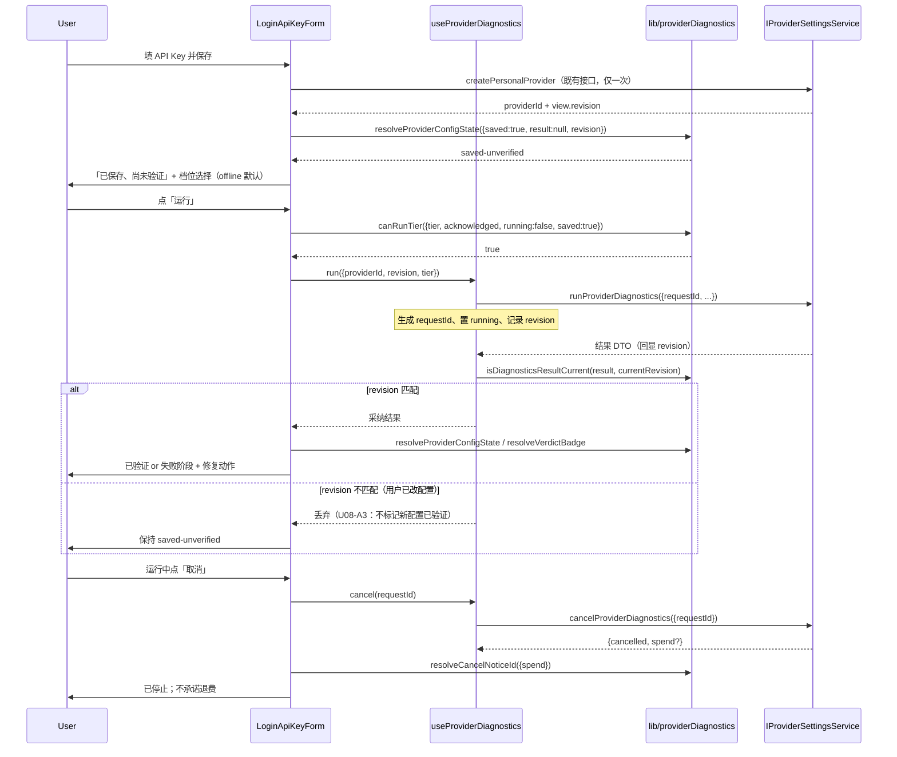

# Provider 诊断 UI（U08 首次配置与模型故障诊断）

> **已退役（2026-10-30）**：用户裁决前端不需要「模型诊断」，因为诊断结果对用户价值不足。
> 前端功能面（`ProviderDiagnosticsPanel`、`ProviderDiagnosticsCard`、
> `useProviderDiagnostics`、`lib/providerDiagnostics(.Labels)`、登录首配的「已保存尚未验证」
> 三档 tier 卡片与运行诊断、设置页诊断卡片、i18n `settings.modelProvider.diagnostics.*`
> 76 键）已整体删除；本 spec 仅作历史记录保留。保留面：CLI `acode doctor --provider`
> 命令（`apps/acode-cli/packages/adapters/src/doctor/*`、
> `packages/cli/src/provider-doctor-command.ts`）、`packages/shared/src/providerDiagnostics*.ts`
> 线协议词表与 barrel 导出、`apps/acode-cli/specs/provider-doctor.md`。

用户保存 provider 后能区分**「已保存、尚未验证」**与**「已验证」**，看到明确的故障阶段与可执行的修复动作，并能在**不重复创建 provider** 的前提下重试或稍后验证。

上游规格：[packages/services/specs/provider-diagnostics.md](../../services/specs/provider-diagnostics.md)（服务契约 R1-R10）；档位/checkpoint 语义唯一真源 [apps/acode-cli/specs/provider-doctor.md](../../../apps/acode-cli/specs/provider-doctor.md)。本 spec 只定义 **UI 侧不变量与决策逻辑归属**，不重复定义契约字段。

本项**不做**（对齐提案 §3.1 非目标）：不自动更换模型、不自动修复或覆盖凭据、不把 offline 通过说成「模型可用」、不为首次配置或手机另起 Agent/Host、不把诊断失败等同保存失败、不在 UI 执行 `nextStepCommands`。

## 产品规则

### U1 决策逻辑全部在纯函数里，组件只做渲染

本仓 ui 包**无 jsdom**，radix Portal 在 `minimal-dom-shim` 下不渲染，组件层行为只能用源码断言守护。因此三态判定、revision fencing、档位授权、错误码/动作/检查点文案映射**全部**落在 `src/lib/providerDiagnostics.ts` 的纯函数中（与 `src/lib/localDiagnosticReport.ts` + `tests/localDiagnosticReport.test.mjs` 同一策略），组件只消费其返回值。

不变量：`LoginApiKeyForm.tsx` 内**不得**出现 tier 判定、revision 比较、错误码 → 文案的 if/else 分支。

### U2 三态可见地区分（R1）

| 状态 | UI 呈现 | 判定 |
| --- | --- | --- |
| `unconfigured` | 无状态徽标（还没保存） | `resolveProviderConfigState({saved:false})` |
| `saved-unverified` | 「已保存、尚未验证」+ 可运行诊断 | 已保存但无**当前 revision** 的 `ready` 结果 |
| `validated` | 「已验证」 | 当前 revision 的 `completed` + `verdict==="ready"` |

`tier-passed` **不进入** `validated`。offline 档的 `tier-passed` 另有更保守的文案（`verdict.offlinePassed`），不得复用 catalog/live 的 `tierPassed` 文案——提案明确「不承诺 offline 能证明模型可用」。

### U3 revision fencing（R2）

结果只有在 `result.revision === currentRevision` 时才被展示与参与状态判定；不匹配的结果**丢弃**（`isDiagnosticsResultCurrent` 返回 false → 状态退回 `saved-unverified`、徽标 `none`）。

判据必须与 `resolveProviderConfigState` 同源（同一个 `isDiagnosticsResultCurrent`），否则会出现「状态说未验证、界面却展示旧结论」的自相矛盾。

### U4 单次执行（R3 / U08-A4）

运行中时「运行」按钮禁用（`canRunTier` 在 `running` 时返回 false），双击不产生第二次执行。重试走同一个运行入口，**不重新调用保存接口**、不重新创建 provider。

### U5 档位授权（R9）

- `offline` 默认选中，无需确认，UI 明示「零网络、零费用」。
- `catalog` 需要确认，明示「会联网，约零花费」。
- `live` 需要**显式 opt-in**，明示「会产生费用」。未确认时「运行」禁用。

UI 侧门禁是第一道；服务侧编排器与 CLI 执行方各有一道（三道都不依赖调用方自律）。授权只对本次、该档位生效，**不落盘、不复用**：切换 provider、修改配置或刷新页面后需重新确认。

### U6 skipped 与 failed 可区分（R5 / U08-A5）

检查点四态各有独立文案与视觉（`checkpointStatusLabelId` / `checkpointStatusVariant`）。`skipped` 与 `blocked` 用弱化样式，**不得**呈现成失败——把「本档没跑这个检查」画成红叉会误导用户去修没坏的配置。

### U7 取消语义（R4 / U08-A3）

`cancelled` 是独立运行态，不并入 `failed`。取消后的费用提示由 `resolveCancelNoticeId` 决定：

- 已知零计费调用 → 可以说「未产生调用」（这是事实）；
- 已知有计费调用，或花费**未知**（spend 缺席）→ 只能说「已停止后续阶段，已发生的调用无法撤销」。

**绝不**出现退费/已撤销类措辞。

### U8 隐私（R8）

UI 不渲染任何凭据：契约 DTO 里结构性地没有 `label`/`detail` 自由文本字段，用户可见文本一律由 UI 按 `id` + `reasonCode` 走 i18n 生成。`nextStepCommands` **仅展示**（可复制），绝不执行、不拼进 shell。

### U9 首次配置无 workspace 的降级

首配发生在 `WelcomeScreen`，此时可能一个 workspace 都没打开 → 服务返回 `no-agent-runtime`。UI 必须：保持 `saved-unverified`（不清空已保存 provider）、展示稳定码文案、只给「稍后验证」出口（不给无效的重试）。设置页始终有 workspace，三档完整可用。

## 状态所有者

```
packages/ui/src/lib/providerDiagnostics.ts       全部决策逻辑（纯函数，可行为测试）
packages/ui/src/hooks/useProviderDiagnostics.ts  状态编排：requestId 生成、在飞态、结果与 revision 绑定
packages/ui/src/components/ProviderDiagnosticsPanel.tsx  共享面板（首配与设置页复用同一份渲染/判定）
packages/ui/src/login/LoginApiKeyForm.tsx        首配入口：保存 → saved-unverified → 档位选择/运行/取消/重试
packages/ui/src/settings/ProviderDiagnosticsCard.tsx  设置页入口（自包含，读 providerId/revision）
packages/ui/src/settings/model-provider-section/InlineEditableProviderCard.tsx  挂载 ProviderDiagnosticsCard
```

Panel 放在中立的 `components/` 下而非 `login/`：它是 login（首配）与 settings（设置页）**两个 feature 共用件**，放 `login/` 会让 settings 跨 feature 目录反向 import login 形成耦合。`components/` 是仓库既有的跨 feature 共享组件归属（`TeamApprovalActions`/`TeamStatusSummary` 等）。

草稿态归表单；`saved/unverified` 与 `validated` 归 `resolveProviderConfigState`（读 providerSettingsView.revision）；在飞请求归 `useProviderDiagnostics`（requestId → 结果）。provider 配置与目录仍归 Registry，凭据仍归 vault，检查点判定仍归 Doctor。UI **不新增**业务状态副本，也不缓存诊断结论跨 revision 复用。

## 事件顺序



## 验收场景

映射提案 §3.5。UI 层行为测试落点 `packages/ui/test/providerDiagnostics.test.ts`（纯函数），组件接线用源码契约断言（本仓无 jsdom 的既有惯例，见 `test/modelProviderDiscovery.test.ts`）。

| 编号 | 前提 | 操作 | 必须断言 |
| --- | --- | --- | --- |
| U08-A1 | 保存成功，无 workspace | 运行默认（offline）诊断 | 状态为 `saved-unverified`；offline 档位元数据标 `usesNetwork:false`/`spendsBalance:false`；`no-agent-runtime` 时只给 `verify-later` |
| U08-A2 | 三种凭据/目录故障 | 选合适档位诊断 | 三个错误码映射到三个不同 i18n 键；offline 档结果不产生任何「远端鉴权」结论 |
| U08-A3 | live 正在执行 | 改配置使 revision 前进 | 旧结果 `isDiagnosticsResultCurrent===false`；状态退回 `saved-unverified`；徽标 `none`；取消文案无退费措辞 |
| U08-A4 | 运行中 / 已失败 | 双击、重试 | `canRunTier` 在 `running` 时为 false；重试不经保存接口（组件层源码断言） |
| U08-A5 | skipped / failed / blocked 混合 | 运行 catalog/live | 四态映射到四个不同文案键与三种变体；`skipped` 变体不等于 `failed` 变体 |
| U08-P1 | 任意结果 | 序列化 UI 可见文本 | 不含 key/Authorization/hash 形态字符串；`nextStepCommands` 只出现在展示位，不出现在任何执行调用 |

## 回退

关闭诊断入口即回退：保存流程逐字不变，UI 退回「保存后标记成功」。回退**不得**把失败或未验证的配置标记为已验证。若发现重复写 provider、绕过 offline 网络门禁、或 UI 获得凭据，立即阻止发布。
